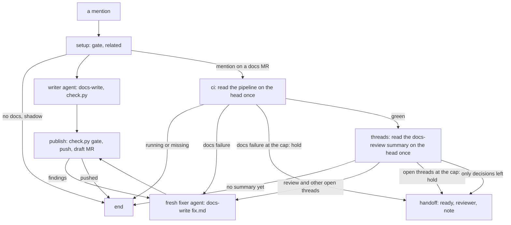
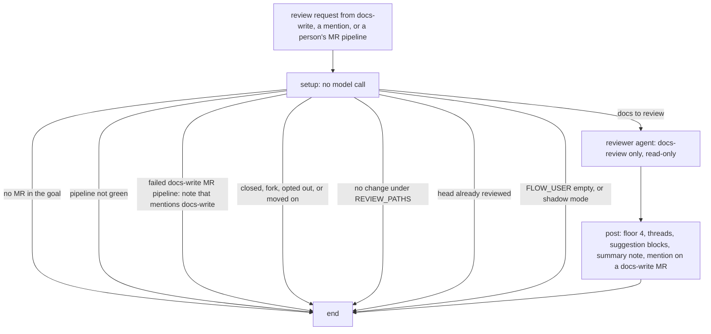
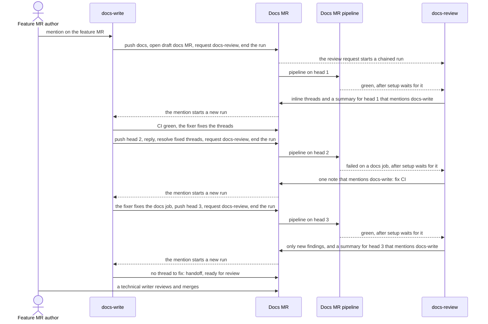

# docs-write and docs-review flows

Two GitLab Duo custom flows for this project's docs. Plan and coordination:
[#1494](https://gitlab.com/gitlab-org/orbit/knowledge-graph/-/work_items/1494).

- `docs-write.yml` drafts the docs MR for a feature MR, fixes its failed
  docs jobs and its threads, and hands it off. A run never waits: it ends
  after each push.
- `docs-review.yml` reviews every docs MR in the project, whether a person or
  docs-write wrote it, once per head, in its own session. It posts threads
  and never pushes. On a docs-write MR it mentions docs-write, which starts
  the next docs-write run.

The logic lives in two skills in
[`gitlab-org/orbit/team/skills`](https://gitlab.com/gitlab-org/orbit/team/skills),
which both flows fetch at runtime: `docs-write` for the writer, the fixers,
and both flows' step helpers, and `docs-review` for the reviewer. File
shapes and route tokens: `skills/docs-write/references/contracts.md` there.

The YAML files are the reviewable copies. The AI Catalog items are what
runs: after a change here, update the catalog item from the file, then
update this table.

| Setting | Value |
|---|---|
| `SKILLS_REF` in both files | `d5730abdd459575e8b59bd51ce588576da587276`, the head of team/skills!38 (branch `docs-write/issue-403`, unmerged). Re-pin both files to its squash commit on `main` once it merges. |
| `MODE` in both files | `full` |
| `FLOW_USER` in `docs-write.yml` | `44621578`, the user ID of `ai-docs-write-gitlab-org_510eee`, the service account that authors the flow's notes. Under composite identity `GET /user` returns the person who triggered the run, so the skills need it. An ID survives a rename. |
| `REVIEW_USER` in `docs-write.yml` | Empty until the docs-review service account exists, then its user ID. docs-write trusts that account's review threads and its summary note. While it is empty, docs-write finds no review, so a mention on a docs MR with a green pipeline ends without a fix or a handoff. |
| `DOCS_REVIEWERS` in `docs-write.yml` | `fneill,z_painter`: technical writers who approve and merge the docs MRs |
| AI Catalog item `docs-write` | Item 1020976 in this project, private, enabled. Trigger: **Mention** only during rollout. Service account `ai-docs-write-gitlab-org_510eee`, Reporter in `team/skills`. |
| `FLOW_USER` in `docs-review.yml` | Empty until the service account exists, then its user ID. While it is empty, every docs-review run ends in `setup` with no model call. |
| `WRITE_USER` in `docs-review.yml` | Empty until the docs-review service account exists, then `ai-docs-write-gitlab-org_510eee`, the docs-write service account's username. On a docs-write MR, docs-review mentions it in the summary note, and in one note per head when the pipeline failed. The mention starts the next docs-write run. While it is empty, docs-review mentions nobody, and docs-write runs only when a person mentions it. |
| `MIN_IMPORTANCE` in `docs-review.yml` | `4`: post findings at importance 4 or 5, and every blocker. Live runs showed fixers that followed wording nits made docs worse. |
| `REVIEW_PATHS` in `docs-review.yml` | `docs/docs-gitlab-com/,docs/navigation.yaml`, the user docs. See [Engineering docs](#engineering-docs). |
| AI Catalog item `docs-review` | To be created: private, in this project. Its service account, `ai-docs-review-gitlab-org` or similar, needs the Reporter role in `team/skills`. Trigger: **Mention** during rollout, then **Pipeline**, which the docs-write chain needs. |

## How docs-write runs

1. `setup` fetches `SKILLS_REPO` at `SKILLS_REF` with the flow's
   `GITLAB_TOKEN`, then runs the gate (threshold 6) and the related-MR check.
   Most MRs end here, with no model call and no GitLab Credits.
1. `MODE=full`, the committed mode, runs the rest. `MODE=shadow` stops after
   the gate and logs one line per MR.
1. A writer agent writes the change in one context. It runs `check.py`, the
   docs linters and the rules a script can check, until the check is clean.
1. `publish` checks the writer report, runs `check.py` again as a hard gate,
   refuses a branch that changes files outside the user docs, pushes one
   commit, and opens or updates the draft docs MR. The description lists
   what to check. Then it requests the docs-review account's review
   (`REVIEW_USER`) and the run ends: it never waits for CI or the review.
1. The review request starts docs-review as a chained run. GitLab starts no
   flow for a pipeline that the flow's own push created, so the request,
   not the pipeline, starts it. docs-review waits up to 840 seconds for the
   head's pipeline. When it failed on a docs job, docs-review posts one note
   that mentions docs-write and asks it to fix CI. When it is green, or only
   `docs-write-merge-order-check` failed, docs-review posts its threads and
   a summary note that mentions docs-write.
1. The mention starts a new docs-write run on the docs MR. `ci` reads the
   pipeline on the head once: failed docs jobs go to a fixer, and a
   pipeline that is still running ends the run, because docs-review
   mentions docs-write when it finishes. On green, `threads` reads the docs-review
   summary on the head once. With no summary yet, the run ends: docs-review
   mentions docs-write when it posts one. docs-write no longer reviews its
   own change.
1. A fresh fixer agent, one per cycle and three at most per docs MR, fixes the unresolved
   threads from trusted authors in one pass: the flow identity, the
   docs-review account (`REVIEW_USER`), Duo Code Review, the authors and
   reviewers of the feature MRs in the group, the docs MR reviewers, and
   project members with the Developer role or higher. Only MRs from this
   project join the group, never a fork MR. A review thread with a
   suggestion block gets that exact text when the code agrees.
   Replies from anyone else inside a trusted thread are dropped. The flow
   never shows other threads to an agent. They stay open for the person who
   merges and do not hold the handoff. The flow replies once per thread. It
   resolves what it fixed once `check.py` is clean. A thread it cannot fix
   gets a reply and stays open as a reviewer decision.
1. A fix push requests docs-review's review again and ends the run, so
   docs-review reviews the new head. It posts only findings it has not
   posted before, and mentions docs-write again. The cap of three fix
   cycles counts the flow's fix pushes since its last write push. Each hop
   is one level of GitLab's chain depth limit of 10: the write run, its
   review, and three fix and review pairs end with the handoff run at
   depth 9. At the cap, docs-write hands off and holds the MR in draft
   instead of fixing, and pushes nothing, so the loop stops. A person's
   mention starts a new chain.
1. When CI is green, the head has a review, and only decision threads and
   threads from other people are open, the flow removes `Draft:`, adds the
   feature MR author and the `DOCS_REVIEWERS` as reviewers, and posts one
   note. The note lists the decision threads and links the other threads
   without their text. The flow assigns nobody. Otherwise the MR stays in
   draft, with the reason in its description. A person always merges the
   docs MR: one of the `DOCS_REVIEWERS` approves and merges it.



## How docs-review runs

1. `setup` fetches the skills like docs-write, then decides with no model
   call. A review request or a mention waits up to 840 seconds for the
   head's pipeline first. It ends the run when the goal is not an MR
   pipeline, a mention, or a review request; the pipeline is not green (a failed
   `docs-write-merge-order-check` alone counts as green), after one note
   per head that asks docs-write to fix CI when the MR is an open
   docs-write MR and `WRITE_USER` is set; the MR is closed,
   from a fork, has `~"docs-factory::skip"`, or moved past the pipeline's
   commit; it changes nothing under `REVIEW_PATHS`; its head already has a
   docs-review summary; or `FLOW_USER` is empty. Every code-only MR pipeline
   ends here.
1. Otherwise it checks out the MR head and writes what a human reviewer
   sees to `.docs-write/review/`: the docs diff limited to `REVIEW_PATHS`,
   the changed pages, and the feature code. The feature MRs are the ones in
   a docs-write MR's marker, from this project. Without a marker, an MR that
   also changes code is its own feature MR. A docs-only MR from a person is
   checked against the code at its head.
1. A fresh reviewer agent loads only `docs-review` and runs its checks,
   read-only. It writes findings to a file.
1. `post` discards any reviewer edit, combines the findings, and keeps only
   those at `MIN_IMPORTANCE` or more, and blockers. Each becomes one thread
   on its line: a GitLab suggestion block for a small exact fix (five lines
   at most, quote still in the file), a plain **Docs review** thread that
   says what to fix for any other fix, and a **Needs reviewer decision**
   thread for a question. A finding it posted on an earlier head is not
   posted again. Then one summary note for the head, which docs-write
   reads. A failed review posts the summary only, with its status.
1. The flow never pushes, resolves, or marks anything ready. On a
   docs-write MR, the summary note mentions `WRITE_USER`, and docs-write's
   next run fixes the threads or hands off. On a person's MR, the author
   fixes them.



## Both flows together



## Engineering docs

docs-review has a lighter profile for `docs/pages/engineering/`, off by
default. To turn it on, add the folder to `REVIEW_PATHS` in a reviewed MR
here, then update the catalog item:

```plaintext
REVIEW_PATHS=docs/docs-gitlab-com/,docs/navigation.yaml,docs/pages/engineering/;
```

Engineering pages get only three checks: claims against the code, links and
anchors, and missing runbook steps. No style guide, word list, topic type,
or brevity findings: `post` drops them even when a linter reports them.

## Guardrails and residual risk

`.docs-write/` must stay readable: the flows' `read_file` steps read the
route files there, and `read_file` refuses paths that Git ignores, so never add
`.docs-write/` to `.gitignore`.

Every agent in both flows, the docs-review reviewer included, has
`run_command`, a shell in the same workload as the run's `GITLAB_TOKEN`. Tool options cannot restrict a shell, so an agent can read
the token or call the GitLab API. What stands between text an agent reads
and a write:

- The prompts forbid pushes, API writes, and resolving threads, and treat
  MR, thread, and file text as data.
- Scripts enforce three rules: the docs-only push guard, that the flow
  never resolves a **Needs reviewer decision** thread, and thread intake.
  Thread intake limits who can put thread text in front of a fixer to the
  trusted authors above. Thread markers and the review summary count only
  when the flow identity or the docs-review account wrote them. The gate ends the run on a fork MR, and the related-MR check
  groups only MRs from this project, so a fork MR that names the same issue
  never joins the group.
- A mention on a docs MR runs the CI and threads stages only when its `docs-write/`
  branch is in this project, not a fork, and the flow identity already has
  a note on the MR.
- docs-review has no push step: `post` discards any reviewer commit or edit
  outside `.docs-write/` before it posts. Finding text is neutralized: no
  mentions, quick actions, or HTML comments, and no suggestion block for
  text that has one. It ends with no model call on fork MRs and on MRs with
  `~"docs-factory::skip"`.
- The other rules are prompt rules that flow steps check afterward:
  `publish` runs `check.py` as a gate.

Residual risk: a prompt injection in text the agents do read (the diffs and
code of the feature MRs in the group, which no filter checks, the docs diff
of any MR from this project that docs-review reviews, or a thread from an
allowed author) could make an agent use the token before any check runs.
docs-review threads reach docs-write's fixers as trusted text, so an
injection that steers the reviewer's findings also reaches a fixer. The token has the scope of the person
who triggered the run. The checks cannot undo an API write or a push to
another branch.

## Validate

From a `gitlab-org/orbit/team/skills` checkout, with PyYAML (and `jsonschema`
for the full schema check):

```shell
python3 skills/docs-write/scripts/validate_flow.py \
  <orbit>/.gitlab/duo/catalog/flows/docs-write.yml \
  <orbit>/.gitlab/duo/catalog/flows/docs-review.yml
```

It checks the 40 KiB catalog limit on the raw YAML, the schema fields, that
every router target exists, that every route file has a reader whose router
ends by default, that every component has a toolset, and that `setup` sets
`MODE`. It checks `docs-review.yml` against `review_step.py` and
`docs-write.yml` against `flow_step.py`.

## Set up

Prerequisites:

- The Maintainer or Owner role in the project.
- Custom flows turned on for the top-level group, and a runner for flows.

### Register the flow as a private AI Catalog item

1. In the project, select **AI** > **Flows** > **New flow**.
1. In **Display name**, enter `docs-write` (or `docs-review`).
1. For **Visibility**, select **Private**.
1. Under **Configuration**, select **Flow**, and paste `docs-write.yml` (or
   `docs-review.yml`).
1. Keep `setup` as committed: `MODE=full` and `SKILLS_REF` pinned to a
   `team/skills` commit. Change either one in a reviewed MR here first.
1. Select **Create flow**.

The GraphQL mutations are `aiCatalogFlowCreate` (with `visibility: PRIVATE`
and `release: true`) and `aiCatalogFlowUpdate` (with `versionBump`).

### Enable the flow and give it access to the skill

1. Select **AI** > **Flows** > **Managed**, select the flow, then **Enable**.
1. Select the project. GitLab creates the service account
   `ai-docs-write-<group>`, for example `ai-docs-write-gitlab-org`
   (`ai-docs-review-<group>` for docs-review).
1. Ask an Owner of `gitlab-org/orbit/team/skills` to add that service account
   with the Reporter role. Without it, every run ends at `setup`. The flows
   clone the whole project: each runs scripts from both skills.
1. For docs-review, put the service account's user ID in `FLOW_USER` in
   `docs-review.yml` and in `REVIEW_USER` in `docs-write.yml`, and the
   docs-write service account's username in `WRITE_USER` in
   `docs-review.yml`, in a reviewed MR here, then update both catalog items.

### Create the docs-write trigger

During rollout the trigger is **Mention** only, so the flow runs only where
someone asks for it. In **AI** > **Triggers**, select the flow's service
account and the flow, and add one condition:

| Event | Why |
|---|---|
| **Mention** | On a feature MR: run the gate, and draft the docs MR when it needs one. On a docs MR the flow opened in this project, from docs-review or a person: fix failed docs jobs, or open threads from trusted authors (the flow, the docs-review account, Duo Code Review, authors and reviewers of feature MRs from this project, docs MR reviewers, and Developer+ members), or hand off. |

Leave **Instructions** empty. GraphQL: `aiFlowTriggerCreate` with
`eventTypes: [0]` (mention) and `aiCatalogItemConsumerId` set to the
project's item configuration.

A second trigger keeps docs current. Add it only after this file is on `main`
and `SKILLS_REF` points at a `team/skills` commit on `main` that reads pipeline
goals: older skills fail on every pipeline. Then add **Pipeline** events
(`eventTypes: [3]`) with this filter, and change the trigger row in the
settings table to say **Mention** and **Pipeline**:

```json
{"pipeline_hooks": {"rules": [
  {"field": "object_attributes.status", "operator": "in", "value": ["success"]},
  {"field": "object_attributes.source", "operator": "in", "value": ["merge_request_event", "push"]}
]}}
```

The source rule matters: flow sessions run as pipelines too, and without it
each session would start another. Pipeline runs post no progress note on
the MR. A run on a pipeline that no docs-write MR covers ends in `setup`,
with no model call. See [Drift and merge order](#drift-and-merge-order).
Those runs still cost runner time. In November 2026, this project had about 55 successful
MR and push pipelines a day. Each one starts a session that spends 90 to 100 seconds on setup.

### Create the docs-review trigger

During rollout, the trigger is **Mention** only (`eventTypes: [0]`) with the
docs-review service account: mention it on a docs MR to review its head.

For the docs-write chain, add **Assign reviewer** (`eventTypes: [0, 2]`).
GitLab starts no flow for a pipeline that a service account's push created,
so docs-write requests the docs-review account's review after each push
(`REVIEW_USER`). Its API calls send `X-Gitlab-Duo-Workflow-Id`, so GitLab
starts docs-review as a child of the docs-write run, acting for the person
who started the chain (`ai_flow_trigger_chaining`, on for GitLab.com). Setup
waits up to 840 seconds for the head's pipeline, then reviews a green one or
asks docs-write to fix failed docs jobs. GitLab limits a chain to depth 10,
which the fix-cycle cap of three fits.

To also review docs MRs that people push, add **Pipeline** events
(`eventTypes: [3]`), like Duo Code Review, once `FLOW_USER`, `REVIEW_USER`,
and `WRITE_USER` are set. A person's pipeline starts docs-review; a pipeline
from the flow's push starts no flow, so the docs-write chain does not need
this trigger.

```json
{"pipeline_hooks": {"rules": [
  {"field": "object_attributes.status", "operator": "in", "value": ["success", "failed"]},
  {"field": "object_attributes.source", "operator": "in", "value": ["merge_request_event"]}
]}}
```

`failed` is in the filter for two reasons. A docs-write MR pipeline fails on
`docs-write-merge-order-check` until its feature MRs merge: `setup` reviews
a failed pipeline when that job is its only failure. On any other failure
of a docs-write MR head, `setup` asks docs-write to fix CI, and on other
MRs it ends. The source rule keeps MR pipelines only: flow sessions run as
pipelines too, and branch and default-branch pipelines have no MR to
review. Every MR pipeline in the project starts a run, and every run on an
MR that changes no docs ends in `setup`, with no model call, after about
100 seconds of runner time.

### Later triggers for docs-write

To run on every new or ready MR later, add **Merge request** events
(`eventTypes` 6 and 4) in a reviewed MR here first. Filter **Created** with
`{"merge_request": {"rules": [{"field": "action", "operator": "in", "value": ["created"]}]}}`.
Filters are keyed by event type, and **Marked ready** events have no filter
(`Ai::FlowTriggers::FilterEvaluator` in `gitlab-org/gitlab`).

With **Merge request** events on, events that a flow causes start triggers
too, so the docs MR the flow opens starts the flow again. The gate ends that run with no model call: it skips
fork MRs, MRs on a `docs-write/` branch or with the docs-write marker, and
MRs with `~documentation` or `~"docs-factory::skip"`. Each run still spends about
100 seconds of runner time on setup.

## Drift and merge order

- **A push to the feature MR:** when its pipeline succeeds, the flow checks
  whether a docs-write MR covers the MR and whether the feature MR head moved
  since the last docs update. On drift, the writer updates the docs against the
  new diff, docs-review reviews the new head, and fixers fix its threads. The
  docs MR stays ready for review and gets new commits, not a rewrite of the
  history. It posts one drift note per new head.
- **The feature MR merges:** the default-branch pipeline runs the same check.
  With no drift, the flow posts one note that the docs match the merged head,
  and starts a new docs MR pipeline.
- **Merge order:** `docs-write-merge-order-check` runs on every docs MR
  pipeline (`docs-write/mr-*` branches). It fails while any feature MR in the
  docs MR marker is not merged. This project requires a green pipeline to
  merge, so docs never merge before the code. The new pipeline that the flow
  starts at merge, or a retry of the job, turns it green. Both flows count
  this one failure as expected, so docs-review still reviews the docs MR and
  docs-write still hands it off. They match the job by name (`ci_loop.py` in
  `team/skills`): renaming the job turns every docs MR pipeline into a real
  failure for the flows.

## Shadow mode

`MODE=shadow` turns the writes off: use it to test the gate on new trigger
events before they open docs MRs. Each run logs one line in the session
(**AI** > **Sessions**, and the workload job log), and writes nothing:

```plaintext
DOCS-WRITE SHADOW {"mr":123,"gate":{"decision":"small","score":7.5,...},"pages":[...],"related":{...}}
```

Compare these lines with what a technical writer decides for the same MRs.
docs-review's shadow mode logs what it would review, with no model call:

```plaintext
DOCS-REVIEW SHADOW {"base":"...","head":"...","pages":[...],"engineering_pages":[],"feature_mrs":[...],"mr":123,...}
```

## Turn it off

Turn a trigger off in **AI** > **Triggers**, or disable a flow in
**AI** > **Flows**. Disabling removes the service account and its triggers.
With docs-review off, docs-write runs after its push only when a person
mentions it on the docs MR, and finds no review there: also empty
`REVIEW_USER`, or turn docs-write off. To skip one MR in
both flows, add `~"docs-factory::skip"`.
