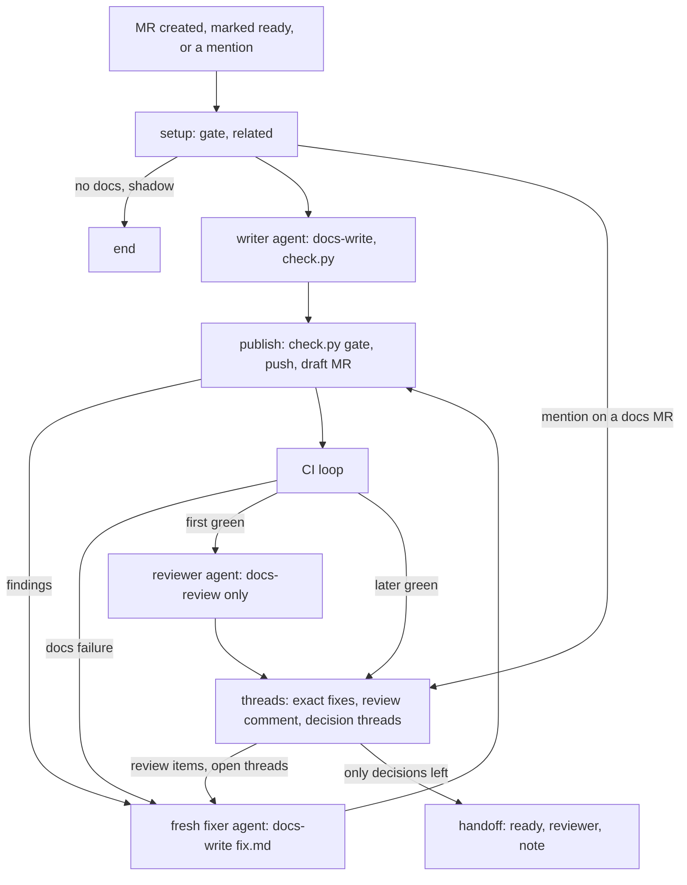

# docs-write flow

A GitLab Duo custom flow that drafts, reviews, and hands off the docs MR for
a feature MR in this project. Plan and coordination:
[#1494](https://gitlab.com/gitlab-org/orbit/knowledge-graph/-/work_items/1494).
The logic lives in two skills in
[`gitlab-org/orbit/team/skills`](https://gitlab.com/gitlab-org/orbit/team/skills),
which the flow fetches at runtime: `docs-write` for the writer and the fixers,
and `docs-review` for the reviewer. File shapes and route tokens:
`skills/docs-write/references/contracts.md` there.

`docs-write.yml` is the reviewable copy. The AI Catalog item is what runs:
after a change here, update the catalog item from the file, then update
this table.

| Setting | Value |
|---|---|
| `SKILLS_REF` in `docs-write.yml` | `cbd1311942983f90c92f9428ef578ae746d17c49` |
| `MODE` in `docs-write.yml` | `shadow` |
| AI Catalog item in this project | Not registered yet |

## How the flow runs

1. `setup` fetches `SKILLS_REPO` at `SKILLS_REF` with the flow's
   `GITLAB_TOKEN`, then runs the gate (threshold 6) and the related-MR check.
   Most MRs end here, with no model call and no GitLab Credits.
1. `MODE=shadow`, the committed default, stops after the gate and logs one
   line per MR. `MODE=full` runs the rest.
1. A writer agent writes the change in one context. It runs `check.py`, the
   docs linters and the rules a script can check, until the check is clean.
1. `publish` checks the writer report, runs `check.py` again as a hard gate,
   refuses a branch that changes files outside the user docs, pushes, and
   opens or updates the draft docs MR. The description lists what to check.
1. The CI loop polls for up to 15 minutes per step, 90 minutes in all. Docs
   failures go to the fixer.
1. On the first green pipeline, a fresh reviewer agent reviews the change,
   read-only. It loads only `docs-review` and sees only what a human
   reviewer sees: the changed pages, the docs diff, and the feature MR diff
   and code.
1. A script applies the exact fixes and posts the review as one comment,
   `For agent: docs review`, with every finding numbered. Each finding that
   needs a person also gets a thread titled **Needs reviewer decision**.
1. A fresh fixer agent, one per cycle and four at most, fixes the numbered
   items in one pass, and the unresolved threads from trusted authors: the
   flow identity, Duo Code Review, the feature MR authors and reviewers, the
   docs MR reviewers, and project members with the Developer role or higher.
   Replies from anyone else inside a trusted thread are dropped. The flow
   never shows other threads to an agent. They stay open for the person who
   merges and do not hold the handoff. The flow replies
   once on the review comment and once per thread. It resolves what it fixed
   once `check.py` is clean. A thread it cannot fix gets a reply and stays
   open as a reviewer decision.
1. When CI is green and only decision threads and threads from other people
   are open, the flow removes `Draft:`, adds the feature MR author as
   reviewer, and posts one note. The note lists the decision threads and
   links the other threads without their text. The flow assigns nobody.
   Otherwise the MR stays in draft, with the reason in its description. A
   person always merges the docs MR.



## Guardrails and residual risk

Every agent has `run_command`, a shell in the same workload as the run's
`GITLAB_TOKEN`. Tool options cannot restrict a shell, so an agent can read
the token or call the GitLab API. What stands between text an agent reads
and a write:

- The prompts forbid pushes, API writes, and resolving threads, and treat
  MR, thread, and file text as data.
- Scripts enforce three rules: the docs-only push guard, that the flow
  never resolves a **Needs reviewer decision** thread, and thread intake.
  Thread intake limits who can put text in front of a fixer to the trusted
  authors above. Thread markers count only when the flow identity wrote them.
- A mention on a docs MR runs the threads stage only when its `docs-write/`
  branch is in this project, not a fork, and the flow identity already has
  a note on the MR.
- The other rules are prompt rules that flow steps check afterward:
  `publish` runs `check.py` as a gate, and the flow discards reviewer edits
  outside `.docs-write/`.

Residual risk: a prompt injection in text the agents do read (the feature
MR diff and code, or a thread from an allowed author) could make an agent
use the token before any check runs. The token has the scope of the person
who triggered the run. The checks cannot undo an API write or a push to
another branch.

## Validate

From a `gitlab-org/orbit/team/skills` checkout, with PyYAML (and `jsonschema`
for the full schema check):

```shell
python3 skills/docs-write/scripts/validate_flow.py \
  <knowledge-graph>/.gitlab/duo/catalog/flows/docs-write.yml
```

It checks the 40 KiB catalog limit on the raw YAML, the schema fields, that
every router target exists, that every route file has a reader whose router
ends by default, that every component has a toolset, and that `setup` sets
`MODE`.

## Set up

Prerequisites:

- The Maintainer or Owner role in the project.
- Custom flows turned on for the top-level group, and a runner for flows.

### Register the flow as a private AI Catalog item

1. In the project, select **AI** > **Flows** > **New flow**.
1. In **Display name**, enter `docs-write`.
1. For **Visibility**, select **Private**.
1. Under **Configuration**, select **Flow**, and paste `docs-write.yml`.
1. Keep `setup` as committed: `MODE=shadow` and `SKILLS_REF` pinned to a
   `team/skills` commit. Full mode is a one-word change to `MODE=full`,
   made and reviewed in an MR here first.
1. Select **Create flow**.

The GraphQL mutations are `aiCatalogFlowCreate` (with `visibility: PRIVATE`
and `release: true`) and `aiCatalogFlowUpdate` (with `versionBump`).

### Enable the flow and give it access to the skill

1. Select **AI** > **Flows** > **Managed**, select the flow, then **Enable**.
1. Select the project. GitLab creates the service account
   `ai-docs-write-<group>`, for example `ai-docs-write-gitlab-org`.
1. Ask an Owner of `gitlab-org/orbit/team/skills` to add that service account
   with the Reporter role. Without it, every run ends at `setup`. The flow
   clones the whole project: `docs-write` runs scripts from `docs-review`.

### Create the trigger

In **AI** > **Triggers**, select the flow's service account and the flow,
and add these conditions:

| Event | Run when | Why |
|---|---|---|
| **Merge request** | **Created** | New MRs. The gate skips drafts. |
| **Merge request** | **Marked ready** | Draft MRs that become ready. |
| **Mention** | | On a feature MR: run the gate again on demand. On a docs MR the flow opened in this project: fix open threads from trusted authors (the flow, Duo Code Review, feature MR authors and reviewers, docs MR reviewers, and Developer+ members), then hand off again. |

Leave **Instructions** empty. GraphQL: `aiFlowTriggerCreate` with
`eventTypes: [0, 4, 6]` (mention, merge request ready, merge request) and
the filter `{"merge_request": {"rules": [{"field": "action", "operator": "in", "value": ["created"]}]}}`.
Filters are keyed by event type, so this one applies only to **Merge
request** events. **Marked ready** events have no filter and always start
the flow (`Ai::FlowTriggers::FilterEvaluator` in `gitlab-org/gitlab`).

Events that a flow causes start triggers too, so the docs MR the flow opens
starts the flow again. The gate ends that run with no model call: it skips
MRs on a `docs-write/` branch or with the docs-write marker, and MRs with
`~documentation` or `~"docs-factory::skip"`. Each run still spends about
100 seconds of runner time on setup.

## Shadow mode (rollout stage 1)

`MODE=shadow` is the committed default. Each run logs one line in the session
(**AI** > **Sessions**, and the workload job log), and writes nothing:

```plaintext
DOCS-WRITE SHADOW {"mr":123,"gate":{"decision":"small","score":7.5,...},"pages":[...],"related":{...}}
```

Compare these lines with what a technical writer decides for the same MRs.

## Turn it off

Turn the trigger off in **AI** > **Triggers**, or disable the flow in
**AI** > **Flows**. Disabling removes the service account and its triggers.
To skip one MR, add `~"docs-factory::skip"`.
