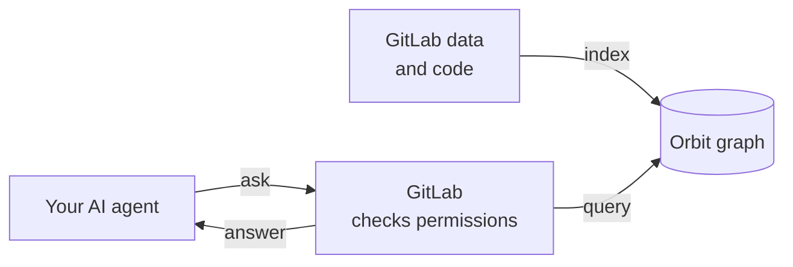

<!-- markdownlint-disable MD041 -->
<div align="center">


# GitLab Orbit

**Software lifecycle context graph for AI agents**

[](https://gitlab.com/gitlab-org/orbit/knowledge-graph/-/pipelines)
[](https://gitlab.com/gitlab-org/orbit/knowledge-graph/-/releases)
[](https://gitlab.com/gitlab-org/orbit/orbit-helm-charts)
[](LICENSE.md)
[](https://gitlab.com/gitlab-community/gitlab-org/orbit/knowledge-graph)

[Documentation](https://docs.gitlab.com/orbit/) · [Quickstart](#quickstart) · [Use cases](docs/docs-gitlab-com/prompt-examples.md) · [CLI](docs/docs-gitlab-com/cli.md) · [Contribute](#contribute)

</div>

Ask your GitLab anything.
GitLab Orbit is the context graph of your software lifecycle.
It connects your code, merge requests, pipelines, work items, and vulnerabilities in one graph that your AI agents can query.
Ask what breaks if a service changes, or which CI/CD jobs fail most.
Each answer shows only the data that your GitLab role lets you see.
The graph of your group needs GitLab Premium or Ultimate.

## Quickstart

Install the [GitLab CLI](https://docs.gitlab.com/cli/) (`glab`) 1.126 or later.
Then, in a Git repository, run:

```shell
glab auth login
glab orbit setup
```

`setup` downloads the GitLab Orbit CLI, connects the AI agents on your machine, and indexes the repository.
Open your agent in the repository, and ask this question:

```plaintext
Using GitLab Orbit, what does this project do, and how is it structured?
```

To ask about merge requests, pipelines, and vulnerabilities, a user with the Owner role for the top-level group must
[turn on GitLab Orbit](docs/docs-gitlab-com/quickstart.md#step-1-turn-on-gitlab-orbit) first.

## Ways to use GitLab Orbit

| Surface | Use it to |
|---------|-----------|
| [`glab orbit`](docs/docs-gitlab-com/cli.md) | Search code, read definitions with their callers, and query the graph from a terminal. |
| [AI coding agents](docs/docs-gitlab-com/agents/_index.md) | Give your coding agents the graph and the GitLab Orbit skill through `glab orbit setup`. |
| [MCP](docs/docs-gitlab-com/agents/mcp.md) | Connect any Model Context Protocol (MCP) client to the graph. |
| [GitLab Duo Agent Platform](docs/docs-gitlab-com/agents/duo.md) | Ask questions in the GitLab UI. |
| [REST API](https://docs.gitlab.com/api/orbit/) | Query the graph from scripts, pipelines, and your own tools. |

For the query language, the schema, security, and troubleshooting, see the [GitLab Orbit documentation](https://docs.gitlab.com/orbit/).

## Architecture



1. GitLab Orbit copies the data and the default-branch code of each top-level group that has GitLab Orbit turned on into a graph in ClickHouse.
   GitLab Orbit updates the graph when the data changes.
1. Your agent sends a question through `glab orbit`, MCP, the REST API, or GitLab Duo.
1. GitLab checks your permissions, runs the query on the graph, and returns only the data that you can read.

`glab orbit` also indexes the repository on your machine, so code questions work offline.
For the components, see [how GitLab Orbit works](docs/docs-gitlab-com/how-it-works.md).

## Contribute

Read [CONTRIBUTING.md](CONTRIBUTING.md) first.
`CONTRIBUTING.md` has the setup, the `mise` tasks, good first issues, and the MR conventions.
Many tasks need no deep Rust knowledge, for example documentation, ontology YAML, and test fixtures for a language.

| Guide | Use it to |
|-------|-----------|
| [Local development](docs/pages/engineering/development/local-development.md) | Run the full stack on a Caproni cluster. |
| [Testing strategy](docs/pages/engineering/testing/README.md) | Learn which tests a change needs. |
| [Adding a language](docs/pages/engineering/development/adding-a-language.md) | Add a parser for a new language. |
| [Architecture](docs/pages/engineering/architecture/) | Read the design of each area before you change it. |

GitLab Orbit also uses these public repositories:
[GitLab Rails](https://gitlab.com/gitlab-org/gitlab),
[Siphon](https://gitlab.com/gitlab-org/analytics-section/siphon),
the [GitLab Orbit Helm chart](https://gitlab.com/gitlab-org/orbit/orbit-helm-charts), and the
[end-to-end test harness](https://gitlab.com/gitlab-org/orbit/orbit-e2e-harness).

To report a bug, open an issue with the [bug report template](https://gitlab.com/gitlab-org/orbit/knowledge-graph/-/issues/new?issuable_template=Bug_Report).
GitLab team members can find the roadmap, the team, runbooks, deployments, and dashboards in the [GitLab Orbit team portal](https://gitlab-org.gitlab.io/orbit/portal/).

## Founders and contributors

These people founded GitLab Orbit:

- [@michaelangeloio](https://gitlab.com/michaelangeloio) (Angelo Rivera): engineering lead
- [@michaelusa](https://gitlab.com/michaelusa) (Michael Usachenko): code graph and query engine
- [@jgdoyon1](https://gitlab.com/jgdoyon1) (Jean-Gabriel Doyon): extract, transform, and load (ETL) engine and indexing
- [@bohdanpk](https://gitlab.com/bohdanpk) (Bohdan Parkhomchuk): infrastructure, web server, and security

See the [contributors graph](https://gitlab.com/gitlab-org/orbit/knowledge-graph/-/graphs/main) for everyone who contributes to GitLab Orbit.

## License

GitLab Enterprise Edition (EE) License. See [LICENSE.md](LICENSE.md).
