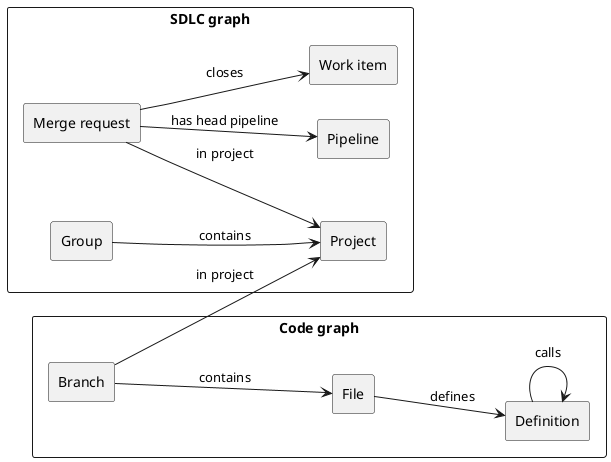

**TL;DR:** Orbit stores GitLab data as one property graph. One ontology
declares everything the graph can hold. Storage, indexing, query validation,
and authorization all come from that one declaration.

## Terms

- A **node** is a typed entity with properties, such as a project, a merge
  request, a file, or a function definition.
- A **relationship** is a typed, directed connection between two nodes, such
  as a merge request that closes a work item.
- The **ontology** is the declaration of every node type, relationship type,
  and property, with the source and the access rules of each one.

## The graph

- The **SDLC graph** holds the lifecycle data that GitLab stores in its
  database: groups, projects, work items, merge requests, CI, security,
  packages, and registries.
- The **code graph** holds the structure of the source code: branches,
  directories, files, definitions, imports, and the references between them.
- Shared nodes, such as projects, join the two graphs. A query
  can start in one graph and end in the other.

## Contracts

- The ontology is the single source of truth. Orbit derives the storage
  schema, the indexing plans, query validation, schema discovery, and
  redaction rules from it.
- A new entity is a declaration in the ontology, not a new code path.
- The ontology describes Orbit's model, not the GitLab database schema.
  Callers never see the source tables or the storage tables.
- Nodes follow the concepts that GitLab users know. For example, issues,
  epics, and tasks are all one work item type, with a property that tells
  them apart.
- Every row that belongs to a namespace carries its namespace path. Only
  declared global entities, such as users and runners, have no path. The
  [security model](security.md) depends on this.
- In Orbit Remote, every row has a version. A delete writes a new version
  that marks the row as deleted and keeps its identity and its unchanged
  columns. Queries read the latest version of each row and skip deleted
  rows.
- The lifecycle graph is kept apart from the raw replicated data. Orbit can
  rebuild it from that data.
- Orbit Remote and the Orbit CLI build their storage from the same ontology.
  The code graph uses the same node and relationship types in both.
- A change to the stored shape of the graph is a new schema version. The
  [schema evolution](schema-evolution.md) page describes how a version
  reaches production.

## Trade-offs

- A property graph fits GitLab better than a triple store, because GitLab
  relationships have strong types and fixed endpoints. The graph gives up
  the open schema of a triple store.
- The graph keeps the data that agents and users ask about. It does not copy
  every column of the source data, so a new question can need an ontology
  change.

## Decisions

- [ADR 000: ClickHouse as graph storage](../design-documents/decisions/000_clickhouse_graph_storage.md)
- [ADR 014: Entity-level indexing](../design-documents/decisions/014_entity_level_indexing.md)
- [ADR 015: Pluggable entity pipelines](../design-documents/decisions/015_pluggable_entity_pipelines.md)
