**TL;DR:** GitLab Orbit's query engine turns a graph query into parameterized SQL over typed node tables and adjacency-ordered edge tables.

Data flows through the engine in these steps:

1. A frontend like JSON or GQL parses a graph query into a shared input.
   The [Query languages](query-languages.md) doc describes the frontends.
1. The engine validates the shared input against Orbit's GitLab ontology, GitLab permissions, and general querying limits.
1. The query planner attempts to pick the most efficient way to execute a graph query.
1. The selected query plan is turned into a SQL syntax tree.
1. Additional engine passes add authorization filters, response formatting, and query settings.
1. A final validation pass is executed to ensure all authorization filters and redaction metadata are present.
1. Code generation renders the syntax tree as SQL for a particular backend, like ClickHouse.

ClickHouse gives Orbit fast aggregations for analytical queries.
The engine adds property-graph semantics on top: traversals, paths, neighborhoods, and grouped counts.
Orbit needs no separate graph database.
[ADR 000](../design-documents/decisions/000_clickhouse_graph_storage.md) records that decision.

Every query gets these guarantees:

| Guarantee | Meaning |
| --- | --- |
| **Parameterized SQL** | Values are bound parameters, and names must match the ontology. |
| **Fail-closed authorization** | Every namespaced read has an authorization filter, or the query is rejected. |
| **Bounded queries** | Hard limits on query shape, result size, time, and memory. |
| **Current state** | Every read sees the latest version of each row. |
| **Stable results** | The plan changes how data is read, never what is returned. |
| **Read-only access** | The webserver can only run `SELECT`. |

The engine supports four query types: traversal, aggregation, path finding, and neighbors.
This table shows a GQL example of each one, and the SQL that it produces.

> [!note]
> These SQL fragments show only the core of each query.
> The full SQL also has authorization filters, page limits, and query settings.

| Query type | Example (GQL) | Meaning | SQL output fragment |
| --- | --- | --- | --- |
| **Traversal** | `MATCH (u:User)-[:AUTHORED]->(mr:MergeRequest {state: 'merged'}) RETURN u.username, mr.title` | Merged merge requests and the users who wrote them | `FROM gl_edge AS e JOIN gl_merge_request AS mr ON mr.id = e.target_id WHERE e.relationship_kind = ? AND mr.state = ?` |
| **Aggregation** | `MATCH (mr:MergeRequest)-[:IN_PROJECT]->(p:Project {id: 278964}) RETURN mr.state, count(mr) AS mrs` | How many merge requests one project has in each state | `SELECT mr.state, COUNT(mr.id) AS mrs ... GROUP BY mr.state` |
| **Path finding** | `MATCH path = ANY SHORTEST (g:Group {id: 9970})-[:CONTAINS*1..2]->(p:Project {id: 278964}) RETURN path` | The shortest path from a group to a project | `WITH forward AS (...), backward AS (...) SELECT ... FROM forward JOIN backward ON ...` |
| **Neighbors** | `MATCH (mr:MergeRequest {id: 42})--(n) RETURN n` | Everything directly connected to one merge request, in either direction | `SELECT ... FROM gl_edge WHERE source_id = ? UNION ALL SELECT ... FROM gl_edge WHERE target_id = ?` |

---

## Walkthrough

This section maps the parts of the engine, in the order that the rest of this document describes them.
It starts with the data model, and follows one query through each phase, from text to SQL.

| Theme | Component | What it does | Query Engine Phases |
| --- | --- | --- | --- |
| Data | [Query data model](#query-data-model) | The engine's read-only view of one schema version: the graph, the ClickHouse tables that store it, and its authorization rules | None |
| Data | [Storage model](#storage-model) | Node tables, edge tables, and row versions in ClickHouse, inside the query data model | None |
| Structure | [Pipelines](#pipelines) | Ordered lists of phases, built from reusable segments, one per frontend and backend | All |
| Querying | [Frontends](query-languages.md) | Parse GQL or JSON into the shared input, in their own doc | `gql_parse`, `json_dsl_parse` |
| Querying | [Validation](#phases) | Rejects bad queries early, then normalizes names and types | `validate`, `validate_relationships`, `normalize` |
| Querying | [Restriction and scope](#phases) | Applies who is asking, and narrows the query to the namespaces it touches | `restrict` |
| Querying | [Planning](#phases) | Picks how to read each node and relationship | `plan` |
| Querying | [Current-state reads](#phases) | Makes sure every read sees the latest version of each row | `plan` |
| Querying | [Lowering and code generation](#phases) | Turns the plan into a SQL syntax tree, then into SQL for one backend | `lower`, `response_policy`, `codegen` |
| Querying | [Authorization](#phases) | Adds authorization filters and redaction columns, then proves they are all there | `enforce`, `security`, `check` |
| Querying | [Hydration](#phases) | Plans a second, small query for the properties the main query didn't fetch | `hydrate_plan` |
| Querying | [Pagination](#phases) | Pages through results without keeping state between requests | `paginate` |
| Querying | [Settings](#phases) | Picks time and memory limits for each query type | `settings` |

---

### System diagram

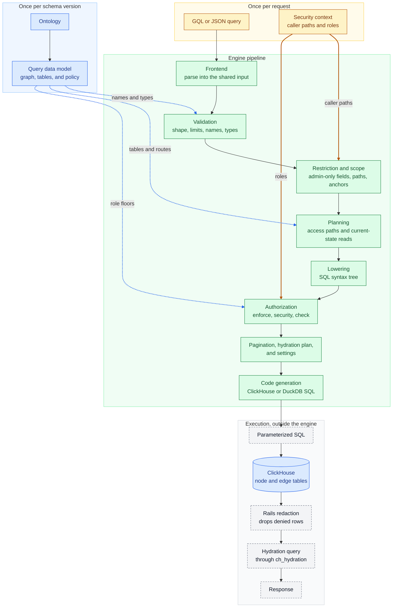

---

## Query data model

The query engine never reads the ontology directly.
Instead, each schema version of Orbit derives one immutable query data model from its ontology, and every engine phase reads from that model.

The model splits the ontology into three kinds of facts:

- The **logical graph**: entities, properties, relationships, and relationship variants.
  A variant is one relationship between one pair of entity types, like `(User)-[:AUTHORED]->(MergeRequest)`.
- The **backend facts**: the ClickHouse tables, columns, sort keys, and foreign keys, and which edge table each relationship variant lives in.
- The **authorization facts**: role requirements, redaction rules, and scope rules.

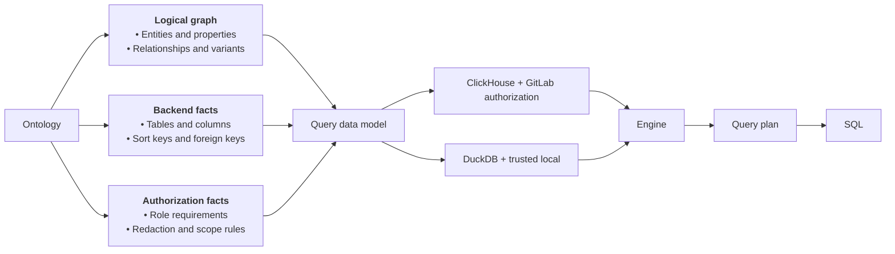

<b>How a model is put together</b>: the graph catalog, the layout, and the policy

Every model has the same three parts, and each part can be swapped on its own:

- The **graph catalog** describes the logical graph.
  It is shared by every backend.
- The **layout** pairs a physical schema with a mapping.
  The schema describes the tables a backend actually has.
  The mapping connects each graph identity, like an entity or a property, to the table and column that stores it.
- The **policy** decides what a caller may see.

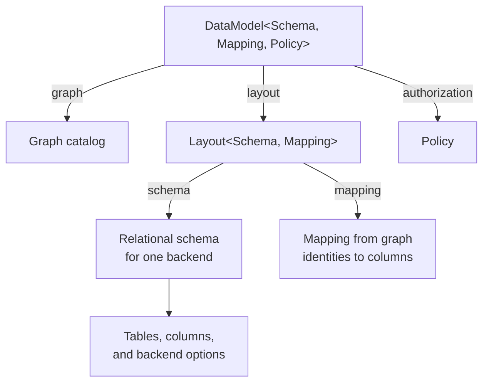

The model builds its mapping from the graph and the schema it is given, so a mapping can never be paired with the wrong schema.
A missing property in the mapping means that the backend cannot supply it.

Orbit has two models:

| Model | Schema | Policy | Used by |
| --- | --- | --- | --- |
| `ClickHouseDataModel` | ClickHouse tables, engines, indexes, and views | GitLab authorization | Orbit Remote |
| `DuckDbDataModel` | The local DuckDB tables | Trusted local, since a local graph has one user | The local graph schema and the code-graph test suites |

A new backend, like a document store, supplies its own schema and mapping.
It does not have to look relational, and the graph catalog stays the same.

<b>Data model consumers</b>: the query server, the engine phases, and schema management

The query server builds one ClickHouse data model when it loads a schema version.
It keeps the model next to the ontology and the named queries for that version.
The compilation and hydration stages pass it to the engine, and every phase reads it as read-only input.

Each phase asks the model different questions:

| Phase | Asks the data model |
| --- | --- |
| `validate`, `normalize` | Does this entity, property, or relationship exist? Is the property filterable or text-indexed? Which foreign key links these nodes? |
| `restrict` | Which table and column hold an anchor's traversal path? |
| `plan` | Which table stores this entity, and which edge tables does this relationship route to? Is there a foreign key, a sort key, or a sorted copy? Is the property mutable or selective? |
| `lower` | Is this column in the table's sort key? |
| `security`, `check` | Which columns hold a traversal path, and what role floor does each table need? |
| `hydrate_plan` | Which table stores each entity, and which properties are virtual, hidden, or admin-only? |

Schema management doesn't need the mapping or the policy.
It derives only the physical ClickHouse schema from the same ontology.
DDL, view lifecycle, migration scope, and the indexer's table cleanup all read that schema, so they can't drift from what the engine queries.

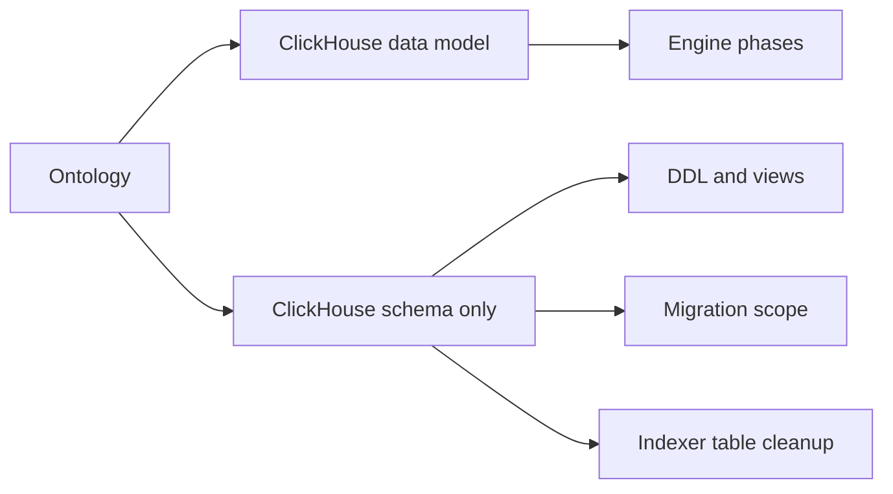

The DuckDB data model follows the same path for local compilation and the code-graph test suites.

The code lives in `crates/query-data-model/`.

### Storage model

The storage model is the physical schema inside the data model's layout.
The ontology defines every table, sort key, and index in it.

- Each entity has its own node table.
  Namespaced tables lead their sort key with the traversal path, so authorization filters prune the primary index.
- Relationships share edge tables.
  The ontology routes each relationship to a table, with `gl_edge` as the default.
  Edge tables sort by traversal path, relationship kind, and source, so one-hop lookups read a narrow range.
- Every row has a version and a deleted flag.
  The indexer appends new versions, and ClickHouse merges old ones away in the background.
- The ontology can declare a denormalized join: a pre-joined chain of tables that answers several hops in one scan.
  Every table in the chain keeps its own traversal path, and each one is filtered on its own.

This diagram shows how ClickHouse stores one relationship, `(User)-[:AUTHORED]->(MergeRequest)`.
`PK` marks the primary key columns.
`gl_ci_edge` and `gl_sec_edge` have the same columns.
`gl_code_edge` adds `project_id` and `branch` to its sort key, so code queries can pin one project and branch.

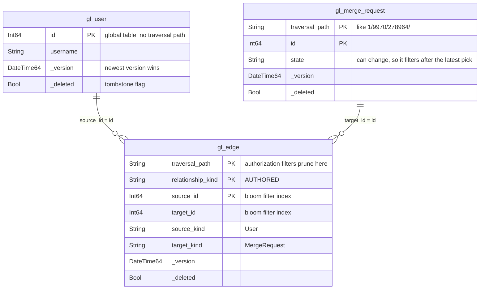

[Data model](data-model.md) describes the entities and relationships.
[Schema management](schema-evolution.md) describes how tables change between versions.

---

## Pipelines

A pipeline is a list of compiler phases that executes in order.
`crates/query-engine/compiler/src/config.rs` declares every phase, the state it reads and writes, and every pipeline that uses it.
Because each phase declares its inputs and outputs, the same run of phases can show up in several pipelines.

A segment is a run of phases that several pipelines share:

| Segment | Phases |
| --- | --- |
| GQL front | `gql_parse` → `validate` → `validate_relationships` → `normalize` |
| JSON front | `json_dsl_parse` → `validate` → `normalize` |
| Remote core | `restrict` → `plan` → `lower` → `response_policy` → `enforce` → `security` |
| Remote finish | `paginate` → `check` → `hydrate_plan` → `settings` → `codegen` |
| Local tail | `plan` → `lower` → `enforce_local` → `paginate` → `duckdb_codegen` |

This diagram shows how each pipeline combines segments.
Boxes with the same color are the same segment:

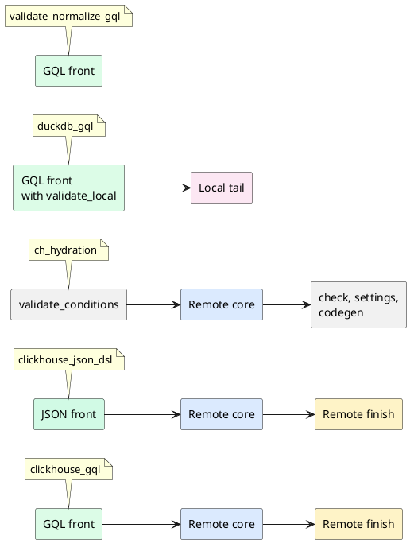

Segment reuse has these effects:

- **Both remote languages share everything after parsing.** `clickhouse_gql` and `clickhouse_json_dsl` differ only in their front segment.
- **Hydration reuses the remote core.** It starts from an input the server builds, so it skips parsing, but it runs the same restrict, plan, and security phases.
  Hydration queries can't bypass authorization.
- **Local queries reuse the front.** The DuckDB pipelines parse and normalize the same way.
  Then they swap in a local tail with no security phases, because a local graph has a single user.
- **A front segment can run alone.** When a new schema version loads, the server runs every named query through `validate_normalize_gql` and `validate_normalize`, to prove each one still fits the new ontology.

| Pipeline | Frontend | Backend | Used by |
| --- | --- | --- | --- |
| `clickhouse_gql` | GQL | ClickHouse | Orbit Remote |
| `clickhouse_json_dsl` | JSON Query DSL | ClickHouse | Orbit Remote |
| `ch_hydration` | None | ClickHouse | Hydration queries |
| `duckdb_gql`, `duckdb_json_dsl` | Either | DuckDB | The local graph schema and the code-graph test suites |
| `validate_normalize_gql`, `validate_normalize` | Either | None | Named-query checks when a schema version loads |

---

## Phases

A query runs through these phases in order.
Expand a phase to see how it works.

<b>Validation</b>: rejects invalid queries before planning starts

Validation is the first phase after parsing.
It rejects an invalid query before planning starts.
Each check rejects a different kind of mistake, and every rejection is a client-safe error.

```plantuml
@startuml
left to right direction
skinparam componentStyle rectangle
component "Query text" as text
component "Parse" as parse
component "Shape and\nlimits" as shape
component "Ontology names\nand types" as names
component "Relationship\ndirection" as direction
component "Normalize" as normalize
component "Shared input" as input
text --> parse
parse --> shape
shape --> names
names --> direction
direction --> normalize
normalize --> input

note bottom of parse
  MATCH (u:User RETURN u
  rejected: unexpected token,
  line 1, column 15
end note

note bottom of shape
  -[:CONTAINS*1..5]->
  rejected: hops cap at 3
end note

note bottom of names
  MATCH (mr:MergeRequest)
  RETURN mr.titel
  rejected: unknown property
end note

note bottom of direction
  (mr:MergeRequest)-[:AUTHORED]->(u:User)
  rejected: AUTHORED goes
  from User to MergeRequest
end note

note bottom of normalize
  MergeRequest becomes gl_merge_request,
  '42' becomes 42,
  columns * becomes a list
end note
@enduml
```

Validation checks these categories:

- **Syntax.** GQL must match the grammar.
  JSON must match the JSON schema.
  Syntax errors report the line and column, and never echo the query text.
- **Shape.** A query has one to five nodes.
  A traversal has exactly one fewer relationship than nodes.
  A GQL pattern must be one connected tree with unique variables and no cycles.
- **Limits.** Hops and path depth cap at 3.
  `LIMIT` caps at 1,000, and `SKIP` at 10,000.
  A query has at most 16 predicates, 500 node IDs per node, 100 values per `IN` list, and 10 relationship types.
  GQL text caps at 32 KiB and 32 levels of nesting.
- **Ontology names.** Every entity, relationship, and property must exist, and each property must belong to its entity.
- **Types.** Filter values must match the property type.
  `sum` and `avg` need numeric properties.
  Group keys must be stored, filterable properties, and date buckets need date properties.
- **Relationship direction.** In GQL, a typed relationship between two labeled nodes must match the ontology.
  A reversed arrow is rejected with a hint that names the right direction.
- **Normalization.** Once a query is valid, `normalize` resolves entity names to tables, coerces filter values to their property types, and expands wildcard columns.
  It also orders filters into stable predicate lists, so the same query always produces the same SQL.

The limits live as Rust constants, and a build script checks that the JSON schema states the same ones.
The [query language reference](../source/remote/queries/query-language.md#validation-limits) lists them all.

<b>Restriction and scope</b>: applies the caller's access, and narrows the query to the namespaces it touches

Restriction is the first phase that reads the caller's security context: their organization, plus each traversal path they can read and their role on it.
Restriction does three things:

- It removes properties that the ontology marks as admin-only, like `User.email`, unless the caller is an admin.
- It rejects any traversal path the caller asks for that isn't inside their authorized paths.
- It derives the query's scope, so a project-scoped query reads only that project's rows.

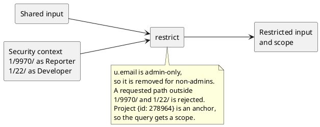

**How scope works**

A scope starts at an anchor: a node with a known ID or path, like a project, group, merge request, or file.
The anchor's traversal path becomes a `startsWith` filter, which lets ClickHouse prune most of the primary index.

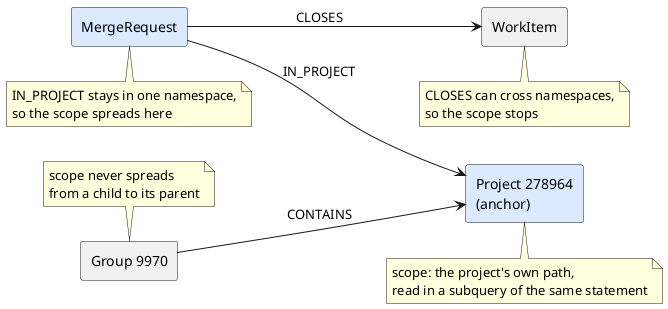

The rules for scope:

- The anchor's current path is read in a subquery inside the same statement.
  There is no lookup before the query and no cache.
  A transferred project scopes to its new path as soon as its rows are indexed.
- ClickHouse evaluates that subquery before index analysis, so it prunes like a literal prefix.
- The scope spreads along relationships that the ontology marks as staying in one namespace, like `IN_PROJECT` and `CONTAINS`.
- It never spreads across relationships that can cross namespaces, like `CLOSES`, and never from a child namespace up to its parent.
- A node with several anchors gets one `startsWith` per anchor, combined with `OR`.
  Past eight anchors, the node keeps only the authorization filter.
- A missing or deleted anchor falls back to the authorization filter alone, so the query still returns the rows that are indexed.
- Scope only narrows a query.
  It never widens what the caller can read.

<b>Planning</b>: picks how to read each node and relationship

The planner decides how to read each node and relationship.
It works from facts in the query data model, not from the shape of the query text.

The planner uses these strategies, among others.

**Read edges first, and join nodes only when needed.** Edge tables already hold both endpoint IDs, so a query that only needs IDs never touches a node table.

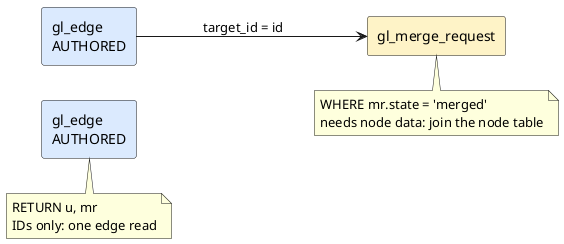

**Union the edge tables a relationship lives in.** The ontology can route each relationship variant to its own edge table.
When a query's relationship spans more than one table, every table becomes one arm of a `UNION ALL`, and every arm returns the same columns.

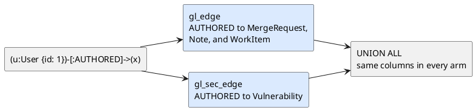

**Narrow a chain as it goes.** In a selective chain, the distinct endpoints of one hop bound the scan of the next hop.

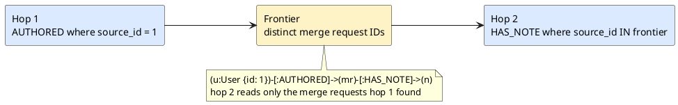

The full set of planning decisions:

- **Relations.** Each relationship in the query becomes one relation.
  Shared nodes connect the relations into a chain or a branch.
- **Node joins.** The planner joins a node table only for node data: a filter, a returned property, a group key, or a sort key.
- **Edge filters.** A node filter can run on the edge row itself when every selected relationship variant carries that property.
- **Routing.** Each relationship variant reads the edge table the ontology routes it to.
  A relationship that spans several tables becomes a union.
- **Foreign keys.** A relationship stored as a foreign key joins node to node on that column, with no edge table.
- **Direction.** A reverse hop filters on the target column, which has its own index.
  It can also read a sorted copy of the table when the ontology declares one.
- **Frontiers.** Selective chains narrow hop by hop, and path finding searches from both ends at once.
- **Reuse.** A relation used more than once becomes a CTE.
  A relation that is only a point lookup, like one ID, is cheaper to repeat inline.
- **Aggregations.** Filters run before grouping, and groups run on the smallest set of rows possible.
  A property group keeps its node table-backed, so security and current-row checks run before the aggregate.
- **Current state.** The planner picks `FINAL` or a selective current-row read for each relation.
  The current-state reads entry below explains the choice.
- **Hydration.** The planner decides which properties the main query returns, and which ones hydration fetches later.

The planner may change how a query reads data, but never what it returns.
Plan-shape fixtures pin these choices for the common query shapes.
A planner change that picks a different plan for one of them fails a test.

<b>Current-state reads</b>: makes every read see the latest version of each row

Node and edge tables keep several versions of a row until ClickHouse merges them.
A correct query has to ask "does the current version match?", not "did any version ever match?".
Those two questions give different answers for any column that can change back.

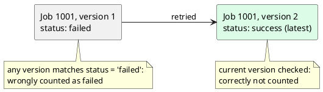

The engine reads current state in one of two ways:

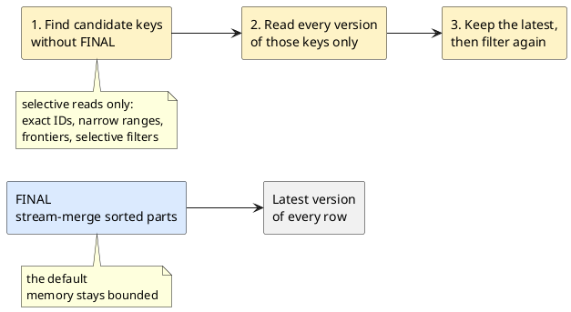

Where a filter runs depends on whether its column can change:

- **Sort-key and unchanging columns** filter before the latest version is picked.
  Every tombstone carries these columns, so a tombstone passes the filter and hides the deleted row.
- **Changing columns**, like `state` or `status`, filter after the pick, so an old version can't match.
- **The deleted flag** always filters last.

Some more details:

- The selective read is safe for changing columns because finding candidates never decides the result.
  It only limits which keys the second read checks.
- Negated filters, `!=`, `IS NOT NULL`, wide ID ranges, and low-selectivity fields keep `FINAL`.
- Edge-only reads don't join node tables, so the indexer deletes a node's edges in the same batch as the node.
- Hydration reads a tiny, fixed set of IDs, so it picks the latest version without `FINAL` and keeps column pruning.
- Orbit doesn't use `argMax`-style aggregations to resolve the latest version.
  Their memory grows with the number of result rows, which is unknown when the query compiles.
- On settled ClickHouse parts, `FINAL` was faster or equal in every measured case, and stayed bounded.
  A slow `FINAL` aggregation is a sign of fragmented parts, and the fix belongs in storage, not in the query.

<b>Lowering and code generation</b>: turns the plan into SQL for one backend

Lowering turns the plan into a SQL syntax tree.
Code generation then renders that tree for one backend.
Built-in functions are a closed vocabulary in the tree, so each backend spells them its own way.

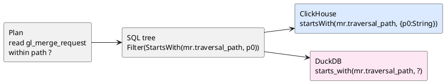

- Planning decides what to read.
  Lowering decides how to express it as SQL.
  Code generation decides the dialect.
- Every query value stays a bound parameter, all the way to the database driver.
- `response_policy` caps the size of large projected values, like long text, before the result leaves ClickHouse.
- Date buckets keep their units until code generation picks the backend expression.
- When a backend can't support an operation, it rejects the query.
  DuckDB, for example, has no equivalent for ClickHouse's token search.

<b>Authorization</b>: adds authorization filters, then proves that every read has one

Three phases protect every remote query.
`enforce` adds what redaction needs, `security` adds the authorization filters, and `check` verifies that every read has a filter.

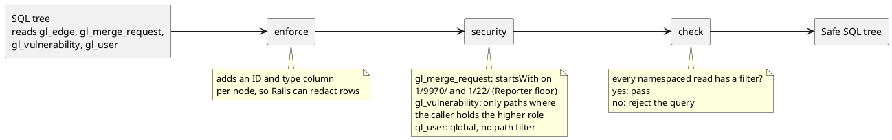

- Every namespaced node and edge read gets a `startsWith(traversal_path, ?)` filter at the role floor of its entity.
  Most entities need Reporter, and security entities like vulnerabilities need a higher role.
- When the caller holds no path at the right role, the read gets a filter that is always false.
  Some queries are refused outright instead.
  In both cases, the caller gets no rows for that entity.
- Global tables, like `gl_user`, have no traversal path.
  Their rows rely on Rails redaction, and joins through namespaced relationships keep their path filters.
- `check` walks the final SQL tree.
  If any namespaced read lacks a valid filter, the engine rejects the query instead of running it.
- `enforce` adds the columns that redaction needs, so Rails can check rows that SQL can't decide on its own, like confidential items.

The [Security](security.md) design document describes the full authorization model and the redaction layer.

<b>Hydration</b>: fetches the properties that the main query didn't return

The main query returns identities, plus the properties it already joined.
Hydration fetches the rest in one more small query.

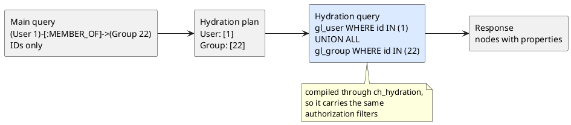

- Path finding and neighbors find node types only at run time, so they usually return IDs alone and rely on hydration.
- Nodes that the main query already joined, for a sort or a group key, need no second query.
- The hydration query compiles through `ch_hydration`, so it runs the same restrict and security phases as the main query.
- The caller picks how many columns dynamic nodes return: the ontology defaults, or all columns.

<b>Pagination</b>: pages through results without keeping server state

The engine pages without keeping any state between requests.
Every page is a new, bounded query.

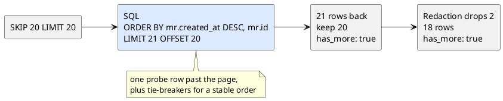

- The engine asks for one row past the page.
  If that row exists, `has_more` is true.
- `SKIP` becomes an `OFFSET` over a stable order.
  Tie-breakers keep pages from overlapping or dropping rows: node IDs for traversals, group keys for aggregations, and path arrays for path finding.
- Redaction runs after SQL, so a page can hold fewer rows than its limit while `has_more` is still true.
  Callers stop when `has_more` is false.

<b>Settings</b>: sets time and memory limits for each query type

The `settings` phase picks ClickHouse settings for each query type: time limits, memory limits, and caching.
Path finding has hard ceilings of 15 seconds and 15 GiB.
Server configuration can tighten these limits, but never raise them past the ceilings.

---

## Appendix

### Glossary

- An **anchor** is a node with a known ID or path, like a project, that a query's scope starts from.
- A **frontier** is the set of distinct endpoints that one hop hands to the next.
- A **phase** is one engine step, such as `validate` or `plan`.
- A **pipeline** is an ordered list of phases for one frontend and one backend.
- The **query data model** is the engine's view of one schema version: the logical graph, its physical layout for one backend, and its authorization policy.
- A **relation** is one read of a node or edge table in the plan.
- A **scope** is a narrow traversal path prefix that the engine derives from the query, such as the path of one project.
- A **segment** is a run of phases that several pipelines share.
- A **tombstone** is the row version that marks a row as deleted.

### Observability

Each query reports the time of each phase, the rows it returned, and the rows, bytes, and memory that ClickHouse used.
Authorized callers can see the compiled SQL and its parameters.

### Testing

Query scenarios check results in both languages.
Plan-shape fixtures check the plan the engine picks.
Fuzz targets check the frontends.
[Testing](testing.md) describes each layer and its CI job.

### Related documents

- [Querying overview](querying.md)
- [Query languages](query-languages.md)
- [Security](security.md)
- [Data model](data-model.md)
- [Schema management](schema-evolution.md)
- [ADR 000: ClickHouse as graph storage](../design-documents/decisions/000_clickhouse_graph_storage.md)
