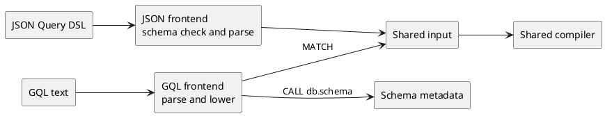

**TL;DR:** Orbit Remote accepts two query languages.
Both compile through one shared compiler.

1. The JSON Query DSL is a JSON object that follows a published schema.
   It is the default.
1. GQL is read-only text based on openCypher 9 syntax, such as `MATCH (u:User)-[:AUTHORED]->(mr:MergeRequest)`.
1. Each language has its own frontend.
   The frontend parses the query and lowers it into the shared input.
1. From the shared input on, the [graph query engine](query-engine.md) treats every query the same way.
   It validates, secures, plans, and renders it.

A language changes how a caller writes a query, not what the engine can do.
Authorization, limits, and results are the same in both languages.

> [!note]
> GQL is off by default.
> Rails turns it on for each user with the `orbit_gql_queries` feature flag.

---

## Language principles

- Both languages lower to one input.
  A capability that exists in the input works in every language that can express it.
- The same query returns the same result in both languages.
  Tests check both spellings against one expectation.
- Query values never become SQL text.
  The compiler binds every value as a parameter, and every name must match the ontology.
- A frontend rejects what it does not support.
  It never drops part of a query and runs the rest.
- Errors are safe to show the caller.
  They name the problem without echoing the query text.
- Callers discover the graph from the ontology, never from the ClickHouse schema.
- Rails picks the language for each user.
  The server never guesses the language from the payload.

---

## Terms

- A **frontend** is the part of the compiler that parses one query language.
- The **input** is the language-neutral form of a query: node selectors, relationship selectors, filters, aggregations, ordering, and limits.
- A **node selector** names an entity type and a variable, with optional IDs, filters, and returned properties.
- A **relationship selector** connects two node selectors, with a relationship type, a direction, and a hop range.
- A **pattern** is the GQL form of node and relationship selectors, such as `(u:User)-[:AUTHORED]->(mr)`.

---

## The languages at a glance



| | JSON Query DSL | GQL |
| --- | --- | --- |
| Form | A JSON object | One text statement |
| Built for | LLMs that fill in a JSON schema, and services that build queries in code | Agents and people who know Cypher |
| Query type | Stated in `query_type` | Inferred from the statement |
| Checks | JSON schema, then the shared validator | Grammar, then the shared validator |
| Schema discovery | `get_graph_schema` | `CALL db.schema()` |
| Frontend code | `passes/frontend/json_dsl/` | `passes/frontend/gql/` |

Both frontends live under `crates/query-engine/compiler/src/passes/frontend/`.

---

## Query types

Every query is one of four types.
JSON names the type, and GQL infers it from the statement.

| Query type | Answers | GQL form |
| --- | --- | --- |
| Traversal | Which nodes match this pattern? A single node with no relationships is a lookup. | Any other supported pattern |
| Aggregation | How many, how much, grouped by what? | An aggregate in `RETURN` |
| Path finding | What is the shortest path between these nodes? | A named `ANY SHORTEST` pattern |
| Neighbors | What is connected to this node? | One relationship to an unlabeled, unfiltered endpoint |

The [query language reference](../source/remote/queries/query-language.md) documents every field, operator, and limit.

---

## JSON Query DSL

JSON is the default language.
It is designed for LLMs and services:

- LLMs produce valid JSON against a schema more reliably than free-form query text.
- One machine-readable file, `config/schemas/graph_query.schema.json`, documents every field, type, and limit.
- Every value has its own field, so values never mix with query structure.
- Services can build queries in code without a parser.

A query names its type and its nodes.
The other fields depend on the type:

| Part | Purpose |
| --- | --- |
| `query_type` | One of `traversal`, `aggregation`, `path_finding`, or `neighbors` |
| `nodes` | The node selectors |
| `relationships` | The relationship selectors that connect the nodes |
| `aggregations` and `group_by` | The metrics and group keys of an aggregation |
| `path` and `neighbors` | The settings for path finding and neighbors |
| `limit` and ordering | The size and order of the result |
| `options` | Presentation settings that do not change what the query matches |

For example, this query returns merged merge requests with their authors:

```json orbit-query
{
  "query_type": "traversal",
  "nodes": [
    {"id": "u", "entity": "User"},
    {"id": "mr", "entity": "MergeRequest", "filters": {"state": "merged"}}
  ],
  "relationships": [
    {"type": "AUTHORED", "from": "u", "to": "mr"}
  ],
  "limit": 25,
  "order_by": "-mr.merged_at"
}
```

The DSL has a version: the `query_dsl` pin in `config/versions.yaml`.
Its major version is part of the schema `$id`.
`get_query_dsl` returns the current schema.

---

## GQL

GQL is the text language.
It is designed for agents that know Cypher:

- A short pattern costs fewer tokens than the same query in JSON.
- A pattern has the same shape as the graph it matches.
- One statement form covers queries and schema discovery.

GQL in Orbit is a restricted subset of openCypher 9 with a few extensions.
It reads and never writes.
It accepts one statement per request and has no query parameters, so callers keep untrusted values out of the query text.
It is not a Neo4j-compatible driver.
The grammar adapts productions from the official openCypher 9 M23 EBNF grammar, and the grammar module carries the Apache-2.0 license and the upstream attribution.

A statement has this shape:

```plaintext
MATCH pattern [WHERE predicates]
[MATCH pattern [WHERE predicates] ...]
RETURN projections
[ORDER BY key [ASC | DESC]]
[SKIP rows]
[LIMIT rows]
[DEBUG]
```

For example, this statement asks the same question as the JSON example:

```gql orbit-query
MATCH (u:User)-[:AUTHORED]->(mr:MergeRequest {state: 'merged'})
RETURN u.username, mr.title
LIMIT 10
```

The pattern must form one connected tree.
Several `MATCH` clauses join into one pattern, and their `WHERE` predicates combine with `AND`.
`RETURN` selects what the graph response includes.
It is not a general table of expressions.

The GQL frontend works in two steps:

1. Parsing checks syntax: identifiers, strings, numbers, and the order of clauses.
1. Lowering checks the whole statement: unique variables, a connected pattern, the query type, and the projections.

Orbit adds these extensions to openCypher 9:

- Shortest paths use the ISO GQL prefix `ANY SHORTEST`, because openCypher 9 has no shortest-path syntax.
- `date_trunc` buckets dates in aggregations.
- Token predicates search text-indexed properties.
- `OFFSET` is a synonym for `SKIP`.
- `DEBUG` returns the compiled SQL to authorized users.

The frontend rejects writes, `OPTIONAL MATCH`, `WITH`, `UNION`, `OR`, cycles, and other syntax outside this shape.

---

## Validation

Both languages end in the same shared validator.
It checks the limits, then checks every entity, relationship, and property against the ontology.
The limits are Rust constants, and a build script checks that the JSON schema states the same limits.

A JSON query is checked twice: first by the JSON schema, then by the shared validator.
Every JSON test therefore also tests the shared validator.

---

## Schema discovery

Callers read the graph schema before they write a query.
Both languages read it from the ontology, sized for an LLM context window:

- In JSON mode, `get_graph_schema` lists node types by domain and relationship types with their endpoints.
  A caller expands the node types it needs to see their properties.
- In GQL mode, `CALL db.schema()` lists the same types, and `CALL db.schema('MergeRequest')` expands one node type.
  A schema call runs no SQL and emits no billing event.

---

## Language selection

Each user has one active language.
The default-off, per-user `orbit_gql_queries` flag in Rails selects it, and Rails sets the language on the gRPC request.

- With the flag off, every surface accepts only JSON.
- With the flag on, the query endpoint, named queries, and discovery use GQL, and JSON queries fail.
- Discovery describes only the active language.
- Agents and public callers cannot choose the language, and there is no fallback between languages.

---

## Adding or retiring a language

Every language-specific step lives in its frontend, so each language is one module:

- A new language adds a frontend that lowers to the shared input, and a compiler pipeline that starts with its parse phase.
- Retiring the JSON Query DSL deletes its frontend, its parse phase, and its schema file.
  The shared phases do not change.
- A check that reads only the input works for every language.
  For example, the relationship-direction check runs on GQL today, and the JSON pipelines can add it without frontend changes.

---

## Testing

Query scenarios state each query once in each language, and both spellings must return the same result.
A grammar fuzz target generates statements from the GQL grammar, and other fuzz targets send arbitrary input through both frontends.
[Testing](../design-documents/testing.md) describes these layers.
