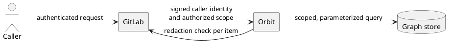

**TL;DR:** Orbit never decides who can see what. GitLab decides, and Orbit
enforces that decision at three layers. Each layer fails closed, so a fault
removes data from a response and never adds data to it.

## Terms

- The **namespace path** is the chain of IDs above a row, from the
  organization down to its group or project.
- The **authorized scope** is the set of namespace paths that GitLab lets the
  caller read, with the caller's role on each path.
- **Redaction** is the check that GitLab does on each returned item before
  the caller receives it.

## Trust model

- Every request reaches Orbit through GitLab. No caller connects to Orbit
  directly.
- GitLab authenticates the caller. Then it sends Orbit a signed, short-lived
  statement of the caller's identity and authorized scope.
- GitLab is the only source of truth for permissions. Orbit does not
  re-implement GitLab policy, so a policy change in GitLab applies to Orbit
  without an Orbit change.
- GitLab token scopes control which Orbit routes a token can call. They do
  not filter results. The caller's own access filters results.

## The three layers

1. **Tenant data in storage.** Every row that belongs to a namespace carries
   its namespace path. A few global entities, such as users and runners, have
   no path. GitLab redaction controls access to them.
2. **Scope in every query.** Orbit adds the authorized scope to every read of
   namespaced data. Before a query runs, a final check rejects it if one of
   those reads has no scope.
3. **Redaction of each item.** Some permissions apply to one item, not to a
   namespace. Examples are confidential items and IP or SAML restrictions.
   GitLab checks these items, and Orbit removes each item that GitLab denies.

## Guarantees

- Access follows the GitLab group hierarchy. Access to a group gives access
  to the groups and projects below it. Every authorized path needs at least
  the Reporter role.
- An entity can require a higher role than the default. For example, the security
  entities need the Security Manager role. Orbit removes paths below that role
  before it builds the query, so counts and groupings cannot expose the entity.
- A filter from the caller can only make the scope smaller. It can never make
  the scope larger.
- Aggregations return no items to redact. The scope and the role floors are
  the filters that protect them.
- An empty authorized scope is an error, not an empty result.
- Caller input never becomes query text. Names must match the graph schema,
  and every value is sent as a separate parameter.
- Every query has limits on depth, size, and time. Orbit rejects a
  query that asks for more than the limits allow.
- Orbit shows the generated database query only to privileged callers who
  ask for it. The query language and the response format are the contract.
- Each log field is marked as safe or as expanded. A field that can hold
  customer data is an expanded field, and configuration controls when it
  appears.

## Service trust

- Every hop between GitLab and Orbit supports TLS, and the deployment turns
  it on. Internal listeners can use TLS too.
- The server uses only a FIPS-validated cryptographic module. It does not
  start if that module is not active, and it has no fallback module.
- Each runtime role connects to the graph store with the least privilege it
  needs. The query tier can only read. Only the indexing and dispatch
  tiers can write, and only the one-time setup step can manage users and
  grants.

## Supply chain

- The project signs each release image. The signature identifies the
  pipeline that built it. Release tags move only after the signatures are
  verified.
- Images run as a user that is not root.
- A scan checks each release image before its tags move. A high or critical
  vulnerability that has a fix blocks the release.

## Failure behavior

- If GitLab does not answer a redaction check, the query fails. Orbit does
  not return items that GitLab did not check.
- If the signed caller identity is missing, invalid, or expired, Orbit rejects
  the request before it does any work.

## Decisions

- [ADR 001: gRPC communication](../design-documents/decisions/001_grpc_communication.md)
- [ADR 008: Workhorse query acceleration](../design-documents/decisions/008_workhorse_query_acceleration.md)
