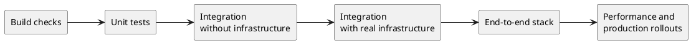

**TL;DR:** Orbit tests behavior at the highest layer that can see it. Most
tests are data files that run real Orbit code against real infrastructure.
Mocks replace only the systems that Orbit does not own. The GitLab
side of Orbit has its own tests in the GitLab project.

## Principles

- Prefer integration, scenario, and end-to-end tests over unit tests. Use a
  unit test only for pure logic that a higher layer cannot reach.
- Write new correctness tests as data-driven scenarios. If a case does not
  fit, extend the harness instead of writing a one-off test.
- Every bug fix gets a test that fails before the fix. Write it at the layer
  where a user can see the bug.
- Test the behavior that Orbit owns against real infrastructure. Mock only
  the systems that Orbit does not own, such as GitLab authorization and
  repository storage.
- Keep tests deterministic. A test that gates a merge measures cost in rows or
  bytes read, never in wall-clock time.
- A test never depends on the state that another test leaves.
- Do not delete a test until a scenario checks every one of its assertions.
- Every marked query example in the documentation runs as a test.
- A query scenario gives each query in both query languages, and both must
  return the same result.

## Terms

- A **test layer** is one level of the stack in the diagram below.
- A **scenario** is a data file that a harness turns into one or more tests.
- The **end-to-end stack** is one full deployment of GitLab and every Orbit
  component.

## Layers

- **Build checks** verify inputs that the compiler cannot type-check, such as
  vendored schemas and generated files. A failed check stops the build.
- **Unit tests** cover pure logic and repository consistency, such as the
  migration ledger and the named queries.
- **Integration without infrastructure** runs the query compiler, the
  code-graph engine, and the command-line tool with no external services.
  - Compiler tests check the generated queries and the plans that the
    compiler picks. Plan checks do not measure latency.
  - Code-graph suites declare source files inline, index them, and check the
    resulting graph with graph queries. A suite fails if the engine writes a
    relationship that the graph schema does not declare.
  - Command-line tests run the real binary against temporary repositories.
- **Integration with real infrastructure** runs Orbit against a real graph
  store and a real message broker in containers.
  - Query scenarios are the main surface for query correctness. Each one runs
    the full query path, from compilation to the formatted response, and
    checks the result.
  - Indexer scenarios seed source rows, run the indexing steps, and check the
    nodes, relationships, and messages that come out.
  - Broker tests check delivery, redelivery, work-queue rules, locks, and
    mutual TLS.
  - The query corpus runs a large set of real queries and every documented
    query example through the production query stages.
- **End-to-end tests** deploy GitLab and every Orbit component. Then they use
  the stack the way a user does: they create data through the GitLab API and
  query until the expected graph appears. A pass proves the full chain, from
  a database row to a query response. A variant runs the same suites on a
  replicated graph store and stops replicas during the run.
- **Performance tests** load a synthetic graph and send concurrent queries.
  Separate benchmarks measure code indexing on real repositories. Shared CI
  machines do not give stable timings, so benchmark timings never block a
  merge.
- **Production rollouts** are also load tests. A schema change that rebuilds
  the graph re-indexes the real workload. Each rollout uses the same
  measurements, so a regression is visible when you compare two rollouts.
- **Fuzzing** sends random input to the query languages, the source parsers,
  and the message decoders. A short run happens on each merge request but
  does not block it. A longer run happens each day.

## Gates

- Static analysis, formatting, dependency audits, and secret detection run on
  every merge request.
- Schema checks validate the ontology, the named queries, the migration
  ledger, and the scenario files.
- Freshness checks fail when a generated file does not match its source.
- Version checks fail when a change to the query language, the response
  format, the agent skills, or the prompts does not bump its version.
- Review automation checks each change for security, performance, logging
  safety, and the billing boundary.
- Billing code is in scope for SOX. A check keeps it behind one boundary, and
  changes to it need approval from the Orbit team.

The [testing commands](../dev/testing-commands.md) page lists the command for
each layer.
