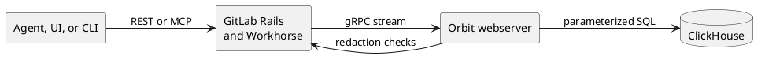

<!-- markdownlint-disable MD041 -->

# GitLab Orbit: Querying

**How a graph question becomes one bounded, authorized query**

[Overview](README.md) · [Query languages](querying.md) · [Graph query engine](engine.md) · [Query language reference](../../source/remote/queries/query-language.md)

Orbit answers a graph question with one bounded, authorized ClickHouse query.

1. A caller writes a query in the JSON Query DSL or in GQL, a read-only text language based on openCypher 9.
1. GitLab Rails authenticates the caller and finds the namespaces they can read.
   Workhorse forwards the request to the Orbit webserver over gRPC.
1. The webserver compiles the query into parameterized SQL.
   The authorization filters are part of that SQL.
1. ClickHouse runs the SQL against the graph tables.
1. Rails checks the rows that SQL cannot decide on its own, such as confidential items.
   The webserver drops the rows that Rails denies.
1. The webserver fills in the remaining properties and returns one response shape for every query type.

> [!note]
> GitLab Orbit is in beta.
> The query languages and the schema can change.

---

## Design principles

- One compiler serves every query language.
  Each language lowers to the same input, so validation, security, planning, and SQL generation exist once.
- The ontology is the schema.
  Entities, relationships, properties, storage tables, and redaction rules come from `config/ontology/`.
  A new entity needs no compiler change.
- Caller input never becomes SQL text.
  Values are bound parameters, and names must match the ontology.
- Security fails closed.
  A final check rejects any SQL that reads a namespaced table without an authorization filter.
- Every query is bounded.
  Hops, path depth, result size, predicates, memory, and execution time all have hard limits.
- The query tier is read-only.
  It connects to ClickHouse as a user that can only run `SELECT`.
- Queries see current state.
  A query never matches a stale version of a row or a deleted row.
- The webserver is stateless.
  Each request, including each page, is a fresh query.
- All query types share one response contract, so a caller can render a graph, a table, or a chart from one format.

---

## Terms

- The **JSON Query DSL** is the JSON query language.
  It is the default.
- **GQL** is Orbit's read-only text query language.
  It uses openCypher 9 syntax with Orbit restrictions and extensions.
  It is not a Neo4j-compatible driver.
- A **frontend** is the part of the compiler that parses one query language.
- The **input** is the language-neutral form of a query: node selectors, relationship selectors, filters, aggregations, ordering, and limits.
- The **ontology** declares the entities, relationships, and properties of the graph, and how each one is stored and authorized.
- The **traversal path** is the namespace hierarchy of a row, such as `1/9970/`.
  Authorization and scope filter on its prefix.
- **Redaction** is the Rails permission check on individual rows after SQL runs.
- **Hydration** is a second, smaller query that fetches properties for nodes the main query only identified.
- A **named query** is a server-defined query that a client calls by name.

---

## The request at a glance

| Stage | What it does |
| --- | --- |
| Routing | Selects the frontend for the request language. Answers schema calls without SQL. |
| Security | Builds the security context from the JWT: the organization and the caller's traversal paths with their roles. |
| Compilation | Turns the query into parameterized SQL and a hydration plan. |
| Execution | Runs the SQL on ClickHouse. |
| Authorization and redaction | Asks Rails about the resources that need a permission check, and drops the denied rows. |
| Hydration | Fetches the properties of discovered nodes, under the same authorization rules. |
| Output | Formats the result as raw JSON, as compact text for LLMs, or as a GQL table. |

The [Security](../security.md) design document covers the authorization layers.
[ADR 008](../decisions/008_workhorse_query_acceleration.md) explains why the gRPC stream runs in Workhorse.

---

## Capabilities

The engine supports four query types:

| Query type | Answers questions like |
| --- | --- |
| Traversal | Which merge requests did this user author? Which files define this function? |
| Aggregation | How many failed jobs does each pipeline have? Which authors merged the most work this month? |
| Path finding | What is the shortest chain of relationships between these two projects? |
| Neighbors | What is connected to this work item? |

A traversal with one node and no relationships is a lookup.

Queries can also:

- Filter on properties with comparisons, membership, string matching, null checks, and token search on text-indexed properties.
- Group aggregations by node or by property, and bucket dates by unit.
- Read virtual columns, such as file content and merge request diffs from Gitaly.
- Page through results with `SKIP` and `LIMIT`.
- Return the compiled SQL to authorized users for debugging.

The [query language reference](../../source/remote/queries/query-language.md) lists every field, operator, and limit.

---

## Flexible by design

The engine separates what a query means from where the data lives and how the caller writes it.
Each part can change on its own.

- **Query languages.** A frontend parses one language into the shared input.
  Adding a language adds one frontend.
  Retiring the JSON Query DSL removes one frontend, and the other phases do not change.
  See [Query languages](querying.md).
- **Storage backends.** The compiler reads a query data model, not table names.
  ClickHouse serves Orbit Remote.
  DuckDB compiles the same queries against the local graph schema, and the code-graph test suites use it.
- **The graph.** A new entity, property, or relationship is an ontology change.
  Tables, validation, schema discovery, and redaction follow from it.
- **Storage layout.** The ontology routes each relationship to an edge table and can declare pre-joined tables.
  The planner picks the access path, so queries do not change when the layout does.
- **Compiler pipelines.** Each phase declares the state it reads and writes.
  A pipeline is an ordered list of phases, so hydration and local queries reuse the same phases in different combinations.
- **Response formats.** One formatter stage renders the result.
  A new format does not touch compilation or execution.

---

## Query surfaces

- **gRPC.** `ExecuteQuery` is the only path from a query to SQL.
  Rails and Workhorse are its callers.
- **REST and MCP.** Rails serves `/api/v4/orbit/*` and the Orbit MCP tools.
  The [API reference](../../source/remote/access/api.md) lists the endpoints.
- **Agent commands.** Agents discover graph capabilities through a short command catalog instead of long tool descriptions.
  See [ADR 011](../decisions/011_agent_command_surface.md).
- **Named queries.** `config/named_queries/` holds server-defined queries in both languages.
  Clients pass a name and parameters, and the server compiles the spelling for the active language.
  The Orbit dashboard and entity context expansion use them.
- **Schema discovery.** Callers read the ontology, not the ClickHouse schema.
  The JSON mode uses `get_graph_schema`, and GQL uses `CALL db.schema()`.

Each user has one active language, which a per-user flag in Rails selects.
[Query languages](querying.md#language-selection) describes the rules.

---

## Responses

Every query type returns the same envelope: nodes, edges, optional aggregation columns and rows, and pagination metadata.
Nodes appear once, and edges connect node instances.
[ADR 004](../decisions/004_unified_response_schema.md) defines the contract, and its version is the `raw_output_format` pin in `config/versions.yaml`.

The same result can render as raw JSON, as [TOON](https://github.com/toon-format/spec/blob/main/SPEC.md) text for LLMs, or as a cypher-shell style table for GQL callers ([ADR 019](../decisions/019_gql_response_format.md)).

---

## Design documents

| Document | Covers |
| --- | --- |
| [Query languages](querying.md) | The JSON Query DSL and GQL: why each exists, how each lowers to the shared input, and how Rails picks one |
| [Graph query engine](engine.md) | Storage model, compiler phases, planning, current-state reads, and safety |
| [Duo and Orbit prompt routing](../duo_orbit_prompt_routing.md) | When Duo agents reach the Orbit MCP tools |
