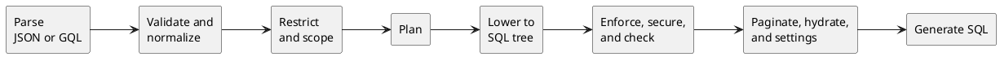

# GitLab Orbit: Graph Query Engine

GitLab Orbit's query engine turns a graph query into parameterized SQL over typed node tables and adjacency-ordered edge tables.

At a high level, here's how data flows through the engine:

1. A frontend like JSON or GQL parses a graph query into a shared input. The [Query languages](querying.md) doc describes the frontends.
2. The engine validates the shared input against Orbit's GitLab ontology, GitLab permissions, and general querying limits.
3. The query planner attempts to pick the most efficient way to execute a graph query.
4. The selected query plan is turned into a SQL syntax tree.
5. Additional engine passes add authorization filters, response formatting, and query settings.
5. A final validation pass is executed to ensure all authorization filters and redaction metadata is present.
6. Code generation renders the syntax tree as SQL for a particular backend, like Clickhouse.

ClickHouse allows Orbit to have the best of both worlds - fast aggregations for analytical queries, and property-graph semantics for traversals, paths, neighborhoods, and grouped counts. Orbit needs no separate graph database, see [ADR 000](../decisions/000_clickhouse_graph_storage.md) which details that decision.

## Terms

- The **query data model** is the compiler's view of one schema version: the logical graph, its physical layout for one backend, and its authorization policy.
- A **phase** is one engine step, such as `validate` or `plan`.
- A **pipeline** is an ordered list of phases for one frontend and one backend.
- A **relation** is one read of a node or edge table in the plan.
- A **scope** is a narrow traversal path prefix that the compiler derives from the query, such as the path of one project.
- A **tombstone** is the row version that marks a row as deleted.

## Engine principles

- The compiler is the only path from a query to SQL. Every safety rule lives in one place.
- Phases are small and ordered. Each phase declares the state it reads and writes, and cannot touch anything else.
- Planning decides what to read. Lowering decides how to spell it in SQL. Code generation decides the dialect.
- The planner may change how a query reads data, but never what the query returns.
- A query reads the current version of each row. Speed never comes at the cost of stale results.
- When the engine cannot prove that a read is safe, it rejects the query.

## Storage model

The ontology defines every table, sort key, and index.

- Each entity has its own node table. Namespaced tables lead their sort key with the traversal path, so authorization filters prune the primary index.
- Relationships share edge tables. The ontology routes each relationship to a table, with `gl_edge` as the default. Edge tables sort by traversal path, relationship kind, and source, so one-hop lookups read a narrow range.
- Every row has a version and a deleted flag. The indexer appends new versions, and ClickHouse merges old ones away in the background.
- The ontology can declare a denormalized join: a pre-joined chain of tables that answers several hops in one scan. Every table in the chain keeps its own traversal path, and each one is filtered on its own.

[Data model](../data_model.md) describes the entities and relationships. [Schema management](../schema_management.md) describes how tables change between versions.

Each schema version derives one immutable query data model from its ontology. The compiler reads only that model. It never reads table names from the query or from the ontology files directly.

## Compiler phases at a glance

| Group | Phases | Responsibility |
| --- | --- | --- |
| Parse | `json_dsl_parse`, `gql_parse` | Turn query text into the shared input |
| Understand | `validate`, `validate_relationships`, `normalize` | Check shape, limits, and ontology names, then resolve names and types |
| Restrict | `restrict` | Remove admin-only fields, check requested paths, and derive the query scope |
| Plan | `plan` | Choose access paths, join order, current-state reads, and hydration |
| Lower | `lower`, `response_policy` | Build the SQL tree and cap the size of projected values |
| Protect | `enforce`, `security`, `check` | Add role-gated reads and redaction columns, inject authorization filters, and verify them |
| Finish | `paginate`, `hydrate_plan`, `settings`, `codegen` | Set the page window, plan hydration, pick query settings, and render SQL |

`crates/query-engine/compiler/src/config.rs` declares the phases and the pipelines that use them:

| Pipeline | Frontend | Backend | Used by |
| --- | --- | --- | --- |
| `clickhouse_json_dsl` | JSON Query DSL | ClickHouse | Orbit Remote |
| `clickhouse_gql` | GQL | ClickHouse | Orbit Remote |
| `ch_hydration` | None | ClickHouse | Hydration queries, with the same security phases |
| `duckdb_json_dsl`, `duckdb_gql` | Either | DuckDB | The local graph schema and the code-graph test suites |

The DuckDB pipelines skip the security phases, because a local graph has a single user.

## Planning

The planner builds a graph of relations and decides how to read each one. It works from facts in the query data model, not from the shape of the query text.

- Each relationship in the query becomes one relation. Shared nodes connect the relations into a chain or a branch.
- The planner reads edges first. It joins a node table only when the query needs node data: a filter, a returned property, a group key, or a sort key.
- A relationship that spans several edge tables becomes a union. Every arm returns the same columns, so later phases see one shape.
- A selective chain narrows as it goes. The distinct endpoints of one hop bound the scan of the next hop.
- Hops in the reverse direction filter on the target column, which has its own index.

### Scope

A project-scoped or group-scoped query should read only that project's rows. The compiler gets this without a lookup before the query.

1. The restrict phase finds anchor nodes, such as a project, group, merge request, or file with a known ID or path.
2. The query reads the anchor's current traversal path in a subquery inside the same statement. ClickHouse evaluates it before index analysis, so it prunes like a literal prefix.
3. The scope spreads along relationships that stay in one namespace. It never spreads across relationships that can cross namespaces, and never from a child namespace to its parent.

A missing anchor falls back to the caller's authorization filter, so the query still returns rows that are indexed. A transferred project scopes to its new path as soon as its rows are indexed.

## Current-state reads

Node and edge tables keep several versions of a row until ClickHouse merges them. A correct query must answer "does the current version match?", not "did any version ever match?". The two answers differ for any column that can change back, such as a job status after a retry.

The compiler reads current state in one of two ways:

- `FINAL` is the default. ClickHouse merges sorted parts as a stream, so memory stays bounded no matter how many rows match.
- A selective read finds candidate keys first, then reads every version of only those keys and keeps the latest. The planner uses it for exact IDs, narrow ID ranges, relation frontiers, and filters that the ontology marks as selective.

Where a filter runs depends on whether its column can change:

- Sort-key and unchanging columns filter before the latest version is picked. Every tombstone carries these columns, so a tombstone passes the filter and hides the deleted row.
- Changing columns filter after the pick, so an old version cannot match.
- The deleted flag always filters last.

Orbit does not use `argMax`-style aggregations to resolve the latest version. Their memory grows with the number of result rows, and that number is unknown when the query compiles. On settled ClickHouse parts, `FINAL` was faster or equal in every measured case and stayed bounded. A slow `FINAL` aggregation is a sign of fragmented parts, and the fix belongs in storage, not in the query.

## Hydration

The main query returns identities and the properties it already joined. Path-finding and neighbor queries find node types only at run time, so they usually return identities alone.

The hydration plan describes a second query that fetches the missing properties for a small, fixed set of IDs. That query compiles through the `ch_hydration` pipeline, so it carries the same authorization filters as the main query.

## Pagination

The server asks for one row beyond the page and uses it to report `has_more`. `SKIP` becomes an `OFFSET` over a stable order, and the compiler adds tie-breakers so that pages neither overlap nor drop rows. Redaction runs after SQL, so a page can hold fewer rows than its limit while `has_more` is still true.

## Safety

The compiler enforces these rules on every query:

- Query values are bound parameters. Names must match the ontology. The SQL tree accepts only a closed set of functions, and each backend renders its own spelling.
- Every namespaced node and edge read carries a `startsWith(traversal_path, ?)` filter at the role floor of its entity.
- The `check` phase walks the final SQL tree and rejects the query if any namespaced read lacks a valid filter.
- Shape limits cap nodes, relationships, hops, path depth, predicates, ID lists, and result size. The [query language reference](../../source/remote/queries/query-language.md#validation-limits) lists them.
- The `settings` phase sets a time and memory limit for each query type.
- The webserver connects to ClickHouse as a read-only user.

The [Security](../security.md) design document describes the authorization model and the redaction layer.

## Observability

Each query reports the time of each phase, the rows it returned, and the rows, bytes, and memory that ClickHouse used. Authorized callers can see the compiled SQL and its parameters. [Observability](../observability.md) lists the metrics.

## Testing

Query scenarios check results in both languages. Plan-shape fixtures check the plan the compiler picks. Fuzz targets check the frontends. [Testing](../testing.md) describes each layer and its CI job.
