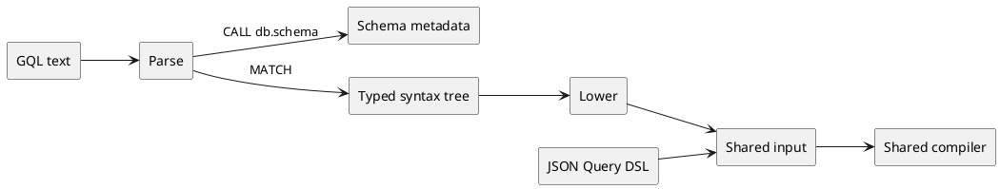

# Orbit query frontend

## Overview

The Orbit query frontend accepts GQL, a read-only text query language based on openCypher 9 syntax.

1. A caller sends one GQL statement as text.
2. The frontend parses it into a typed syntax tree.
3. The frontend lowers the tree into the same input that the JSON Query DSL produces.
4. The shared compiler validates, secures, plans, and renders the query.

GQL changes how a caller writes a query, not what the engine can do. Authorization, limits, and results are the same in both languages.

## Why GQL

- Agents already know Cypher. A short pattern costs fewer tokens than the equivalent JSON object.
- A pattern such as `(u:User)-[:AUTHORED]->(mr:MergeRequest)` reads like the graph it matches.
- One text statement can also ask for the schema, so discovery and queries share one entry point.

## Scope

GQL in Orbit is a restricted subset with a few extensions:

- It reads and never writes.
- It accepts one statement per request.
- It covers the graph shapes that the compiler supports, and no more.
- It is not a Neo4j-compatible driver, and it does not accept query parameters. Callers keep untrusted values out of the query text.

The grammar adapts productions from the official openCypher 9 M23 EBNF grammar. The grammar module carries the Apache-2.0 license and the upstream attribution.

## How it compiles



Parsing checks syntax: identifiers, strings, numbers, and the order of clauses. Lowering checks the whole query: unique variables, a connected pattern, the query type, and the projections. Errors report the line, column, or identifier, and never echo the query text.

The frontend infers the query type from the statement:

| Statement | Query type |
| --- | --- |
| A named `ANY SHORTEST` pattern | Path finding |
| One relationship to an unlabeled, unfiltered endpoint | Neighbors |
| An aggregate in `RETURN` | Aggregation |
| Any other supported pattern | Traversal |

## Statement shape

```plaintext
MATCH pattern [WHERE predicates]
[MATCH pattern [WHERE predicates] ...]
RETURN projections
[ORDER BY key [ASC | DESC]]
[SKIP rows]
[LIMIT rows]
[DEBUG]
```

For example:

```gql orbit-query
MATCH (u:User)-[:AUTHORED]->(mr:MergeRequest {state: 'merged'})
RETURN u.username, mr.title
LIMIT 10
```

The pattern must form one connected tree. Several `MATCH` clauses join into one pattern, and their `WHERE` predicates combine with `AND`. `RETURN` selects what the graph response includes. It is not a general table of expressions.

Orbit adds a few extensions to openCypher 9:

- Shortest paths use the ISO GQL prefix `ANY SHORTEST`, because openCypher 9 has no shortest-path syntax.
- `date_trunc` buckets dates in aggregations.
- Token predicates search text-indexed properties.
- `OFFSET` is a synonym for `SKIP`.
- `DEBUG` returns the compiled SQL to authorized users.

The frontend rejects anything outside this shape, such as writes, `OPTIONAL MATCH`, `WITH`, `UNION`, `OR`, and cycles. A rejected query returns a client-safe error. The frontend never drops the part it does not support.

## Schema discovery

`CALL db.schema()` lists the node and relationship types. `CALL db.schema('MergeRequest')` returns one node type with its properties and relationships. A schema call reads only ontology metadata. It runs no SQL and emits no billing event.

## Language selection

The default-off, per-user `orbit_gql_queries` flag in Rails selects the language. With the flag on, the query endpoint, named queries, and discovery all use GQL, and JSON queries fail. Rails sets the language on the gRPC request. Agents and public callers cannot choose it, and the server never guesses it from the payload.

## Testing

Query scenarios state each query once in each language and expect the same result from both. A grammar fuzz target generates statements from the grammar, and a second target sends arbitrary text through the compiler. [Testing](../testing.md) describes these layers.
