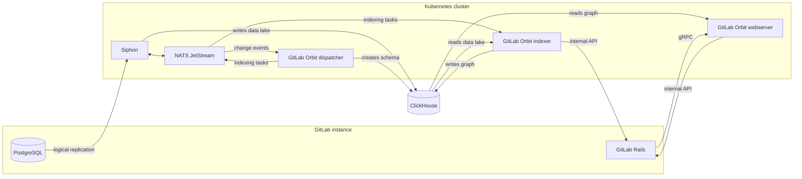



- Tier: Premium, Ultimate
- Offering: GitLab Self-Managed





- [Introduced](https://gitlab.com/groups/gitlab-org/-/epics/22739) in GitLab 19.2.2.



GitLab Orbit is built to add minimal load to your GitLab instance.
It reads GitLab data from a ClickHouse copy of the database, and fetches code through the GitLab internal API, never from Gitaly directly.
The same pipeline gives you a ClickHouse data lake of your GitLab data, which you can build on and scale separately from GitLab.

A GitLab Orbit deployment has two parts:

- A data pipeline that copies the GitLab database into the ClickHouse data lake through PostgreSQL logical replication.
- GitLab Orbit, which turns the data lake and the source code into a queryable graph.

The data pipeline does not depend on GitLab Orbit, so you can verify the pipeline before you install GitLab Orbit.

GitLab distributes GitLab Orbit only as a Helm chart for Kubernetes, not in the Linux package.
Install the chart on the cluster that runs GitLab, or on a separate cluster that can reach GitLab, PostgreSQL, ClickHouse, and NATS.
GitLab Orbit does not run on a GitLab Geo secondary site.

## Architecture

| Component | Function |
|-----------|----------|
| Siphon | Copies rows from PostgreSQL into the ClickHouse data lake, through NATS. |
| Dispatcher | Watches the same NATS stream, owns the graph schema, and publishes indexing tasks back to NATS. |
| Indexer | Takes indexing tasks from NATS, reads the data lake, fetches source code over the GitLab internal API, and writes the property graph. |
| Webserver | Answers queries from the graph, and fetches file content over the internal API when a query needs it. |

GitLab reaches the webserver over gRPC.

## In this section

| Page | Description |
|------|-------------|
| [Get started](getting-started.md) | Prerequisites, installation order, Kubernetes, NATS, object storage, and shared values |
| [ClickHouse](clickhouse.md) | Versions, databases, high availability, memory, log retention, and users |
| [Set up data replication](data-replication.md) | PostgreSQL logical replication and Siphon |
| [Set up GitLab Orbit](orbit-setup.md) | The GitLab connection, the Secrets, the chart, indexing, verification, and upgrades |
| [Networking](networking.md) | TLS, certificates, and the connections that GitLab Orbit uses |
| [Monitor GitLab Orbit](observability.md) | Prometheus metrics, Grafana dashboards, and alerts |
| [Troubleshooting](troubleshooting.md) | Common errors and recovery after the loss of the graph database |

## Cryptographic module

The GitLab Orbit server image runs all TLS connections and JWT verification in the [AWS-LC-FIPS](https://github.com/aws/aws-lc/blob/main/crypto/fipsmodule/FIPS.md) cryptographic module.
The server does not start when the module is not in FIPS mode.
Every published image includes the module, so you do not need a separate FIPS image.
The `orbit` command line tool for local indexing does not include the module.
