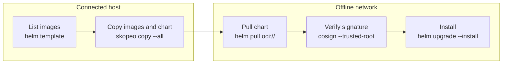



- Tier: Ultimate
- Offering: GitLab Self-Managed



GitLab Orbit runs without internet access when you mirror its images and Helm charts into your network, verify the chart signature with a local Sigstore trust file, and use a license file that includes the GitLab Orbit add-on.
With that setup and the chart defaults, indexing and queries do not connect to hosts outside your network.

An offline setup differs from an online one in four places:

- Images and charts come from a registry that you operate.
- The chart signature check does not reach the Sigstore service.
- GitLab provisions the GitLab Orbit add-on from the license file, not from a subscription check.
- The billing hosts in the Helm chart are unused, analytics is off by default, and you turn off the telemetry of the `orbit` command line tool.

## Install from a mirror



### List the images to mirror

The images that you must mirror depend on the chart version and your values.
List them by rendering each chart with your values file, so the list always matches the version that you install.

Prerequisites:

- A host with internet access, [Helm](https://helm.sh/docs/intro/install/) 3 or later, and the values files that you plan to use.

To list the images for the GitLab Orbit chart:

1. Pull the chart for the version that you plan to install.
   Replace `<orbit_chart_version>` with the GitLab Orbit chart version that you install:

   ```shell
   helm pull oci://registry.gitlab.com/gitlab-org/orbit/orbit-helm-charts/orbit --version <orbit_chart_version>
   ```

1. Render the chart with your values and print the `image` lines:

   ```shell
   helm template orbit orbit-<orbit_chart_version>.tgz -f orbit-values.yaml | grep -E '^\s+image:'
   ```

   Add the same `--set` flags that you use to install.
   The chart renders extra images only when you turn on the features that use them.
   For example, `dashboards.enabled: true` adds the image from `dashboards.applyImage`.

1. Pull and render the Siphon chart, with its own values file and the `global.gitlabVersion` that you plan to use.
   The Siphon chart is published to an HTTP Helm repository, not as an OCI chart.
   Replace `<siphon_chart_version>` with the Siphon chart version that you install:

   ```shell
   helm repo add siphon https://gitlab.com/api/v4/projects/76780115/packages/helm/stable
   helm repo update
   helm pull siphon/siphon --version <siphon_chart_version>
   helm template siphon siphon-<siphon_chart_version>.tgz -f siphon-values.yaml | grep -E '^\s+(image|reference):'
   ```

   `reference:` lines are the `gitlab-siphon-tables` image, which Siphon mounts as an image volume.
   Its tag derives from `global.gitlabVersion`.
   With `splitTables.volumeMode: initCopy`, the tables image is a bare argument of the `crane` init container, so the `grep` does not list it.
   Build its reference from `splitTables.image.registry`, `splitTables.image.repository`, and `splitTables.image.tag`, or take a deployment's `split.tablesImage` if you set it.
   An empty `splitTables.image.tag` resolves to `v` followed by `global.gitlabVersion`, for example `v19.5.0`.

1. Render the NATS chart, and the chart of any object storage service that you deploy, the same way.

For the Siphon chart values, see [Set up data replication](data-replication.md).

### Mirror the images and charts

Copy every image and chart from the lists to your registry.
Replace `<mirror>` with the host and port of your registry.
To copy a chart together with its signature, copy it with every referenced artifact and keep its digest.
Get `<chart_digest>` on the connected host.
`skopeo inspect --format` refuses a Helm chart, so hash the manifest instead.
The output has no `sha256:` prefix:

```shell
skopeo inspect --raw \
  docker://registry.gitlab.com/gitlab-org/orbit/orbit-helm-charts/orbit:<orbit_chart_version> \
  | sha256sum | cut -d' ' -f1
```

Then copy the chart and its signature:

```shell
skopeo copy --all --preserve-digests \
  docker://registry.gitlab.com/gitlab-org/orbit/orbit-helm-charts/orbit:<orbit_chart_version> \
  docker://<mirror>/gitlab-org/orbit/orbit-helm-charts/orbit:<orbit_chart_version>

skopeo copy --all --preserve-digests \
  docker://registry.gitlab.com/gitlab-org/orbit/orbit-helm-charts/orbit:sha256-<chart_digest> \
  docker://<mirror>/gitlab-org/orbit/orbit-helm-charts/orbit:sha256-<chart_digest>
```

The GitLab container registry has no OCI referrers API, so the registry keeps the cosign signature of a chart with digest `D` under the tag `sha256-<D>`.
A mirror that skips that tag cannot verify the chart.

Then point the charts at the mirror:

- In `orbit-values.yaml`, set `image.repository`, and `imagePullSecrets` if the mirror requires credentials.
  If you turn on dashboards, set `dashboards.applyImage` too.
- In `siphon-values.yaml`, set `image.repository` for the Siphon image.
  Set `splitTables.image.registry` and `splitTables.image.repository` for the `gitlab-siphon-tables` image.
  Set `waitForMigrations.image.repository` for the `registry.gitlab.com/gitlab-org/build/cng/kubectl` image.
  The `waitForMigrations` check is on by default in split mode.
  If you turn on dashboards with `dashboards.source: image`, set `dashboards.image.repository` for the same `kubectl` image.
  The default `bundled` source runs no `kubectl` job.
  The two settings default to different tags, so mirror each tag that the render lists.

With `splitTables.volumeMode: initCopy`, two init containers fetch the tables image, and their own images also need a mirror:

- Set `splitTables.initCopy.fetch.image.repository` for the `crane` image, which defaults to `gcr.io`.
- Set `splitTables.initCopy.extract.image.repository` for the `busybox` image, which defaults to `docker.io`.
- The `crane` container pulls the tables image from inside the pod, so `imagePullSecrets` and node registry mirrors do not apply to it.
  For credentials, set `splitTables.initCopy.fetch.dockerConfigSecretName`.
- The `crane` container cannot trust a private certificate authority.
  If your mirror uses a certificate from a private certificate authority, use the default image volume mode instead.
  If the cluster has no ImageVolume support, set `splitTables.volumeMode: toolbox`.
  An init container then copies the tables out of the `gitlab-rails-ee` image, and the node pulls that image, so `imagePullSecrets` and node registry mirrors apply.
  Mirror `registry.gitlab.com/gitlab-org/build/cng/gitlab-rails-ee` in place of the tables image.
  Its tag derives from `global.gitlabVersion`.
  To point at the mirror, set `splitTables.toolbox.image.repository`.

### Pull the chart from the mirror

Pull the chart over OCI from the mirror:

```shell
helm pull oci://<mirror>/gitlab-org/orbit/orbit-helm-charts/orbit --version <orbit_chart_version>
```

Add `--plain-http` when the mirror serves HTTP.
The pulled chart has the same digest as the chart in the origin registry.

The Siphon chart is not an OCI chart, so it has no registry copy.
Carry the `siphon-<siphon_chart_version>.tgz` file that you pulled on the connected host into the offline network, then install from the file:

```shell
helm upgrade --install siphon ./siphon-<siphon_chart_version>.tgz --namespace siphon --values siphon-values.yaml
```

### Verify the chart signature without internet access

By default, `cosign verify` downloads the current Sigstore trust data from `tuf-repo-cdn.sigstore.dev`.
On an offline network it waits for the connection to fail and exits with an error.
To verify offline, give `cosign` a `trusted_root.json` file that you copy in.

Prerequisites:

- [Cosign](https://docs.sigstore.dev/cosign/system_config/installation/) 3 or later.
- The chart and its `sha256-<chart_digest>` tag in your mirror.

To verify the chart:

1. On a host with internet access, download the Sigstore trust data:

   ```shell
   cosign initialize
   ```

   Copy `trusted_root.json` from the directory `~/.sigstore/root/tuf-repo-cdn.sigstore.dev/targets/` into your offline network.

1. Verify the chart from the mirror:

   ```shell
   cosign verify \
     --certificate-identity "https://gitlab.com/gitlab-org/orbit/orbit-helm-charts//.gitlab-ci.yml@refs/tags/v<orbit_chart_version>" \
     --certificate-oidc-issuer https://gitlab.com \
     --trusted-root trusted_root.json \
     <mirror>/gitlab-org/orbit/orbit-helm-charts/orbit:<orbit_chart_version>
   ```

The command exits with `0` when the signature is valid.
The `--offline` flag does not replace `--trusted-root`: it is deprecated, and without `--trusted-root` the command still tries to reach the Sigstore service.

## Use a license file with the add-on

In GitLab 19.6, GitLab Orbit queries require an active GitLab Orbit add-on on the instance, or an instance trial.
An instance trial needs an online cloud license, so an offline instance needs the add-on.
An offline cloud license or a legacy license file can carry the add-on.
Request a license file that includes the GitLab Orbit add-on.

The add-on requirement comes from the `orbit_promo_access_gate` feature flag, which is on by default in GitLab 19.6.
For the versions that turn it on, see the history of [Start a free trial for the instance](https://docs.gitlab.com/integration/orbit/#start-a-free-trial-for-the-instance).

When you add the license in the **Admin** area or through the [license API](https://docs.gitlab.com/api/license/#create-a-license), GitLab provisions the add-on when you upload it.
When you add a license from the Rails console, GitLab provisions the add-on at the next scheduled run.
For an offline cloud license, to provision it at once, see [Provision add-on purchases for an offline cloud license](https://docs.gitlab.com/administration/license_file/#provision-add-on-purchases-for-an-offline-cloud-license).

The following table lists what GitLab Orbit does in each license state on GitLab 19.6.

| License state | GitLab Orbit queries and MCP requests | Cause |
|---------------|--------------------------------|-------|
| License file with an active GitLab Orbit add-on | `200` | None. |
| License file without the add-on | `403` | GitLab denies access because the instance has no active add-on. |
| License file with an expired add-on | `403` | GitLab does not provision an add-on after its `expires_on` date. |
| Online cloud license on a network that cannot reach `customers.gitlab.com` | `402`, `Unable to verify GitLab credits` | GitLab sends the license checksum, and the webserver cannot complete the credits check. On GitLab Self-Managed the check fails closed. |

The `403` response does not name the missing add-on.
The **Admin** area GitLab Orbit page shows **Get GitLab Orbit for this instance**, and the skills list still returns `200`.

Only an online cloud license sends a license checksum to GitLab Orbit.
Without a checksum, the webserver skips the credits check and the billing events, so it does not call `customers.gitlab.com` or `billing.prdsub.gitlab.net`.

## Hosts that GitLab Orbit can connect to

The following table lists the hosts that the GitLab Orbit and Siphon Helm charts, `cosign`, and the `orbit` command line tool can connect to, the setting that controls each one, and what happens on an offline network.
It does not include hosts that GitLab itself connects to, or the registries of the NATS and object storage charts.

| Host | Used for | Setting | Offline behavior |
|------|----------|---------|------------------|
| `registry.gitlab.com` | Images and charts, at install time | `image.repository`, `dashboards.applyImage`, `splitTables.image.registry`, `splitTables.toolbox.image.repository` (with `splitTables.volumeMode: toolbox`), `waitForMigrations.image.repository`, `dashboards.image.repository` (with `dashboards.source: image`) | Use a mirror. |
| `gcr.io`, `docker.io` | The `crane` and `busybox` images, only with `splitTables.volumeMode: initCopy` | `splitTables.initCopy.fetch.image.repository`, `splitTables.initCopy.extract.image.repository` | Use a mirror. |
| `tuf-repo-cdn.sigstore.dev` | `cosign verify`, at install time | `--trusted-root` | Use a local trust file. |
| `customers.gitlab.com` | Credits check on each query, from the webserver | `billing.quota.enabled`, `billing.quota.customers_dot_url` | Called only with an online cloud license. If the call fails, queries return `402`. |
| `billing.prdsub.gitlab.net` | Billing events on each query, from the webserver | `billing.enabled`, `billing.collector_url` | Called only with an online cloud license. |
| `snowplowprd.trx.gitlab.net` | Product analytics, from the indexer, dispatcher, and webserver | `analytics.enabled`, `analytics.collector_url` | Off by default. When you turn it on, pods keep running and queries keep returning `200` while the connection fails. |
| `events.gitlab.net` | Telemetry from the `orbit` command line tool | `ORBIT_TELEMETRY_ENABLED`, `ORBIT_TELEMETRY_COLLECTOR_URL`, or `orbit config set telemetry.enabled` | On by default. Each command tries to connect. |
| `gitlab.com` | The `glab` download of the `orbit` binary | `GLAB_ORBIT_CLI_BINARY_PATH` | The download cannot complete. Set the variable to a local binary. |

The `values.yaml` keys are in the [GitLab Orbit Helm chart](https://gitlab.com/gitlab-org/orbit/orbit-helm-charts/-/blob/main/chart/values.yaml) and the [Siphon Helm chart](https://gitlab.com/gitlab-org/analytics-section/platform-insights/siphon-helm-charts/-/blob/main/chart/values.yaml).

### Use GitLab Orbit Local offline

`glab orbit` downloads the `orbit` binary from `gitlab.com` on first use, and asks for confirmation in a terminal.
On an offline network, the download cannot complete.
To run the local graph offline:

1. Copy a `glab` binary and an `orbit` binary into your network.
1. Set `GLAB_ORBIT_CLI_BINARY_PATH` to the path of the `orbit` binary:

   ```shell
   export GLAB_ORBIT_CLI_BINARY_PATH=/opt/orbit/orbit
   ```

   `glab` ignores the variable `GLAB_ORBIT_LOCAL_BINARY_PATH`.

1. Turn telemetry off:

   ```shell
   export ORBIT_TELEMETRY_ENABLED=false
   ```

   Each `orbit` command otherwise tries to reach `events.gitlab.net`.
   `GLAB_SEND_TELEMETRY=false` does not stop it.

The `workspace index`, `workspace list`, `workspace sql`, and `grep` commands then run with no download and no telemetry connections.
For the persisted setting, see [Settings, storage, and telemetry](../cli.md#settings-storage-and-telemetry).

## Related topics

- [Networking for GitLab Orbit](networking.md)
- [Set up GitLab Orbit](orbit-setup.md)
- [Get started](getting-started.md)
- [Troubleshooting](troubleshooting.md)

## Troubleshooting

### Error: `403 Forbidden` on queries

Queries and MCP requests return `403 Forbidden`, while the skills list returns `200`.
The **Admin** area GitLab Orbit page shows **Get GitLab Orbit for this instance**.
This issue occurs when the instance has no active GitLab Orbit add-on.

To resolve this issue:

1. Confirm that your license file includes the GitLab Orbit add-on and that the add-on has not expired.
1. Add the license again in the **Admin** area or through the license API.
   GitLab provisions the add-on on upload.

### Error: `cosign verify` waits and then fails on `tuf-repo-cdn.sigstore.dev`

This issue occurs when you run `cosign verify` without a local trust file on a network that cannot reach Sigstore.

To resolve this issue, add `--trusted-root trusted_root.json` to the command.
For more information, see [Verify the chart signature without internet access](#verify-the-chart-signature-without-internet-access).
