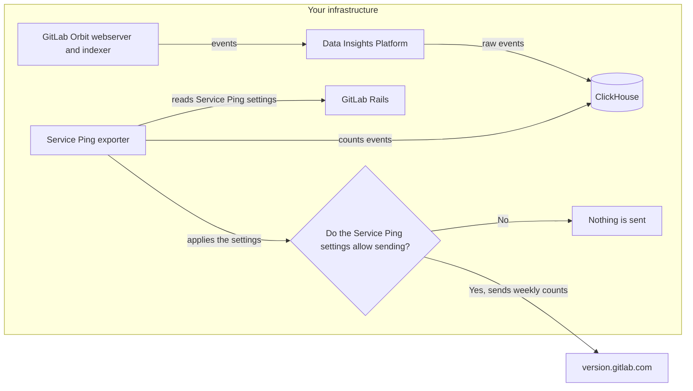



- Tier: Premium, Ultimate
- Offering: GitLab Self-Managed



GitLab Orbit reports its usage to GitLab through Service Ping, under the same settings as your GitLab instance.
Through Service Ping, only a weekly payload of aggregated counts and instance details leaves your infrastructure, and only when your Service Ping settings allow it.
Other connections are listed in [Networking](networking.md).
Service Ping never sends the raw events, which stay in your ClickHouse database.

## Prerequisites

- GitLab 19.6 or later. <!-- TODO: name the first GitLab version with gitlab-org/gitlab!273677 (19.7, or the 19.6 patch release if it is backported). Before it, the exporter sends no Orbit metrics unless Enable Registration Features is on. -->
- GitLab Orbit 1.3.0 or later, with Helm chart 7.1.0 or later.
- The Data Insights Platform and the Service Ping exporter, installed as described in [Set up Service Ping for GitLab Orbit](service-ping.md).

## How GitLab Orbit usage data flows



| Component | Function |
|-----------|----------|
| GitLab Orbit | Sends an event for each query, and for each indexing run that finishes without errors and reads or writes data, to the Data Insights Platform (DIP). |
| DIP | Receives the events and stores them in its own databases on the ClickHouse server that GitLab Orbit uses. |
| Service Ping exporter | Every week, reads your Service Ping settings from GitLab, counts the stored events, and sends the counts to GitLab. |

To install DIP and the exporter, see [Set up Service Ping for GitLab Orbit](service-ping.md).

## What GitLab Orbit sends to GitLab

When your Service Ping settings allow it, the exporter sends one payload a week to `version.gitlab.com`.
By default, it runs on Monday at 03:00 UTC.
The payload contains:

- 7-day and 28-day counts, such as the number of queries from each entry point, the number of indexing runs, and the number of distinct users and projects.
- The end of the period that the counts cover, and the time the payload was built.
- The GitLab Orbit version set in the exporter's `component.version` value, and your GitLab version.
- Your GitLab instance's IDs and host name.
- The version of the payload format.

Every count is a number.
The payload contains no queries, results, code, or names of users, projects, or groups.

For the full list of metrics, see the [GitLab Orbit metric definitions](https://gitlab.com/gitlab-org/orbit/knowledge-graph/-/tree/main/config/metrics).
Every GitLab Orbit metric is optional data.
If **Include optional data in Service Ping** is off, the exporter sends nothing.

The exporter starts in `dry-run` mode, which sends nothing.
Service Ping sends nothing until an administrator switches the exporter to `run`, as described in [Install the Service Ping exporter](service-ping.md#install-the-service-ping-exporter).

<!-- TODO: Link to the GitLab Orbit metrics on metrics.gitlab.com once
internal#989 lands. -->

## What stays in your cluster

When `analytics.local_collector.enabled` is `true`, GitLab Orbit sends every event to the DIP instance installed next to it.
GitLab Orbit sends every event to DIP even when `analytics.enabled` is `false`, because `analytics.enabled` controls only [Snowplow analytics](#send-snowplow-analytics-events-to-gitlab).
**Setting `analytics.enabled` to `false` does not stop local collection.** To stop it, set `analytics.local_collector.enabled` to `false`, as described in [Stop sending events to DIP](#stop-sending-events-to-dip).
Only the weekly aggregated payload leaves your cluster through Service Ping.

GitLab Orbit usage data is kept in these ClickHouse tables:

| Table | Contents | Retention |
|-------|----------|-----------|
| `snowplow.enriched_events` | Every event DIP receives | 7 days |
| `snowplow.bad_events` | Events DIP rejects | 7 days |
| `serviceping.events` | A copy of every event, with all its context fields, that the exporter counts from | 63 days |
| `serviceping.pings` | Each weekly payload and whether GitLab received it | 63 days |

DIP also keeps every event in NATS for 24 hours.

To see each weekly payload and whether GitLab received it, run this query in ClickHouse:

```sql
SELECT component, window_end, status, payload, last_status, acknowledged_at
FROM serviceping.pings FINAL
ORDER BY component, window_end;
```

The `status` column has one of these values:

- `pending`: waiting to be sent, for up to 35 days after the week ends.
- `held`: never sent.
- `acknowledged`: GitLab received the payload.
- `rejected`: GitLab refused the payload.
- `expired`: GitLab did not receive the payload in the 35 days after the week ended.

## Control what GitLab Orbit sends

GitLab Orbit follows the Service Ping settings of your GitLab instance.
These settings control only what the exporter sends.
GitLab Orbit still sends its usage events to DIP, and ClickHouse stores them, until you [stop sending events to DIP](#stop-sending-events-to-dip).
Before each weekly run, the exporter reads the settings from GitLab.
If the exporter cannot read the settings, it sends nothing.
If your GitLab instance has no UUID yet, the exporter builds and sends nothing until GitLab reports one.
A week that waits for a UUID is sent if GitLab reports one in the 35 days after that week ends.

| Setting | When off |
|---------|----------|
| **Enable Service Ping** | New weeks are never sent. If **Enable Service Ping Generation** and **Include optional data in Service Ping** are on, the exporter still builds the payload for each new week and stores it in your cluster. A week that was waiting to be sent before you turned the setting off is sent if you turn it back on in the 35 days after that week ends. |
| **Enable Service Ping Generation** | You can turn off this setting only while **Enable Service Ping** is off. The exporter builds no payload for new weeks, and those weeks are never sent. |
| **Include optional data in Service Ping** | The exporter sends no optional metrics. A week that waits as `pending` for this reason is sent if you turn the setting on in the 35 days after that week ends. |

If your license requires Service Ping, GitLab reports **Enable Service Ping** as on, whatever the setting says.
To stop GitLab Orbit from sending on such a license, turn off **Include optional data in Service Ping**.

<!-- TODO: The rows match the exporter code and the current text of ADR 003
(serviceping-exporter!3). Confirm them when ADR 003 merges. -->

To change these settings, see [Usage statistics](https://docs.gitlab.com/administration/settings/usage_statistics/).

## Network connections

The exporter makes these connections:

| Destination | Port | Purpose |
|-------------|------|---------|
| `version.gitlab.com` | 443 | Sends the weekly payload. GitLab Service Ping uses the same host, so a host allowlist that permits GitLab Service Ping needs no new entry. If an egress NetworkPolicy applies to the exporter's namespace, it must allow this host. |
| Your GitLab instance, through Workhorse | 443, or 8181 inside the GitLab cluster | Reads the Service Ping settings. |
| ClickHouse | The ClickHouse port | Reads the events and stores each weekly payload. |

DIP makes these connections to resolve event schemas:

| Destination | Port | Purpose |
|-------------|------|---------|
| `iglucentral.com` | 80 | Resolves the Snowplow schemas. The DIP chart's default address for Iglu Central uses HTTP. |
| `gitlab-org.gitlab.io` | 443 | Resolves the GitLab Orbit event schemas. |

To avoid the HTTP connection, set `single.pipeline.iglu.repositories` in the DIP values to an HTTPS address for Iglu Central or to an internal Iglu mirror.
The value replaces the whole default list, so include the GitLab repository (`https://gitlab-org.gitlab.io/iglu`) as well.
For more information, see [Set up Service Ping for GitLab Orbit](service-ping.md).

GitLab answers the Service Ping settings request only through Workhorse.
If the exporter connects to Rails directly, GitLab returns `403 Forbidden` and the run stops.

Inside the GitLab cluster, the exporter can reach Workhorse over HTTP on port 8181.
The token then travels unencrypted inside the cluster, and every run logs a warning.
The token is a signed JWT that GitLab accepts for 5 minutes.
It lets the holder read your instance's IDs and Service Ping settings, and nothing else.
The Service Ping secret itself is never sent.
To keep the token off the network unencrypted, set `gitlab.url` to the HTTPS address of your GitLab instance.
To limit which pods can reach port 8181, turn on the `webservice` NetworkPolicy in the GitLab chart (`gitlab.webservice.networkpolicy`) with Ingress rules. Add the exporter's namespace to those rules, next to the sources that GitLab already needs. For more information, see [Configuring the networkpolicy](https://docs.gitlab.com/charts/charts/gitlab/webservice/#configuring-the-networkpolicy).
If the `webservice` NetworkPolicy is on and the exporter's namespace is not allowed, the request times out.

## Offline environments

In offline environments, GitLab Orbit does not send its Service Ping payload.
You cannot upload the payload manually.
Keep the exporter in `dry-run` mode, or do not install it.
In `run` mode, it tries to send every pending week on each run, and the job fails each time.

<!-- TODO: Depends on internal#1013, which decides whether offline
environments can upload GitLab Orbit's payload manually. -->

## Stop sending events to DIP

To keep DIP installed but stop GitLab Orbit sending events to it, set `analytics.local_collector.enabled` to `false` in [`orbit-values.yaml`](orbit-setup.md#install-gitlab-orbit):

```yaml
analytics:
  local_collector:
    enabled: false
```

To remove DIP, see [Remove Service Ping for GitLab Orbit](service-ping.md#remove-service-ping-for-gitlab-orbit).

Either way, only new events stop.
Weekly payloads keep counting the events already stored: the 7-day counts reach zero in the first payload that ends more than 7 days after the last event, and the 28-day counts in the first payload that ends more than 28 days after it.
If the exporter still runs, it keeps sending those payloads, and stored events are deleted from `serviceping.events` after 63 days.

To stop what GitLab Orbit sends to GitLab, use the Service Ping settings in [Control what GitLab Orbit sends](#control-what-gitlab-orbit-sends).

## Send Snowplow analytics events to GitLab

GitLab Orbit can also send each event directly to the GitLab Snowplow collector.
Snowplow analytics is separate from Service Ping and off by default.
When it is on, GitLab Orbit sends every event individually, with its context fields, not aggregated.
The Service Ping settings in [Control what GitLab Orbit sends](#control-what-gitlab-orbit-sends) do not apply to these events.

Each event contains these fields:

- For every event: your GitLab instance's IDs and host name.
- For a query:
  - The ID of the organization, and the ID of the top-level group that the user's GitLab Orbit usage belongs to.
  - A user ID and the IDs of the groups the user can query.
    The user ID is a hash of your instance's UUID and the user's ID in GitLab.
  - Details of the caller: the client name and version from the User-Agent, the coding agent, the session ID, the user type, the token type, and whether the user is a GitLab team member.
  - Details of the query: the entity types, relationship types, filter fields, and columns that the query uses.
    They also include how long the query took and how many rows it returned.
- For an indexing run: the ID of the indexed group or project, and the ID of its top-level group.
  The event also counts the rows and bytes processed.
  For code indexing, it also contains the ID of the project's group, the branch name, the commit SHA, and the number of files processed.
- Every day: the size of the graph and the number of rows for each entity type.
  The event also counts the indexed projects and the top-level groups with GitLab Orbit turned on.
  A separate event for each top-level group contains the group's ID and the same figures for that group.

For the full list of fields, see the [GitLab Orbit event schemas](https://gitlab.com/gitlab-org/orbit/knowledge-graph/-/tree/main/config/schemas/iglu).

The events contain no filter values, query results, file contents, or usernames.
Code indexing events contain the branch name and commit SHA as they are in the repository, so a branch name that includes a username or an unreleased feature name is sent as it is.

To send Snowplow analytics events to GitLab, set `analytics.enabled: true` in `orbit-values.yaml`.

## GitLab Orbit CLI telemetry

The GitLab Orbit CLI sends its own usage events.
To turn them off, see [Settings, storage, and telemetry](../cli.md#settings-storage-and-telemetry).

## Related topics

- [Set up Service Ping for GitLab Orbit](service-ping.md)
- [Usage statistics](https://docs.gitlab.com/administration/settings/usage_statistics/)
- [Customer product usage information](https://handbook.gitlab.com/handbook/legal/privacy/customer-product-usage-information/)
