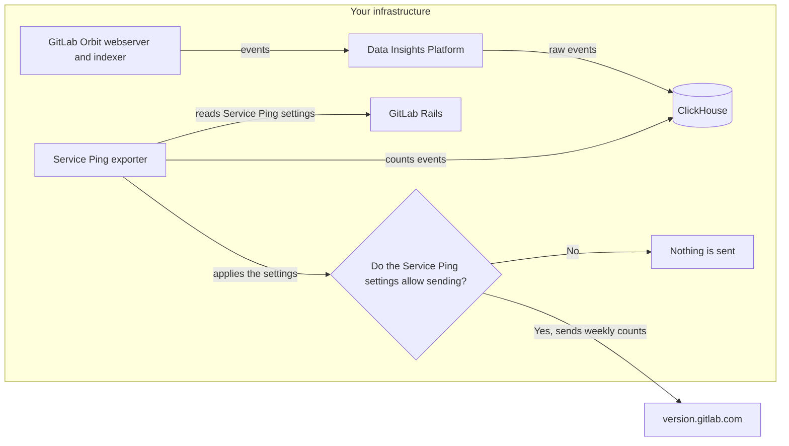



- Tier: Premium, Ultimate
- Offering: GitLab Self-Managed



GitLab Orbit reports its usage to GitLab through Service Ping, under the same settings as your GitLab instance.
Through Service Ping, only a weekly payload of aggregated counts and instance details leaves your infrastructure, and only when your Service Ping settings allow it.
Other connections are listed in [Networking](networking.md).
Service Ping never sends the raw events, which stay in your ClickHouse database.

## Prerequisites

- GitLab 19.6 or later.
- GitLab Orbit 1.3.0 or later.
- The Service Ping exporter uses the same Service Ping secret as your GitLab instance.

<!-- TODO: Add the Helm chart version that installs DIP (orbit-helm-charts!197),
and link to the admin steps for the Service Ping secret once gitlab!268510
merges. -->

## How GitLab Orbit usage data flows



| Component | Function |
|-----------|----------|
| GitLab Orbit | Sends an event for each query and each indexing run to the Data Insights Platform (DIP). |
| DIP | Receives the events and stores them in the ClickHouse database that GitLab Orbit uses. |
| Service Ping exporter | Every week, reads your Service Ping settings from GitLab, counts the stored events, and sends the counts to GitLab. |

<!-- TODO: What gets installed (DIP and the exporter, one chart or two), the
footprint, the chart values, and the exporter command (the exporter chart
defaults to `dry-run`, which sends nothing). Depends on internal#994 and
internal#985. -->

## What GitLab Orbit sends to GitLab

When your Service Ping settings allow it, the exporter sends one payload a week to `version.gitlab.com`.
By default, it runs on Monday at 03:00 UTC.
The payload contains:

- 7-day and 28-day counts, such as the number of queries from each entry point, the number of indexing runs, and the number of distinct users and projects.
- The week that the counts cover.
- The GitLab Orbit version and your GitLab version.
- Your GitLab instance's IDs and host name.

Every count is a number.
The payload contains no queries, results, code, or names of users, projects, or groups.

For the full list of metrics, see the [GitLab Orbit metric definitions](https://gitlab.com/gitlab-org/orbit/knowledge-graph/-/tree/main/config/metrics).
Every GitLab Orbit metric is optional data.
If **Include optional data in Service Ping** is off, the exporter sends nothing.

<!-- TODO: The exporter chart defaults to `dry-run`, which sends nothing.
If that default stays, say here that nothing leaves your cluster until an
administrator switches the exporter to `run`. Depends on internal#994. -->

<!-- TODO: Link to the GitLab Orbit metrics on metrics.gitlab.com once
internal#989 lands. -->

## What stays in your cluster

By default, chart 8.0 and later installs DIP and configures GitLab Orbit to send every event to it.
GitLab Orbit sends every event to DIP even when `analytics.enabled` is `false`, because `analytics.enabled` controls only [Snowplow analytics](#send-snowplow-analytics-events-to-gitlab).
Only the weekly aggregated payload leaves your cluster through Service Ping.
To stop sending events to DIP, see [Stop sending events to DIP](#stop-sending-events-to-dip).

GitLab Orbit usage data is kept in these ClickHouse tables:

| Table | Contents | Retention |
|-------|----------|-----------|
| `snowplow.enriched_events` | Every event DIP receives | 7 days |
| `serviceping.events` | A structured copy of each event that the exporter counts | 63 days |
| `serviceping.pings` | Each weekly payload and whether GitLab received it | 63 days |

To see each weekly payload and whether GitLab received it, run this query in ClickHouse:

```sql
SELECT component, window_end, status, acknowledged_at
FROM serviceping.pings FINAL
ORDER BY component, window_end;
```

## Control what GitLab Orbit sends

GitLab Orbit follows the Service Ping settings of your GitLab instance.
Before each weekly run, the exporter reads the settings from GitLab.
If the exporter cannot read the settings, it sends nothing.
If your GitLab instance has no UUID yet, the exporter builds and sends nothing until GitLab reports one.
A week that waits for a UUID is sent if GitLab reports one in the 35 days after that week ends.

| Setting | When off |
|---------|----------|
| **Enable Service Ping** | The exporter stores the payload for each new week in your cluster and sends nothing. Weeks stored while the setting is off are never sent. A week that was waiting to be sent before you turned the setting off is sent after you turn it back on. |
| **Enable Service Ping Generation** | You can turn off this setting only while **Enable Service Ping** is off. The exporter builds no payload for new weeks, and those weeks are never sent. |
| **Include optional data in Service Ping** | The exporter sends no optional metrics. A week held back for this reason is sent if you turn the setting on in the 35 days after that week ends. |

<!-- TODO: The rows match the exporter code and the current text of ADR 003
(serviceping-exporter!3). Confirm them when ADR 003 merges. -->

To change these settings, see [Usage statistics](https://docs.gitlab.com/administration/settings/usage_statistics/).

## Network connections

The exporter makes these connections:

| Destination | Port | Purpose |
|-------------|------|---------|
| `version.gitlab.com` | 443 | Sends the weekly payload. GitLab Service Ping uses the same host, so an allowlist that permits GitLab Service Ping needs no new entry. |
| Your GitLab instance, through Workhorse | 443, or 8181 inside the GitLab cluster | Reads the Service Ping settings. |
| ClickHouse | The ClickHouse port | Reads the events and stores each weekly payload. |

GitLab answers the Service Ping settings request only through Workhorse.
If the exporter connects to Rails directly, GitLab returns `403 Forbidden` and the run stops.

Inside the GitLab cluster, the exporter connects to Workhorse over HTTP, and every run logs a warning that the token is sent unencrypted.
If the GitLab chart's `webservice` NetworkPolicy is on, allow the exporter's namespace on port 8181.
Otherwise, the request times out.

## Offline environments

In offline environments, GitLab Orbit does not send its Service Ping payload.
You cannot upload the payload manually.

<!-- TODO: Depends on internal#1013, which decides whether offline
environments can upload GitLab Orbit's payload manually. -->

## Stop sending events to DIP

To keep DIP installed but stop GitLab Orbit sending events to it, set `analytics.local_collector.enabled` to `false` in [`orbit-values.yaml`](orbit-setup.md#install-gitlab-orbit):

```yaml
analytics:
  local_collector:
    enabled: false
```

To leave DIP out of the installation, set `dataInsightsPlatform.enabled` to `false`.

Either way, only new events stop.
Events already stored stay in `serviceping.events` for 63 days, and 28-day counts still include them.
If the exporter still runs, it keeps sending a weekly payload, with zero counts after the stored events expire.

To stop what GitLab Orbit sends to GitLab, use the Service Ping settings in [Control what GitLab Orbit sends](#control-what-gitlab-orbit-sends).

## Send Snowplow analytics events to GitLab

GitLab Orbit can also send each event directly to the GitLab Snowplow collector.
Snowplow analytics is separate from Service Ping and off by default.

To send Snowplow analytics events to GitLab, set `analytics.enabled: true` in `orbit-values.yaml`.

## GitLab Orbit CLI telemetry

The GitLab Orbit CLI sends its own usage events.
To turn them off, see [Settings, storage, and telemetry](../cli.md#settings-storage-and-telemetry).

## Related topics

- [Usage statistics](https://docs.gitlab.com/administration/settings/usage_statistics/)
- [Customer product usage information](https://handbook.gitlab.com/handbook/legal/privacy/customer-product-usage-information/)
