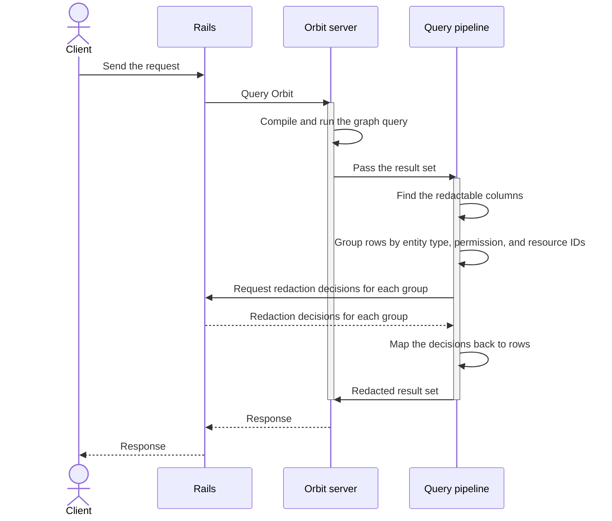

## Status

Accepted

## Date

2026-02-19

## Context

Orbit is a Rust service that queries ClickHouse, but Rails owns all authorization decisions.
So Orbit runs a query, then asks Rails to check permissions on the results before it returns them.

This means Orbit must call back to Rails while the query runs.
A plain request and response protocol cannot do this without a second connection from Orbit to Rails, which makes a circular dependency.

## Decision

**We use gRPC between Rails and Orbit, with a bidirectional stream for queries so that the redaction exchange runs inside one call.**

Redaction is the step that removes the rows the user cannot see.
The tool list, graph schema, and cluster health calls need no redaction, so they are unary, with one request and one response.

| RPC | Pattern | Purpose |
|---|---|---|
| Tool list | Unary | Return the tool definitions with their JSON schemas |
| Query | Bidirectional stream | Run a graph query with a redaction exchange in the stream |
| Graph schema | Unary | Return the graph schema with optional node expansion |
| Cluster health | Unary | Return cluster health for the Orbit dashboard |

The first design had five RPCs.
We merged tool execution into the query RPC, which now takes a response format.
We also merged the ontology RPC into the graph schema RPC.
[ADR 003](003_api_design.md) gives the reasons.
During the product rename, the server also answers the old service paths.

### Redaction exchange

The query stream carries four steps:

1. Rails sends the query request.
1. Orbit sends a redaction request with batches of resource IDs, each with a resource type and an ability to check.
1. Rails sends a map from each resource ID to an authorized flag, for each resource type.
1. Orbit sends the result, with the unauthorized rows already removed.

One envelope message carries every phase of the stream: the request, the redaction exchange, the result, and an error.



### Row-level authorization

Indexing stores permission metadata with each entity, and Orbit reads it from each query result.
Orbit groups the resource IDs by resource type and ability, so Rails gets one check for each group instead of one for each row.
Orbit then removes the rows that Rails did not authorize.

```plaintext
rows:      Project 1, Project 5
check:     can the user read projects 1 and 5?
decision:  1 yes, 5 no
returned:  Project 1
```

### Gitaly pattern

The Rails integration copies the patterns that Rails already uses for Gitaly, the gRPC service for Git repositories.
We generate a Ruby gem from the Orbit protocol definition and publish it to RubyGems, and Rails uses it for client stubs.

Rails keeps a pool of gRPC channels to Orbit.
Connection settings, such as keepalive, maximum message size, and timeouts, follow the Gitaly configuration model.

Error handling also mirrors Gitaly.
Rails retries an unavailable server with backoff, returns HTTP 403 for permission denied, and returns HTTP 504 for a deadline exceeded.
gRPC interceptors handle request logging, tracing with LabKit, and metrics, as they do for Gitaly.

### Response compression

The server compresses responses with Gzip or Zstandard, and accepts either on requests.
It uses the first of those two encodings in the order that the client lists them, and sends no compression if the client lists neither.
The Ruby and Python clients list Gzip and not Zstandard, so they get Gzip.
Only clients that list Zstandard, such as some Rust or Go clients, can get Zstandard.

### Authentication

Service-to-service authentication has two layers, as the security design document describes.
A JSON Web Token (JWT) carries the user context, such as the user ID, organization ID, and the groups the user can reach.
A shared secret signs the token, the token expires after a few minutes, and each call carries it in gRPC metadata.
Mutual TLS (mTLS) verifies the identity of each service at the transport layer.

A Kubernetes service mesh such as Istio or Linkerd can manage the TLS certificates and rotate them with no application configuration.
cert-manager can also provision and renew them from a cluster-internal certificate authority.
GitLab Self-Managed can configure them manually, with the same certificate setup as Gitaly.

### Authorization boundary

**Orbit never makes an authorization decision.**

It runs queries, collects the resource IDs from the results, and sends them to Rails for permission checks.
Rails is the single source of truth for permissions, and Orbit only removes the rows that Rails marks unauthorized.

## Benefits of this approach

The protocol definition is the contract between Rails and Orbit.
Rails generates a Ruby client from it and Orbit implements the server in Rust, so a schema mismatch fails at build time.
REST and GraphQL have no clean way to do a two-way exchange inside one request.
Protocol Buffers, the gRPC message format, are smaller and faster to parse than JSON for batches of resource IDs.

GitLab already runs gRPC services in production, such as Gitaly, Praefect, and Duo Workflow.
The operational patterns for channels, errors, monitoring, and deployment already exist.

The whole exchange runs in one call on one connection with one timeout, with no polling and no callback service.
Rails and Orbit use half the connections, and do not open a callback connection under load.

## Consequences

- Rails needs the gRPC gem and the generated Orbit client gem, through the same gem setup as Gitaly.
- A change to the protocol definition needs a new gem release and a Rails update.
  Compatible changes, such as a new field or RPC, need no lockstep deploy.
  Breaking changes, such as a removed field or a changed type, follow the standard deprecation process.
- Standard HTTP tools cannot inspect a bidirectional stream.
  Teams need gRPC tools, such as grpcurl, Bloom RPC, or logging interceptors.
- If Rails is down or slow, Orbit cannot finish a query that needs redaction checks.
  We accept this, because to skip redaction would be a security violation.
- Requests carry no key for deduplication or replay detection, so a failed request is retried from the start.
  Queries are read-only, so a retry is safe, but it runs the same ClickHouse work again.

### Denial of service

A bidirectional stream adds denial-of-service risks:

- A query with millions of rows would make a very large redaction request, but the row limit of the query engine prevents this.
- A slow client holds the stream open on the server.
  Neither Rails nor Orbit sets a stream deadline yet, so only TCP keepalive bounds the wait.
  We must add a deadline for each RPC before the production rollout.
- An attacker can open many streams and send no messages.
  Orbit does not limit concurrent streams, and each stream starts its own task and ClickHouse query.
  The gRPC limit on concurrent streams and the Kubernetes resource limits are the only controls.
  We must add stream limits on the server.

### PostgreSQL load from redaction checks

Each Rails permission check evaluates the Rails policy rules against PostgreSQL, and it can load the resource and evaluate several conditions.
A full result across several resource types could cause one check for each row.

Grouped IDs and a cap on the IDs in each check reduce this load to a few batched checks.
The row limit of the query engine also bounds the number of checks for each request.
The Rails handler must preload resources and their policy dependencies instead of checking each ID alone, as Rails does for search results.

The Auth Architecture team is building GLAZ, a Rust authorization service modeled on Google Zanzibar.
GLAZ will control access based on relationships, roles, and attributes, and it stores its data in PostgreSQL or YugabyteDB.
When GLAZ is available, Rails can send redaction checks to it over gRPC instead of to PostgreSQL.
Only the Rails handler changes, and the stream protocol stays the same.
Until then, the batch caps and row limits bound the load.

### Puma threads

The Rails gRPC client is synchronous, so each query blocks a Puma thread for the full stream, from the request to the result.
A REST callback would use a second thread for the authorization callback, but the stream needs only one.
Other synchronous services in Rails, such as Gitaly, Elasticsearch, and Zoekt, block the same way.
The mitigations are the same: request deadlines, small result sets, and monitoring of thread pool use.

## Why not the alternatives

### REST callback

Orbit would call a Rails HTTP endpoint during the request, which makes a circular service dependency.
The second connection doubles the connection and failure surface and complicates load balancer configuration.
Orbit would need its own HTTP client and separate credentials for the callback.
The callback can also time out apart from the original request.

### Unary gRPC for each phase

Rails would start the query, poll for the redaction request, send the response, and poll for the result.
Polling adds latency, and the server must keep state for each query in flight.
One logical operation becomes four RPCs, each with its own failure modes.

### Server streaming

Orbit could stream results to Rails, but Rails could not send redaction decisions back on the same stream.

### Shared database

Orbit would read permissions from PostgreSQL directly.
That couples Orbit to the Rails schema, bypasses the change data capture pipeline, and breaks the boundary between transactional and analytical storage.

### Precomputed authorization cache

The cache must change on every permission change, such as a role update, a confidentiality change, or a SAML change.
That invalidation problem is as hard as the original authorization problem.

### Message queue

A queue such as NATS or Kafka adds infrastructure for a request-response exchange.
Orbit cannot continue until it has the authorization results, and gRPC handles that exchange directly.

### Server-sent events over HTTP/2

Server-sent events go only from server to client.
The redaction exchange needs both directions in one request.

## References

- [Orbit gRPC service definition](../../../../crates/orbit-server/proto/orbit.proto)
- [Orbit security design document](https://gitlab.com/gitlab-org/orbit/knowledge-graph/-/blob/2da7a9340bb4ae77d07050e0b01f50cf507af66c/docs/design-documents/security.md)
- [gRPC service implementation](https://gitlab.com/gitlab-org/rust/knowledge-graph/-/merge_requests/273)
- [Gitaly client in Rails](https://gitlab.com/gitlab-org/gitlab/-/tree/master/lib/gitlab/gitaly_client)
- [Gitaly protocol definitions](https://gitlab.com/gitlab-org/gitaly/-/tree/master/proto)
- [GLAZ authorization service design document](https://gitlab.com/gitlab-org/architecture/auth-architecture/design-doc/-/merge_requests/74)
- [ADR 003: Orbit API design (unified REST and GraphQL)](003_api_design.md)
