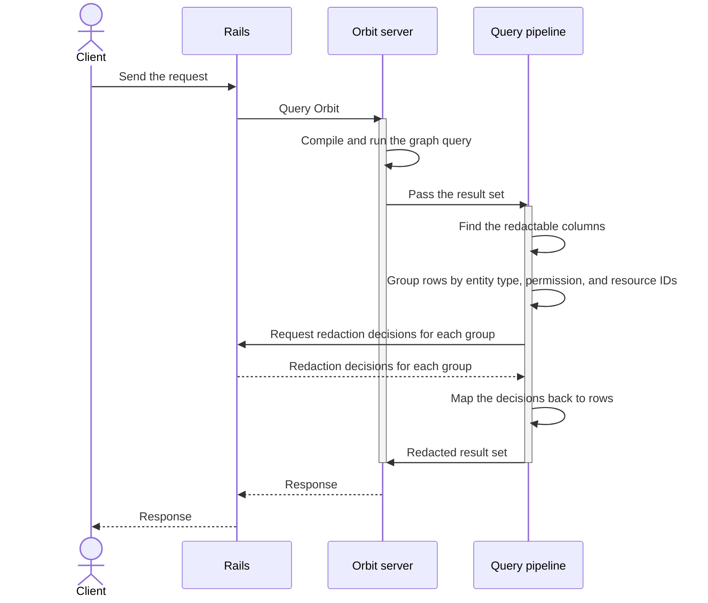

## Status

Accepted

## Date

2026-02-19

## Context

Orbit is a Rust service that queries ClickHouse.
Rails owns all authorization decisions.
Orbit runs a query, then asks Rails to check permissions on the results before it returns them.

Orbit must call back to Rails during query execution.
A standard request-response protocol cannot express this exchange.
It would need a second connection from Orbit to Rails, which makes a circular dependency.

## Decision

**We use gRPC with bidirectional streaming for the query RPC, which needs redaction.**

The tool list, graph schema, and cluster health RPCs need no redaction, so they are unary.

| RPC | Pattern | Purpose |
|---|---|---|
| Tool list | Unary | Return the tool definitions with their JSON schemas |
| Query | Bidirectional stream | Run a graph query with a redaction exchange in the stream |
| Graph schema | Unary | Return the graph schema with optional node expansion |
| Cluster health | Unary | Return cluster health for the Orbit dashboard |

The first design had five RPCs.
We merged tool execution into the query RPC, which takes a response format, and we merged the ontology RPC into the graph schema RPC.
[ADR 003](003_api_design.md) gives the reasons.
During the product rename, the server also answers the old service paths.

### Redaction exchange

The query stream carries four steps:

1. Rails sends the query request.
1. Orbit sends a redaction request with batches of resource IDs, each with a resource type and an ability to check.
1. Rails sends a map from each resource ID to an authorized flag, for each resource type.
1. Orbit sends the result, with the unauthorized rows already removed.

One envelope message carries every phase of the stream: the request, the redaction exchange, the result, and an error.



### Row-level authorization

Indexing adds permission metadata columns to each entity.
After Orbit runs a ClickHouse query, it reads these columns from the result.
It groups the resource IDs by resource type and ability, so Rails gets one check for each group instead of one for each row.
Orbit then marks each row authorized or unauthorized and removes the unauthorized rows.

```plaintext
rows:      { id: 1, type: Project }, { id: 5, type: Project }
check:     { resource_type: projects, ability: read, ids: [1, 5] }
decision:  { 1: true, 5: false }
returned:  { id: 1, type: Project }
```

### Gitaly pattern

The Rails integration copies the patterns of Gitaly.
A Ruby gem, generated from the Orbit protocol definition, is published to RubyGems.
Rails uses it for client stubs, as it uses the Gitaly protocol gem.

The design has Rails keep a gRPC channel pool to Orbit, configured with the Orbit service address.
Connection settings, such as keepalive, maximum message size, and timeouts, follow the Gitaly configuration model.

The error handling middleware mirrors Gitaly.
An unavailable status causes a retry with backoff, permission denied maps to HTTP 403, and deadline exceeded maps to HTTP 504.
gRPC interceptors handle request logging, tracing with LabKit, and metrics, as they do for Gitaly.

### Response compression

The server compresses responses with Gzip or Zstandard, and accepts either on requests.
It answers with the first of those encodings in the list that the client accepts, and with no compression if the client lists neither.
The Ruby and Python C-core clients advertise Gzip and decode it transparently, so they get Gzip.
Only clients that advertise Zstandard, such as the Rust and Go clients, get Zstandard.

### Authentication

Service-to-service authentication has two layers, as the security design document describes.
A JSON Web Token (JWT) carries the user context: the user ID, organization ID, and traversal IDs.
A shared secret signs the token with HS256, and the token expires after a few minutes.
Each RPC call carries the token in gRPC metadata.
Mutual TLS (mTLS) verifies the identity of each service at the transport layer.

A Kubernetes service mesh such as Istio or Linkerd can manage the TLS certificates and rotate them with no application configuration.
cert-manager can also provision and renew them from a cluster-internal certificate authority.
GitLab Self-Managed can configure them manually, with the same certificate setup as Gitaly.

### Authorization boundary

**Orbit never makes an authorization decision.**

It runs queries, collects the resource IDs from the results, and sends them to Rails for permission checks.
Rails is the single source of truth for permissions.
Orbit only removes rows based on the authorized flags that it receives.

## Benefits of this approach

The protocol definition is the contract.
Rails generates a Ruby client from it, Orbit implements the server in Rust, and a schema mismatch fails at compile time.
gRPC includes HTTP/2 multiplexing, and the bidirectional exchange has no clean equivalent in REST or GraphQL.
Protobuf is smaller and faster to parse than JSON for batches of resource IDs and authorization results.

GitLab already runs gRPC services in production, such as Gitaly, Praefect, and Duo Workflow.
The operational patterns for channels, errors, monitoring, and deployment already exist.

The whole exchange runs in one RPC on one connection with one timeout, with no polling and no callback service.
This halves the connection overhead and removes the cost to open a callback connection under load.

## Consequences

- Rails needs the gRPC gem and the generated Orbit client gem, through the same gem setup as Gitaly.
- A change to the protocol definition needs a new gem release and a Rails update.
  Compatible changes, such as a new field or RPC, need no lockstep deploy.
  Breaking changes, such as a removed field or a changed type, follow the standard deprecation process.
- Standard HTTP tools cannot inspect a bidirectional stream.
  Teams need gRPC-aware tools, such as `grpcurl`, Bloom RPC, or logging interceptors.
- If Rails is down or slow, Orbit cannot finish a query that needs Layer 3 redaction checks.
  We accept this, because to skip redaction would be a security violation.
- Requests carry no key for deduplication or replay detection, so a failed request is retried from the start.
  Queries are read-only, so a retry is safe, but it runs the same ClickHouse work again.

### Denial of service

A bidirectional stream adds denial-of-service risks:

- A query with millions of rows would make a very large redaction request. The row limit of the query engine prevents this.
- A slow client holds the stream open on the server. Neither Rails nor Orbit sets a stream deadline yet, so only TCP keepalive bounds the wait. We must add per-RPC deadlines before the production rollout.
- An attacker can open many streams and send no messages. Orbit does not limit concurrent streams, and each stream starts its own task and ClickHouse query. The gRPC concurrent stream limit and Kubernetes resource limits are the only controls, and we must add server-side stream limits.

### Postgres load from redaction checks

Each Rails permission check evaluates DeclarativePolicy rules against Postgres.
A result with a full row limit across several resource types could cause one check for each row.
Each check can load the resource and evaluate several policy conditions.

Grouped IDs and a cap on the IDs in each check reduce this load to a few batched checks.
The row limit of the query engine also bounds the number of checks for each request.
The Rails handler must preload resources and their policy dependencies instead of checking each ID alone.
The redaction of search results in Rails gives the template.

The Auth Architecture team is building GLAZ, a Zanzibar-like authorization service in Rust.
GLAZ is to control access based on relationships, roles, and attributes.
PostgreSQL or YugabyteDB stores its data.
When GLAZ is available, Rails can send Layer 3 redaction checks to it over gRPC instead of Postgres.
The stream protocol does not change, and only the Rails handler changes.
Until then, the batch caps and row limits bound the load.

### Puma threads

Each query blocks a Puma thread for the full stream, from the request through the redaction lookups to the result.
The Rails gRPC client is synchronous.
A REST callback would use a second thread to handle the authorization callback, but the stream needs one thread.
Other synchronous services in Rails, such as Gitaly, Elasticsearch, and Zoekt, block the same way.
The mitigations are the same: request deadlines, small result sets, and monitoring of thread pool use.

## Why not the alternatives

### REST callback

Orbit would call a Rails HTTP endpoint during the request, which makes a circular service dependency.
The second connection doubles the connection and failure surface and complicates load balancer configuration.
Orbit would need its own HTTP client and separate credentials for the callback.
The callback can also time out apart from the original request.

### Unary gRPC for each phase

Rails would start the query, poll for the redaction request, send the response, and poll for the result.
Polling adds latency, and the server must keep state for each query in flight.
One logical operation becomes four RPCs, each with its own failure modes.

### Server streaming

Orbit could stream results to Rails, but Rails could not send redaction decisions back on the same stream.

### Shared database

Orbit would read from Postgres.
That couples Orbit to the Rails schema and bypasses the change data capture pipeline.
It also breaks the boundary between transactional and analytical storage.

### Precomputed authorization cache

The cache must change on every permission change, such as a role update, a confidentiality change, or a SAML change.
That invalidation problem is as hard as the original authorization problem.

### Message queue

A queue such as NATS or Kafka adds infrastructure for a request-response exchange.
Orbit cannot continue until it has the authorization results, and gRPC handles that exchange directly.

### Server-sent events over HTTP/2

Server-sent events go only from server to client.
The redaction exchange needs both directions in one request.

## References

- [Orbit gRPC service definition](../../../../crates/orbit-server/proto/orbit.proto)
- [Orbit security design document](https://gitlab.com/gitlab-org/orbit/knowledge-graph/-/blob/2da7a9340bb4ae77d07050e0b01f50cf507af66c/docs/design-documents/security.md)
- [gRPC service implementation](https://gitlab.com/gitlab-org/rust/knowledge-graph/-/merge_requests/273)
- [Gitaly client in Rails](https://gitlab.com/gitlab-org/gitlab/-/tree/master/lib/gitlab/gitaly_client)
- [Gitaly protocol definitions](https://gitlab.com/gitlab-org/gitaly/-/tree/master/proto)
- [GLAZ authorization service design document](https://gitlab.com/gitlab-org/architecture/auth-architecture/design-doc/-/merge_requests/74)
- [ADR 003: API design, unified REST and GraphQL](003_api_design.md)
