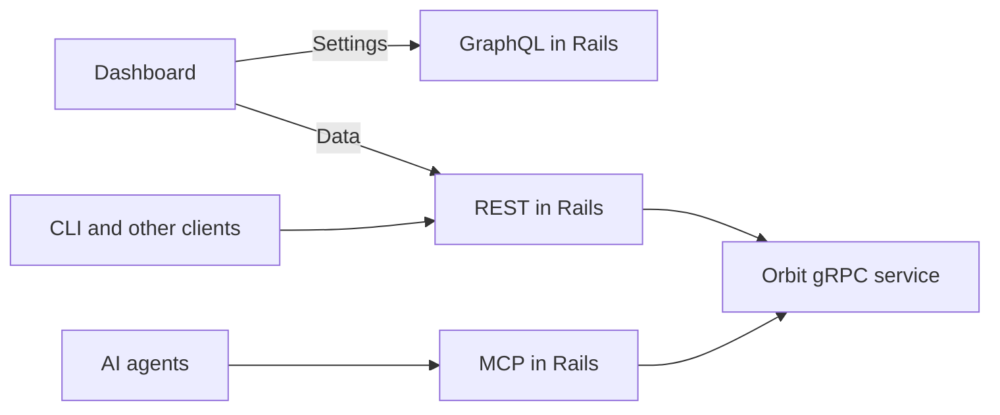

## Status

Proposed

## Date

2026-02-26

## Context

The Orbit API serves three consumers:

- The Orbit dashboard, a Vue app that renders graphs, tables, and schema views
- AI agents that call the query and schema tools through the Model Context Protocol (MCP)
- The GitLab command-line interface (CLI), which runs queries and prints them for people or for agents

The gRPC service had five operations at the time of this decision.
Two listed tools and dispatched a generic tool call.
The others ran a raw query, returned the full ontology as protobuf, and reported cluster health.

The design had these problems:

- The generic tool call added indirection for only two tools.
- The query tool and the raw query ran the same pipeline with a different formatter.
- The schema tool and the ontology operation returned the same data in a different serialization and detail level.
- No REST API existed, so the dashboard needed GraphQL or a Rails controller, agents needed MCP JSON-RPC, and the CLI had no entry point.

Both query paths ran the same steps:

```plaintext
check security -> compile -> run in ClickHouse -> extract IDs -> authorize
  -> redact -> hydrate -> format
```

## Decision

**GraphQL serves Orbit settings, and REST serves Orbit data.**



### Settings through GraphQL

A review of the first settings change showed that the existing GraphQL groups query already lists groups and supports search.
We add the Orbit enablement state to that query, so the dashboard can restore the state of each checkbox.
We do not build a new API for this list.

A dedicated Orbit mutation changes Orbit settings.
We do not use the generic group update mutation, because Orbit can get more options later.
These fields are licensed, so they live in the Enterprise Edition (EE) code.

### Data through REST

REST serves query execution, schema retrieval, health, and the tool list.
Each data endpoint returns one of two formats, for people or for agents.
Any consumer can reuse these endpoints, including the frontend, the CLI, agents, and external integrations.

### Fewer gRPC operations

We remove the generic tool call and the separate ontology operation.
The query operation and the new schema operation take a response format instead.
The service goes from five operations to four:

| Before | After |
| ------ | ----- |
| List tools | List tools |
| Generic call to the query tool | Run query, large language model (LLM) format |
| Raw query | Run query, raw format |
| Generic call to the schema tool | Get schema with expanded nodes, LLM format |
| Get ontology | Get schema, raw format |
| Get cluster health | Get cluster health |

### Agent command operations

The agent surface adds a catalog of commands that agents load on demand.
One operation lists the commands and their parameter schemas, and one runs a command.
Agents reach query language discovery and response format discovery through these two operations.
[ADR 011](011_agent_command_surface.md) describes this surface.

Two direct operations return the query language schema and the response format schema, each with its version.
These operations serve REST and API consumers that need stable structured endpoints without the command wrapper.

Two more operations list the embedded Orbit skills and return one skill.
They back typed REST endpoints in Rails.
They stay out of the agent command catalog, because skills are CLI artifacts and not MCP capabilities.

### One response format parameter

The response format answers one question: who consumes the response?
The two values are `raw` for structured data and `llm` for an LLM.

| Operation | Raw format | LLM format |
| --------- | ---------- | ---------- |
| Run query | Tabular JSON rows and query metadata | Graph Object Output Notation (GOON) with deduplicated nodes and edges that saves 25% to 50% of tokens |
| Get schema | Structured domains, nodes, edges, properties, and styles | Token-Oriented Object Notation (TOON) text |
| Get cluster health | Structured status, version, and components | TOON key-value notation |
| List tools | Tool names, descriptions, and parameter JSON schemas | Same as raw |

We leave the detailed response format specification to a follow-up ADR.
That specification covers the response envelope and the GOON encoding.
It also covers a shared JSON Schema contract between the Rust service and the Vue frontend.

### REST contract

Each endpoint requires authentication with a personal access token, a session cookie, or an OAuth token.
A feature flag gates every endpoint, and the endpoint returns not found when the flag is off.
Each data endpoint accepts the response format parameter, and raw is the default.

The query endpoint accepts a query, a query language, and a format.
The only query language at the time was a structured JSON DSL, and an OpenCypher-like language was a future option.
The response holds the result, the query type, the generated SQL strings, and the row count.
An illustrative exchange with placeholder values:

```plaintext
Request:
  format: raw
  query:  MATCH (mr:MergeRequest {state: 'merged'}) RETURN mr LIMIT 10

Response:
  result:      [{id: <id>, type: MergeRequest, title: <title>, state: merged}, ...]
  query_type:  <query type>
  sql:         [<generated SQL>]
  row_count:   <count>
```

In the LLM format, the result is GOON text and the metadata stays the same.
The query uses a bidirectional stream, and the Rails gRPC client handles the redaction exchange inside it.
The signed token carries the traversal IDs of the user, and Orbit redacts results for that user.
A query error returns bad request, and a connection error returns service unavailable.

The schema endpoint accepts an optional list of node names to expand.
Without the list, the response has domains, node summaries, and edges.
Each edge lists its source and target types.
An expanded node also has its properties, its style, and its edges in each direction.
The schema operation is unary and reads the in-memory ontology with no ClickHouse query and no redaction.

The status endpoint returns the cluster status, the version, and the status of each component.
The status operation is unary.

### Tool metadata

**The Rust service owns all tool metadata.**

The service defines the tool names, the descriptions, and the parameter JSON schemas.
The query tool description includes the full schema in TOON as context for an LLM.
Rails never copies this metadata.
Rails passes the tool list through unchanged to the MCP tool list and to the REST tool endpoint.
The only addition in Rails is a field that maps each tool name to its REST endpoint.

### MCP tool calls

The MCP tool call handler in Rails maps each tool name to one gRPC client method.
The tool names are fixed in Rails, because only two tools exist and each has its own parameter shape.
The handler rejects an unknown tool name before dispatch, as the AppSec review asked.
No dynamic method dispatch is involved.
Both tools request the LLM format.

### CLI

The CLI has commands to run a query, read the schema with optional expansion, show status, and list tools.
The human format requests raw data and renders tables in the terminal.
The LLM format prints text for piping to an agent.
Human is the default.

### Protocol changes

The run query operation is a bidirectional stream of messages.
Each message holds a request, a redaction exchange, a result, or an error.
The request carries the query string, the format, and the query language.
The result carries JSON or formatted text, and metadata with the query type, the SQL strings, and the row count.
An error carries a message and a code.
The redaction exchange is unchanged from [ADR 001](001_grpc_communication.md).

The schema response holds either the structured schema or formatted text.
The proposal also had a pagination message in the query metadata.
The shipped protocol has no pagination message, and pagination metadata lives in the formatted result body.

In the Rails gRPC client, a new schema method replaces the ontology method.
The query method gets the format and query language parameters.

**We keep no backward compatibility.**

The Rust service drops the removed operations.
All consumers move to the new operations in one coordinated deploy.

### Access control

All Orbit code in Rails lives in the EE code and behind a feature flag.
Orbit is already listed as a GitLab Premium feature.
A separate epic tracks billing, tier gating, instrumentation, and monetization.

## References

- [Orbit gRPC contract](../../../../crates/orbit-server/proto/orbit.proto)
- [ADR 001: gRPC communication protocol](001_grpc_communication.md)
- [ADR 002: Rust core runtime](002_rust_core_runtime.md)
- [ADR 011: Agent command surface](011_agent_command_surface.md)
- [Orbit settings in GraphQL, first review](https://gitlab.com/gitlab-org/gitlab/-/merge_requests/224831)
- [Review note: reuse the groups query](https://gitlab.com/gitlab-org/gitlab/-/merge_requests/224831#note_3115671286)
- [Review note: licensed fields and a dedicated mutation](https://gitlab.com/gitlab-org/gitlab/-/merge_requests/224831#note_3118324266)
- [Guidelines for implementing Enterprise Edition features](https://docs.gitlab.com/development/ee_features/)
- [Add Orbit to the Premium features](https://gitlab.com/gitlab-org/gitlab/-/merge_requests/224832)
- [AppSec review note on tool call validation](https://gitlab.com/gitlab-org/gitlab/-/merge_requests/224832#note_3116878754)
- [Orbit monetization engineering](https://gitlab.com/groups/gitlab-org/-/work_items/21198)
- [Rewrite the gRPC contract for REST API alignment](https://gitlab.com/gitlab-org/orbit/knowledge-graph/-/merge_requests/411)
- [GOON format specification](https://gitlab.com/gitlab-org/gitlab/-/snippets/4929205)
- [TOON specification](https://github.com/toon-format/spec/blob/main/SPEC.md)
- [Unified response format proposal](https://gitlab.com/gitlab-org/gitlab/-/snippets/5965027)
- [Unified response format extension with a uniform graph model](https://gitlab.com/gitlab-org/gitlab/-/snippets/5965036)
- [Duo and Orbit prompt routing architecture](https://gitlab.com/gitlab-org/orbit/knowledge-graph/-/blob/2da7a9340bb4ae77d07050e0b01f50cf507af66c/docs/design-documents/duo_orbit_prompt_routing.md)
- [Orbit GA designs in Figma](https://www.figma.com/design/GOrqDStp1E1SE0Ms7lVbXF/--588317--Orbit-GA-Designs?node-id=4066-5048)
