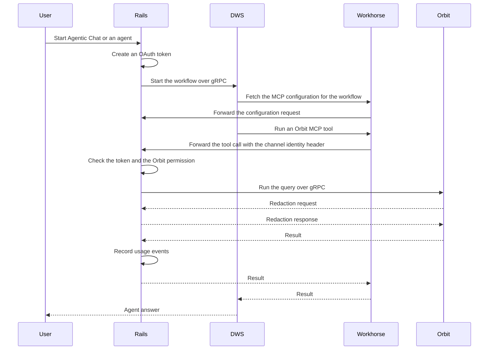

## Status

Accepted

Amended by [ADR 022](022_queries_in_rails.md): Rails now runs the query stream, and Workhorse only proxies the request.

## Date

2026-03-26

## Context

GitLab Duo Agent Platform (DAP) agents needed Orbit tools, but they had no way to reach them.
DAP runs agents in the Duo Workflow Service (DWS), a separate service with no direct connection to Orbit.

Without Orbit, a large language model (LLM) assembles answers from dozens of REST calls.
Orbit gives agents a query tool for the graph query language, a schema tool, and two tools for named commands ([ADR 011](011_agent_command_surface.md)).
One call returns relational data, so agents make fewer calls and give better answers.
Other agents already reach these tools through the Rails REST API and the Orbit Model Context Protocol (MCP) server.
[ADR 007](007_monetization_engineering.md) covers billing and usage tracking.

Orbit has four consumption channels, each with its own authentication and billing:

| Channel | Path | Authentication | Billing |
|---------|------|----------------|---------|
| DAP (DWS) | User to Rails to DWS to Workhorse to Rails (Orbit MCP) to Orbit | User OAuth token with the workflow scope | Zero-rated, bundled with the Duo seat |
| Frontend dashboard | User to Rails to Orbit over gRPC | User JSON Web Token (JWT) | Included in the license |
| Core features | Internal Rails service to Orbit | System JWT | Infrastructure, not billed |
| External agents through MCP or the GitLab command-line interface (CLI) | Agent to Rails OAuth to Orbit | OAuth and user JWT | Metered, paid add-on |

Rails creates the DWS OAuth token when the workflow starts.
The DWS executor sends all GitLab API traffic through Workhorse, and DWS makes no direct HTTP calls to Rails.
The Orbit REST API accepts the workflow scope through the same shared check as the other APIs that DWS calls.
So the integration needs no new authentication mechanism on the data plane.
The scope only admits the token type, and it covers more than Orbit.
So every Orbit route also requires the Orbit read permission.

## Decision

**Orbit is a first-class MCP server in the Duo Agent Platform.**

Rails defines the Orbit server in its MCP configuration the same way it defines the built-in GitLab MCP server.
Workhorse hosts the MCP session, and DWS uses the tools like any other MCP tools, with no tool classes of its own for Orbit.

The REST data endpoints for queries and schema stay available for other consumers.
The DAP path does not use them for tool execution.

### Why DWS calls Orbit through Rails

DWS calls Orbit through Rails, not directly, for four reasons:

1. Rails owns authorization.
   The streaming redaction protocol requires Rails to authorize each resource in a result set, and DWS cannot do that.
1. Orbit runs wherever the GitLab instance runs, including GitLab Self-Managed and GitLab Dedicated.
   DWS deployment topologies vary too.
   Rails is the one component that always sits next to Orbit and holds the authorization context.
1. DWS already reaches every other GitLab capability through Rails.
   Orbit follows the same principle, over MCP instead of native tools.
1. DWS needs no gRPC client to Orbit and no separate authentication channel.
   The only gRPC clients to Orbit live in Rails and Workhorse.

We keep Workhorse in this path on purpose.
It hosts the MCP client, finds the internal endpoint for the built-in servers, forwards session identifiers, and signs the channel identity header.
It also streams results from Orbit directly, which makes queries faster ([ADR 008](008_workhorse_query_acceleration.md)).

### First-class MCP server

For the built-in GitLab and Orbit servers, the Rails MCP configuration supplies three things:

- The authentication headers, which carry the user OAuth token
- The pre-approved tool set
- A trusted flag

Rails supplies no URL, because Workhorse resolves the internal endpoint path from the server name.
Workhorse opens the MCP session, lists the tools, and filters them against the allowlist.
It prefixes each tool name with the server name and passes the definitions to DWS.
When the agent calls a tool, DWS sends the call back through Workhorse, which proxies it to the server.

Rails marks the Orbit server trusted, and DWS derives tool trust from that flag.
So Orbit tool descriptions carry no warning banner for an untrusted source.
The name prefix is the only change to the tools.

The trusted tool set holds the query tool, the schema tool, and the two named-command tools.
A feature flag switches the visible tools between the older pair of query tools and the named-command pair.
So we can retire the older tools without a change to the transport.

The integration depends on these properties:

- DWS has no code for each tool.
  Tool loading is dynamic, and the descriptions come from the MCP tool listing, so they stay in sync with the ontology.
- Rollout and rollback use flags and need no DWS deploy.
- Custom agents in the AI Catalog can select Orbit tools like any other MCP tools.

### Gating

One Rails check controls enablement, instead of feature flag checks spread through the code.
The check has three layers:

1. Platform kill switches.
   Two feature flags disable Orbit everywhere when either one is off.
1. The MCP client flag, which controls whether Rails sends any MCP servers to DWS.
1. A user preference, with a global kill switch and one setting for each surface.
   The surfaces are Agentic Chat, the standalone Orbit agent, other foundational agents, and custom catalog agents.

When a workflow starts, Rails puts it in one of those surfaces and checks the matching rule.
If the rule passes, Rails adds the Orbit server to the MCP configuration.
If the rule fails, the entry is absent, and the agent does not learn that Orbit exists for that run.
Duo Code Review never gets Orbit, because it is flat-rate and we chose not to add Orbit to it.

### Surfaces

Each surface gets Orbit in its own way:

- Agentic Chat and the standalone Orbit foundational agent receive the Orbit MCP tools directly.
- Other foundational agents, such as the data analyst agent, receive the tools through the same injection, with guidance in their flow definitions.
- Custom catalog agents select Orbit tools for each agent.
  The injected tool list is the intersection of the agent selection and the pre-approved set.

Duo Developer takes a different route and does not use the MCP tools.
When Orbit is on for the user, Duo Developer runs an Orbit variant of its flow.
That variant is a single agent with shell access, and its system prompt includes a shared Orbit skill.
The skill teaches the agent to reach Orbit through the GitLab CLI, which is already signed in.
The agent reads the schema and the query language first, then runs queries against the same REST API as the other channels.
The CLI also serves a local graph for code structure questions about the current branch, which the remote graph does not cover.
Flows that already give the agent a shell get Orbit this way at no extra cost.
The MCP path exists for the surfaces that have no shell.

### Caller identification

Rails puts every Orbit request in one source class: frontend, DWS, MCP, REST, code intelligence, or core.
A verified session marks a browser request.
The workflow scope marks a DWS request, and the endpoint marks an MCP request.
Other authenticated callers default to REST.
The source travels to Orbit as a required claim on the JWT, and the claim matches the telemetry values.
So both sides of the gRPC boundary can report usage, query mix, and latency for each channel.

Detection by scope is enough for metrics, but a user can defeat it by extracting a workflow token and replaying it.
Zero-rating needs stronger attribution.
So Workhorse stamps Orbit calls from DWS with a short-lived signed channel header, and Rails verifies it.
[ADR 007](007_monetization_engineering.md) covers that mechanism.

### Changes to Orbit

Orbit needs no new endpoints for this integration.
[ADR 003](003_api_design.md) made Rails the REST proxy, and Orbit still serves only gRPC.
Agent capabilities, such as schema discovery and named queries, are gRPC methods.
The JWT carries the source claim, and namespace access checks and redaction work the same for every channel.

### Prompt engineering

Registering the Orbit tools is not enough, because agents also need prompt guidance.
Each tool description embeds the full query language grammar, encoded as Token-Oriented Object Notation (TOON).
So each description is a few thousand tokens long and fills the context window.
In a crowded tool list with no guidance, the agent cannot tell when to prefer them.
The prompt must cover when to prefer Orbit, when to avoid it, and how to use it well.

Orbit data is not real time.
The pipeline from PostgreSQL through Siphon change data capture, NATS, ClickHouse, and the indexer adds a short delay.
Orbit measures how far indexing lags behind, and each namespace records when it was last indexed.

Agents default to Orbit for anything that is not brand new.
They expect an empty result for entities that the user just created, and then fall back to the generic REST tool.
An agent never reports an empty result to the user as "does not exist".
An empty-result tool response is a good place for the fallback hint, so the guidance does not rely on the system prompt alone.
Full file contents, job logs, and diffs are not in the graph, so agents use the standard tools for them.

The schema tool supports progressive disclosure in two steps.
The first call, with no arguments, returns a compact list of domains, node types, and edge types.
A second call returns full property and relationship detail for the named types only.
Agents expand everything only when the user asks to describe the whole schema.

Prompts for Orbit-aware agents teach these points:

- When to use Orbit: questions across entity types, aggregations, relationship traversals, search across entities, neighbor discovery, and path finding
- When to use standard tools: new entities, file contents, job logs, diffs, live pipeline state, live deployment state, and resources given by URL
- How to query: discover the schema first, expand only the relevant nodes, respect the server limits, filter early, and read results as TOON

The server limits cap the number of hops, the number of results, and the number of node IDs in each selector.
Guidance in flow definitions must agree with the server limits and with itself.
A prompt that names the wrong depth limit, or that encourages expansion of the whole schema, makes agents worse.
We treat such a prompt as a defect.

Orbit prompt content lives inline in the DWS flow configurations and in a shared skill partial, next to the agent definitions.
So prompts stay pinned with the flow version, prompt changes get review in one place, and no workflow fetches prompts at runtime.
The Orbit repository documents the intended guidance, and the flow definitions are the runtime source of truth.

## Benefits of this approach

- Agents get relational answers in one tool call instead of a chain of REST calls.
- New Orbit capabilities reach agents with no deploy of DWS or Rails.
  Examples are named commands and schema changes.
  Agents fetch tool descriptions at session start.
- Gating for each surface and user preferences allow a gradual rollout and a quick kill.

## Consequences

- Latency expectations must cover the full round trip through DWS, Workhorse, Rails, and Orbit, not only query execution.
  Single-entity lookups return quickly.
  Multi-hop traversals and aggregations can be much slower and can reach the query timeout.
- The MCP JSON-RPC framing adds overhead compared with a direct REST call.
  Workhorse query acceleration recovers most of it on the expensive path.
- The MCP server and the prompts control tool behavior such as caching, retries, and error shape, and no custom DWS code does.

## Why not the alternatives

### Native DWS tools

DWS would get Orbit tool classes that call the Orbit REST API directly.
A dedicated agent privilege would register them, and the Rails built-in tool catalog would list them.
We rejected this for three reasons:

- It duplicates tool definitions in DWS classes, Rails catalog entries, and Orbit descriptions.
- It needs explicit logic to fetch descriptions, which MCP provides at no cost.
- It ties Orbit changes to DWS and Rails deploys.

### Direct connection from DWS to Orbit

DWS would get its own gRPC client to the Orbit server.
We rejected this because Rails owns authorization and the redaction protocol.
Also, cloud services cannot reach the Orbit server in GitLab Self-Managed and GitLab Dedicated topologies.

### Prompts served by Orbit

A REST endpoint would serve agent prompt content, so the Orbit team could change prompts without a change to flow definitions.
We rejected this in review.
Prompts in flow definitions are version-pinned, reviewable, and traceable.
A runtime prompt fetch would break pinning and add a query to every workflow.

## References

- [ADR 003: Orbit API design (unified REST and GraphQL)](003_api_design.md), Rails as the REST proxy
- [ADR 007: Orbit monetization engineering](007_monetization_engineering.md), billing, quotas, and channel attribution
- [ADR 008: Workhorse query acceleration](008_workhorse_query_acceleration.md)
- [ADR 011: Agent command surface](011_agent_command_surface.md), the named-command tools
- [ADR 012: GOON format](012_goon_format.md)
- [ADR 022: Run Orbit queries in Rails instead of Workhorse](022_queries_in_rails.md)
- [Duo and Orbit prompt routing architecture](https://gitlab.com/gitlab-org/orbit/knowledge-graph/-/blob/2da7a9340bb4ae77d07050e0b01f50cf507af66c/docs/design-documents/duo_orbit_prompt_routing.md), the consumer-side map of the Rails routing seams
- [Security](https://gitlab.com/gitlab-org/orbit/knowledge-graph/-/blob/2da7a9340bb4ae77d07050e0b01f50cf507af66c/docs/design-documents/security.md), the redaction and authorization model
