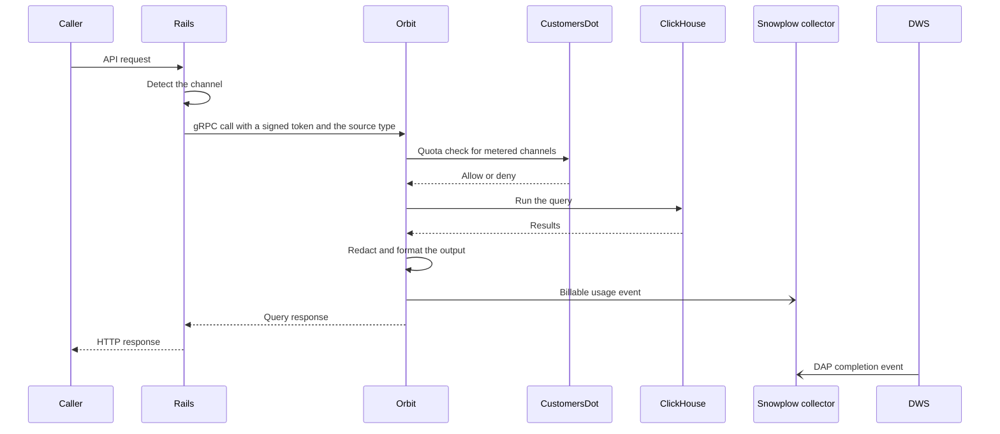

## Status

Draft

## Date

2026-03-26

## Context

Orbit needed a way to bill queries by channel that users cannot fake.
Orbit has four consumption channels, and each deployment type bills them differently.
GitLab Duo Agent Platform (DAP) agents call Orbit through the Duo Workflow Service (DWS).
The frontend dashboard calls Orbit for a user in the browser.
Core callers are internal services, such as the indexer.
External callers use the Model Context Protocol (MCP) endpoint, the GitLab command-line interface (CLI), or the REST API.

| Channel | Request path | Authentication | GitLab.com and GitLab-hosted Dedicated | Customer-hosted GitLab Dedicated | GitLab Self-Managed |
|---|---|---|---|---|---|
| DAP | User to Rails to DWS to Rails to Orbit | OAuth token with the workflow scope, plus a signed service token from Phase 3 | Zero-rated, bundled with the Duo seat | Included, seat-based | Included, GB-based fee |
| Frontend | User to Rails to Orbit | User JSON Web Token (JWT) | Included in the license | Included in the license | Included in the license |
| Core | Rails service to Orbit | System JWT | Not applicable, infrastructure | Not applicable, infrastructure | Not applicable, infrastructure |
| External | Agent to Rails OAuth to Orbit | OAuth and user JWT | Metered per query with credits | Metered per query with credits | Included, GB-based fee |

On GitLab.com and GitLab-hosted Dedicated, DAP usage is zero-rated and MCP and CLI usage is charged.
So a user must not be able to make a query look like DAP traffic to get it free.
GitLab Self-Managed and customer-hosted GitLab Dedicated have no per-query billing today, so the channel is for analytics only.
Their pricing model can change, so instrumentation covers every deployment and the billing pipeline can extend to them later.

## Decision

**The service that executes the work emits the billing event, and Rails only acts as a proxy.**

Orbit emits one billable event for each query.
The indexer will emit volume events where GB-based pricing applies.
The AI Gateway and DWS keep their own DAP completion event, and they do not annotate Orbit calls.

We split the work into four phases:

1. Instrumentation, in April: Rails sends the source type, and Orbit emits billable events and checks quota before each metered query.
1. Tier enforcement, in April and in parallel: every Orbit endpoint requires GitLab Premium or GitLab Ultimate.
1. Zero-rate enforcement, in May, after Phase 1: a signed service token proves that a request came from DWS.
1. CustomersDot billing pipeline, from May to June: flat-rate multiplier pricing in CustomersDot, plus a credits dashboard.

Phase 1 needs no AI Gateway work.
Phase 3 depends on Phase 1, because events must exist before their tags need to be accurate.
Phase 4 depends on Phase 1 for the events and on Phase 3 for a trusted channel.

The phases apply to each deployment type as follows:

| Deployment | Instrumentation | Tier gate | Zero-rate enforcement | CustomersDot billing |
|---|---|---|---|---|
| GitLab.com | Yes | Yes | Yes | Yes, credits |
| GitLab-hosted Dedicated | Yes | Yes | Yes, with the tenant secret | Yes, credits |
| Customer-hosted GitLab Dedicated | Yes, analytics only | Yes | No, seat-based pricing | No |
| GitLab Self-Managed | Yes, analytics only | Yes | No, GB-based fee | No |

### Source type

Rails sends the source type to Orbit only as a claim in the signed JWT, and never as a field in the gRPC request body.

Rails signs the JWT with the shared secret, so Orbit can trust the claim.
Any caller could set an unsigned body field, so it would carry no trust.
The claim is required, so Orbit rejects a token without it and reads an unknown value as REST.
The source types are frontend, DWS, MCP, core, REST, and code intelligence.

| Source type | Caller | How Rails detects it |
|---|---|---|
| MCP | MCP clients and the GitLab CLI | The request reaches the MCP endpoint, which is its own endpoint class, so the channel is MCP by definition |
| Core | Internal services, such as the indexer | The request reaches the internal API, which accepts only an indexer token |
| Frontend | The browser | The cross-site request forgery (CSRF) token matches the session |
| DWS | DAP agents | In Phase 1, the OAuth token has the workflow scope. In Phase 3, the request carries a valid Workhorse-signed token. |
| REST | External REST callers with a personal access token or OAuth | None of the other checks match |

The MCP and internal endpoints set the source type from the endpoint itself.
On the REST endpoints, Rails checks the CSRF token first, and then the OAuth scope.
In Phase 3, the Workhorse-signed token check comes first.

Only the Rails workflow services create tokens with the workflow scope, and users cannot create personal access tokens with it.
A user can still copy a short-lived DWS token from the browser developer tools and call the API directly.
That risk is acceptable for Phase 1 analytics, and Phase 3 closes it.

Orbit uses the source type in three places:

- The billable event, as an Orbit feature name for each source type
- The quota check, which runs only for MCP and REST
- The quota metrics and the query analytics context, so dashboards show quota decisions and billing volume by channel

Query pipeline latency metrics stay labeled by query type.

### Billing attribution

An Orbit query has no namespace context, because every query covers all top-level namespaces that the user can access.
Rails must resolve the billing namespace before it calls Orbit.

Each user has an Orbit governing namespace preference, and Rails sends it as the root namespace claim.

The candidates are the Premium or Ultimate namespaces where the user is a member.
If exactly one candidate exists, Rails sets the preference without asking.
If the preference is empty and more than one candidate exists, MCP and REST queries return an error that points to the setting.
The setting is in the user preferences, next to the Duo default namespace selector, and shows only when the user has more than one candidate.
Rails resolves the preference on the server for each request, and Orbit reads only the signed claim.

A GitLab.com request with no root namespace claim skips the quota check, and Orbit drops its billing event.
CustomersDot attributes GitLab.com usage to the root namespace, so neither can work without it.
Rails should block these requests before they reach Orbit.

We accept that every Orbit event bills to the governing namespace, even when the user queries content in other namespaces.

### Billable events

Orbit emits each event after a successful query execution.
One conversion point in the billing code turns the token claims into billing inputs.
The event carries these fields:

| Field | Source | Content |
|---|---|---|
| Realm | Token claims | GitLab.com or GitLab Self-Managed |
| User and global user ID | Token claims | Caller identity |
| Root namespace | Token claims, governing namespace | Attribution on GitLab.com |
| Organization | Token claims | Attribution |
| Instance and unique instance ID | Token claims | Attribution on GitLab Self-Managed and Dedicated |
| Feature name | Source type | One Orbit feature name for each source type |
| Unit and quantity | Constant | One request for each query |
| Metadata | Pipeline context and server build | Query type, Orbit version, compile time, execute time, and row count |

Delivery is asynchronous: Orbit queues events in memory, sends them from a background task, and drains the queue at shutdown.
The billing drain and the analytics drain run at the same time, so a slow collector on one side does not delay the other.

The planned indexer events report, for each indexing batch, the namespace, the rows written, the bytes written, and the entity type.
They drive GB-based pricing on GitLab Self-Managed.

### Event transport

Orbit sends billable events as Snowplow structured events through the shared LabKit event library.
Each event carries the self-describing billable usage context.
The Data Insights Platform ingests the events, and the hourly CustomersDot mediation processes them.

Orbit authenticates to the collector with tokens, because Orbit has no static egress IP addresses for an allowlist.

On GitLab.com, Orbit mints OpenID Connect (OIDC) tokens from its workload identity.
GitLab Self-Managed and Dedicated have no workload identity.
There, Orbit pulls the Cloud Connector instance token from an internal Rails endpoint and sends it in the authorization header.
CustomersDot mints that token, and Rails stores it.
A token claim for each request would not work, because indexer events come from change data capture and scheduled jobs with no request token.

Orbit caches the instance token in memory and refreshes it on the send path:

- Orbit refreshes the token some time before it expires, with jitter.
  The token lives for days, so each pod calls Rails about once for each token.
- If a fetch fails and a cached token exists, Orbit keeps the cached token and waits a short time before it calls Rails again.
- The same wait applies when Rails returns a token that is close to expiry, so a fetch does not happen for each event.
- Before the first token arrives, every call retries immediately, because no token exists to protect.
- While the cached token is valid, a fetch has a short timeout, so a hung Rails cannot stall the billing send loop.
- With no valid token, the fetch waits for the client timeouts, because the collector rejects an expired token anyway.
- If the token has expired and Rails cannot supply a new one, Orbit sends the expired token.
  The hosted collector rejects it, so GitLab sees the error instead of it staying hidden on the customer instance.

### Quota check

Before it runs a query on a metered channel, Orbit asks CustomersDot whether the namespace has credits, and it fails closed.

The check runs before the query pipeline, and only for MCP and REST, because they are the charged channels.
The other channels are zero-rated or included, so they skip the check.

On GitLab.com, Orbit authenticates to CustomersDot with admin credentials.
GitLab Self-Managed and Dedicated cannot hold those credentials.
There, Rails adds the checksum of the online cloud license to the token, and Orbit sends it to CustomersDot.
A request without the checksum skips the check.
Orbit never logs or re-serializes the checksum.

Orbit caches each decision for each namespace, so most requests skip the round trip.
The time to live (TTL) comes from the cache headers of CustomersDot, with a default when the header is absent.
A small jitter stops entries from expiring across the fleet at the same time.
Orbit caches both allow and deny decisions, but not a failed check, so the next request tries CustomersDot again.
Orbit does not follow redirects, and each request sends the Orbit version and the correlation ID.

Only a 200 response from CustomersDot allows the query.
A 402 denies the query, and so does every other result: 401, 403, 422, any other status, a timeout, or a connection failure.
This matches the AI Gateway, which denies on any quota-check error.
So an outage or a rejected credential cannot turn into usage without a charge.
A denied check returns the gRPC resource exhausted status with the credits-exhausted reason, and Workhorse maps that reason to a 402.
A failed check returns the same status and reason, but its message says that Orbit could not verify credits.
Metrics record failed checks as a separate fail-closed decision.
Orbit logs any block reason that CustomersDot sends, for cached denials too.

An enforced build validates the billing configuration at startup.
The build exits unless all of these conditions are true:

- Billing and the quota check are on.
- The CustomersDot and collector URLs are one built-in production or staging pair.
- The quota and billing authentication modes belong to the same family.

The enforcement flag is set at compile time, so the deployed configuration cannot turn it off.

### Tier enforcement

Every Orbit endpoint requires the Orbit licensed feature, which is part of GitLab Premium.
This covers the query, schema, tools, MCP, and health endpoints, the GraphQL update mutation, and the admin namespace pages.
The MCP endpoint already had the check, and the health endpoint can be exempt because health checks are admin-only.
On GitLab.com, Rails checks the license of each top-level namespace.
On GitLab Self-Managed, Rails checks the instance license, and no per-query billing applies.
The Orbit feature flag stays as a kill switch next to the tier gate.

### Zero-rate enforcement

Zero-rate enforcement applies only to GitLab.com and GitLab-hosted Dedicated, where per-query credit billing is active.

Workhorse stamps a short-lived signed token on DWS calls to Orbit, and Rails classifies a request as DWS only when the token is valid.

Workhorse signs the token with the existing Workhorse-to-Rails secret.
Rails checks the signature, the expiry, and the claim that marks the request as DWS traffic.
Rails still runs a request without a valid token, but tags it as frontend or REST.
A valid token proves that the request came through the DWS path.
A token with the workflow scope proves only that a workflow token was issued.

The secret lives only in Workhorse and Rails, so users cannot forge the token, and DWS manages no secret.
The secret already exists in every deployment that runs Workhorse, so Phase 3 adds no new secret for each tenant.

### CustomersDot pricing

Orbit follows the flat-rate pricing pattern of the static application security testing (SAST) flows.
CustomersDot applies a multiplier to each event by source type:

- An MCP event is charged with a flat credit multiplier, such as one credit for each query.
- A DWS event has a zero multiplier.
- A frontend or core event is not billed.

Attribution uses the root namespace on GitLab.com and the instance ID on Dedicated.
The query type is for analytics only.
The credits dashboard shows Orbit as its own line item.
The line item shows the total queries in the billing period, the split by channel, and the credit spend.

**A DAP workflow that calls Orbit is zero-rated by the multiplier, and no event is suppressed or annotated.**

The DAP completion event stays the billable event for DAP usage itself.
Each event stands alone with its own source type, which sets its multiplier.
We dropped an earlier design that marked the DAP event with a flag when it called Orbit.

### SOX compliance

Orbit billing code falls under the Sarbanes-Oxley (SOX) IT general controls (ITGC).
The existing controls cover the AI Gateway, the Data Insights Platform, ClickHouse, and the Google Cloud infrastructure.
Orbit billing code joins one or more of these control sets.

| Control family | Controls |
|---|---|
| Access to programs and data, LA.1 to LA.5 | Code owners on billing files, a quarterly review of who can merge to those paths, and single sign-on (SSO) enforcement |
| Program changes, PC.1 to PC.3 | Code owner approval before a billing change merges, a monthly audit log review for separation of duties, and limited production deploy access |
| Computer operations, CO.1 to CO.2 | Restricted access to billing continuous integration (CI) jobs, and job monitoring with documented issue resolution |

We limit the scope to code owner rules on the billing paths, so the full Orbit repository stays out of SOX scope.
Billing event emission lives in its own module, with one conversion point from token claims to billing inputs, so the audit surface stays small.
Code owner rules require approval from the billing owners for the module and the conversion point, which satisfies PC.2 and LA.4.
[ADR 020](020_billing_sox_scope.md) records the detailed scope.

## Consequences

- Correlation IDs still flow from Rails to Orbit in gRPC metadata for logs and traces, and billing does not use them.
- The credit cost of an Orbit query is a product and pricing decision, informed by Phase 1 data.
  The infrastructure does not depend on the number.
- Different query rate limits for Premium and Ultimate need a product decision first, and then a follow-up.
- Phase 2 decides whether Orbit gets its own Cloud Connector unit primitive, separate from DAP.
- If GitLab Self-Managed or customer-hosted GitLab Dedicated moves to usage-based pricing, the signed-token approach must change.
- Phase 3 must confirm that the Workhorse token covers every DWS entry point to Orbit.
- Phase 3 must also set the token expiry and replay window for long-running DAP workflows.

## Why not the alternatives

### Emit billing events from Rails

Rails is only a proxy, and Orbit has execution data that Rails does not see: latency, result count before redaction, and cache hits.
Emission from Orbit also matches the billing service connection pattern for other Rust and Go services.

### Suppress events for zero-rated channels

Fulfillment requires an event for every access, as agreed at the zero-rating meeting.
Zero-rating is a multiplier in CustomersDot, and it does not suppress events.

### Use only the workflow scope for zero-rating

A user can copy the token from the browser developer tools and call the API directly.
The scope is enough for Phase 1 analytics, but billing needs the signed service token.

### Link DAP and Orbit events with correlation IDs

CustomersDot would suppress the Orbit charge when it saw a matching DAP event.
At the zero-rating meeting, Fulfillment confirmed that CustomersDot does not support this.
CustomersDot uses correlation IDs only for logs and traces.
Each billing event must carry its own source type to set its multiplier.

### Check quota in Rails

Rails already has CustomersDot subscription data.
Orbit already emits billable events and integrates with CustomersDot, so it can run the check itself.
The check in Orbit keeps the billing logic with the service that runs queries, and it adds no latency to the Rails proxy.
This matches the AI Gateway, where the executing service owns quota enforcement.

### Use Cloud Connector instance tokens for Rails-to-Orbit authentication

Rails and Orbit run side by side, so a shared signing secret is enough.
Cloud Connector serves GitLab Self-Managed and Dedicated instances that reach GitLab cloud services over the internet.
Orbit runs next to the GitLab instance, and it is not a central cloud service.
If Orbit becomes an add-on that customers buy separately, the right path is to register an Orbit query unit primitive in Cloud Connector.
That registration would come at general availability (GA).
CustomersDot can then control Orbit access through subscription status, in addition to the current approach.

### Reuse the Duo default namespace

The Duo setting carries governance meaning, such as tool policies and AI controls, that Orbit does not inherit.

### Infer the namespace for each request

Every Orbit query covers all top-level namespaces of the user by design, so a request has no single namespace.

## References

- [Integrate monetization in Orbit](https://gitlab.com/groups/gitlab-org/-/epics/21198)
- [Build Orbit core distributed system](https://gitlab.com/groups/gitlab-org/-/epics/20357)
- [Orbit instrumentation for usage billing](https://gitlab.com/groups/gitlab-org/-/epics/20762)
- [Add the Orbit and Duo Agent Platform integration ADR](https://gitlab.com/gitlab-org/orbit/knowledge-graph/-/merge_requests/709)
- [ADR 006: Orbit and DAP integration](006_dap_integration.md)
- [ADR 020: SOX scoping for billing event emission](020_billing_sox_scope.md)
- [Zero-rating meeting notes, 2026-03-11](https://docs.google.com/document/d/1JbzhTtlF4rDMhmIjNkmDwLQyLovRmDlaGprw5yc-rOw)
- [GA launch super document](https://docs.google.com/document/d/1UD5E_53bMfX6IYRVu41KGZ7NGh-wObXrOA0EizI_d0U)
- [Connect the billing service with Orbit with OIDC tokens for LabKit](https://gitlab.com/gitlab-org/orbit/knowledge-graph/-/issues/307)
- [Add JWT-based authentication for incoming platform requests](https://gitlab.com/gitlab-org/analytics-section/platform-insights/core/-/work_items/98#note_3108588468)
- [Add an OIDC-based authentication stack for incoming platform requests](https://gitlab.com/gitlab-org/analytics-section/platform-insights/core/-/merge_requests/106)
- [Decide the default enabled namespace for Orbit usage billing](https://gitlab.com/gitlab-org/orbit/knowledge-graph/-/work_items/471)
- [Rails monolith tier gating](https://gitlab.com/gitlab-org/orbit/knowledge-graph/-/issues/221)
- [Tamper-proof DWS channel detection for zero-rated Orbit billing](https://gitlab.com/gitlab-org/orbit/knowledge-graph/-/issues/501)
- [Stamp a Workhorse-signed JWT on DuoWorkflow Orbit calls](https://gitlab.com/gitlab-org/gitlab/-/merge_requests/242241)
- [Validate the Workhorse JWT to classify DWS Orbit requests](https://gitlab.com/gitlab-org/gitlab/-/merge_requests/242242)
- [Implement flat-rate pricing for SAST false positive detection](https://gitlab.com/gitlab-org/gitlab/-/issues/592304)
- [Add flat-rate multiplier pricing for Orbit billable events](https://gitlab.com/gitlab-org/gitlab/-/issues/593193)
- [Update the credits dashboard to display Orbit billable events](https://gitlab.com/gitlab-org/gitlab/-/issues/593194)
- [Cloud Connector architecture](https://docs.gitlab.com/ee/development/cloud_connector/architecture.html)
- [SOX ITGC controls spreadsheet](https://docs.google.com/spreadsheets/d/1BGTZAriUYIubEJcVHoYqmXm7FLoqQcNiPJkylZidkeY/edit?gid=121873557#gid=121873557)
- [Determine SOX compliance scope and controls for Orbit billing event emission](https://gitlab.com/gitlab-org/orbit/knowledge-graph/-/issues/507)
