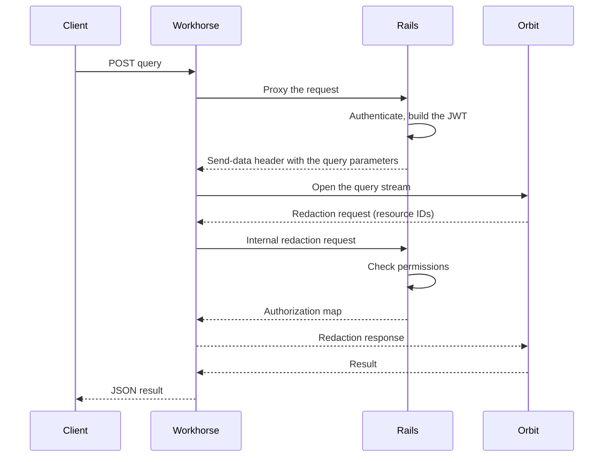

## Status

Superseded by [ADR 022](022_queries_in_rails.md).

## Date

2026-03-29

## Context

Every Orbit graph query holds a Rails Puma worker for the full duration of a bidirectional gRPC stream.
The request flows this way:

1. The client sends a query to the Orbit query API, or a query tool call to the Orbit MCP endpoint.
1. Workhorse proxies the request to Rails.
1. A Puma worker authenticates the user, builds a JWT, and opens a bidirectional gRPC stream to the Orbit server.
1. The Orbit server compiles and runs a ClickHouse query.
   It sends back a redaction request, a batch of resource IDs that need permission checks.
1. Rails loads each resource, checks the permission, and sends a redaction response.
1. The Orbit server filters the results, hydrates node properties, and returns the final result.
1. The Puma worker writes the response and is released.

The Puma worker stays blocked for the full round trip: compilation, ClickHouse execution, the redaction exchange, and hydration.
Median latency for basic graph queries was about 500 ms.
Larger queries, such as row scans with redaction, took 7 to 8 seconds.
In a staging load test at 1,000 requests per second, Puma saturation reached 70%.
At 150 requests per second, three failures appeared: gRPC deadline errors, bad gateway errors from NGINX, and ClickHouse out-of-memory errors.

Puma workers are finite.
Each one is a thread that cannot serve other requests while it waits on a gRPC stream.
Orbit query traffic grows, mainly from AI agents on the MCP endpoint.
More traffic means more threads that wait on ClickHouse and redaction.

The Model Context Protocol (MCP) endpoint handles JSON-RPC calls and has the same problem.
A query tool call opens the same bidirectional stream and blocks Puma the same way.
MCP uses OAuth with an Orbit MCP scope instead of standard GitLab authentication, but the gRPC layer is the same.
AI agents call the query tool repeatedly, so MCP generates more sustained streaming load than the REST endpoint.

## Decision

**Workhorse runs the Orbit query stream, and Rails keeps authentication, feature flags, and JWT construction.**

Workhorse calls back to Rails only for short redaction checks.
The handoff uses the standard Workhorse send-data pattern.
Rails authenticates the request and returns a response header with an operation prefix and encoded parameters.
Workhorse reads the header, drops the Rails response body, and runs the operation itself.
Workhorse already uses this pattern for Gitaly gRPC streams, file downloads, and the dependency proxy.
We add a prefix for Orbit queries.

Puma handles two short calls instead of one long call.
The first call takes about 10 ms and returns the connection parameters.
The second call takes about 50 ms and runs the permission checks for redaction.
The gRPC stream lives in Workhorse, a Go process that serves concurrent connections with goroutines instead of threads.

### The Workhorse query handler

A new Workhorse handler runs the stream.
Most existing send-data handlers only read from an external source, such as Gitaly or a URL.
This handler must also call back to Rails during the stream, so it makes signed internal requests to Rails.

The handler does these steps:

1. Decodes the parameters from Rails: the Orbit server address and JWT, the query, the format, a timeout, and an optional MCP request ID.
1. Applies the timeout, which has a default and an upper cap.
1. Reuses a cached gRPC connection for the address, and replaces a connection that has failed.
1. Opens the stream with the JWT as gRPC metadata and sends the query.
1. Handles each message from the stream until the result arrives.

On a redaction request, the handler forwards the original user credentials to the internal Rails redaction endpoint.
It returns the authorization map to the Orbit server.
On a result, the handler writes the JSON response.
For an MCP call, the handler wraps the result in a JSON-RPC response that holds an MCP tool result.
On an error, the handler maps the Orbit error class to an HTTP status.
Compile and validation errors become client errors.
Execution and internal errors become bad gateway errors, and timeouts become gateway timeouts.

Rails builds the JWT when it builds the send-data header.
The authorization context computes the user's traversal IDs, compacts them to a capped list, and caches them for a few minutes.
The timeout comes from the instance configuration, with an environment variable fallback and a default.

### Internal redaction endpoint

A new internal Rails endpoint answers the redaction callback from Workhorse.
It requires Workhorse request signing and a valid user session.
Workhorse forwards the original client credentials, so Rails identifies the user without a user ID parameter.
The endpoint also accepts OAuth tokens with the Orbit MCP scope, which covers MCP clients.

A request lists resource types, each with its IDs and the ability to check.
The response maps each ID to an authorized or unauthorized result.
The endpoint rejects a request with a duplicate resource type.
It calls the shared redaction service for batch permission checks and records metrics for duration, batch size, and filtered count.

The precomputed member access map gives each namespace that the user can access with the highest access level.
On large instances, the map can have millions of entries.
So the map cannot cross the HTTP boundary from Workhorse to Rails.
The computation stays inside the Rails redaction request:

1. In the send-data call, Rails computes traversal IDs and caches them for a few minutes.
   The JWT embeds the compacted traversal IDs.
1. In the redaction call, Rails reads the same cache.
   The group lookup fills the member access levels into the request store, and the redaction service reads them.

All of this happens in one Rails request, and nothing goes over the wire.
Workhorse passes only the user credentials and the resource IDs.

### gRPC client and contract

The Go gRPC client in Workhorse uses the same channel settings as the Ruby client.
The settings cover keepalive, message size limits for large results and redaction batches, and the standard Workhorse tracing, correlation ID, and metrics interceptors.
Server-side connection rebalancing comes from a maximum connection age on the Orbit server.
We also raised the Ruby client streaming timeout and gave it the same keepalive and message size settings.

Workhorse imports the generated Go protobuf types from a Go module that the Orbit repository publishes.
A change to the gRPC contract requires a new module version in Workhorse.

### Transport security

The design has three network legs:

| Leg | Security |
|-----|----------|
| Client to Workhorse | TLS terminated by NGINX or Workhorse, as before |
| Workhorse to Orbit over gRPC | TLS when the configured address uses a TLS scheme, plaintext otherwise, as in the Ruby client |
| Workhorse to the Rails internal API | The shared Workhorse secret signs the request, as for other internal callers such as Gitaly |

In production, Orbit runs in the same cluster as Workhorse, and the Istio service mesh handles mutual TLS.
So only local development uses the plaintext path.

The Orbit JWT holds the user identity and traversal IDs.
Rails puts it in the send-data response header to Workhorse.
That header never leaves the machine, because it travels over the Unix socket or loopback connection between Puma and Workhorse.
Workhorse then sends the JWT to Orbit as a bearer token in gRPC metadata over the internal network.

### Scope

The query API and the MCP query tool move to Workhorse.
Both use bidirectional streaming, and the MCP tool carries the AI agent traffic.
The schema, tools, and status APIs stay in Rails.
They are fast unary calls that do not hold Puma workers for long.

The Orbit server does not change.
The gRPC protocol is the same for a Rails or a Workhorse client, including the JWT format, metadata, stream messages, and the redaction handshake.
The gRPC contract does not change, and we compile it for Go.
The Orbit query pipeline runs the same way.

The existing instance-level Orbit infrastructure feature flag gates the Workhorse path.
That flag gates all Orbit internal endpoints, so the rollout needs no other mechanism.

## Consequences

The improvements are:

- Puma workers are free in about 10 ms instead of 500 ms to 8 seconds.
  On staging, this would have prevented the 70% saturation at 1,000 requests per second.
- Orbit query volume can scale apart from the size of the Puma worker pool.
- AI agents can call the MCP query tool often without starving other Rails endpoints.
- The design reuses the send-data pattern that Workhorse already uses for Gitaly gRPC streams.
- The internal redaction endpoint makes the authorization contract explicit and testable on its own.

The costs are:

- Debugging now spans three processes instead of two.
  Correlation IDs must propagate through all three legs.
- We must compile the gRPC contract for Go and keep it in sync with the Rust source.
  A contract change needs an update to both the Rust server and the Go client.
- The bidirectional stream is more complex than existing handlers, which use server-streaming or unary Gitaly calls.
  The callback to Rails during a stream is new for Workhorse.
- We must remove the synchronous Rails path after the Workhorse path is stable, so we do not keep two implementations.

## Why not the alternatives

### Keep the synchronous Rails flow and optimize redaction further

The redaction preloading work cut SQL queries from 348 to 5 for 100 projects.
Redaction is still the main bottleneck and takes most of the end-to-end latency in large queries.
The move to Workhorse does not make redaction faster.
It frees the Puma thread while the slow parts run, so other Rails requests do not starve.
We need both changes.
Faster redaction cuts total latency, and the move to Workhorse cuts thread use.

### Workhorse intercepts the route

In the GitLab Observability Backend proxy pattern, Workhorse intercepts the route before Rails.
It makes an internal authorization call and then proxies to the upstream service.
This pattern works, but it needs a separate internal authorization endpoint.
It also duplicates the feature flag and permission checks that already exist in the Rails API.
Send-data is simpler, because the request still goes through Rails first.
Authentication, feature flags, and JWT construction stay in the existing code path.

### Replicate authorization in Orbit

The Orbit server would replicate the full Rails permission model, which removes the redaction callback.
That model covers group hierarchies, custom roles, SAML, and organization membership.
We would rebuild the declarative policy framework and keep permission data in sync.
Two authorization implementations give authorization bugs two places to hide.
Orbit does not own authorization.

### Async job queue with polling

Rails would put the query in a Sidekiq job, return a job ID, and let the client poll for results.
This removes the Puma block.
It adds polling latency, job queue contention, and a more complex client contract.
The Workhorse design keeps the request and response model that clients already use.

### Expose Orbit directly

Clients could call the Orbit query endpoint directly, without Workhorse or Rails.
Orbit would then need its own authentication and authorization, which is out of scope here.
We may consider it later.
The Workhorse design is the intermediate step that removes the Puma bottleneck and keeps authorization in Rails.

## References

- [Use workhorse pattern for Orbit graph queries](https://gitlab.com/gitlab-org/gitlab/-/merge_requests/229394)
- [Move GKG queries to Workhorse](https://gitlab.com/gitlab-org/orbit/knowledge-graph/-/work_items/349)
- [ADR 001: gRPC communication protocol](001_grpc_communication.md), the bidirectional streaming redaction exchange that this decision builds on
- [ADR 022: Run Orbit queries in Rails instead of Workhorse](022_queries_in_rails.md)
