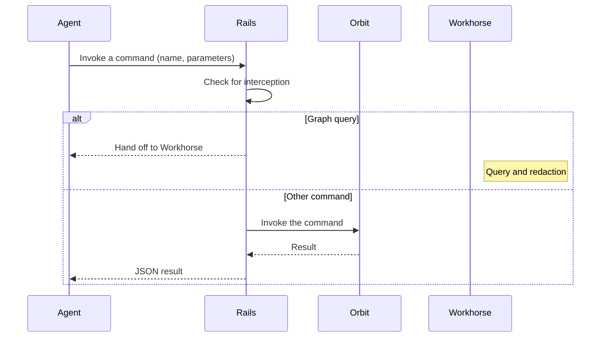

## Status

Accepted

Amended by [ADR 022](022_queries_in_rails.md): Rails now runs the query stream, and Workhorse only proxies the request.

## Date

2026-05-06

## Context

Orbit exposed agent tools through its gRPC service, through Rails REST endpoints, and through Model Context Protocol (MCP) tools in Rails.
Each tool had a hand-written description and a JSON Schema.
That worked for GitLab Duo and Agentic Chat, but it failed when external coding agents such as Claude Code, OpenCode, and Codex used it.

Claude Code truncates long tool descriptions.
The query tool description embedded the full query grammar, so the grammar was cut off mid-token and agents wrote invalid queries.
The schema tool returned no property descriptions.
Agents could not tell that a property held a coarse category, and they guessed filter values that did not exist.
No endpoint returned the response JSON Schema or its version, which coding agents need to process query results.

Every new tool needed changes in Orbit, Rails, and the agent prompts, with three review queues.
We added one tool every few months, and we wanted to ship changes several times a week.

The query tool could not move into the Orbit executor, because it needed context that only Rails had.
It ran through Workhorse to stream results and to redact them, which means to remove the results that the caller cannot see.

We already used the lazy-mcp pattern internally.
It puts a catalog of typed commands behind two tools, one for discovery and one for invocation.
We applied the same pattern to Orbit, with one change: Rails must handle the commands that need Rails context.

## Decision

**Agents see two MCP tools, one to list commands and one to invoke a command, backed by a typed command registry in Orbit.**

Rails intercepts the commands that depend on Rails-only behavior.
Every other command goes directly to Orbit.

### Surface in each layer

| Layer | Surface |
|---|---|
| MCP tool list | The two command tools only |
| MCP tool call | Routed through the invoke tool |
| Agent REST | One endpoint to list commands and one to invoke a command by name |
| UI and programmatic REST | The structured query, schema, status, and tool endpoints, unchanged |
| Orbit gRPC | New methods to list and invoke commands, return the query grammar and response format, and serve skills, next to the existing methods |

The agent REST endpoints sit in a hidden, agent-only namespace.
Orbit can change the command catalog at any time without breaking dashboards or hand-written clients, which use the structured endpoints.

### Command catalog

Each command has a name, a short description, and a JSON Schema for its parameters.
Orbit already used the same shape for MCP tools.
The first catalog had four commands:

| Command | Runs in | Reason |
|---|---|---|
| Graph query | Rails hands off to Workhorse, which calls Orbit | Needs Workhorse streaming and the two-way redaction exchange |
| Graph schema | Orbit executor | Ontology lookup with no Rails context |
| Query language | Orbit executor | Returns the grammar and its version |
| Response format | Orbit executor | Returns the response JSON Schema and its semantic version |

The query language and response format commands answer the discovery problems above.
Direct API consumers can call the matching gRPC method or a REST endpoint.
Like the schema command, both accept a raw format, which returns the JSON Schema as stored.
They also accept a large language model (LLM) format, which returns a condensed Token-Oriented Object Notation (TOON) form to save tokens.

The GQL query mode, which uses an OpenCypher-like syntax, has no query language command.
Instead, the GQL query command description holds brief OpenCypher-like syntax rules under a small size cap.
Other descriptions keep a smaller cap, except the list tool, which also holds the command summaries.
Both query modes keep large schemas out of descriptions.

### Command flow

A Rails interceptor runs before the Orbit dispatch, reports whether it handled the command, and builds the Workhorse hand-off for the graph query.
The Orbit executor also refuses an intercepted command with an error.
So if a misconfigured Rails forwards the graph query, Orbit does not run it without the Rails context.

### Discovery and invocation

The list tool accepts an optional set of command names and returns that part of the catalog.
The invoke tool takes a command name and a generic parameters object.
Orbit validates the parameters against the schema of the command.

When the caller token identifies GitLab Duo Agent Platform, Orbit puts the catalog in the list tool description.
Each command appears with its description and input schema as compact JSON.
One line for each source node and edge type then gives the relationship patterns of the active ontology.
These agents need no discovery turn and no schema call for node and edge names.
Other callers keep the short description.

The Orbit agent prompt in GitLab Duo Agent Platform encodes the contract for agents:

1. List the commands once for each session.
   Agent Platform callers can skip this step.
1. Before the first query, fetch the query language and the graph schema.
   Do not guess names from GitLab API terms.
1. Invoke the graph query command for queries.
1. On a schema violation, fetch the schema again with the relevant node expanded, then retry.

Agents keep one model of the surface, whether a command runs in Orbit, Rails, or Workhorse.

### Skills are not commands

Skills are a delivery channel for the command-line interface (CLI), not an agent capability.
Separate gRPC methods serve the deployed skills to Rails, and the Rails skill endpoints are their only consumer.
These methods sit outside the command registry, so MCP agents cannot list or invoke skills.

The server embeds the main Orbit skill and a skill for a guided first session, and the Orbit CLI owns its own skill.
The name and version in the manifest identify a skill, and the manifest also lists compatibility for environment discovery.
A merge request check requires a version bump when the skill files change.
The check does not make a version unique, because concurrent changes can pick the same version and an explicit bypass exists.

The list method returns the name, version, description, and compatibility of each skill.
The get method returns the versioned file tree, sorted by path with a hash of each file, or only the metadata.
Both requests carry the query language of the caller.
GQL callers get the GQL variant, whose version has a GQL suffix so caches differ by mode.
A missing language selects JSON, and an unknown language is rejected.
An unknown name returns a not-found error with the sorted known names.
Both responses include the server version as provenance, outside skill identity.

Rails uses the skill version as the HTTP cache tag (ETag) of one skill.
The tag of the list is a digest of all skill names and versions.
Clients check every file hash before they publish a tree, and they key their caches by skill version.
This envelope is separate from the query response format, so a change to it needs no response format version bump.

### Switchover

A Rails feature flag selects the MCP tool list.
When it is off, agents see the legacy query and schema tools, and when it is on, they see the two command tools.
**An agent session sees one surface or the other, never both.**

With both, agents would see the graph query as a tool and as a command, and tool selection would become unpredictable.
The flag does not affect the REST endpoints.
Older GitLab Duo and Agentic Chat clients keep using the same MCP endpoint and see a different tool list.
After the full rollout, we can remove the legacy MCP tools.

## Benefits of this approach

A new command that needs no Rails context ships with one Orbit change, with no Rails or prompt change.
Agents with a description limit can still fetch the full grammar and response shape.
External agents can pin against the response format version and write code that survives schema changes.

## Consequences

- The first rollout changed Orbit, Rails, and the agent prompts together.
  After that, the catalog grows in Orbit alone.
- Orbit validates command parameters against the command schema before it runs a command.
  Validation moves from the Rails API layer, which validated each structured endpoint, into the Orbit executor.
- The legacy and new MCP paths coexist until the flag is fully rolled out.
- Two registries exist during the transition.
  The MCP tool registry keeps the two command tools and the structured tools that the UI still uses.
  We can merge the two registries after we remove the legacy MCP tools, which is out of scope here.
- The agent REST surface is dynamic.
  A hand-written client of those endpoints gets schema changes without a Rails deprecation cycle.
  We accept this because the structured endpoints stay stable, and the hidden agent namespace signals the contract.
- Orbit does not see the result of an intercepted command, because Workhorse handles the response.
  Command-level metrics for those commands must come from Rails.
- Agents pay one discovery call for each session before they can write queries.
  The lazy-mcp pattern accepts this cost to fit under MCP description limits.

## Why not the alternatives

### One discovery tool with capability flags

One MCP tool would take a list of capabilities, such as schema, grammar, and response format, and return one object keyed by capability.
A list of opaque keys does not type-check the parameters of each capability.
Smaller models cannot map those parameters onto a flat union, and per-command schemas type-check better.
The graph query still needs its own parameter shape, so we would still have more than one top-level tool.
The command pair also matches a pattern that we trust and that external agents already know.

### Move the graph query into the Orbit executor

This would remove the Rails interceptor.
The query runs through Workhorse for streaming and for the two-way redaction exchange with Rails.
In the executor, Rails would buffer large results and lose streaming, unless we duplicated the Workhorse path.
With the interceptor first and the executor as the fallback, every other command still moves at the pace of Orbit.

### Keep the REST surface fully structured

Each new command would need a new Rails endpoint and a Rails merge request.

### Make the structured REST endpoints dynamic

The GitLab UI and community dashboards depend on stable schemas at the structured endpoints.

### One REST endpoint for each command

Generated endpoints would keep REST and MCP one-to-one.
Each one would need a new Rails route and declaration and a review from the API team.
That defeats the goal of a release cadence independent of Rails.

### A self-describing hypermedia API

Every response would embed links to the next actions.
Current LLM agents find a flat command list with typed parameter schemas simpler to navigate.
We may revisit this as agents improve.

## References

- [Tool design sync, May 6, 2026, transcript](https://gitlab.com/gitlab-org/orbit/documentation/orbit-artifacts/-/blob/49763c824a0aebd5f390af3fb08fdf0df322fb2b/meetings/Other/GKG%20Tool%20Design%20Sync%202026-05-06.transcript.vtt)
- [Agent command RPCs and registry in Orbit](https://gitlab.com/gitlab-org/orbit/knowledge-graph/-/merge_requests/1252)
- [MCP and REST command surface and interceptor in Rails](https://gitlab.com/gitlab-org/gitlab/-/merge_requests/234925)
- [Agent prompt and command discovery in GitLab Duo Agent Platform](https://gitlab.com/gitlab-org/modelops/applied-ml/code-suggestions/ai-assist/-/merge_requests/5446)
- [lazy-mcp project](https://gitlab.com/gitlab-org/ai/lazy-mcp)
- [Duo and Orbit prompt routing architecture](https://gitlab.com/gitlab-org/orbit/knowledge-graph/-/blob/2da7a9340bb4ae77d07050e0b01f50cf507af66c/docs/design-documents/duo_orbit_prompt_routing.md)
- [ADR 003: API design](003_api_design.md)
- [ADR 004: Unified response schema](004_unified_response_schema.md)
- [ADR 010: Graph status endpoint](010_graph_status_endpoint.md)
- [ADR 022: Run Orbit queries in Rails instead of Workhorse](022_queries_in_rails.md)
