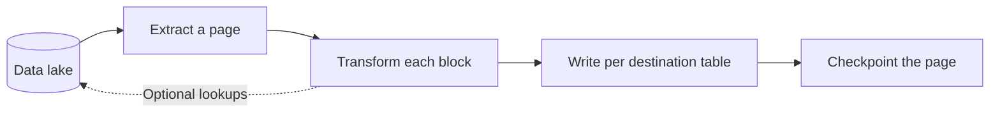

## Status

Accepted

## Date

2026-06-03

## Context

The software development lifecycle (SDLC) indexer runs every entity through one generic entity handler and one shared pipeline.
The pipeline owns extraction, transformation, writes, and checkpoints.
Nodes, edges, and derived entities declare ontology pipelines.
Each ontology pipeline has an extract section and a transform section.
The indexer lowers each ontology pipeline into a plan with an extract SQL template and a transform spec.

Before this change, the transform stage was SQL-only.
That fits an entity whose graph shape is a row-wise projection of one extracted batch.
It does not fit an entity whose transform must query the data lake again in the middle of the transform.

The driver is the system note handler from [ADR 013](013_system_note_edges.md).
It parses GitLab Flavored Markdown reference tokens out of free-text note bodies.
It then resolves them to entity IDs with batched lookups against the route table and the entity tables.
A SQL projection over one in-memory block cannot express that second hop.

A per-entity pipeline for system notes would be the wrong answer.
**The pipeline is shared extraction and writing machinery that every SDLC entity needs.**

None of its optimizations are entity-specific:

| Optimization | Effect |
|---|---|
| Keyset pagination with a cursor predicate | Uses the ClickHouse sort-key index |
| Watermark window and traversal path scope in the extract SQL | Limits the extract to rows changed since the watermark, inside the scope of the request |
| Whole-page read with read-ahead of one page | Overlaps the next read with the current writes |
| Adaptive retry | Shrinks the block size on a data lake failure, down to a floor |
| Lazy bulk writers per destination table | Opens no insert for an empty table |
| Checkpoints at page boundaries | Resumes from the cursor after a crash |
| Replacing merge tree tables | Makes reprocessing idempotent |
| Read and write statistics | Feeds the pipeline observers |

An Arrow string-offset overflow makes the adaptive retry drop straight to the floor.
The only entity-specific part of this machinery was the SQL transformer.

[ADR 014](014_entity_level_indexing.md) named an entity pipeline extension point with system notes as the custom example.
Taken literally, one custom pipeline per hard entity reintroduces the duplication above.
This decision refines the granularity of that extension point.
The dispatch, per-entity NATS subjects, and partitioning from ADR 014 do not change.

## Decision

**One shared pipeline owns all extraction and writing, and the transform is the only stage that varies per entity.**

Every SDLC entity runs on the same pipeline, whether its transform is a SQL projection or hand-written Rust.
Code indexing and namespace deletion are out of scope, because they already sit outside the SQL plan path.

### The transform contract

A transform has a name and declares its destination tables in output order.
It turns one extracted block into rows for one or more of those tables.
Each output batch selects its destination by position in the list.

A transform takes no per-call context.
Its registry factory captures its dependencies, such as the data lake handle and its configuration, when it builds the transform.
The namespace scope for the lookups of a transform travels in the traversal path column of the block.

The contract enforces two rules:

- The SQL engine session is not part of the contract, so a transform that does not run SQL never receives one.
- Data lake access comes from construction, so a transform can read a second hop without owning pagination, checkpoints, or writes.

The pipeline feeds the blocks of a page through the transform one at a time.
It groups the output rows per destination table before one bulk write.
Per-block calls also bound the lookup list of a transform to one block instead of a whole page.
A transform that needs wider batches can buffer internally.

### Two implementations of one contract

The SQL transform keeps the existing behavior.
It owns a DataFusion session internally, registers the block as the source table, and runs the SQL that the ontology generates.

The system notes transform is hand-written Rust.
It parses note bodies and collects distinct references.
It resolves the references with data lake reads against the route table and the entity tables, and then emits edge rows.

### Reuse of extraction and writing

The system note entity needs no custom extractor.
Its ontology pipeline has an authored extract template that scans notes in batches.
The template joins the system note metadata in the page bounds to get the note action.
The entity uses the same pagination, watermark window, retry, read-ahead, checkpoints, and streaming writes as every other entity.

A new hand-written entity provides two things:

- An ontology pipeline that declares its extract
- A transform that implements the contract

The pipeline opens one bulk writer for each non-empty destination table.
The SQL transform keeps its own dictionary encoding of columns.
A Rust transform must emit batches that match the graph schema.

### The transform spec in the plan

Each plan carries its transform spec.
The spec is either the built-in SQL projection, which is the default, or the name of a Rust transform.
The plan builder sets the SQL spec for node and standalone edge pipelines that declare the SQL transform type.
It sets the Rust spec for a derived entity pipeline.

At the start of each run, the pipeline asks its transform registry to build the transform for the plan.
A SQL spec calls the injected SQL transform factory, and a Rust spec looks up a registered factory by name.
The SQL transform is the default path and has no registry entry.
Each Rust transform registers itself from its own module, so a new transform adds one registration line.
Handler registration skips a Rust plan whose transform has no registration, so the derived entity stays dormant until its transform lands.

The indexer builds one pipeline at handler registration and shares it with every handler.
The pipeline bundles stateless collaborators, so sharing one instance duplicates no logic.
The collaborators are the data lake, the checkpoint store, the metrics, and the retry configuration.

The pipeline owns per-page execution: extract, transform, write, and checkpoint.
The entity handler owns the plan and the dispatch decisions: watermark derivation, partition ranges, and request decoding.
The handler passes the plan to the pipeline on each request.
Because the spec rides in the plan, the handler never holds a transform.

### The ontology model and the indexer SQL

The ontology is a declarative YAML model.
It holds no ClickHouse SQL and no knowledge of runtime markers.
An extract query is either generated or authored:

- A generated query comes from the declaration and its filter, and the indexer builds the SQL.
- An authored query is the raw content of a co-located MiniJinja template, with its markers unresolved.

Derived entity pipelines are always authored.
Their rows are neither node properties nor edge endpoints, so the indexer has nothing to generate a projection from.
Only a few complex nodes and the system note entity use authored templates, and every other node and edge is generated.

The plan builder is the only code that reads the transform declaration.
It walks nodes, edge configurations, and derived entities, and decomposes each pipeline once.
It hands each stage only its inputs, so data flows top-down:

- A single point-lookup convention turns declared extract lookups into internal common table expressions (CTEs).
- Each lookup CTE joins on the ID of the source node against the declared batch ID column.
- A lookup CTE is scoped by path when the pipeline and the source node are both namespaced.
- The final projection exposes only the stable output field aliases from the extract declaration.
- The extract stage produces one validated extract spec with its version, watermark, and deletion expressions.
- The transform stage produces the transform spec: node columns with foreign key edge rows, a standalone edge row, or a named Rust transform.

The extract stage and the transform stage do not depend on each other.
The schema of the batch at runtime is the contract between them, and planning keeps no second schema model.
Edge endpoints map ontology properties to fields in the extracted batch.
The SQL transform uses those bindings to build denormalized edge tags.

A plan gets its extract template only through validation, so every template that reaches the runtime is valid.
An ontology unit test checks that every authored template projects the version and deletion aliases.
The same test checks that the template uses the watermark and deletion markers instead of literal column names.
The indexer integration scenarios check projection completeness from end to end.

## Benefits of this approach

The transform stage is no longer SQL-only, and every entity inherits the extraction and writing optimizations.
A new Rust entity, such as the system note entity of [ADR 013](013_system_note_edges.md), is one transform plus an extract plan.
Existing entities do not change behavior, because they run the SQL transform over the same pipeline and plans.

## Consequences

A contract boundary replaced the concrete SQL transformer, which needed a mechanical refactor where the transformer was built.

Hand-written transforms can multiply.
The default stays an ontology plan with the SQL transform.
A Rust transform is justified only when the projection cannot be SQL, such as multi-hop data lake reads or cross-row work.
The indexer agent guide documents that bar beside the reuse checklist.

## Why not the alternatives

### A custom pipeline per entity

Each custom pipeline would re-own extraction and writing, which is the duplication this decision prevents.

### Custom extractors and writers for Rust entities

Rust entities reuse the shared pipeline.
A different source shape needs only a different extract plan.

### The SQL engine in the transform contract

DataFusion is an implementation detail of the SQL transform.
A transform that does not run SQL has no use for a session.

### A transform taxonomy in the ontology

The ontology names the transform type of each pipeline: the built-in SQL type or a registered Rust transform name.
The ontology does not model transform behavior.
Whether a named Rust transform resolves is a registration concern.
Edge and node kinds stay declared in the ontology.

### Central dictionary encoding in the writer

Central encoding would let a Rust transform inherit dictionary encoding for free.
We did not adopt it in this change.
It can follow if Rust transforms find manual encoding error-prone.

## References

- [ADR 013: Materialize edges from system notes](013_system_note_edges.md)
- [ADR 014: Entity-level SDLC indexing](014_entity_level_indexing.md)
- [SDLC indexing design document](https://gitlab.com/gitlab-org/orbit/knowledge-graph/-/blob/2da7a9340bb4ae77d07050e0b01f50cf507af66c/docs/design-documents/indexing/sdlc_indexing.md)
