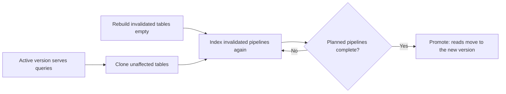

## Status

Accepted

## Date

2026-07-13

## Context

A breaking schema change writes to a new set of tables with a version prefix.
The old version keeps serving queries.
The new set takes over when it is populated.
The schema management design describes that layout, and this decision does not change it.

The problem is cost.
The original flow rebuilt every table on every schema version change.
It created the full new set empty, then indexed every namespace and repository into it again.
A one-column change to one software development lifecycle (SDLC) entity pulled billions of Siphon rows and every code archive again before promotion.
Most tables were identical, byte for byte, to the old version.

The indexer could compare ontology versions at runtime and guess which tables changed.
That guess is not safe.
A missed change to an edge key leaves a stale row in a cloned table, and nothing can find the row later.
The decision must be declared and reviewed.

## Decision

**On a forward migration, we clone each table that the version does not invalidate and index again only the invalidated entities.**

A migration ledger declares the invalidated set for each version.
When the scope is not clear, it defaults to a full rebuild.

### Ledger declares scope

The ledger has one entry for each schema version.
The tool that bumps the version adds the entry.
An entry has one of these scopes:

- Full: rebuild all tables.
  A version with no entry gets this scope.
- SDLC: rebuild the SDLC tables, with an optional list of entities to narrow the scope.
- Code: rebuild the code graph tables and their edge table.

A person can widen an entry.
A person cannot narrow it below the drift that the schema fingerprint snapshot detects.
A continuous integration (CI) check and a unit test enforce that floor.
A migration across several versions uses the union of their scopes.
A gap in the ledger or a backward range widens the scope to full.

### Runtime widening for shared tables

A declared scope is a request.
The indexer widens it to full when a clone would corrupt data:

- The scope touches the shared edge table.
  A clone that rebuilds only some of its writers keeps rows with old keys that the corrected writer no longer emits.
- A rebuilt table has writers outside the scope.
  The clone would drop their rows.

The code scope is the exception.
It clones the shared edge table intact.
A sweep for stale code rows marks old code edge rows as deleted after each namespace finishes its new index run.
A code version change touches only code.

The indexer then marks each table as clone or rebuild.
A table is rebuilt only when the version invalidates every writer of that table.
The indexer maps the invalidated entities to the pipelines that must run again.
For example, a change to the note edge reruns the note pipeline.

### Checkpoint seeding drives re-dispatch

The checkpoints in the new set decide what runs again.
The namespace sweep dispatches each pipeline that has no completed checkpoint.
Seeding differs by scope:

| Scope | Checkpoint seeding |
| ----- | ------------------ |
| SDLC | Copy completed checkpoints for unchanged pipelines. Drop the invalidated checkpoints and the dispatch cursors. |
| Code | Clone the checkpoints intact, with the dispatch cursors. Drop only the stale sweep gate for each namespace. |
| Full | Start with an empty checkpoint table, so everything backfills. |

Control tables, such as the table that records the schema version, have no prefix.
A migration never clones or drops them.

### Promotion gates on the plan

A scheduled check promotes the migrating version under one condition.
Each enabled namespace must have a completed checkpoint for each required namespace pipeline.
Each required global pipeline must also have a completed checkpoint.
The required set is the plan that the scope produced, so a selective migration waits only for the work it dispatched.

The check computes the enabled set each time.
A checkpoint from a namespace that was disabled after the migration started does not count.
The check reports code coverage, but code coverage does not block promotion.
One slow or failing repository must not keep a migration open.

The gate uses checkpoints, not row counts.
Full correctness validation stays in the staging end-to-end tests.
The schema management design describes this trade-off.

### Blue-green deployment

The prefix layout is already a blue-green split.
The active version keeps serving queries and streaming updates from its tables.
The migrating version fills its own set at the same time.
Promotion moves reads to the new set in one step.
The two versions also have separate NATS streams and locks.
The readiness probe keeps the new pods out of rotation until their version is active.

Clone-based migration makes the green side cheap to stand up.
A full rebuild must index from the start before it can promote.
For hours, the blue side alone carries fresh data under heavy Siphon and Gitaly load.
Cloning brings the green tables up almost complete at once and indexes only what changed.
The blue side is never disturbed, and the window shrinks to the size of the change.
Promotion happens when that change is indexed, as the gate in [Promotion gates on the plan](#promotion-gates-on-the-plan) describes.

## Benefits of this approach

- A narrow version change indexes only what it invalidates, so the migration window and the Siphon and Gitaly load are smaller.
- The invalidation set is a reviewed file with a floor that CI enforces.
- Unmapped versions, ledger gaps, shared edge tables, and writers outside the scope all widen to full.

## Consequences

- Each breaking version change needs a ledger entry.
- A scope that is too narrow is a data correctness bug, not only wasted work.
- The shared edge table forces many SDLC scopes to full.
- The savings are large for entities with their own tables and for code, and smaller for changes that touch edges.
- SDLC and code use two seeding paths with different cursor handling.

These items are out of scope:

- Changes to the prefix layout or the promotion mechanism
- Row-count validation at the gate, which stays in staging end-to-end tests
- Runtime comparison of ontology versions, because the scope is declared and the runtime can only widen it
- Cleanup of single rows in shared SDLC edge tables, because those changes widen to full instead

## References

- [Schema management design](https://gitlab.com/gitlab-org/orbit/knowledge-graph/-/blob/2da7a9340bb4ae77d07050e0b01f50cf507af66c/docs/design-documents/schema_management.md)
- [Checkpoint-based validation trade-off](https://gitlab.com/gitlab-org/orbit/knowledge-graph/-/blob/2da7a9340bb4ae77d07050e0b01f50cf507af66c/docs/design-documents/schema_management.md#known-trade-off-checkpoint-based-validation)
- [SDLC indexing design](https://gitlab.com/gitlab-org/orbit/knowledge-graph/-/blob/2da7a9340bb4ae77d07050e0b01f50cf507af66c/docs/design-documents/indexing/sdlc_indexing.md)
- [ADR 014: Entity-level SDLC indexing](014_entity_level_indexing.md)
- [ADR 015: Pluggable transforms over a shared SDLC pipeline](015_pluggable_entity_pipelines.md)
- [Non-blocking migrations and blue/green deployment](https://gitlab.com/groups/gitlab-org/orbit/-/work_items/7)
