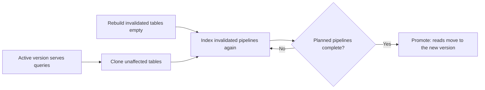

## Status

Accepted

## Date

2026-07-13

## Context

When the graph schema changes in a breaking way, Orbit writes to a new set of tables whose names carry a version prefix.
The old version keeps serving queries until the new set is populated and takes over.
The schema management design describes that layout, and this decision does not change it.

The problem is cost.
The original flow rebuilt every table on every schema version change.
It created the full new set empty, then indexed every namespace and repository into it again.
A one-column change to one software development lifecycle (SDLC) entity read billions of rows from Siphon again, with every code archive from Gitaly, before promotion.
Siphon copies GitLab database rows for the indexer to read, and Gitaly stores the Git repositories.
Most tables were identical, byte for byte, to the old version.

The indexer could compare ontology versions at runtime to guess which tables changed, but the guess is not safe.
A missed change to an edge key leaves a stale row in a cloned table, and nothing can find the row later.
So a person must declare the scope of each change, and a reviewer must check it.

## Decision

**On a forward migration, we clone each table that the new version does not invalidate and reindex only the invalidated entities.**

A migration ledger, a reviewed file in the repository, declares which entities each version invalidates.
When the scope is not clear, the migration rebuilds all tables.

### Ledger declares scope

The ledger has one entry for each schema version.
The tool that bumps the version adds the entry.
An entry has one of these scopes:

- Full: rebuild all tables.
  A version with no entry gets this scope.
- SDLC: rebuild the SDLC tables, with an optional list of entities to narrow the scope.
- Code: rebuild the code graph tables and their edge table.

A person can widen an entry but cannot narrow it below the changes that the stored schema fingerprint detects.
A continuous integration (CI) check and a unit test enforce that floor.
A migration across several versions uses the union of their scopes.
A gap in the ledger or a backward range widens the scope to full.

### Runtime widening for shared tables

A declared scope is only a starting point.
The indexer widens it to full when a clone would corrupt data:

- The scope touches the shared edge table.
  A clone that rebuilds only some of its writers keeps rows with old keys that the corrected writer no longer emits.
- A rebuilt table has writers outside the scope, so the rebuild would drop their rows.

The code scope is the exception, and it clones the shared edge table intact.
After each namespace finishes its new index run, a sweep marks the old code edge rows as deleted.
A code version change touches only code.

The indexer then marks each table as clone or rebuild.
A table is rebuilt only when the version invalidates every pipeline that writes to it.
The indexer maps the invalidated entities to the pipelines that must run again.
For example, a change to the note edge reruns the note pipeline.

### Checkpoint seeding drives re-dispatch

A pipeline records a checkpoint when it completes, and the checkpoints in the new set decide what runs again.
The namespace sweep dispatches each pipeline that has no completed checkpoint.
Seeding differs by scope:

| Scope | Checkpoint seeding |
| ----- | ------------------ |
| SDLC | Copy completed checkpoints for unchanged pipelines. Drop the invalidated checkpoints and the dispatch cursors. |
| Code | Clone the checkpoints intact, with the dispatch cursors. Drop only the marker that the stale-row sweep is done for each namespace. |
| Full | Start with an empty checkpoint table, so everything backfills. |

Control tables, such as the table that records the schema version, have no prefix.
A migration never clones or drops them.

### Promotion gates on the plan

A scheduled check promotes the migrating version when each enabled namespace has a completed checkpoint for each required namespace pipeline.
Each required global pipeline must also have one.
The required set is the plan that the scope produced, so a selective migration waits only for the work it dispatched.

The check reads the enabled set each time, so a checkpoint from a namespace that is not enabled now does not count.
The check reports code coverage but does not wait for it, because one slow or failing repository must not keep a migration open.

The gate counts checkpoints and does not count rows.
Full correctness validation stays in the staging end-to-end tests.
The schema management design describes this trade-off.

### Blue-green deployment

The prefix layout is already a blue-green split, with two copies side by side.
The active version keeps serving queries and streaming updates from its tables while the migrating version fills its own set.
Promotion moves reads to the new set in one step.
The two versions also have separate NATS message streams and locks.
The readiness probe keeps the new pods out of rotation until their version is active.

Cloning makes the green side cheap to stand up.
A full rebuild indexes everything from the start, so for hours only the blue side has fresh data, under heavy Siphon and Gitaly load.
Cloning brings the green tables up almost complete at once, so the window shrinks to the size of the change.
The blue side is never disturbed.
Promotion happens when that change is indexed, as [Promotion gates on the plan](#promotion-gates-on-the-plan) describes.

## Benefits of this approach

- A narrow version change indexes only what it invalidates, so the migration window and the Siphon and Gitaly load are smaller.
- The invalidation set is a reviewed file with a floor that CI enforces.
- Unmapped versions, ledger gaps, shared edge tables, and writers outside the scope all widen to full.

## Consequences

- Each breaking version change needs a ledger entry.
- A scope that is too narrow is a data correctness bug, not only wasted work.
- The shared edge table forces many SDLC scopes to full.
- The savings are real for entities with their own tables and for code, and smaller for changes that are mostly edges.
- SDLC and code use two seeding paths with different cursor handling.

These items are out of scope:

- Changes to the prefix layout or the promotion mechanism
- Row-count validation at the gate, which stays in staging end-to-end tests
- Runtime comparison of ontology versions, because the scope is declared and the runtime can only widen it
- Cleanup of single rows in shared SDLC edge tables, because those changes widen to full instead

## References

- [Schema management design](https://gitlab.com/gitlab-org/orbit/knowledge-graph/-/blob/2da7a9340bb4ae77d07050e0b01f50cf507af66c/docs/design-documents/schema_management.md)
- [Checkpoint-based validation trade-off](https://gitlab.com/gitlab-org/orbit/knowledge-graph/-/blob/2da7a9340bb4ae77d07050e0b01f50cf507af66c/docs/design-documents/schema_management.md#known-trade-off-checkpoint-based-validation)
- [SDLC indexing design](https://gitlab.com/gitlab-org/orbit/knowledge-graph/-/blob/2da7a9340bb4ae77d07050e0b01f50cf507af66c/docs/design-documents/indexing/sdlc_indexing.md)
- [ADR 014: Entity-level SDLC indexing](014_entity_level_indexing.md)
- [ADR 015: Pluggable transforms over a shared SDLC pipeline](015_pluggable_entity_pipelines.md)
- [Non-blocking migrations and blue/green deployment](https://gitlab.com/groups/gitlab-org/orbit/-/work_items/7)
