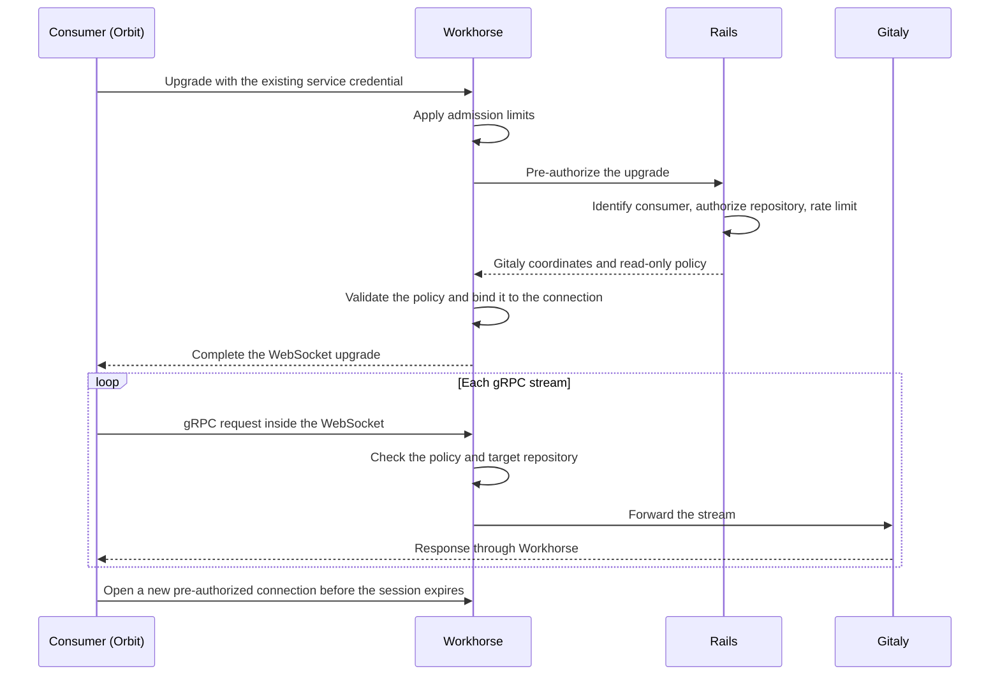

## Status

Proposed

## Date

2026-09-03

## Context

Orbit reads repository content from Gitaly, the GitLab Git storage service.
It does this through internal Rails endpoints, one for each Gitaly remote procedure call (RPC).
The archive endpoint wraps the archive RPC, and other endpoints wrap the changed-path, blob, and merge request diff RPCs.
Rails authenticates and authorizes the request, resolves the repository storage, and hands the call to Workhorse.
Workhorse performs the RPC and streams the bytes to Orbit.

Each new RPC needs a Rails endpoint, a Workhorse handler, an HTTP encoding of the response, and a client method in Orbit.
Four codebases and review paths change to produce an endpoint with one caller.
Each read is also a full Rails request.
One request per project archive is acceptable, but blob reads at query time would cost one Puma request per blob.

Orbit cannot call Gitaly directly, because Orbit runs in its own Kubernetes cluster.
Gitaly and Praefect, its router, are reachable only inside the GitLab network, so every read must pass through Workhorse.

Native gRPC needs HTTP/2, and the inbound Workhorse listener does not support it.
The listener receives HTTP/1.1 behind an edge that terminates Transport Layer Security (TLS), in every supported topology.
GitLab has worked around this limit with WebSockets before.
Duo Workflow bridges a bidirectional gRPC stream over a WebSocket, and the language server executors moved to WebSockets because some customers block HTTP/2.

A proof of concept (POC) compared a framed HTTP route, a dedicated gRPC port, and a reverse tunnel, and settled on a transparent proxy.
Generated Gitaly client stubs speak gRPC through a WebSocket, and Workhorse forwards RPCs without decoding them, as Praefect does.
An unmodified Rust gRPC client completed a code indexing job through a local Workhorse, Praefect, and Gitaly.
The job covered a large archive, back pressure, and concurrent streams.

## Decision

**Workhorse gets one Gitaly proxy route for any consumer, with gRPC tunneled over a WebSocket.**

Rails authorizes each connection and returns Gitaly coordinates and a read-only policy to Workhorse.
Workhorse holds both in memory for that connection and enforces the policy on each gRPC stream.
The consumer uses generated gRPC stubs and never sees a Gitaly address or token.

### Responsibilities

| Component | Decides | Never sees |
|---|---|---|
| Rails | Consumer identity, repository access, policy selection, and limits | Proxied streams and repository bytes |
| Workhorse | Profile compilation, policy validity and enforcement, and proxy limits | Authorization code for a specific consumer |
| Consumer | Transport mode, connection rotation, and retries | Gitaly addresses, tokens, and storage routing |

Workhorse knows how to enforce a policy, and Rails decides who may use it, with the rest of the GitLab authorization logic.

### Connections

For Orbit, the service credential is the JSON Web Token (JWT) that it already uses against Rails.
Rails may narrow the named policy for each session.
After the consumer opens a new connection, the old one stops accepting streams and closes when its in-flight streams finish.

Rails answers Workhorse directly, and the consumer holds no token with the authorization in it.
No token exists to replay or revoke, and the Gitaly secret never leaves the GitLab deployment.

Each connection covers one project, because Rails resolves the repository storage of that project.
A tunnel for a group would have to resolve storage again for each stream and route across Gitaly nodes.
A connection costs one Rails pre-authorization round trip.
Workhorse pools its Gitaly client, so connections per project do not multiply connections on the Gitaly side.

### Read-only policy

A profile is a rule set compiled into Workhorse.
A policy is a profile that Rails selects and narrows for one session.
The first version has one read-only repository profile.
The profile allows read RPCs on the repository that Rails authorized and rejects all other calls.
The profile also rejects a write RPC that Rails allowlists by mistake.
Workhorse resolves the target repository with the same protobuf annotation as Gitaly and Praefect.

Workhorse sets the Gitaly client name on every stream from the value that Rails returned, and ignores metadata from the consumer.
The Gitaly limits and dashboards per client therefore keep working.
The consumer identity from Rails also flows into Workhorse metrics and logs, so attribution stays.

### Session lifetime

A session is active while it accepts new streams, draining while existing streams finish, and then closed.
Rails sets a short session age for Orbit, and Workhorse gives each stream a longer deadline.

We do not use gRPC connection aging, because its grace period ends in-flight archives.
The indexer would restart each cut archive from byte zero, so the largest repositories could never finish.
This design lets in-flight streams run until their own deadline.

A session admitted just before Rails revokes access can start streams until the session age ends.
Those streams can run until their deadline, so the worst case is the session age plus the stream deadline.
For Orbit, the worst case is about an hour more than the session age.
The cap on this window is fixed in Workhorse, whatever values Rails requests.
A short hard-kill grace then lets in-flight work close cleanly, so the observed ceiling can be a few seconds over the cap.

A rollout feature flag for each project or root namespace controls new pre-authorizations and is off by default.
When the flag is off, Rails refuses new pre-authorizations and existing sessions drain.
Pre-authorization also requires Orbit indexing to be on for the project, the same gate that the indexer applies before it schedules work.
The proxy therefore cannot read a project that the indexer would not index.

### Capacity

Each indexer pod limits how many archives it fetches at once, and backfill and incremental indexing share that limit.
A NATS key-value lease also caps archive downloads for each Gitaly storage across all pods.
The fleet cap is the fetch limit times the pod count, unless those storage budgets are lower.
The repository count does not change this cap, and more worker slots do not raise it.
At the time of this decision, the GitLab.com indexer pool had about 40 archive fetch slots.
In each connection, Rails returns a stream cap that can narrow the Workhorse default.
Workhorse also caps total connections, in-flight pre-authorizations, idle time, and message size.

Over seven days, Gitaly logs for the indexer client showed 2.97 million archive calls.
Blob listing had about 8,000 calls, and other RPCs were noise.

| Window | p50 | p95 | p99 | Maximum |
|---|---:|---:|---:|---:|
| 7 days | 0.63 req/s | 2.07 req/s | 95 req/s | 196 req/s |
| 30 days | 0.69 req/s | 1.66 req/s | 18.4 req/s | About 160 req/s |

Incremental indexing runs at about 0.7 requests per second and rarely goes above two.
Backfills produce short bursts of about 160 to 200 requests per second.
Bursts of 50 requests per second or more carry about two thirds of the weekly volume in about two hours.
The weekly mean of about five requests per second is therefore well above the steady-state percentiles.

Over 24 hours, about 81,000 archive calls had bimodal durations, with a long tail for large repositories:

| p50 | Average | p90 | p95 | p99 |
|---:|---:|---:|---:|---:|
| 0.11 s | 2.0 s | 3.4 s | 12.6 s | 36 s |

Incremental indexing therefore uses one or two concurrent connections, and a backfill stays at the configured cap.
The average and p99 show that some slots stay busy for tens of seconds, and the stream deadline accommodates the largest repositories.

Rails serves cheap pre-authorization calls at about the current archive rate, and it is no longer in the archive data path.
A proxy connection lives slightly longer than its RPC and can carry several RPCs, so the archive rate is an upper bound.

### New consumers and RPCs

A new consumer adds a Rails authorization check for its own credential, an RPC allowlist, and its own feature flag.
The shared route needs no Workhorse, Ingress, or Cells routing change.
Zoekt, the code search service, and the GitLab agent server for Kubernetes (KAS) are possible future consumers, and this decision does not implement them.

A new RPC for an existing consumer is a Rails allowlist change when Workhorse already includes the Gitaly definition of that RPC.
Otherwise, Workhorse must update its Gitaly dependency before the proxy can allow the method.

### Orbit as the first consumer

The indexer archive download moves first and calls the Gitaly archive RPC over the proxy.
Project metadata stays on Rails HTTP.
An indexer setting selects the transport mode:

| Mode | Behavior |
|---|---|
| Rails HTTP, the default | The current path, unchanged |
| Proxy with fallback | Try the proxy, and fall back to Rails when the proxy refuses to authorize or admit the connection |
| Proxy only | Use only the proxy |

Fallback to Rails is allowed only before archive bytes start to flow.
If a stream is cut, the download restarts from zero over the proxy and never switches to Rails.
Orbit spools the archive to a temporary file before extraction, so partial bytes never reach the parser.

## Why not the alternatives

### Give Orbit the Gitaly address and token

Orbit cannot reach Gitaly from its cluster.
This option would also expose storage details and credentials in another cluster, and make Orbit own routing and credentials.

### Keep one Rails endpoint per RPC

This keeps the current authorization path.
Each RPC would still need changes across four codebases and add another endpoint with one caller.
Each read would stay a Rails request, which does not scale to reads per blob.
Planned blob and diff reads would repeat that work.

### A framed HTTP route instead of a WebSocket tunnel

The POC proved that Workhorse can accept a serialized request and return length-prefixed protobuf frames.
Consumers would have to serialize requests and parse responses themselves.
The route supports only unary and server-streaming RPCs.
A WebSocket tunnel keeps generated gRPC clients at the same edge cost.

### Real inbound HTTP/2 in Workhorse

Native gRPC would remove the tunnel.
It needs a coordinated edge change across every supported deployment topology for one consumer.
We consider that a separate platform decision.

## References

- [Implement Gitaly proxy in Workhorse](https://gitlab.com/gitlab-org/orbit/knowledge-graph/-/issues/1252)
- [POC: generic Gitaly proxy in Workhorse](https://gitlab.com/gitlab-org/orbit/knowledge-graph/-/issues/1226)
- [Add support to node executor for WebSockets connection](https://gitlab.com/gitlab-org/editor-extensions/gitlab-lsp/-/issues/1219)
- [Code indexing design with the archive storage budget](https://gitlab.com/gitlab-org/orbit/knowledge-graph/-/blob/2da7a9340bb4ae77d07050e0b01f50cf507af66c/docs/design-documents/indexing/code_indexing.md)
- [Workhorse proxy core](https://gitlab.com/gitlab-org/gitlab/-/merge_requests/253414)
- [Workhorse route, sessions, and director](https://gitlab.com/gitlab-org/gitlab/-/merge_requests/253431)
- [Add Rails Gitaly proxy pre-authorization](https://gitlab.com/gitlab-org/gitlab/-/merge_requests/253417)
- [Orbit client transport](https://gitlab.com/gitlab-org/orbit/knowledge-graph/-/merge_requests/2381)
- [Orbit indexer archive transport](https://gitlab.com/gitlab-org/orbit/knowledge-graph/-/merge_requests/2382)
