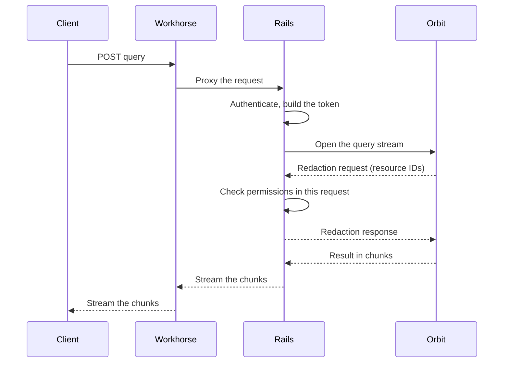

## Status

Accepted. This ADR supersedes [ADR 008](008_workhorse_query_acceleration.md).

## Date

2026-10-28

## Context

[ADR 008](008_workhorse_query_acceleration.md) moved the Orbit query stream from Rails to Workhorse.
A staging load test had shown Puma threads held open by long gRPC streams.
Workhorse is written in Go and holds many connections at low cost.
Rails kept authentication and redaction, and Workhorse called back to Rails for each redaction batch.

After six months in production, the trade did not pay off.
Every change to the query path needed Go code and a Workhorse maintainer review on top of the Rails change.
The context endpoint ([ADR 021](021_entity_context_expansion.md)) would have needed that work again.

Each redaction batch also cost a second HTTP request.
Workhorse sent the user's credentials to an internal Rails endpoint.
Rails then authenticated the user again and recomputed member access before it checked one resource.

**And we did not need the threads we saved.**

Production traffic is far below the load test, and most queries end in less than 200 ms.

## Decision

**Rails runs the query stream and redaction in one request.**

Workhorse only proxies the request, as it does for most API endpoints.

Rails reuses the user and authorization context that it loaded for the request, so a redaction batch costs only the permission checks.
Orbit sends a large result in chunks, and Rails streams each chunk to the client.
The result never sits in memory as one object.

We removed the Workhorse query code and the internal redaction endpoint.

## Benefits of this approach

A change to the query path is now one Rails change with one review.
The Go copy of the gRPC contract is gone.
Orbit-specific work runs in two processes, Rails and Orbit, instead of three.
The context endpoint and the Orbit tools in the GitLab MCP server use the same Rails code.

Redaction is faster because it no longer pays for a second request.
In a controlled test before the rollout, the p50 redaction round trip went from 154 ms to 61 ms.

We then compared 18 hours at 100% of GitLab.com users with the same hours one week before, when Workhorse served most of the traffic.

| Measure | Workhorse | Rails |
|---|---:|---:|
| Redaction callbacks | 674 | 0 |
| End-to-end latency p50 / p95 / p99 | 43 / 173 / 1,045 ms | 45 / 179 / 757 ms |
| Redaction time mean / p99 | 325 / 6,599 ms | 181 / 949 ms |
| Puma threads held by Orbit, fleet mean | n/a | 0.04 |

**Latency stayed the same at p50 and p95, and p99 dropped from 1,045 ms to 757 ms.**

## Consequences

- Each query holds a Puma thread for its full duration.
  In the 18 hours after the rollout, no worker held more than one Orbit query at a time.
  Puma can add threads for I/O-bound requests if traffic grows, and we do not need them today.
- CPU per query went up a little.
  A benchmark showed a saving, but production did not.
- Slow queries now count against the Rails apdex.
  Requests over the apdex target went up after the rollout.
- The Rails request timeout caps a query, and that cap is lower than the old Workhorse deadline.
- There is no fallback to Workhorse.
  GitLab Self-Managed and GitLab Dedicated run the Rails path from the release that removed the flag.

## Why not the alternatives

### Keep the Workhorse path

This keeps both costs from the Context section to save threads that we do not need.

### A separate Rails fleet for Orbit queries

A dedicated fleet would keep Orbit queries away from other API traffic.
It needs its own deployment, routing, and database connections in each environment.
Self-Managed and Dedicated run one web fleet, so they would not get the benefit.
That is too much work for a load that uses a small part of one thread on average.

### Take over the socket

Rails could hand the client socket to another thread and stream the response outside the request.
That frees the Puma thread, but it skips the Rails middleware.
It also could not serve a future GraphQL field that runs Orbit queries.

## References

- [Run Orbit query streams in Rails instead of Workhorse](https://gitlab.com/gitlab-org/orbit/knowledge-graph/-/work_items/1381)
- [Move Orbit queries to Workhorse](https://gitlab.com/gitlab-org/orbit/knowledge-graph/-/work_items/349)
- [Run Orbit query streams in Rails](https://gitlab.com/gitlab-org/gitlab/-/merge_requests/261318)
- [Stream Orbit query results through Rails in chunks](https://gitlab.com/gitlab-org/gitlab/-/merge_requests/263038)
- [Remove the Rails query feature flag](https://gitlab.com/gitlab-org/gitlab/-/merge_requests/263077)
- [Send query results in chunks](https://gitlab.com/gitlab-org/orbit/knowledge-graph/-/merge_requests/2940)
- [ADR 008: Workhorse query acceleration](008_workhorse_query_acceleration.md)
