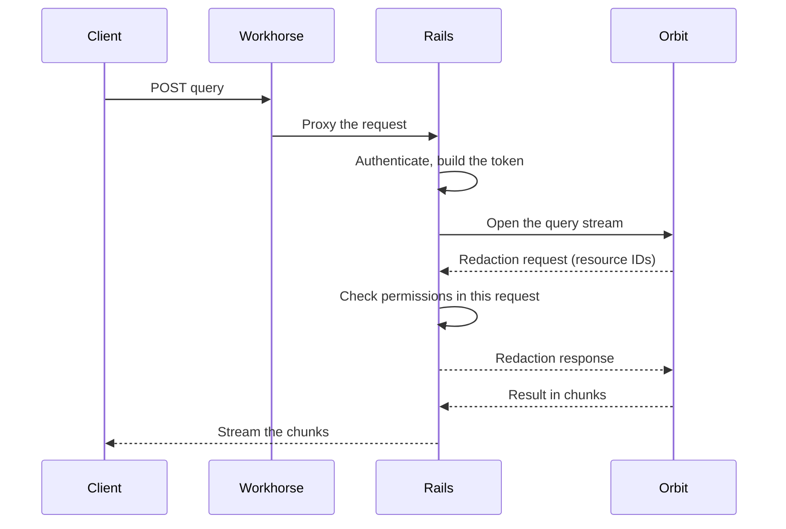

## Status

Accepted. This ADR supersedes [ADR 008](008_workhorse_query_acceleration.md).

## Date

2026-10-28

## Context

[ADR 008](008_workhorse_query_acceleration.md) moved the Orbit query stream from Rails to Workhorse.
A staging load test had shown Puma threads held open by long gRPC streams, so we gave the stream to Workhorse.
Workhorse is written in Go and can hold many connections at low cost.
Rails kept authentication and redaction, and Workhorse called back to Rails for each redaction batch.

After six months in production, the costs were different from what we expected:

- **The Workhorse path slowed every change to the query path.**
  A new field or endpoint needed Go code and a Workhorse maintainer review.
  That work came in addition to the Rails change.
  The planned context endpoint ([ADR 021](021_entity_context_expansion.md)) would have needed the same work again.
- **Redaction needed a second HTTP request.**
  For each batch, Workhorse sent the user's credentials to an internal Rails endpoint.
  Rails authenticated the user again and loaded the authorization context again before it checked a single resource.
- **The Puma threads that we saved were few.**
  Production traffic is far below the load test.
  Most queries end in less than 200 ms.

## Decision

**Rails runs the query stream and redaction in one request.**
Workhorse only proxies the request, as for most API endpoints.

1. Rails authenticates the caller and builds the signed token, as before.
1. Rails opens the gRPC stream to Orbit and keeps it for the whole query.
1. When Orbit asks for redaction, Rails checks the resources in the same request.
   It uses the user and authorization context that it already loaded.
1. Orbit sends large results in chunks, and Rails streams each chunk to the client.
   A large result does not stay in the Ruby heap as one object.

We removed the Workhorse Orbit package, the internal redaction endpoint, and its token scopes.

## Why this is better

- **One codebase for the query path.**
  A change to the query path is a Rails change with a Rails review.
  The Go client and its copy of the protobuf contract are gone.
- **Faster redaction.**
  Redaction no longer pays for a second request, a second authentication, and a second context load.
  In a controlled test, the p50 redaction round trip went from 154 ms to 61 ms.
  The p90 went from 683 ms to 93 ms.
- **Fewer parts to debug.**
  A query crosses two processes instead of three.
  Rails records the full query time, so the GitLab dashboards show the real cost of each query.
- **New endpoints are cheap.**
  The context endpoint and the MCP tools in the main GitLab MCP server reuse the same Rails code.

### Results in production

We compared 18 hours at 100% of GitLab.com users with the same hours one week before, when Workhorse served most of the traffic.

| Measure | Workhorse | Rails |
|---|---:|---:|
| Redaction callbacks | 674 | 0 |
| End-to-end latency p50 / p95 / p99 | 43 / 173 / 1,045 ms | 45 / 179 / 757 ms |
| Redaction time mean / p99 | 325 / 6,599 ms | 181 / 949 ms |
| Puma threads held by Orbit, mean | n/a | 0.04 |

**Latency stayed the same at p50 and p95, and the slowest queries became faster.**
CPU per query is about the same.

## Consequences

- **Each query holds a Puma thread for its full duration.**
  At current traffic, a worker never holds more than one Orbit query at a time.
  Puma can add extra threads for I/O-bound requests if the traffic grows, and we do not need them today.
- **Long queries count against the Rails apdex.**
  Rails now sees the full query time.
  A query that runs over the apdex target lowers the score.
- **Rails has a request timeout.**
  A query cannot run longer than the Rails request timeout.
- **There is no fallback to Workhorse.**
  GitLab Self-Managed and GitLab Dedicated run the Rails path in every release after the flag removal.

## Why not the alternatives

### Keep the Workhorse path

The Workhorse path saved Puma threads that we do not need at current traffic.
It made every query-path change slower and added a second request to each redaction batch.

### A separate Rails fleet for Orbit queries

A dedicated fleet would keep Orbit queries away from other API traffic.
It needs its own deployment, routing, and database connections in each environment.
That is too much work for a load that uses a small part of one thread on average.

### Rack hijack

Rails could take over the socket and stream the response outside the normal request.
This does not work for the GraphQL API, which also runs Orbit queries.

## References

- [Run Orbit query streams in Rails instead of Workhorse](https://gitlab.com/gitlab-org/orbit/knowledge-graph/-/work_items/1381)
- [Move Orbit queries to Workhorse](https://gitlab.com/gitlab-org/orbit/knowledge-graph/-/work_items/349)
- [Run Orbit query streams in Rails](https://gitlab.com/gitlab-org/gitlab/-/merge_requests/261318)
- [Stream Orbit query results through Rails in chunks](https://gitlab.com/gitlab-org/gitlab/-/merge_requests/263038)
- [Remove the Rails query feature flag](https://gitlab.com/gitlab-org/gitlab/-/merge_requests/263077)
- [Send query results in chunks](https://gitlab.com/gitlab-org/orbit/knowledge-graph/-/merge_requests/2940)
- [ADR 008: Workhorse query acceleration](008_workhorse_query_acceleration.md)
