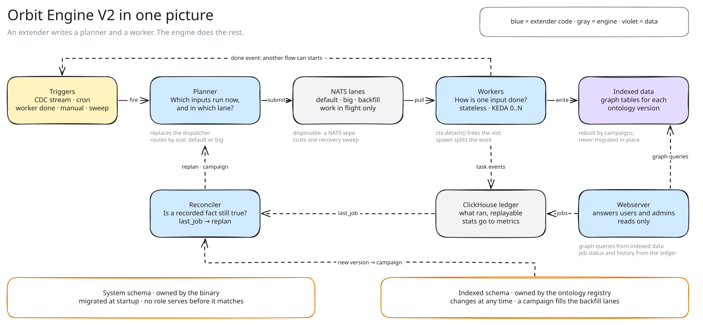

## Status

Proposed. This ADR amends [ADR 017](017_clone_based_non_blocking_migrations.md).
The clone scope stays.
Campaigns replace checkpoint seeding and the checkpoint promotion gate.
A schema version no longer needs its own NATS streams or pods.

## Date

2026-11-07

## Context and problem

Orbit indexing has two parts today.
The dispatcher decides what runs. The indexer engine runs each task from NATS.
Both parts grew with each new flow.

This shape causes three problems:

- **Each flow brings its own mechanics.** The dispatcher has one pattern for each kind of trigger: cron, CDC, sweeps and migrations. The code handler adds its own lanes and slot release. KEDA and the logs cannot see them.
- **Migrations block indexing.** Schema migrations run when the dispatcher starts. A rollout waits for them.
- **Runs are not visible.** Nothing records what ran. We cannot explain a stale namespace or replay a run.

The next two projects make these problems larger.
[Orbit Next](https://gitlab.com/groups/gitlab-org/orbit/-/work_items/16) and [third-party data](https://gitlab.com/groups/gitlab-org/orbit/-/work_items/20) need new flows without engine changes.
They also need new ontology versions at runtime, with no deploy.

## Decision

**One library, `indexing-engine`, runs all indexing work. A flow is a planner and a worker. The engine owns lanes, retries, scaling, the ledger and migrations.**

[The indexing engine](../architecture/indexing/indexing-engine.md) explains how it works.
[Extending the indexing engine](../development/extending-the-indexing-engine.md) shows the API.

1. **One library runs all indexing work.** It has no domain terms: no project, namespace, Gitaly or ontology. A CI check enforces it.
2. **A flow is a planner and a worker.** The planner decides which inputs run now, and in which lane. The worker runs one input. A planner never calls a source. A worker never knows its lane.
3. **Reconcilers keep facts true.** A reconciler runs on a timer and compares the wanted state with the observed state. It never submits a task. It asks a planner to replan or to start a campaign.
4. **A worker splits only its own work.** Child tasks join the job of their parent. Work for another team starts in that team's planner, when the first task ends.
5. **Helm owns capacity.** Each pod reads only its own config: the lanes and sinks it pulls, with their slots and pools. Helm decides which configs run, and how many pods run each one. KEDA scales each deployment on its pending tasks.
6. **NATS and pod disks hold no facts.** NATS holds work in flight, dedupe markers and leases. A lease stores its holder and its expiry, with no NATS TTL. A NATS wipe costs one recovery campaign. A pod's disk is a cache. A task is acked only when its data is durable somewhere else.
7. **ClickHouse records what ran.** The ledger keeps each task and job that did work, so an admin can replay it. Metrics keep the stats.
8. **Two kinds of schema.** The binary owns the system schema. The engine migrates it at startup, with steps that only change metadata. A failed step rebuilds the store and starts a recovery campaign. The ontology registry owns the indexed data schema. A campaign fills a new version in the background.

## Consequences

- Every write must be idempotent. Tasks run at least once. Recovery repeats work.
- A planner must answer sweeps and manual requests, or ignore them in a visible code arm. A planner that ignores sweeps depends on its triggers to recover lost work.
- KEDA scales on message count, not cost. The planner must split work into lanes by size.
- A failed migration costs a full reindex and the ledger history, at most once for each release. Graph queries keep working.
- The active version pointer is never rebuilt. A failed step on it stops indexing until an admin acts.
- A system table change that rewrites data is a new table and a campaign.
- Live work writes to two versions during a campaign. Code jobs run two times while it lasts.
- The ledger shares the graph cluster for now. If it loads the cluster too much, it moves to its own backend.
- The version scope of ADR 017 must travel with the version in the registry. A reviewed file cannot follow a runtime change.
- V2 replaces the V1 concurrency and timeout keys. Both config blocks are accepted until V1 is removed.

These items are out of scope:

- The query side, authorization of the admin API and billing emission
- Fair scheduling for each tenant inside a lane
- Connectors for third-party data

## Why not the alternatives

### Grow the current dispatcher and engine

Each flow would keep its own lanes, retries and migration path.
The dispatcher already has one pattern for each trigger. The next two projects would add two more.

### A declarative diff for system tables

A tool could compare the declared `CREATE TABLE` with the live table. It would compute the `ALTER` statements.
Each backend would need its own shadow database and diff rules.
Numbered steps work on any SQL backend. A SQLite file restored from S3 knows its own version.

## References

- [The indexing engine](../architecture/indexing/indexing-engine.md)
- [Extending the indexing engine](../development/extending-the-indexing-engine.md)
- [Orbit Engine v2 epic](https://gitlab.com/groups/gitlab-org/orbit/-/work_items/21)
- [Orbit Code Indexing v2 with Object Store](https://gitlab.com/groups/gitlab-org/orbit/-/work_items/16)
- [Support third-party data sources in Orbit](https://gitlab.com/groups/gitlab-org/orbit/-/work_items/20)
- [Non-blocking migrations and blue/green deployment](https://gitlab.com/groups/gitlab-org/orbit/-/work_items/7)
- [ADR 017: Clone-based non-blocking schema migrations](017_clone_based_non_blocking_migrations.md)
