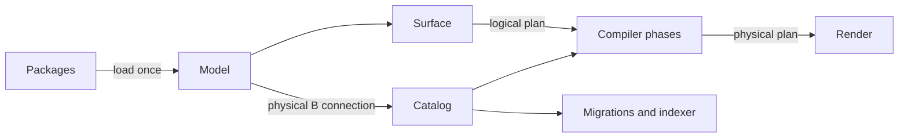

## Status

Proposed. This ADR replaces the ontology as the source of truth for the query engine, the schema migrations and the indexer.
[ADR 000](000_clickhouse_graph_storage.md) is unchanged: ClickHouse remains the graph store.

## Date

2026-11-08

## Context

The ontology is a single YAML tree that describes the graph, its ClickHouse tables and its access rules at once.
The compiler, the migrations and the indexer each read it in their own way, and each has grown its own helpers around it.

That shape has three costs.

**The ontology mixes concerns.**
One entity file holds graph properties, ClickHouse column types and codecs, the role floor and the redaction ability.
Adding a storage target or an access rule means editing the same file as the graph definition, and a third party cannot add an entity without touching platform files.

**The compiler finds facts late, by name.**
It asks the ontology for facts through roughly 60 accessors, about 150 times per compile, and every phase re-checks the names it uses.
A typo in a YAML file surfaces as a failed query in production rather than a failed load at startup.
Security is the sharpest case: the security pass derives each table's path filter and role floor from the table name on every query.

**Every pipeline builds plans its own way.**
A query passes through `Input`, then `QueryPlan` and a relation graph, then a SQL AST, then SQL.
Each representation has its own invariants, passes mutate AST fields directly, and nothing verifies that a rewritten query is still valid.
ClickHouse and DuckDB each carry a hand-written emitter, so a new query type, backend or query language repeats the same plumbing.

The next projects make this worse.
[Orbit Next](https://gitlab.com/groups/gitlab-org/orbit/-/work_items/16) and [third-party data](https://gitlab.com/groups/gitlab-org/orbit/-/work_items/20) need new entities and sources without compiler changes, and agent memory needs custom node types scoped to a single tenant.

## Decision

**A data model in `query-data-model` replaces the ontology.**
The ontology is split into packages of independent fragments that a loader checks once.
Every compiler pipeline builds and rewrites plans through the model's checked builders, and each backend is an implementation of one trait that renders those plans.

The rest of this section follows one query from the YAML to the SQL:

```plaintext
MATCH (u:User)-[:AUTHORED]->(mr:MergeRequest)
WHERE mr.state = 'opened'
RETURN u.username, mr.title LIMIT 10
```



The data model is infrastructure and makes no planning decisions.
Planning stays in the compiler phases, which express every decision through the model's builders.

### Packages replace the ontology

The ontology splits into five kinds of fragment, each a single YAML document:

| Kind | Holds | Lived in the ontology as |
|---|---|---|
| `graph` | Entities, typed properties and relationships | Node and edge files |
| `authorization` | Scope, role floor and redaction for each entity | Fields mixed into node files |
| `storage` | One store's tables, columns, routes and backend layout | Fields mixed into node files, plus the DDL generator |
| `service` | Lookups that return properties from an external service | Virtual property fields |
| `source` | Where indexed data comes from: source tables, extraction queries, field mappings and reindex triggers | The `indexer:` and `pipelines:` blocks |

A package is a directory of fragments.
The platform ships the `gitlab.*` packages, an integration ships one package with every kind it needs, and a tenant overlay ships a package that loads for one tenant.

Each layer depends only on the one above it: storage binds to the graph, and authorization refers to the graph.
The graph itself knows nothing about tables.

```yaml
kind: graph
package: gitlab.code_review
entities:
  MergeRequest:
    label: title
    defaults: [id, iid, title, state, source_branch, target_branch]
    properties:
      id: {type: int64, immutable: true}
      title: {type: string}
      state: {type: enum, values: {1: opened, 2: closed, 3: merged, 4: locked}}
```

```yaml
kind: authorization
package: gitlab.code_review
entities:
  MergeRequest: {scope: namespace, role: reporter}
```

```yaml
kind: storage
package: gitlab.code_review
store: graph
entities:
  MergeRequest:
    backend:
      primary_key: [traversal_path, id]
      columns:
        title: {default: "''", codec: [ZSTD(1)]}
```

```yaml
kind: source
package: gitlab.core
source: siphon
connection: datalake
entities:
  Group:
    tables: [namespace_traversal_paths, siphon_namespaces, siphon_namespace_details, siphon_routes]
    order_by: [traversal_path, id]
    query: group.sql.j2
    reindex_on: [siphon_namespaces, siphon_namespace_details, siphon_routes]
relationships:
  CONTAINS:
    "WorkItem -> WorkItem":
      table: siphon_work_item_parent_links
      from: work_item_parent_id
      to: work_item_id
```

Shared storage fields cover what every backend understands; the `backend` block holds what only that backend understands, and it is validated by that backend.

A source fragment describes how indexed data is produced, and it points at the graph and storage of the same package version.
An indexing worker from [ADR 023](https://gitlab.com/gitlab-org/orbit/knowledge-graph/-/merge_requests/3333) loads the source fragments of the version in its input, so the indexer writes exactly the tables that the query engine plans against.
A relationship that a foreign key already carries needs no source entry: the graph reference and the storage route are enough.

Packages compose under four rules: a package cannot redeclare an entity another package owns, cannot add a second authorization entry for the same entity, property or relationship, can add variants to a platform relationship, and can bind additional entities to a store another package declares.

### The model is loaded at runtime

Packages are data, not code.
The server reads them at runtime from a package source, such as the platform packages bundled with the binary, an integration's package in object storage, or a tenant overlay, and composes them into a single `Model`:

```rust
let model = Packages::from_source(&source).await?.load()?;
```

A new or changed package does not need a rebuild or a deploy.
The loader validates the candidate packages in full, and only a model that passes every check replaces the active one.
The swap is atomic: compiles already in flight keep the snapshot they started with, through an `Arc<Model>`, and new compiles pick up the new one.
A package that fails validation is rejected with its errors, and the previous model stays active.

#### The package registry

The package source is a registry keyed by package.
Each package has its own version line, so `gitlab.ci`, `integration.linear` and a tenant's `tenant.agent_memory` move independently.
A tenant's model is the composition of the active version of every package that applies to it.

A new package version reaches queries as follows, with the indexing engine of [ADR 023](https://gitlab.com/gitlab-org/orbit/knowledge-graph/-/merge_requests/3333) owning the backfill:

1. The registry loads the candidate model and diffs its physical catalogs against the active model's. The diff is the migration scope: the tables whose layout or contents change. Nobody declares the scope by hand.
2. If the scope is empty, as it is for a change that only adds query metadata, the version is promoted at once.
3. Otherwise the indexing engine creates the new tables from the candidate catalog and runs a backfill campaign for the tables in scope. Live indexing writes both versions until the campaign is done.
4. The registry promotes the version, and the query engine swaps to the new model.

The query engine therefore never sees a model whose tables are not built yet, and the indexer and the query engine always agree on one package version.

Work that the compiler used to repeat on every query moves into this load:

- Every name resolves to an ID. Later stages read facts by ID and never search by name.
- Every rule is checked, and all errors are collected with the package that caused each one before the load fails.
- Each read gets a precomputed security guard: its path filter, role floor and redaction flag. The guard comes from graph reachability. The source's own path column is used if it has one, otherwise the nearest anchor reachable through a foreign key on the same connection. The security phase reads the guard instead of deriving it.
- The packages hash into a `ModelId` that keys caches and is carried by every plan built against the model.

A namespaced entity with no guard, an unknown field or a duplicate entity fails the load.

### Backends implement one trait

```rust
pub trait StorageBackend: Sized {
    const KIND: &'static str;
    type Options: DeserializeOwned;
    type SourceOptions: DeserializeOwned;
    type RouteOptions: DeserializeOwned;
    type Store: Debug;

    fn resolve(store: StoreInput<'_, Self>, diagnostics: &mut Diagnostics) -> Self::Store;
}
```

A physical catalog is the typed view of one connection, with all of its stores and the facts of its backend.

Each backend owns its query facts, its physical schema and its renderer.
The ClickHouse backend owns tables, codecs, engines, sort keys, skip indexes and projections, and the migrations read them from the catalog.
The generated DDL is byte-identical to the ontology's DDL for every bundled schema version.

Backends declare capabilities as facts, such as current-row reads or materialized CTEs, and shared code branches on capabilities rather than backend names.
A compile targets one connection, and one query can read any store on that connection.

### Catalogs build every plan

A catalog is the set of declarations for one model and one plan language, plus the API that builds plans in that language.
The model exposes one logical catalog and one physical catalog per connection:

```rust
let logical = model.logical();
let clickhouse = model.physical::<ClickHouse>("main")?;
```

Each catalog has its own vocabulary.
The logical catalog speaks in entities and relationships; a relational catalog speaks in tables and relational operations; a search catalog speaks in indexes, matches and ranking.
They share one construction discipline, not one operation set:

```plaintext
                          query-data-model
               shared tracking: identities and connections
                                  |
           +----------------------+----------------------+
           |                      |                      |
    Logical builder        Relational builder      Search builder
    entities, follow       scan, join, latest      search, rank, top
    filter, aggregate      filter, share, limit    select fields
           |                      |                      |
      Logical plan          Relational plan          Search plan
```

Nothing builds a plan by hand.
Surfaces build logical plans, the compiler's `plan` phase builds physical plans, and every later phase rewrites through the same builder.

#### Shared tracking owns identities and connections

Three small public traits describe the boundary that every catalog implements:

```rust
pub trait Catalog: Sized {
    type Operation;
    type ValueType;
    type Error;

    fn identity(&self) -> ModelId;
}

pub trait Construct: Catalog {
    type Builder<'catalog>
    where
        Self: 'catalog;

    fn builder(&self) -> Self::Builder<'_>;
}

pub trait Render: Catalog {
    type Executable;

    fn render(&self, plan: &Plan<Self>) -> Result<Self::Executable, Self::Error>;
}
```

The associated types keep engine details local: the logical catalog's operations are graph operations, ClickHouse's are relational operations with SQL types, and Zoekt's are search operations.
Each catalog chooses its own builder methods through `Construct`, and a logical catalog does not implement `Render` at all.
Underneath, the tracking layer is generic over the operation language and holds the concrete plan, node, output and scope identities.

Declarations stay owned by the catalog.
A plan owns its occurrences of them: scanning `gl_user` twice gives two occurrences of one declaration, so an author and a reviewer join without ambiguity.
Names are lookup conveniences, not identity.
Each plan also carries the `ModelId` it was built against, so a plan can never be checked against a different snapshot.

Each builder call runs two kinds of checks.
Tracking proves the structural facts: the handle belongs to this plan, the input is visible in this scope, the referenced output still exists, and a replacement keeps the outputs its consumers need.
The language supplies the rest: a relational join condition is boolean, an aggregate does not nest another aggregate, a search index supports the requested match mode.
SQL notions such as cardinality or nullability live in the relational language and are never forced on a search backend.

#### Rewrites use the same builder

A phase changes a plan by building replacements through the same API the planner used:

```rust
let plan = catalog.rewrite(plan, |q, root| {
    let rows = q.detach(root)?;
    let rows = q.limit(rows, Some(fetch_limit), None)?;
    q.reattach(rows)
})?;
```

The rewrite contract is fixed: inputs are visited before their consumers, each shared body is visited once, operations inserted during the pass are not revisited, and a replacement that changes outputs must reconnect its consumers explicitly.
A phase therefore cannot produce a plan the builder would reject.
Checked construction proves structure, not meaning: a rewrite can still be wrong, but it cannot be malformed.

#### Planning stays in the compiler

The query engine translates logical plans into physical plans.
A surface parses text into a logical plan, with name, type and connectivity errors raised as construction errors, so there is no separate validation pass:

```rust
let statement = surface::gql::parse(text, model.logical())?;
```

The compiler phases then decide how the query runs:

| Phase | Reads | Produces |
|---|---|---|
| `gql_parse` | Query text | Logical plan |
| `normalize`, `restrict`, `admit`, `tp_bounds` | Logical plan | Logical plan, or a rejection |
| `plan` | Logical plan | Physical plan for the target backend |
| `response_policy`, `result_contract`, `paginate`, `materialize`, `settings` | Physical plan | Physical plan |
| `security`, `security_check` | Physical plan | Physical plan, or a rejection |
| `codegen` | Physical plan | The backend's executable request |

The `plan` phase decides and builds in one step.
Its helpers return builder values, such as rows, expressions or shared bodies, never an intermediate plan description that a later helper interprets.
For the example query, it takes the `author_id` foreign key from the catalog instead of reading the edge table, reads only the current row of each merge request, and leaves `u.username` to hydration:

```rust
let plan = clickhouse.build(|q| {
    let requests = q.filter(q.scan(merge_requests, "mr")?, state.eq("opened"))?;
    let joined = q.join(q.scan(users, "u")?, requests, author_id.eq(user_id))?;
    q.select(q.limit(joined, Some(10), None)?, [username, title])
})?;
```

Security remains its own phase: it inserts ordinary operations through the builder, and a final policy check verifies that every read carries its guard.
No other phase adds or removes a scope filter.

#### Rendering belongs to the catalog

The catalog that builds a plan also renders it, because the builder and the renderer must agree on what each operation means:

```rust
let request = clickhouse.render(&plan);
```

The executable stays backend-specific.
ClickHouse and DuckDB return SQL with parameters and settings, sharing one relational renderer with a small dialect each.
A search backend returns its native request object.
A backend whose operations need lowering, such as expanding a latest-row read into sort and first-row-per-key, lowers inside its own render path; a search catalog whose operations map directly to a native request renders the plan as is.

#### A search catalog looks quite different

A Zoekt adapter shows that the shared layer is not secretly relational.
A storage fragment declares a store on a Zoekt connection and binds the searchable fields:

```yaml
kind: storage
package: gitlab.source_code
store: code_search
engine:
  kind: zoekt
  connection: zoekt
entities:
  File:
    text: [content, path]
```

The `plan` phase builds a search plan through the search catalog:

```rust
let zoekt = model.physical::<Zoekt>("zoekt")?;
let plan = zoekt.build(|q| {
    let repositories = q.repositories(zoekt.index("code_search", "File")?, project_ids)?;
    let matches = q.search(repositories, Search::Literal("fn compile"))?;
    let matches = q.top(q.rank(matches, Ranking::Relevance)?, 20)?;
    q.select(matches, [matches.field("path")?, matches.field("snippet")?])
})?;
let request = zoekt.render(&plan);
```

The loader computes a guard for each searchable source, as for any other store, and the security phase applies it as a restriction the backend understands, here the set of repositories the caller can read.
If the tracking layer ever needed a SQL table or a join to express this, it would be too specific.

One compile targets one connection.
A query that needs both code search results and graph data reads its keys from one backend and fetches the rest through a lookup, as virtual columns do.
General cross-engine execution needs separate orchestration and is out of scope.

### What a new pipeline needs

| To add | Write | Leave untouched |
|---|---|---|
| An entity or tenant overlay | A package | The compiler |
| A data source to index | A `source` fragment | The indexing engine |
| A query language | A surface that builds logical plans | The planner |
| A query type | A planner branch that builds through the relational builder | The surfaces and the renderer |
| A backend | A `StorageBackend` implementation, its plan language and its renderer | Shared compiler code |

Every pipeline shares the same model, builders and test harness.
End-to-end plan tests assert three checked stages of each query: the `logical` plan from the surface, the `planned` relational plan straight out of `plan`, and the `emitted` plan after every phase.

## Consequences

### Benefits

The ontology's concerns separate, so graph, storage, access and services evolve independently, and a new entity, source or tenant overlay is a package loaded at runtime rather than a compiler change or a deploy.

Validation happens once per load: a bad package is rejected with every error reported before it can serve a query, and the compiler reads facts by ID instead of searching by name.

Plan construction is consistent across pipelines.
Each pass is a checked rewrite and cannot leave an invalid plan behind.
The compiler keeps one representation per layer, and `Input`, `QueryPlan`, the relation graph, the SQL AST and both dialect emitters go away.

Backends are pluggable, and planning reads capabilities rather than backend names, so one pipeline serves relational backends such as ClickHouse and DuckDB and search backends such as Zoekt.

### Costs and constraints

- A package that fails its load checks is rejected and the previous model keeps serving. Package publishing needs the same validation up front, so authors see the errors before the server does.
- The loader is strict: a fragment cannot carry unknown fields for later use.
- Every namespaced entity needs a guard, which means its package must declare a path column, an anchor foreign key or a redaction rule.
- A package change that alters physical storage needs a new schema version, which the migration path builds before the new model goes live. A change that only adds query metadata takes effect on the next load.
- The server must hold every active model snapshot until the compiles that use it finish, and caches keyed by `ModelId` must evict old snapshots.

### Out of scope

- The indexing engine (ADR 023, [!3333](https://gitlab.com/gitlab-org/orbit/knowledge-graph/-/merge_requests/3333))
- Connectors for third-party data
- Cost-based join ordering ([ADR 016](016_column_statistics_for_join_ordering.md))

## Alternatives considered

### Keep the ontology and add accessors

Each new source would add accessors and name checks to each compiler phase, storage and access would stay mixed into the graph files, and a third party still could not add an entity without editing platform files.

### Keep a single SQL AST for every pass

Passes would keep mutating AST fields without any validation, each backend would keep its own emitter, and a non-SQL target would have nothing to compile to.
Every new pipeline would repeat the same plumbing.

### Derive the new model from the ontology at runtime

A converter could build the model from the ontology files, but the ontology would remain the source of truth, with the same mixed concerns and the same late, name-based checks.

## What it enables

The model makes a number of smaller features cheap:

- **Relationship attributes.** A relationship can declare typed attributes, such as the branch on a `CALLS` edge, that queries filter and select like properties.
- **Tenant overlays.** Agent memory adds custom node types as a package scoped to one tenant, with its own authorization entries.
- **Service lookups.** A service fragment declares properties served by an external service, such as a diff from Gitaly. The engine reads the keys from the graph and then calls the service.
- **Search targets.** Code search through Zoekt, or any text index, is a backend with its own plan language on the same tracking layer.
- **Shared reads.** The planner marks a read that several parts of a query use, and one backend-generic rule decides whether it becomes a CTE or stays inline.
- **Better errors.** Unknown names list the valid candidates and reversed arrows get a hint. Both come from the builder, so every surface gets them for free.
- **Layered plan tests.** Tests assert the logical and relational plans separately, before any SQL is rendered.

## References

- [Query data model crate](https://gitlab.com/gitlab-org/orbit/knowledge-graph/-/tree/main/crates/query-data-model)
- [MR !1967: ontology graph and reachability](https://gitlab.com/gitlab-org/orbit/knowledge-graph/-/merge_requests/1967)
- [ADR 000: ClickHouse graph storage](000_clickhouse_graph_storage.md)
- [ADR 017: Clone-based non-blocking schema migrations](017_clone_based_non_blocking_migrations.md)
- [Orbit Code Indexing v2 with Object Store](https://gitlab.com/groups/gitlab-org/orbit/-/work_items/16)
- [Support third-party data sources in Orbit](https://gitlab.com/groups/gitlab-org/orbit/-/work_items/20)
