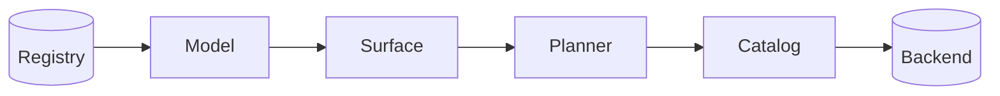

## Status

Proposed. This ADR replaces the ontology as the source of truth for the query engine, the schema migrations and the indexer.
[ADR 000](000_clickhouse_graph_storage.md) is unchanged: ClickHouse remains the graph store.
It works with [ADR 023](https://gitlab.com/gitlab-org/orbit/knowledge-graph/-/merge_requests/3333), whose indexing engine backfills a new package version before it goes live.

## Date

2026-11-08

## Context and problem

The ontology is one YAML tree that describes the graph, its ClickHouse tables, its access rules and its ETL pipelines at once.
The compiler, the migrations and the indexer each read it in their own way.

This shape causes three problems:

- **The ontology mixes concerns.** One entity file holds graph properties, column codecs, the role floor, the redaction ability and the pipeline. A new store, source or access rule edits the same file, and a third party cannot add an entity without touching platform files.
- **Facts are found late, by name.** The compiler asks for facts through about 60 accessors, about 150 times per compile, and every phase re-checks the names it uses. A typo in a YAML file fails a query in production instead of failing a load. The security pass derives each table's guard from its name on every query.
- **Every pipeline builds plans its own way.** A query passes through `Input`, a `QueryPlan` with a relation graph, a SQL AST and then SQL. Passes edit AST fields directly, nothing checks the result, and each backend carries its own emitter.

The next projects make these problems larger.
[Orbit Next](https://gitlab.com/groups/gitlab-org/orbit/-/work_items/16) needs a code backend that is not SQL.
[Third-party data](https://gitlab.com/groups/gitlab-org/orbit/-/work_items/20) needs new entities without compiler changes, some indexed and some fetched at query time.
Agent memory needs custom node types for one tenant.

## Decision

**A data model of versioned packages replaces the ontology. A loader checks the packages once, and every compiler pipeline builds, rewrites and renders its plans through the model's checked catalogs.**

[Packages and catalogs](../architecture/packages-and-catalogs.md) explains how it works.
[Extending the data model](../development/extending-the-data-model.md) shows the packages and the APIs.

1. **Packages replace the ontology.** A package is a set of fragments of five kinds: graph, authorization, storage, source and service. Every fragment refers to the graph, and the graph knows nothing about tables. The platform, each integration and each tenant overlay ship their own packages.
2. **The loader does the work once.** It resolves every name to an ID, checks every rule, and fails once with every error and its package. It precomputes the guard of every read from graph reachability. A hash of the packages identifies the model, and every plan carries it.
3. **Packages load at runtime from a registry keyed by package.** Each package has its own version line. A tenant's model is the active version of every package that applies to it. A new version needs no rebuild and no deploy.
4. **A version goes live after its backfill.** The migration scope is the diff between the new version's storage and the active one's. The indexing engine of ADR 023 backfills the tables in scope, then the registry promotes the version and the query engine swaps models atomically.
5. **A backend implements one trait.** A catalog is the typed view of one connection: its stores, its physical schema and the facts of its engine. Shared code reads capabilities and never checks a backend name. One compile targets one connection.
6. **Every plan is built through a checked catalog builder.** There is one logical plan language and one physical plan language per kind of backend. Shared tracking checks every connection as it is made, and rewrites use the same builder, so no phase can leave an invalid plan.
7. **Surfaces parse, and the compiler plans.** A surface turns text into a logical plan, and construction errors replace the validation pass. The planning phase reads the logical plan and builds the physical plan in one step, with no intermediate plan description.
8. **Security reads guards in its own phase.** It applies the guard of every read as ordinary plan operations, as a filter or as a precondition on the request. A final check proves that every read carries its guard.
9. **The catalog renders its own plans.** The catalog that builds a plan renders it, into SQL with parameters or into the backend's native request.
10. **Plans are tested in three stages.** Plan tests assert the logical plan, the physical plan right after planning, and the physical plan after every phase.

## Consequences

- A package that fails its load checks is rejected, and the previous model keeps serving. Publishing must run the same checks, so authors see the errors first.
- The loader is strict. A fragment cannot carry unknown fields for later use.
- Every namespaced entity needs a guard, so its package must declare a path column, an anchor foreign key or a redaction rule.
- A change to storage goes live only after its backfill. A change that only adds query metadata takes effect on the next load.
- The server holds each model snapshot until the compiles that use it finish, and caches keyed by the model hash evict old snapshots.
- A new backend brings its own plan language and renderer, but it reuses the surfaces, the shared tracking and the phases.

These items are out of scope:

- The indexing engine, which ADR 023 covers
- Connectors for third-party data
- Execution across connections, beyond lookups
- Cost-based join ordering ([ADR 016](016_column_statistics_for_join_ordering.md))

## Why not the alternatives

### Keep the ontology and add accessors

Each new source would add accessors and name checks to each compiler phase.
Storage, sources and access would stay mixed into the graph files, and a third party still could not add an entity without editing platform files.

### Keep one SQL AST for every pass

Passes would keep editing AST fields that nothing checks, and each backend would keep its own emitter.
A backend that is not SQL, such as Orbit Next, would have nothing to compile to.

### Derive the new model from the ontology at runtime

A converter could build the model from the ontology files.
The ontology would stay the source of truth, with the same mixed concerns and the same late, name-based checks.

## References

- [Packages and catalogs](../architecture/packages-and-catalogs.md)
- [Extending the data model](../development/extending-the-data-model.md)
- [MR !1967: ontology graph and reachability](https://gitlab.com/gitlab-org/orbit/knowledge-graph/-/merge_requests/1967)
- [ADR 000: ClickHouse graph storage](000_clickhouse_graph_storage.md)
- [ADR 017: Clone-based non-blocking schema migrations](017_clone_based_non_blocking_migrations.md)
- [ADR 023: A self-contained engine for indexing work](https://gitlab.com/gitlab-org/orbit/knowledge-graph/-/merge_requests/3333)
- [Orbit Code Indexing v2 with Object Store](https://gitlab.com/groups/gitlab-org/orbit/-/work_items/16)
- [Support third-party data sources in Orbit](https://gitlab.com/groups/gitlab-org/orbit/-/work_items/20)
