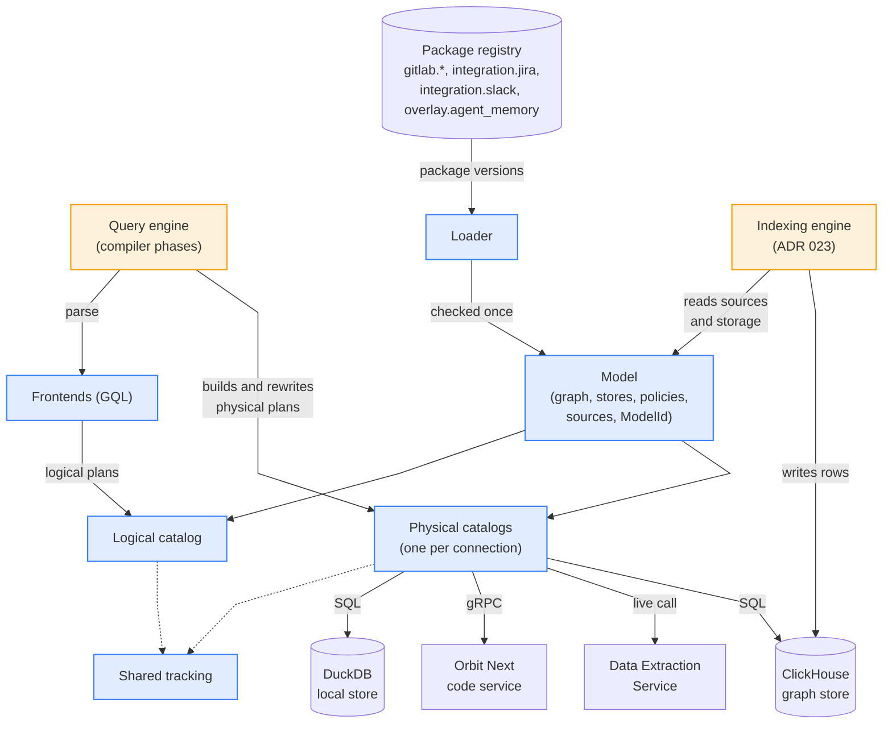
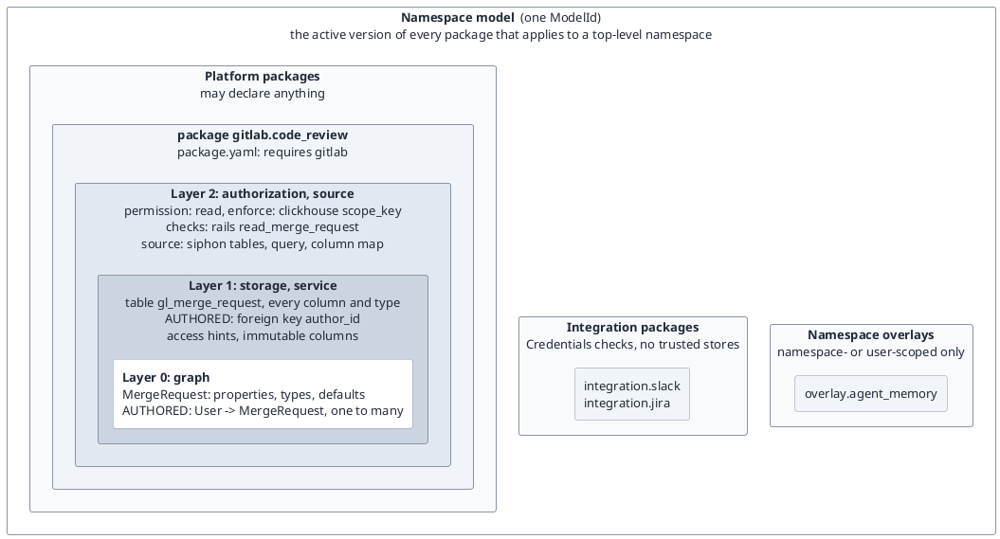
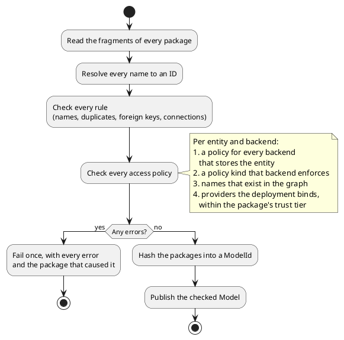
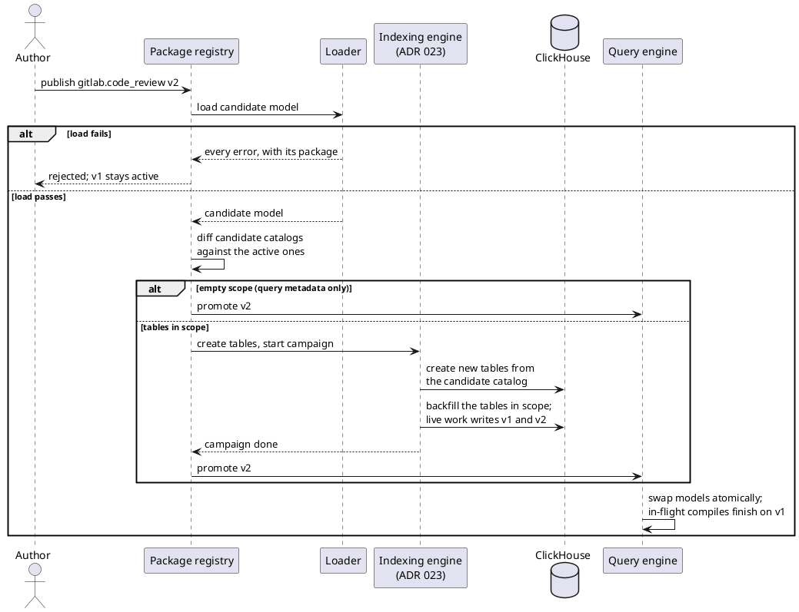
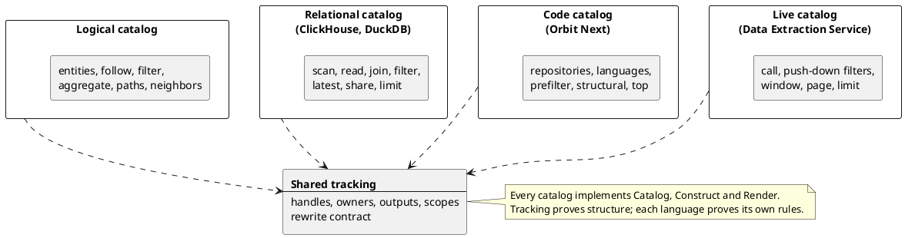
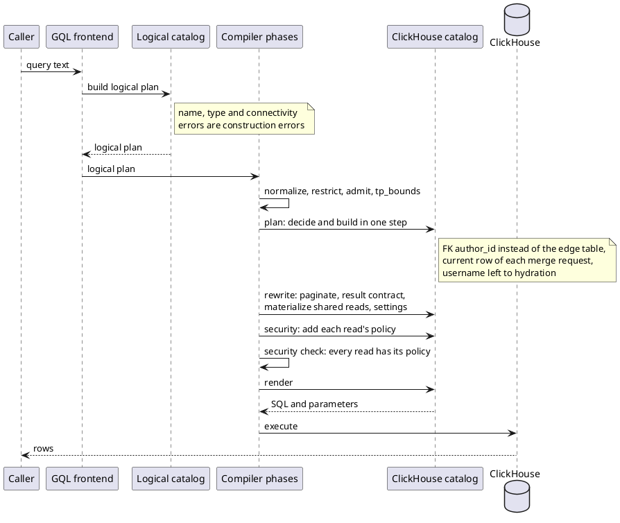
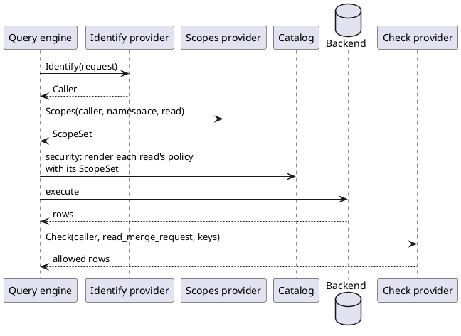
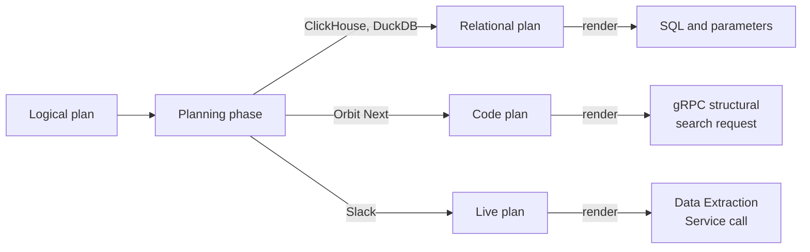
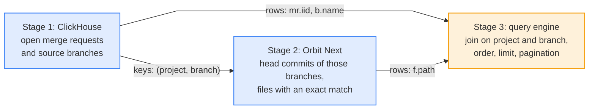

## Status

Approved.

This ADR replaces the ontology as the source of truth for the query engine, the schema migrations and the indexer.
[ADR 000](000_clickhouse_graph_storage.md) is unchanged: ClickHouse remains the graph store.
It works with [ADR 023](023_self_contained_indexing_engine.md), whose indexing engine backfills a new package version before it goes live.
This ADR amends [ADR 017](017_clone_based_non_blocking_migrations.md) on two points.
This ADR derives the migration scope from the diff of the storage and source fragments.
That scope is a floor, which a ledger entry can widen but never narrow.
A shared edge table no longer widens the scope to full.
The migration clones it intact, and re-writes and sweeps only its in-scope variants.

## Date

2026-11-08

## Context and problem

The ontology is one YAML tree that describes the graph, its ClickHouse tables, its access rules and its ETL pipelines at once.
The compiler, the migrations and the indexer each read it in their own way.

This shape causes three problems:

- **The ontology mixes concerns.** One entity file holds graph properties, column codecs, the role floor, the redaction ability and the pipeline. To add a store, source or access rule, an author edits that same file. A third party must edit platform files to add an entity.
- **The compiler finds facts late, by name.** The compiler asks for facts through about 60 accessors, about 150 times per compile. Every phase re-checks the names that it uses. A typo in a YAML file fails a query in production instead of the load. On every query, the security pass derives the guard of each table from the table name.
- **Every pipeline builds plans its own way.** A query passes through `Input`, a `QueryPlan` with a relation graph, a SQL AST and then SQL. Passes edit AST fields directly, and nothing checks the result. Each backend has its own emitter.

The next projects make these problems larger.
[Orbit Next](https://gitlab.com/groups/gitlab-org/orbit/-/work_items/16) needs a code backend that is not SQL.
[Third-party data](https://gitlab.com/groups/gitlab-org/orbit/-/work_items/20) needs new entities without compiler changes, some indexed and some fetched at query time.
Agent memory needs custom node types for one top-level namespace.

## Decision

**A data model of versioned packages replaces the ontology. A loader checks the packages once, and every compiler pipeline builds, rewrites and renders its plans through the model's checked catalogs.**

1. **Packages drive everything, and nothing is hidden.** Every behavior traces to a declaration in a package. Code knows no entity, relationship, table, connection, permission or domain by name. It holds no default for a fact that a package can declare. A missing declaration fails the load, and the loader never guesses.
2. **Packages replace the ontology.** A package is a set of fragments: graph, storage, service, authorization and source. The fragments form layers around the graph, and each layer names only the layers inside it.
3. **The loader does the work once, and infers nothing.** It resolves every name to an ID, checks every rule, and fails once with every error. Packages declare every column, relationship binding and access policy. A hash of the packages identifies the model, and every plan carries that hash.
4. **Packages load at runtime from a registry keyed by package.** Each package has its own version line and declares the packages that it requires. A new version needs no rebuild and no deploy. The tier of the publisher limits what a package can declare.
5. **A version goes live after its backfill.** The migration scope is the diff of the storage and source fragments between the new version and the active version. The indexing engine of ADR 023 backfills the tables in scope. Then the registry promotes the version, and the query engine swaps models atomically.
6. **A backend implements one trait.** A catalog is the typed view of one connection: its stores, its physical schema and the facts of its engine. Shared code reads capabilities and never checks a backend name.
7. **Every plan is built through a checked catalog builder.** There is one logical plan language and one physical plan language per kind of backend. Shared tracking checks every connection when the builder makes it. Rewrites use the same builder, so no phase can leave an invalid plan.
8. **Frontends parse, and the compiler plans.** A frontend turns text into a logical plan, and construction errors replace the validation pass. The planning phase reads the logical plan and builds the physical plan in one step, with no intermediate plan description.
9. **Authorization runs through providers, and security enforces it in its own phase.** Packages declare each entity's scope, permission, one policy per backend and its checks. A deployment binds provider names to modules that identify the caller, list the caller's scopes and check rows. GitLab is one such module. A final check proves that every read carries its policy.
10. **The catalog renders its own plans.** The catalog that builds a plan renders it, into SQL with parameters or into the backend's native request.
11. **A query that spans connections runs as an execution DAG.** The planner splits it into stages, one per connection. Key sets and rows connect the stages. The query engine runs the DAG and applies the final order, limit and pagination.
12. **Plan tests check three points.** Plan tests assert the logical plan, the physical plan right after planning, and the physical plan after every phase.

## How it works

This section describes how a new version of the `gitlab.code_review` package goes live, and how the following query then runs against it.

```cypher
MATCH (u:User)-[:AUTHORED]->(mr:MergeRequest)
WHERE mr.state = 'opened'
RETURN u.username, mr.title LIMIT 10
```

### The system



Blue boxes belong to `query-data-model`, and orange boxes are the two engines.
The model is the only description of the graph.
The query engine and the indexing engine read the same model, so they always agree on what exists and where it lives.
The data model is infrastructure and makes no planning decisions.
The compiler phases make every decision and express it through a catalog.

### 1. Packages describe what exists

A package is a directory of fragments, and the registry holds one version line per package:

```plaintext
packages/
├── gitlab/
│   ├── package.yaml
│   ├── graph.yaml
│   ├── authorization.yaml
│   ├── storage/
│   │   ├── clickhouse.yaml
│   │   └── duckdb.yaml
│   ├── services/
│   │   └── gitaly.yaml
│   └── sources/
│       ├── siphon.yaml
│       └── system_note.sql.j2
├── gitlab.code_review/
│   ├── package.yaml
│   ├── graph.yaml
│   ├── authorization.yaml
│   ├── storage/
│   │   └── clickhouse.yaml
│   └── sources/
│       ├── siphon.yaml
│       └── merge_request.sql.j2
├── gitlab.source_code/
│   ├── package.yaml
│   ├── graph.yaml
│   ├── authorization.yaml
│   ├── storage/
│   │   ├── clickhouse.yaml
│   │   └── orbit_code.yaml
│   └── sources/
│       ├── siphon.yaml
│       └── code_indexer.yaml
├── integration.jira/
│   ├── package.yaml
│   ├── graph.yaml
│   ├── authorization.yaml
│   ├── storage/
│   │   └── clickhouse.yaml
│   └── sources/
│       └── data_lake.yaml
├── integration.slack/
│   ├── package.yaml
│   ├── graph.yaml
│   ├── authorization.yaml
│   ├── storage/
│   │   ├── clickhouse.yaml
│   │   └── live.yaml
│   └── sources/
│       └── data_lake.yaml
└── overlay.agent_memory/
    ├── package.yaml
    ├── graph.yaml
    ├── authorization.yaml
    ├── storage/
    │   └── clickhouse.yaml
    └── sources/
        └── agent_api.yaml
```

A storage fragment takes the name of its backend.
A service or source fragment takes the name of its service or source.
Query templates sit next to the source that names them.



Each layer names only the layers inside it, and the loader checks them from the inside out:

| Layer | Fragment | Names | Owns |
|---|---|---|---|
| 0 | graph | nothing | entities with their identity, properties, types and defaults, and relationship variants with their cardinality and edge-owned attributes |
| 1 | storage | the graph | tables, columns, storage types, immutable columns, and access and statistics hints, plus a foreign key or an edge table for every variant |
| 1 | service | the graph | lookups for virtual properties |
| 2 | authorization | the graph, backends, provider names | scope, permission, one policy per backend that stores the entity, checks by provider |
| 2 | source | the graph | every writer: source tables, query templates and a column map, or the code indexer. Rows land in the tables that storage binds. |
| package | `package.yaml` | other packages | name, `requires` |

The loader infers nothing.
A forgotten column, an unbound variant or a backend without a policy fails the load.

Every stored entity marks exactly one store `complete: true`, even when it has only one store.
That store lists or excludes every graph property.
Unless a query needs another store, the planner reads the entity from that store.
Every other store is partial and lists only the properties that it holds.

Each variant has one binding, in the store that holds its rows.
For a foreign key, that store is the one whose table holds the column.
For an edge table, it is the store that declares the edge table.
That store can differ from the store of the other endpoint.
For example, `IN_WORKSPACE` connects a live message to an indexed workspace.

Storage access hints are backend-neutral, and each backend converts them to its own indexes and sort keys.
If a platform package needs it, a `backend` block overrides that conversion.
An edge table can copy endpoint properties into its sort key for pruning, and storage declares each copy.

Keys are typed, and nothing casts them:

- An entity declares its identity: one property such as `id`, or a composite such as a Jira site and key. Its type is the declared type of that property: an integer, a string or a UUID.
- A foreign key column has the type of the identity that it points to. An edge table declares its endpoint ID columns. A variant binds to an edge table only if both endpoint identities match the types of those columns. An integration with string IDs declares its own edge table.
- A `via` step or a join between different key types needs a declared relationship or a service lookup. The loader rejects a mismatch and does not cast it.

Two rules of the model govern what the stores keep, and no fragment configures them:

- A row's identity is its entity's identity, not its physical key. A row that moves to another path tombstones its old row.
- A relationship exists only while both endpoints are live. If a writer tombstones a node, the indexing engine tombstones the edges of that node in the same flow. It does this in every edge table that binds a variant of the node. A foreign key needs nothing, because it lives on the node's row.

The four places that hold facts are fixed, and nothing lives outside them:

| Owner | Holds |
|---|---|
| Packages | data: entities, identity, storage, bindings, writers, policies |
| Deployment config | connections, providers, limits such as row and node caps, engine settings |
| Backends, in Rust | capabilities: operators, functions, match modes, how each scope kind renders |
| Compiler phases | decisions: routing, foreign key or edge, how to read the latest row, stage splits |

The registry records each package's tier from its publisher, and the loader enforces it:

| Tier | May declare | May not declare |
|---|---|---|
| Platform | permissions, scope kinds, checks by any provider, `none` | |
| Integration | entities in a platform scope, `Credentials` checks | permissions, scope kinds, other checks, `none`, global scope, trusted stores |
| Namespace overlay | namespace- and user-scoped entities | permissions, scope kinds, any check, `none`, trusted stores |

Packages compose under five rules:

- A name from another package must come from a package in `requires`. A version activates only when every package that it requires is active.
- A package cannot redeclare an entity that another package owns.
- A package cannot add a second authorization entry.
- A package can add variants to a platform relationship.
- A package can bind its own entities to a store that another package declares.

### 2. The loader checks every package once



Code after the loader reads facts by ID. Each plan carries the `ModelId` that the compiler used to build it. A missing declaration is always a load error, never a default.

The platform package declares the vocabulary that every package uses: the permissions and the scope kinds. A scope kind is a rule that every backend can render:

| Scope kind | Meaning | Example |
|---|---|---|
| `hierarchy` | a grant on a scope covers its descendants | GitLab namespaces |
| `flat` | a grant covers one scope only | a team, an organization |
| `owner` | one entity owns the row, and the caller must be it | a todo owned by its `User` |
| `global` | no scope, only the permission | `User` |

An entity names its scope, the permission that a read needs, and one `enforce` policy per backend that stores it. A policy names graph properties and relationships, never columns:

| Policy | Example |
|---|---|
| `scope_key`, on the entity | `MergeRequest`: `{clickhouse: {scope_key: traversal_path}}` |
| `scope_key`, through relationships | `File`: `{orbit_code: {scope_key: {via: IN_PROJECT}}}`, and `SlackMessage`: `{live: {scope_key: {via: [IN_WORKSPACE, INSTALLED_IN]}}}` |
| `owner`, through a relationship to the owner | todo: `{clickhouse: {owner: OWNS}}` |
| `none`, only with a check | a check-only entity |

`checks` name a provider and a permission, and they run on the returned rows. A row comes back only if every check allows it.
Each check derives its own key from the row, through the object and ID property that it declares.
Because of this, a Rails check on a commit's project and a Cedar check on the commit itself can sit on one entity.

Every property of an entity, and every attribute of a relationship, has exactly one access class:

| Class | Read | Filter | Pattern match | Who |
|---|---|---|---|---|
| `open` | yes | yes | yes | everyone |
| `exact` | yes | equality and ranges only | no | everyone |
| `unfiltered` | yes | no | no | everyone |
| `hidden` | no | no | no | nobody |
| `admin` | yes | yes | yes | administrators |
| `admin_exact` | yes | equality and ranges only | no | administrators |

If a property has no class or two classes, the load fails. The security phase enforces the classes on every plan, including plans that a phase builds directly.

A relationship declares its own scope and permission, and each variant states which key decides whether the caller can see the edge:

| `of:` | The caller must hold the scope of | Example |
|---|---|---|
| `target` | the target, and the source can sit elsewhere | `User -> MergeRequest` `AUTHORED` |
| `source` | the source, and the target can sit elsewhere | a link from a work item to a global entity |
| `both` | the target, which the source shares | `Job -> Pipeline` `AUTO_CANCELED_BY` |
| `nested` | the target, which lies inside the source's scope | `Group -> Project` `CONTAINS` |
| `holder` | the source, and the target is the scope entity that holds it | `File -> Project` `IN_PROJECT` |
| `own` | the edge's own key, which neither endpoint is known to share | `WorkItem -> WorkItem` links across projects |

The planner uses `of:` for the security filter on an edge read and for the path bounds that it pushes onto that read.
If a variant has `of: own`, the scope key is an attribute of the relationship.
The graph declares that attribute and gives it an access class, like any property.

### 3. A new version goes live after its backfill



The model of a top-level namespace is the active version of every package that applies to that namespace.
The migration scope is the diff of the storage and source fragments. It is a floor, which a ledger entry can widen but never narrow.

Each variant in an edge table has exactly one writer. So a shared edge table migrates in three steps:

1. The migration clones the edge table intact.
2. The writers of the in-scope variants re-emit their rows.
3. After each namespace finishes, a sweep tombstones the older rows of each in-scope variant in that namespace.

The query engine sees a model only after its tables exist.
The indexer and the query engine always agree on one package version.

### 4. Catalogs give each connection a typed view



A catalog is the set of declarations for one model and one plan language, plus the API that builds plans in that language.
The model exposes one logical catalog and one physical catalog per connection.
Each backend implements `StorageBackend` and owns its physical schema and renderer.
It declares its capabilities as facts, and shared code never checks a backend name.
A stage targets one connection, and it can read every store on that connection.

### 5. A query becomes a request



The frontend records what the caller asked for and makes no planning decisions.
The planning phase decides and builds in one step, and every later phase rewrites through the same builder.
The rewrite contract has four fixed rules:

- Inputs come before consumers.
- The plan holds each shared body once.
- A phase never revisits operations that it inserted.
- If outputs change, the phase reconnects them explicitly.

As a result, no phase can produce a plan that the builder rejects.

The security phase adds the policy of each read as plan operations.
It adds a path filter to the `MergeRequest` read.
On the `User` read, it adds a filter that admits rows only if the caller holds `read`.
The Rails checks run on the rows that come back.

### 6. Authorization runs through providers



The contract is one trait with one query type per job:

```rust
pub trait Query { type Response; }

pub trait Provider<Q: Query>: Send + Sync {
    async fn call(&self, query: Q) -> Result<Q::Response, AuthError>;
}

pub struct Identify<'a> { pub request: &'a RequestContext }
pub struct Scopes<'a> { pub caller: &'a Caller, pub scope: ScopeId, pub permission: PermissionId }
pub struct Check<'a> { pub caller: &'a Caller, pub permission: PermissionId, pub object: EntityId, pub keys: &'a [Key] }
pub struct Credentials<'a> { pub caller: &'a Caller, pub service: ServiceId }

pub enum ScopeSet { All, Keys(Vec<Key>), Subtrees(Vec<ScopePath>) }
pub enum Key { Int(i64), Text(String), Uuid(Uuid), Composite(Vec<Key>) }
```

Each query returns one result:

- `Identify` returns a `Caller`.
- `Scopes` returns a `ScopeSet`.
- `Check` returns the allowed rows.
- `Credentials` returns the caller's sign-in for a delegated service.

Every ID that crosses the contract is a typed `Key`, so a provider never assumes integer IDs.
A module implements the queries that it answers, and a `Module` trait builds it from its options.
The deployment config binds each provider name that packages use to a module, the way it binds store connections. It also names the one `Identify` provider.

Each backend renders a `ScopeSet` its own way: `Subtrees` as a prefix filter, `Keys` as an `IN` list, `All` as no filter.
If a set exceeds the key-set cap, the query fails.
Every provider fails closed.

The same contract fits other authorization systems:

| Deployment | `Identify` | `Scopes` | `Check` |
|---|---|---|---|
| GitLab | the session token Rails issues | the caller's paths at the role each permission maps to | Rails abilities, in batches |
| SpiceDB or OpenFGA | an OIDC token | `LookupResources` | `CheckBulkPermissions` |
| Cedar, as a check | the deployment's `Identify` | the deployment's `Scopes` | `is_authorized` per row, over the declared attributes |
| OIDC groups | an OIDC token | the `groups` claim | none |

GitLab access levels live only in the options of the GitLab module, which map each permission to a role. If the provider owns the grants, its `Scopes` answer is exact. GitLab paths, SpiceDB lookups and group claims are examples. If the scope answer for an entity is not exact, the entity must declare a check.

### 7. The same path for every backend



The planning phase turns one logical plan into the physical plan of the connection that holds the data:

| Backend | Plan language | A planning decision | Policy | Request |
|---|---|---|---|---|
| ClickHouse, DuckDB | relational | a foreign key instead of an edge table | path filter | SQL and parameters |
| Orbit Next | code | a trigram prefilter before the ast-grep pass | repository restriction | gRPC structural search |
| Slack | live | a push-down filter | workspace precondition, then the provider check | Data Extraction Service call |

### 8. A query that spans connections runs as a DAG of stages

Some queries need data from more than one connection. This query joins open merge requests in ClickHouse with code in Orbit Next. Orbit Next keeps that code on S3 in its trigram index, commit manifests and code graph:

```cypher
MATCH (mr:MergeRequest {state: 'opened'})-[:SOURCE_BRANCH]->(b:Branch)
      -[:HAS_COMMIT {head: true}]->(:Commit)-[:HAS_FILE]->(f:File)
WHERE f.content CONTAINS EXACT 'TODO(security)'
RETURN mr.iid, b.name, f.path
```

The planner splits the logical plan into stages, one per connection, and connects them in an execution DAG:



Each stage is an ordinary physical plan in its catalog's language.
An edge carries either a key set or rows.
The next stage reads a key set as an `IN` input, and a later stage joins rows.
The planner orders stages by selectivity: the few open merge requests limit the code search to their branches.
The content match runs before order, limit and pagination, so those apply to matched rows only.
Every stage has its own policy.
Plan tests assert the logical plan, the planned DAG and the emitted DAG.

[Extending the data model](../development/extending-the-data-model.md) documents each extension with its packages and code. The extensions are a GitLab entity, Jira, Slack, Orbit Next, agent memory and a new query language.

## Consequences

- If a package fails its load checks, the registry rejects it and the previous model keeps serving. The publish step must run the same checks, so authors see the errors first.
- The loader is strict. A fragment cannot carry unknown fields for later use.
- A test loads every shipped package and collects the names that the packages own: entities, relationships, tables, stores, connections, sources and providers. The test reads the non-test source of the query engine, the indexer, the migrations and the server. If one of the names appears there as a literal, the test fails. The test excludes property names such as `id` or `state`, because they are ordinary words in code. A hard-coded table, entity or connection name fails CI.
- Every scoped entity declares a policy for each backend that stores it. A new backend for an existing entity needs both a storage change and an authorization change.
- The query engine has no built-in authorization system. If a deployment has no Rails, it supplies its own `Identify` and `Scopes` modules. If its scope answer is not exact, it also supplies a `Check` module.
- A change to storage goes live only after its backfill. A change that only adds query metadata takes effect on the next load.
- The migration scope covers what the packages describe: the storage and source fragments. If a change in indexer code alters the rows that the indexer writes, that change is outside every package. The ledger keeps a hand-written widening for it.
- The server keeps each model snapshot until the compiles that use it finish. Caches keyed by the model hash evict old snapshots.
- A new backend brings its own plan language and renderer, but it reuses the frontends, the shared tracking and the phases.
- A key set between stages has a size cap. If the keys of a stage exceed the cap, the query fails. The stage never reads without a bound.

These items are out of scope:

- The indexing engine, which ADR 023 covers
- Connectors for third-party data
- Cost-based join ordering ([ADR 016](016_column_statistics_for_join_ordering.md))

## Why not the alternatives

### Keep the ontology and add accessors

Each new source would add accessors and name checks to each compiler phase.
Storage, sources and access would stay mixed into the graph files.
A third party would still need to edit platform files to add an entity.

### Keep one SQL AST for every pass

Passes would still edit AST fields that nothing checks.
Each backend would keep its own emitter.
A backend that is not SQL, such as Orbit Next, would have nothing to compile to.

### Derive the new model from the ontology at runtime

A converter could build the model from the ontology files.
The ontology would stay the source of truth.
It would keep the same mixed concerns and the same late, name-based checks.

## References

- [Extending the data model](../development/extending-the-data-model.md)
- [Data model spike MR !3346](https://gitlab.com/gitlab-org/orbit/knowledge-graph/-/merge_requests/3346)
- [MR !1967: ontology graph and reachability](https://gitlab.com/gitlab-org/orbit/knowledge-graph/-/merge_requests/1967)
- [ADR 000: ClickHouse graph storage](000_clickhouse_graph_storage.md)
- [ADR 017: Clone-based non-blocking schema migrations](017_clone_based_non_blocking_migrations.md)
- [ADR 023: A self-contained engine for indexing work](023_self_contained_indexing_engine.md)
- [Orbit Code Indexing v2 with Object Store](https://gitlab.com/groups/gitlab-org/orbit/-/work_items/16)
- [Support third-party data sources in Orbit](https://gitlab.com/groups/gitlab-org/orbit/-/work_items/20)
