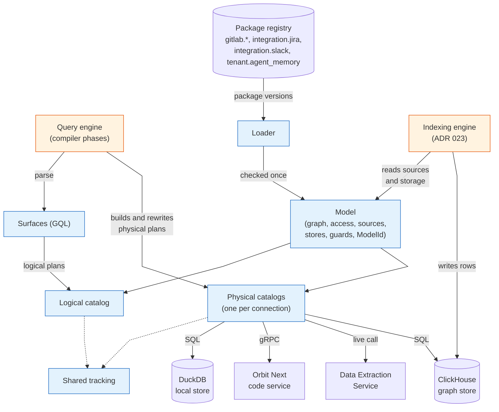
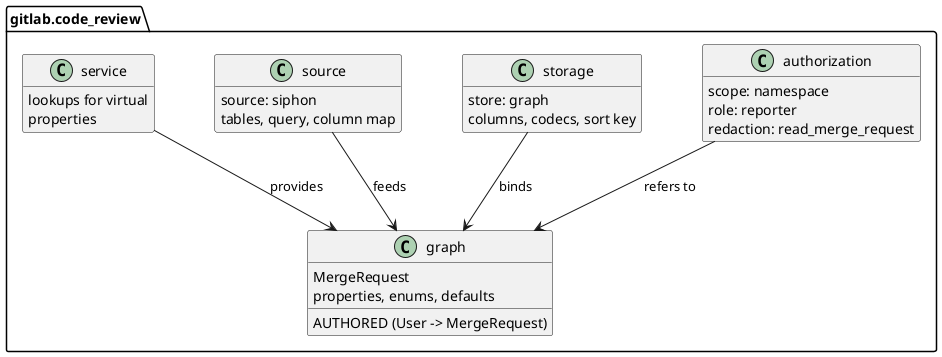
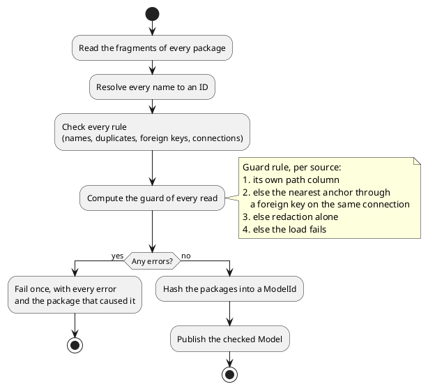
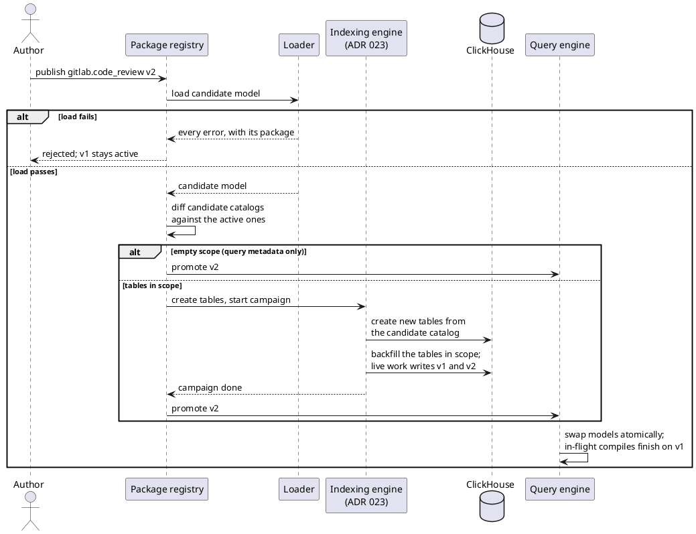
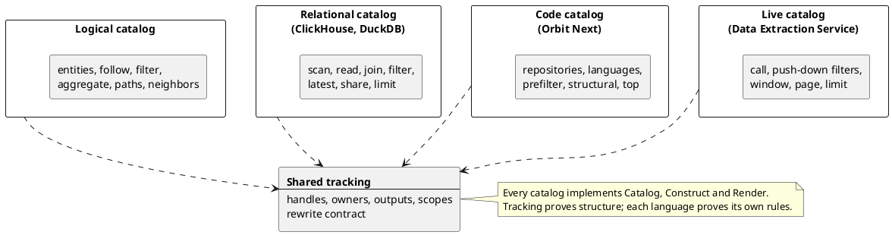
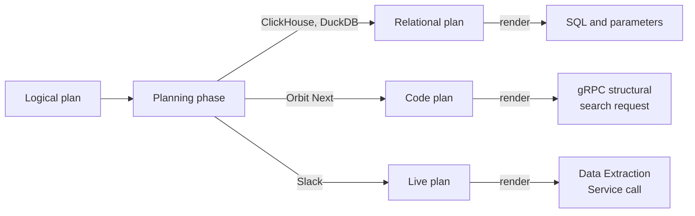

## Status

Proposed. This ADR replaces the ontology as the source of truth for the query engine, the schema migrations and the indexer.
[ADR 000](000_clickhouse_graph_storage.md) is unchanged: ClickHouse remains the graph store.
It works with [ADR 023](https://gitlab.com/gitlab-org/orbit/knowledge-graph/-/merge_requests/3333), whose indexing engine backfills a new package version before it goes live.
This ADR amends [ADR 017](017_clone_based_non_blocking_migrations.md) on two points.
The migration scope is derived from the package diff, as a floor that a ledger entry can widen but never narrow.
A shared edge table no longer widens the scope to full: it is cloned intact, and only in-scope writers are re-run and swept.

## Date

2026-11-08

## Context and problem

The ontology is one YAML tree that describes the graph, its ClickHouse tables, its access rules and its ETL pipelines at once.
The compiler, the migrations and the indexer each read it in their own way.

This shape causes three problems:

- **The ontology mixes concerns.** One entity file holds graph properties, column codecs, the role floor, the redaction ability and the pipeline. A new store, source or access rule edits the same file, and a third party cannot add an entity without touching platform files.
- **Facts are found late, by name.** The compiler asks for facts through about 60 accessors, about 150 times per compile, and every phase re-checks the names it uses. A typo in a YAML file fails a query in production instead of failing a load. The security pass derives each table's guard from its name on every query.
- **Every pipeline builds plans its own way.** A query passes through `Input`, a `QueryPlan` with a relation graph, a SQL AST and then SQL. Passes edit AST fields directly, nothing checks the result, and each backend carries its own emitter.

The next projects make these problems larger.
[Orbit Next](https://gitlab.com/groups/gitlab-org/orbit/-/work_items/16) needs a code backend that is not SQL.
[Third-party data](https://gitlab.com/groups/gitlab-org/orbit/-/work_items/20) needs new entities without compiler changes, some indexed and some fetched at query time.
Agent memory needs custom node types for one tenant.

## Decision

**A data model of versioned packages replaces the ontology. A loader checks the packages once, and every compiler pipeline builds, rewrites and renders its plans through the model's checked catalogs.**

1. **Packages replace the ontology.** A package is a set of fragments of five kinds: graph, authorization, storage, source and service. Every fragment refers to the graph, and the graph knows nothing about tables. The platform, each integration and each tenant overlay ship their own packages.
2. **The loader does the work once.** It resolves every name to an ID, checks every rule, and fails once with every error and its package. It precomputes the guard of every read from graph reachability. A hash of the packages identifies the model, and every plan carries it.
3. **Packages load at runtime from a registry keyed by package.** Each package has its own version line. A tenant's model is the active version of every package that applies to it. A new version needs no rebuild and no deploy.
4. **A version goes live after its backfill.** The migration scope is the diff between the new version's storage and source fragments and the active one's. The indexing engine of ADR 023 backfills the tables in scope, then the registry promotes the version and the query engine swaps models atomically.
5. **A backend implements one trait.** A catalog is the typed view of one connection: its stores, its physical schema and the facts of its engine. Shared code reads capabilities and never checks a backend name. One compile targets one connection.
6. **Every plan is built through a checked catalog builder.** There is one logical plan language and one physical plan language per kind of backend. Shared tracking checks every connection as it is made, and rewrites use the same builder, so no phase can leave an invalid plan.
7. **Surfaces parse, and the compiler plans.** A surface turns text into a logical plan, and construction errors replace the validation pass. The planning phase reads the logical plan and builds the physical plan in one step, with no intermediate plan description.
8. **Security reads guards in its own phase.** It applies the guard of every read as ordinary plan operations, as a filter or as a precondition on the request. A final check proves that every read carries its guard.
9. **The catalog renders its own plans.** The catalog that builds a plan renders it, into SQL with parameters or into the backend's native request.
10. **Plans are tested in three stages.** Plan tests assert the logical plan, the physical plan right after planning, and the physical plan after every phase.

## How it works

This section describes how a new version of the `gitlab.code_review` package goes live, and how the following query then runs against it.

```plaintext
MATCH (u:User)-[:AUTHORED]->(mr:MergeRequest)
WHERE mr.state = 'opened'
RETURN u.username, mr.title LIMIT 10
```

### The system



Blue boxes belong to `query-data-model`, and orange boxes are the two engines.
The model is the only description of the graph.
The query engine and the indexing engine read the same model, so they always agree on what exists and where it lives.
The data model is infrastructure and makes no planning decisions: the compiler phases decide, and express every decision through a catalog.

### 1. Packages describe what exists

A package is a directory of fragments, and the registry holds one version line per package:

```plaintext
packages/
├── gitlab/
│   ├── graph.yaml
│   ├── authorization.yaml
│   ├── storage/
│   │   ├── clickhouse.yaml
│   │   └── duckdb.yaml
│   ├── services/
│   │   └── gitaly.yaml
│   └── sources/
│       ├── siphon.yaml
│       └── system_note.sql.j2
├── gitlab.code_review/
│   ├── graph.yaml
│   ├── authorization.yaml
│   ├── storage/
│   │   └── clickhouse.yaml
│   └── sources/
│       ├── siphon.yaml
│       └── merge_request.sql.j2
├── gitlab.source_code/
│   ├── graph.yaml
│   ├── authorization.yaml
│   ├── storage/
│   │   ├── clickhouse.yaml
│   │   └── orbit_code.yaml
│   └── sources/
│       └── siphon.yaml
├── integration.jira/
│   ├── graph.yaml
│   ├── authorization.yaml
│   ├── storage/
│   │   └── clickhouse.yaml
│   └── sources/
│       └── data_lake.yaml
├── integration.slack/
│   ├── graph.yaml
│   ├── authorization.yaml
│   └── storage/
│       └── live.yaml
└── tenant.agent_memory/
    ├── graph.yaml
    ├── authorization.yaml
    └── storage/
        └── clickhouse.yaml
```

Each package has one `graph.yaml` and one `authorization.yaml`. The `storage/`, `services/` and `sources/` directories hold one fragment per store, service or source. A storage fragment is named after its backend, and a service or source fragment after its service or source. A source fragment can name query templates, which sit next to it.



Every fragment refers to the graph and to nothing else, so a new store, a new source or a new access rule never edits the graph.
A relationship that a foreign key already carries, such as `AUTHORED` through `author_id`, needs no source entry.

Packages compose under four rules: a package cannot redeclare an entity another package owns, cannot add a second authorization entry, can add variants to a platform relationship, and can bind its own entities to a store another package declares.

### 2. The loader checks every package once



Later stages read facts by ID and never search by name.
`MergeRequest` carries its own `traversal_path`, so its guard filters on it. `User` is global, so its guard is a role floor alone.
Every plan carries the `ModelId` it was built against, so no plan is ever checked against a different model.

### 3. A new version goes live after its backfill



The registry keeps one version line per package, and a tenant's model is the active version of every package that applies to it.
The migration scope is the diff of the physical catalogs and the source fragments. It is a floor: a ledger entry can widen it but never narrow it.
A shared edge table is cloned intact. Only its in-scope writers re-emit their rows, and after each namespace finishes, a sweep tombstones that writer's older rows in the namespace.
The query engine never sees a model whose tables are not built yet, and the indexer and the query engine always agree on one package version.

### 4. Catalogs give each connection a typed view



A catalog is the set of declarations for one model and one plan language, plus the API that builds plans in that language.
The model exposes one logical catalog and one physical catalog per connection.
Each backend implements `StorageBackend`, owns its physical schema and renderer, and declares capabilities as facts; shared code never checks a backend name.
One compile targets one connection, and one query can read every store on it.

### 5. A query becomes a request


The surface records what the caller asked for and makes no planning decisions.
The planning phase decides and builds in one step, with no intermediate plan description, and every later phase rewrites through the same builder.
The rewrite contract is fixed: inputs before consumers, each shared body once, no revisiting inserted operations, and explicit reconnection when outputs change.
A phase therefore cannot produce a plan the builder would reject.

Security is its own phase.
It adds the guard of every read as ordinary plan operations, so the `MergeRequest` read gets its path filter and the `User` read its role floor.
A final check proves every read carries its guard before anything leaves the query engine.

### 6. The same path for every backend



The planner chooses the target connection from where the requested data lives.
Each physical language has its own planning decisions: a foreign key over an edge table in a relational plan, a trigram prefilter before an ast-grep pass in a code plan, a push-down filter in a live call.
The guard takes the form each backend understands: a path filter in SQL, a repository restriction for Orbit Next, and a namespace precondition on a Slack call, whose results Slack then filters again through the caller's own sign-in.
Plan tests assert three checked stages of every query: the logical plan, the physical plan right after planning, and the physical plan after every phase.

[Extending the data model](../development/extending-the-data-model.md) documents each extension with its packages and code: a GitLab entity, Jira, Slack, Orbit Next, agent memory and a new query language.

## Consequences

- A package that fails its load checks is rejected, and the previous model keeps serving. Publishing must run the same checks, so authors see the errors first.
- The loader is strict. A fragment cannot carry unknown fields for later use.
- Every namespaced entity needs a guard, so its package must declare a path column, an anchor foreign key or a redaction rule.
- A change to storage goes live only after its backfill. A change that only adds query metadata takes effect on the next load.
- The derived scope covers what the packages describe: storage layout and source fragments. A change in indexer code that alters the rows it writes is outside every package, so the ledger keeps a hand-written widening for it.
- The server holds each model snapshot until the compiles that use it finish, and caches keyed by the model hash evict old snapshots.
- A new backend brings its own plan language and renderer, but it reuses the surfaces, the shared tracking and the phases.

These items are out of scope:

- The indexing engine, which ADR 023 covers
- Connectors for third-party data
- Execution across connections, beyond lookups
- Cost-based join ordering ([ADR 016](016_column_statistics_for_join_ordering.md))

## Why not the alternatives

### Keep the ontology and add accessors

Each new source would add accessors and name checks to each compiler phase.
Storage, sources and access would stay mixed into the graph files, and a third party still could not add an entity without editing platform files.

### Keep one SQL AST for every pass

Passes would keep editing AST fields that nothing checks, and each backend would keep its own emitter.
A backend that is not SQL, such as Orbit Next, would have nothing to compile to.

### Derive the new model from the ontology at runtime

A converter could build the model from the ontology files.
The ontology would stay the source of truth, with the same mixed concerns and the same late, name-based checks.

## References

- [Extending the data model](../development/extending-the-data-model.md)
- [MR !1967: ontology graph and reachability](https://gitlab.com/gitlab-org/orbit/knowledge-graph/-/merge_requests/1967)
- [ADR 000: ClickHouse graph storage](000_clickhouse_graph_storage.md)
- [ADR 017: Clone-based non-blocking schema migrations](017_clone_based_non_blocking_migrations.md)
- [ADR 023: A self-contained engine for indexing work](https://gitlab.com/gitlab-org/orbit/knowledge-graph/-/merge_requests/3333)
- [Orbit Code Indexing v2 with Object Store](https://gitlab.com/groups/gitlab-org/orbit/-/work_items/16)
- [Support third-party data sources in Orbit](https://gitlab.com/groups/gitlab-org/orbit/-/work_items/20)
