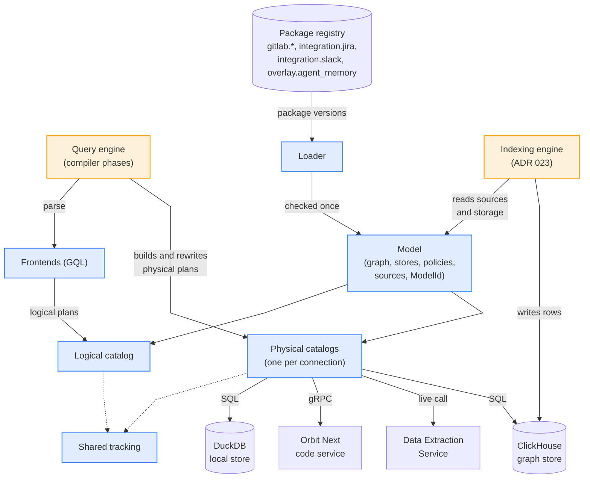
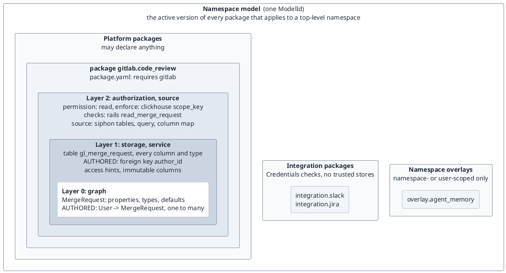
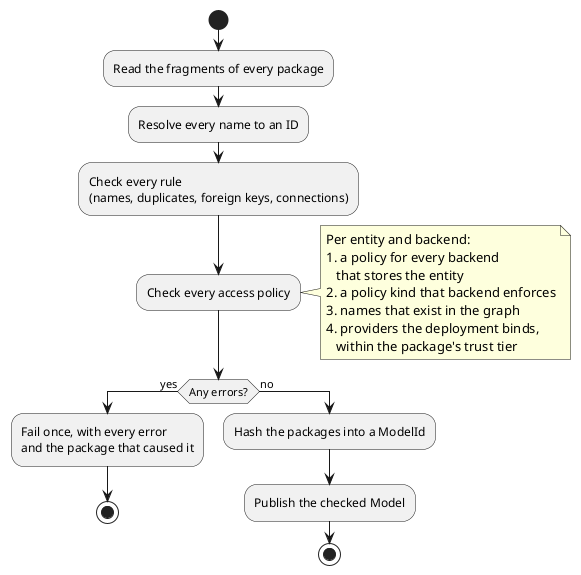
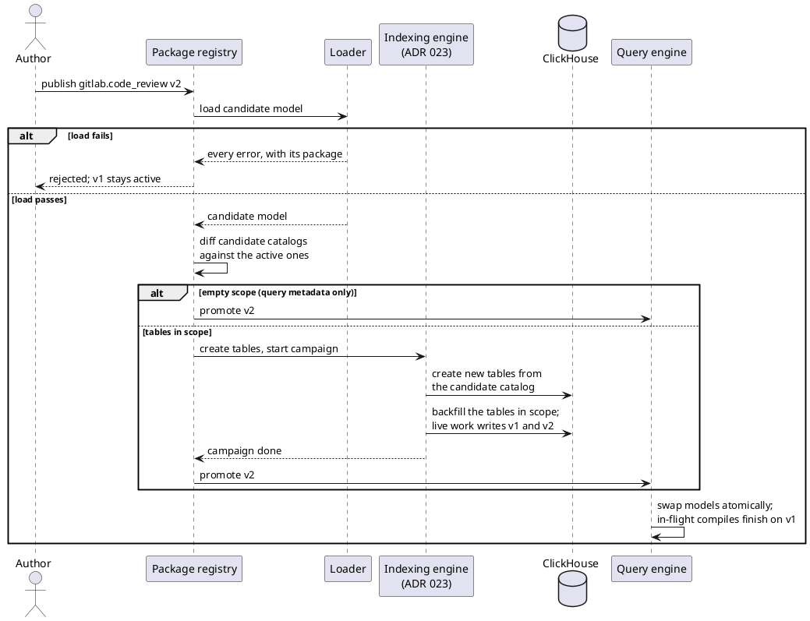
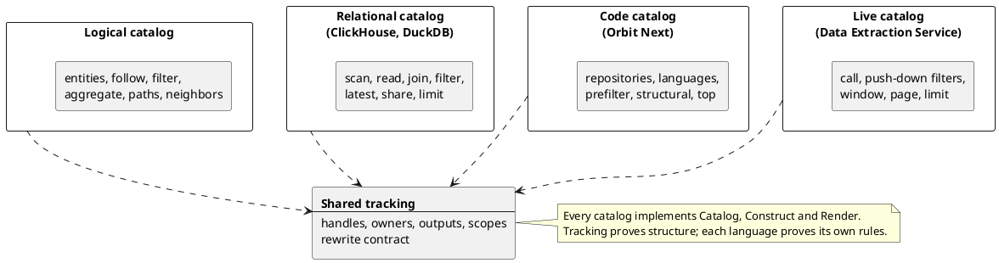
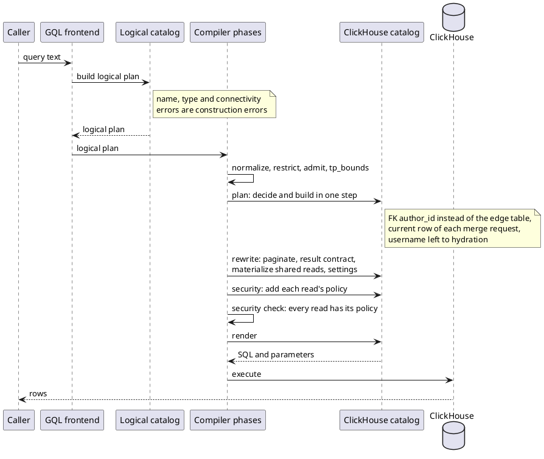
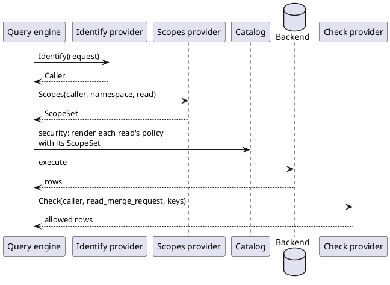
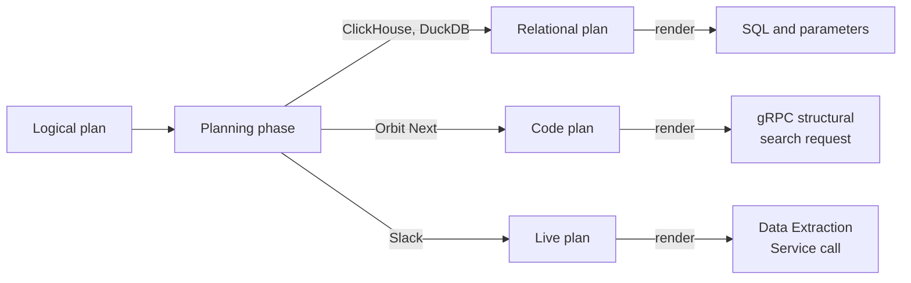
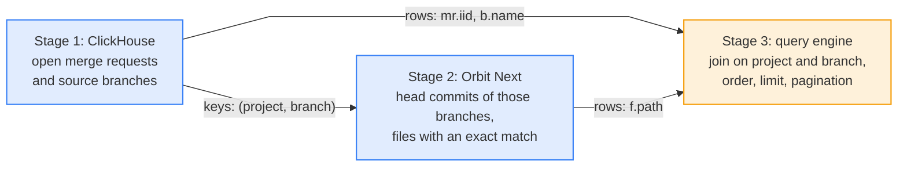

## Status

Approved.

This ADR replaces the ontology as the source of truth for the query engine, the schema migrations and the indexer.
[ADR 000](000_clickhouse_graph_storage.md) is unchanged, so ClickHouse stays the graph store. And the indexing engine of [ADR 023](023_self_contained_indexing_engine.md) backfills each new package version before it goes live.
It amends [ADR 017](017_clone_based_non_blocking_migrations.md) on two points:

- The migration scope comes from the diff of the storage and source fragments, as a floor that a ledger entry can widen but never narrow.
- A shared edge table no longer widens the scope to full. It is cloned intact, and only its in-scope variants are re-written and swept.

## Date

2026-11-08

## Context and problem

The ontology is one YAML tree that describes the graph, its ClickHouse tables, its access rules and its ETL pipelines.
The compiler, the migrations and the indexer each read it their own way. This causes three problems:

- **Mixed concerns.** One entity file holds graph properties, column codecs, the role floor, the redaction ability and the pipeline. A new store, source or access rule edits that file, and a third party must edit platform files to add an entity.
- **Late checks by name.** The compiler reads facts through about 60 accessors, about 150 times per compile, and every phase re-checks its names. A YAML typo fails a query in production instead of the load. The security pass derives each table's guard from its name on every query.
- **One plan path per pipeline.** A query passes through `Input`, a `QueryPlan` with a relation graph, a SQL AST and then SQL. Passes edit the AST directly, nothing checks the result, and each backend has its own emitter.

The next projects make these problems larger:

- [Orbit Next](https://gitlab.com/groups/gitlab-org/orbit/-/work_items/16) needs a code backend that is not SQL.
- [Third-party data](https://gitlab.com/groups/gitlab-org/orbit/-/work_items/20) needs new entities without compiler changes, some indexed and some fetched at query time.
- Agent memory needs custom node types for one top-level namespace.

## Decision

**Versioned packages replace the ontology. A loader checks them once, and every plan is built, rewritten and rendered through the model's checked catalogs.**

1. **Packages declare everything.** Code knows no entity, relationship, table, connection, permission or domain by name. It holds no default for a fact that a package can declare. A missing declaration fails the load.
2. **A package is a set of layered fragments:** graph, storage, service, authorization and source. Each layer names only the layers inside it.
3. **The loader works once and infers nothing.** Packages declare every column, relationship binding and access policy. The loader resolves every name to an ID, checks every rule, and fails once with every error. A hash of the packages identifies the model, and every plan carries it.
4. **Packages load at runtime from a registry.** Each package has its own version line, and a new version needs no rebuild or deploy. The publisher's tier limits what a package can declare. A version goes live after its backfill, and the query engine then swaps models atomically.
5. **Each backend implements one trait.** Its catalog is the typed view of one connection: its stores, its physical schema and the facts of its engine. There is one logical plan language, and one physical plan language per kind of backend. The catalog builds, checks and renders plans into SQL with parameters or a native request. Shared code never checks a backend name.
6. **Frontends parse, and compiler phases plan.** A frontend builds a logical plan, and construction errors replace the validation pass. The planning phase builds the physical plan in one step. Shared tracking checks every connection when the builder makes it. Rewrites use the same builder, so no phase can leave an invalid plan.
7. **Authorization runs through providers.** Packages declare each entity's scope, permission, policies and checks. A deployment binds provider modules that identify the caller, list scopes and check rows. GitLab is one such module. The security phase applies the policies, and a final check proves that every read has its policy.
8. **A query that spans connections runs as a DAG of stages,** one per connection, connected by key sets and rows. The query engine applies the final order, limit and pagination.
9. **Plan tests check three points:** the logical plan, the physical plan right after planning, and the physical plan after every phase.

## How it works

This section follows a new version of the `gitlab.code_review` package, then this query:

```cypher
MATCH (u:User)-[:AUTHORED]->(mr:MergeRequest)
WHERE mr.state = 'opened'
RETURN u.username, mr.title LIMIT 10
```

### The system



Blue boxes belong to `query-data-model`, and orange boxes are the two engines.
The model is the only description of the graph, so both engines always agree on what exists and where it lives.
The data model is infrastructure and makes no planning decisions. The compiler phases make every decision and express it through a catalog.

### 1. Packages describe what exists

A package is a directory of fragments, with one version line per package in the registry:

```plaintext
packages/
├── gitlab/
│   ├── package.yaml
│   ├── graph.yaml
│   ├── authorization.yaml
│   ├── storage/
│   │   ├── clickhouse.yaml
│   │   └── duckdb.yaml
│   ├── services/
│   │   └── gitaly.yaml
│   └── sources/
│       ├── siphon.yaml
│       └── system_note.sql.j2
├── gitlab.code_review/
│   ├── package.yaml
│   ├── graph.yaml
│   ├── authorization.yaml
│   ├── storage/
│   │   └── clickhouse.yaml
│   └── sources/
│       ├── siphon.yaml
│       └── merge_request.sql.j2
├── gitlab.source_code/
│   ├── package.yaml
│   ├── graph.yaml
│   ├── authorization.yaml
│   ├── storage/
│   │   ├── clickhouse.yaml
│   │   └── orbit_code.yaml
│   └── sources/
│       ├── siphon.yaml
│       └── code_indexer.yaml
├── integration.jira/
│   ├── package.yaml
│   ├── graph.yaml
│   ├── authorization.yaml
│   ├── storage/
│   │   └── clickhouse.yaml
│   └── sources/
│       └── data_lake.yaml
├── integration.slack/
│   ├── package.yaml
│   ├── graph.yaml
│   ├── authorization.yaml
│   ├── storage/
│   │   ├── clickhouse.yaml
│   │   └── live.yaml
│   └── sources/
│       └── data_lake.yaml
└── overlay.agent_memory/
    ├── package.yaml
    ├── graph.yaml
    ├── authorization.yaml
    ├── storage/
    │   └── clickhouse.yaml
    └── sources/
        └── agent_api.yaml
```

A storage fragment is named after its backend, and a source or service fragment after its source or service. Query templates sit next to the source that names them.



Each layer names only the layers inside it, and the loader checks them from the inside out:

| Layer | Fragment | Names | Owns |
|---|---|---|---|
| 0 | graph | nothing | entities with identity, properties, types and defaults; relationship variants with cardinality and edge attributes |
| 1 | storage | the graph | tables, typed columns, immutable columns, access and statistics hints, a foreign key or edge table for every variant |
| 1 | service | the graph | lookups for virtual properties |
| 2 | authorization | the graph, backends, providers | scope, permission, one policy per backend, checks by provider |
| 2 | source | the graph | every writer: source tables, templates and a column map, or the code indexer; rows land in the tables that storage binds |
| package | `package.yaml` | other packages | name, `requires` |

Nothing is inferred, so a forgotten column, an unbound variant or a backend without a policy fails the load.

Storage rules:

- Every stored entity marks one store `complete: true`, even with one store. That store lists or excludes every property, and the planner reads the entity there unless a query needs another store. Other stores list only what they hold.
- Each variant is bound once, in the store that holds its rows. A foreign key lives in the store whose table holds the column, and an edge table in the store that declares it. That store can differ from the other endpoint's, as with `IN_WORKSPACE` from a live message to an indexed workspace.
- Access hints are backend-neutral. Each backend turns them into indexes and sort keys, and a platform `backend` block can override that.
- An edge table can copy endpoint properties into its sort key for pruning, and storage declares each copy.

Key rules:

- Keys are typed, and nothing casts them. An identity is one property such as `id`, or a composite such as a Jira site and key. Its type is that property's type: integer, string or UUID.
- A foreign key column has the type of the identity it points to. An edge table declares its endpoint ID columns. A variant binds to an edge table only if both endpoint identities match its ID columns. An integration with string IDs declares its own edge table.
- A `via` step or a join between different key types needs a declared relationship or a service lookup. The loader rejects a mismatch and never casts.

Two model rules need no configuration:

- A row's identity is its entity's identity, not its physical key. A row that moves to another path tombstones its old row.
- An edge lives only while both endpoints live. When a writer tombstones a node, the indexing engine tombstones its edges in every edge table that binds it, in the same flow. A foreign key needs nothing, because it lives on the node's row.

Four fixed places hold every fact, and nothing lives outside them:

| Owner | Holds |
|---|---|
| Packages | data: entities, identity, storage, bindings, writers, policies |
| Deployment config | connections, providers, limits such as row and node caps, engine settings |
| Backends, in Rust | capabilities: operators, functions, match modes, how each scope kind renders |
| Compiler phases | decisions: routing, foreign key or edge, how to read the latest row, stage splits |

The registry records each package's tier from its publisher, and the loader enforces it:

| Tier | May declare | May not declare |
|---|---|---|
| Platform | permissions, scope kinds, checks by any provider, `none` | |
| Integration | entities in a platform scope, `Credentials` checks | permissions, scope kinds, other checks, `none`, global scope, trusted stores |
| Namespace overlay | namespace- and user-scoped entities | permissions, scope kinds, any check, `none`, trusted stores |

Composition rules:

- A package names only packages in its `requires`, and a version activates only when every required package is active.
- A package cannot redeclare another package's entity or add a second authorization entry.
- A package can add variants to a platform relationship, and bind its own entities to another package's store.

### 2. The loader checks every package once



Code after the loader reads facts by ID, and every plan carries the `ModelId` it was built against. A missing declaration is always a load error, never a default.

The platform package declares the permissions and the scope kinds. Every backend can render each scope kind:

| Scope kind | Meaning | Example |
|---|---|---|
| `hierarchy` | a grant covers the scope's descendants | GitLab namespaces |
| `flat` | a grant covers one scope | a team, an organization |
| `owner` | one entity owns the row, and the caller must be that entity | a todo owned by its `User` |
| `global` | no scope, only the permission | `User` |

An entity declares its scope, the permission that a read needs, and one `enforce` policy per backend that stores it. Policies name graph properties and relationships, never columns:

| Policy | Example |
|---|---|
| `scope_key` on the entity | `MergeRequest`: `{clickhouse: {scope_key: traversal_path}}` |
| `scope_key` through relationships | `File`: `{orbit_code: {scope_key: {via: IN_PROJECT}}}`, `SlackMessage`: `{live: {scope_key: {via: [IN_WORKSPACE, INSTALLED_IN]}}}` |
| `owner` through a relationship | todo: `{clickhouse: {owner: OWNS}}` |
| `none`, only with a check | a check-only entity |

`checks` name a provider and a permission and run on returned rows. A row comes back only if every check allows it. Each check derives its own key from the row through its declared object and ID property. So a Rails check on a commit's project and a Cedar check on the commit itself can share one entity.

Every property and edge attribute has exactly one access class. If it has none or two, the load fails. The security phase enforces the classes on every plan, including plans that a phase builds directly.

| Class | Read | Filter | Pattern match | Who |
|---|---|---|---|---|
| `open` | yes | yes | yes | everyone |
| `exact` | yes | equality and ranges only | no | everyone |
| `unfiltered` | yes | no | no | everyone |
| `hidden` | no | no | no | nobody |
| `admin` | yes | yes | yes | administrators |
| `admin_exact` | yes | equality and ranges only | no | administrators |

A relationship declares its own scope and permission. Each variant states, with `of:`, whose scope decides whether the caller sees the edge:

| `of:` | The caller must hold the scope of | Example |
|---|---|---|
| `target` | the target; the source can sit elsewhere | `User -> MergeRequest` `AUTHORED` |
| `source` | the source; the target can sit elsewhere | a link from a work item to a global entity |
| `both` | the target, which the source shares | `Job -> Pipeline` `AUTO_CANCELED_BY` |
| `nested` | the target, inside the source's scope | `Group -> Project` `CONTAINS` |
| `holder` | the source; the target is the scope entity that holds it | `File -> Project` `IN_PROJECT` |
| `own` | the edge's own key, which neither endpoint is known to share | `WorkItem -> WorkItem` across projects |

With `of: own`, the key is a relationship attribute that the graph declares and classes like any property. The planner reads `of:` for the security filter on an edge read and for its path bounds.

### 3. A new version goes live after its backfill



A top-level namespace's model is the active version of every package that applies to it.
The migration scope is the diff of the storage and source fragments, and a ledger entry can widen it but never narrow it.
Each edge-table variant has one writer. So a shared edge table is cloned intact, and only its in-scope writers re-emit their rows. After each namespace finishes, a sweep tombstones the older rows of each in-scope variant in that namespace.
The query engine sees a model only after its tables exist, so the indexer and the query engine always agree on one package version.

### 4. Catalogs give each connection a typed view



A catalog holds the declarations for one model and one plan language, plus the API that builds plans in it.
The model exposes one logical catalog and one physical catalog per connection.
Each backend implements `StorageBackend`, owns its schema and renderer, and declares its capabilities as facts.
A stage targets one connection and can read every store on it.

### 5. A query becomes a request



The frontend records what the caller asked for and makes no planning decisions.
The planning phase decides and builds in one step, with no intermediate plan description. Later phases rewrite through the same builder under four rules:

- Inputs come before consumers.
- The plan holds each shared body once.
- A phase never revisits operations that it inserted.
- A phase reconnects changed outputs explicitly.

The security phase adds each read's policy as plan operations. The `MergeRequest` read gets a path filter, and the `User` read admits rows only if the caller holds `read`. So no phase can produce a plan that the builder rejects. The Rails checks run on the returned rows.

### 6. Authorization runs through providers



The contract is one trait with one query type per job:

```rust
pub trait Query { type Response; }

pub trait Provider<Q: Query>: Send + Sync {
    async fn call(&self, query: Q) -> Result<Q::Response, AuthError>;
}

pub struct Identify<'a> { pub request: &'a RequestContext }
pub struct Scopes<'a> { pub caller: &'a Caller, pub scope: ScopeId, pub permission: PermissionId }
pub struct Check<'a> { pub caller: &'a Caller, pub permission: PermissionId, pub object: EntityId, pub keys: &'a [Key] }
pub struct Credentials<'a> { pub caller: &'a Caller, pub service: ServiceId }

pub enum ScopeSet { All, Keys(Vec<Key>), Subtrees(Vec<ScopePath>) }
pub enum Key { Int(i64), Text(String), Uuid(Uuid), Composite(Vec<Key>) }
```

`Identify` returns the caller, `Scopes` a scope set, `Check` the allowed rows, and `Credentials` the caller's sign-in for a delegated service.
Every ID that crosses the contract is a typed `Key`, so no provider assumes integer IDs.
A module implements the queries it answers, and a `Module` trait builds it from its options.
The deployment config binds each provider name to a module, as it binds store connections, and names one `Identify` provider.
Each backend renders a scope set its own way: `Subtrees` as a prefix filter, `Keys` as an `IN` list, `All` as no filter.
Every provider fails closed, and a key set over the cap fails the query.

The same contract fits other authorization systems:

| Deployment | `Identify` | `Scopes` | `Check` |
|---|---|---|---|
| GitLab | the session token Rails issues | the caller's paths at the role each permission maps to | Rails abilities, in batches |
| SpiceDB or OpenFGA | an OIDC token | `LookupResources` | `CheckBulkPermissions` |
| Cedar, as a check | the deployment's `Identify` | the deployment's `Scopes` | `is_authorized` per row, over the declared attributes |
| OIDC groups | an OIDC token | the `groups` claim | none |

GitLab access levels appear only in the GitLab module's options, which map each permission to a role.
A scope answer is exact when the provider owns the grants, as GitLab paths, SpiceDB lookups and group claims do. Otherwise the entity must declare a check.

### 7. The same path for every backend



The planning phase turns one logical plan into the physical plan of the connection that holds the data:

| Backend | Plan language | A planning decision | Policy | Request |
|---|---|---|---|---|
| ClickHouse, DuckDB | relational | a foreign key instead of an edge table | path filter | SQL and parameters |
| Orbit Next | code | a trigram prefilter before the ast-grep pass | repository restriction | gRPC structural search |
| Slack | live | a push-down filter | workspace precondition, then the provider check | Data Extraction Service call |

### 8. A query that spans connections runs as a DAG of stages

This query joins open merge requests in ClickHouse with code that Orbit Next keeps on S3 in its trigram index, commit manifests and code graph:

```cypher
MATCH (mr:MergeRequest {state: 'opened'})-[:SOURCE_BRANCH]->(b:Branch)
      -[:HAS_COMMIT {head: true}]->(:Commit)-[:HAS_FILE]->(f:File)
WHERE f.content CONTAINS EXACT 'TODO(security)'
RETURN mr.iid, b.name, f.path
```

The planner splits the logical plan into one stage per connection and connects them in a DAG:



Each stage is an ordinary physical plan in its catalog's language. An edge carries a key set, which the next stage reads as an `IN` input, or rows that a later stage joins.
The planner orders stages by selectivity: the few open merge requests limit the code search to their branches.
The content match runs before order, limit and pagination, so those apply to matched rows only.
Every stage carries its own policy, and plan tests assert the logical plan, the planned DAG and the emitted DAG.

[Extending the data model](../development/extending-the-data-model.md) shows each extension with its packages and code. It covers a GitLab entity, Jira, Slack, Orbit Next, agent memory and a new query language.

## Consequences

- A package that fails its checks is rejected, and the previous model keeps serving. Publishing must run the same checks, so authors see errors first.
- The loader is strict, so a fragment cannot carry unknown fields for later use.
- A CI test loads every shipped package and collects the names that the packages own: entities, relationships, tables, stores, connections, sources and providers. It fails if one appears as a literal in the non-test source of the query engine, indexer, migrations or server. It exempts property names such as `id` or `state`, because they are ordinary words in code.
- Every scoped entity declares a policy for each backend that stores it. So a new backend for an existing entity needs a storage change and an authorization change.
- The query engine has no built-in authorization system. A deployment without Rails supplies its own `Identify` and `Scopes` modules, plus a `Check` module if its scopes are not exact.
- A storage change goes live only after its backfill. A change that only adds query metadata takes effect on the next load.
- Indexer code changes that alter written rows sit outside every package, so the ledger widens their scope by hand.
- The server keeps each model snapshot until its compiles finish, and caches keyed by the model hash evict old ones.
- A new backend brings its own plan language and renderer and reuses the frontends, tracking and phases.
- A key set between stages has a size cap. A stage over it fails the query and never reads without a bound.

These items are out of scope:

- The indexing engine, which ADR 023 covers
- Connectors for third-party data
- Cost-based join ordering ([ADR 016](016_column_statistics_for_join_ordering.md))

## Why not the alternatives

### Keep the ontology and add accessors

Each new source adds accessors and name checks to every phase. Storage, sources and access stay mixed into the graph files, and a third party still edits platform files.

### Keep one SQL AST for every pass

Passes keep editing AST fields that nothing checks, and each backend keeps its own emitter. A backend that is not SQL, such as Orbit Next, has nothing to compile to.

### Derive the new model from the ontology at runtime

A converter could build the model from the ontology files. The ontology would stay the source of truth, with the same mixed concerns and late checks.

## References

- [Extending the data model](../development/extending-the-data-model.md)
- [Data model spike MR !3346](https://gitlab.com/gitlab-org/orbit/knowledge-graph/-/merge_requests/3346)
- [MR !1967: ontology graph and reachability](https://gitlab.com/gitlab-org/orbit/knowledge-graph/-/merge_requests/1967)
- [ADR 000: ClickHouse graph storage](000_clickhouse_graph_storage.md)
- [ADR 017: Clone-based non-blocking schema migrations](017_clone_based_non_blocking_migrations.md)
- [ADR 023: A self-contained engine for indexing work](023_self_contained_indexing_engine.md)
- [Orbit Code Indexing v2 with Object Store](https://gitlab.com/groups/gitlab-org/orbit/-/work_items/16)
- [Support third-party data sources in Orbit](https://gitlab.com/groups/gitlab-org/orbit/-/work_items/20)
