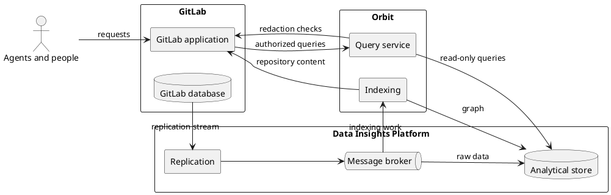

**TL;DR:** Orbit turns GitLab code and lifecycle data into one property
graph that agents and people can query. It reads GitLab data through
replication and runs every analytical query on its own store, so the GitLab
database never serves that load. It is long-term data infrastructure that
other GitLab features can build on.

## Why Orbit

- **Connected answers.** Agents and people ask questions that cross many
  objects. An example is the failed pipelines of the merge requests
  that close the issues in an epic. The GitLab APIs need many calls for one such
  question, and the GitLab database is not built for analytical queries.
- **Minimal impact on GitLab.** Orbit reads a replication stream and runs
  every analytical query on its own store. This was a primary reason to
  build Orbit on the Data Insights Platform instead of adding a graph
  database. [ADR 000](../adr/000_clickhouse_graph_storage.md)
  records the evaluation.
- **A data platform.** The replication pipeline and the analytical store are
  shared GitLab infrastructure. Other features can build on them, and the
  graph grows as GitLab adds data.

## Goals

- Answer traversal, neighbor, path, and aggregation questions with one
  bounded query.
- Never show a caller data that GitLab would not show them.
- Keep the load on the GitLab instance as small as possible.
- Run the same architecture on GitLab.com, GitLab Dedicated, and
  GitLab Self-Managed. Small installs stay cheap, and large ones scale out.
- Upgrade and patch Orbit separately from GitLab. Customers never run
  scripts to repair data.

## Non-goals

- Orbit is not a transactional store, and it is not real time. A result
  shows the graph at the time of the last indexing.
- Orbit does not write to GitLab.
- Orbit does not decide permissions. GitLab does.
- Orbit Remote does not run database queries that callers write. Callers
  use the Orbit query languages.

## System context

Today the replication service is Siphon, the broker is NATS JetStream, and
the store is ClickHouse.

## Parts

- [Data model](data-model.md): the property graph and the ontology that
  defines it.
- [SDLC indexing](sdlc-indexing.md): builds the lifecycle graph from
  replicated GitLab data.
- [Code indexing](code-indexing.md): builds the code graph from
  repositories.
- [Schema evolution](schema-evolution.md): moves the graph to a new schema
  with no downtime.
- [Querying](querying.md): turns a graph question into one bounded,
  authorized query.
  - [Orbit Query Engine](query-engine.md): the data model, the pipelines,
    and each step from query to SQL.
- [Security](security.md): makes sure each caller sees only what GitLab
  lets them see.
- [Orbit CLI](orbit-cli.md): indexes and queries a repository on the user's
  machine.
- [Testing](../testing/README.md): proves that a change is correct before it ships.

Orbit Remote runs as separate roles for query serving, indexing, dispatch,
and health. Each role scales and fails on its own.

## System contracts

- Every request reaches Orbit Remote through GitLab. GitLab is the only
  source of truth for identity and permissions.
- Orbit gets GitLab data only through replication and GitLab APIs. It never
  connects to the GitLab database or to repository storage.
- The query service only reads. Only the indexing and dispatch roles write
  to the graph.
- One ontology defines the graph. Storage, indexing, query validation, and
  authorization all come from it.
- Every query is bounded and scoped to the caller. A query that breaks a
  rule fails instead of returning data outside that scope.
- Indexing is idempotent and can resume after a failure. Orbit can rebuild
  the lifecycle graph from the raw replicated data and the code graph from
  the repositories.
- A schema change builds the new graph next to the active one. Queries move
  to the new graph when its lifecycle data is complete. Code indexing does
  not block the switch.

## Decisions

The [ADRs](../adr/) record each decision and the
reasons for it. A new ADR replaces an old one when a decision changes. The
pages in this folder state the current contracts. New pages follow the
[page template](template.md).
