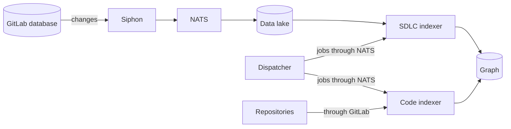
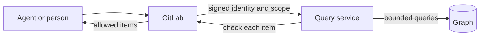

Orbit turns GitLab data about your software into one graph that agents and people can query.
Groups, projects, merge requests, pipelines, vulnerabilities, and code become nodes, and the links between them become edges.

## Why we built Orbit

Say you want to know which merge requests closed the issues in an epic, and which of their pipelines failed.
The GitLab API needs dozens of calls for that, and Orbit answers it with one graph query.

We also wanted that load to stay off GitLab.
Orbit reads a replicated copy of GitLab data and runs every graph query on its own store, so the GitLab database never serves them.
That small footprint was a main reason we built on the ClickHouse, Siphon, and NATS stack instead of buying a graph database.
[ADR 000](../adr/000_clickhouse_graph_storage.md) has the full evaluation.

That stack is shared GitLab data infrastructure, so we see Orbit as a long-term data platform that other features can build on.

## How data gets in

Siphon copies changes to selected GitLab tables into a ClickHouse data lake.
The dispatcher schedules work and sends jobs to both indexers.
The SDLC indexer reads the lake one namespace at a time, plus one pass for instance-wide entities, and turns rows into nodes and edges.
The code indexer fetches repositories through GitLab, parses the source, and writes the code graph into the same store.

## How a question gets answered

Every request goes through GitLab first, and GitLab works out who the caller is and which groups they can see.
Orbit compiles the question into a bounded query inside that scope.
GitLab then checks each result again before anything goes back.
The [security](security.md) page walks through those checks.

## The parts

| Page | What it covers |
| --- | --- |
| [Data model](data-model.md) | The graph and the ontology that defines it |
| [SDLC indexing](indexing/sdlc-indexing.md) | How replicated GitLab data becomes the SDLC graph |
| [Code indexing](indexing/code-indexing.md) | How repositories become the code graph |
| [Schema evolution](indexing/schema-evolution.md) | How the graph moves to a new schema with no downtime |
| [Resiliency](indexing/resiliency.md) | How indexing recovers from crashes, retries, and outages |
| [Querying](querying/README.md) | How a graph question becomes one safe query |
| [Security](security.md) | How each caller sees only what GitLab lets them see |
| [Orbit CLI](orbit-cli.md) | How Orbit indexes and queries code on your own machine |
| [Testing](../testing/README.md) | How we prove a change is correct before it ships |

## Rules every part follows

- **GitLab is the front door.** Every request comes through GitLab, and GitLab decides who can see what. Orbit enforces that decision in each query.
- **Orbit only reads from GitLab.** It uses replication and the GitLab APIs, and never connects to the GitLab database or repository storage.
- **One ontology defines the graph.** Storage, indexing, query validation, and authorization all come from that one declaration.
- **Every query is bounded and scoped.** A query that breaks a rule fails instead of returning data outside the caller's scope.
- **Only the indexers and the dispatcher write.** The query service only reads the graph.
- **Indexing can always start over.** A crashed run resumes where it stopped, and Orbit can rebuild the whole graph from the data lake and the repositories.
- **Schema changes don't take Orbit down.** A new graph builds next to the live one, and queries switch over once its SDLC data is complete.

## What Orbit isn't

Orbit isn't a transactional store or a real-time one, so a result shows the graph as of the last indexing run.
It never writes to GitLab.
Callers send a JSON graph query, a named query, or a GQL query, not raw database queries.

## Where it runs

The same architecture runs on GitLab.com, GitLab Dedicated, and GitLab Self-Managed.
Orbit Remote runs as separate roles for queries, indexing, dispatch, and health checks, plus a one-time ClickHouse setup job.
Orbit ships and upgrades separately from GitLab.

## Decisions

The [ADRs](../adr/) record our main decisions and why we made them, and these pages describe how Orbit works today.
