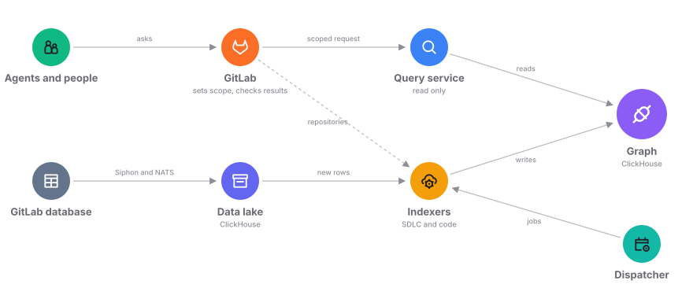

Orbit turns GitLab data and code into one graph. Agents and people query that
graph to answer questions that would take many GitLab API calls. The
[data model](data-model.md) page describes what the graph holds.

## How data gets in

Orbit only reads from GitLab. It never connects to the GitLab database. Siphon
copies the GitLab tables we need into a data lake. The SDLC indexer turns
those rows into nodes and edges. The code indexer fetches repositories through
GitLab and adds the code graph. A dispatcher schedules work for both indexers.

[SDLC indexing](indexing/sdlc-indexing.md) and
[code indexing](indexing/code-indexing.md) walk through each indexer.
[Schema evolution](indexing/schema-evolution.md) covers schema changes with no
downtime. [Resiliency](indexing/resiliency.md) covers how indexing recovers
from failures.

## How a question gets answered

Every request goes through GitLab first. GitLab checks who the caller is and
what they can see. Orbit then runs one bounded query inside that scope. GitLab
checks each result again before it goes back. Results show the graph as of the
last indexing run.

[Querying](querying/README.md) follows a request from start to end.
[Security](security.md) explains each check.

## Why we built it this way

We wanted deploying Orbit to add no operational load to GitLab. Orbit runs
every query on its own store, so the GitLab database never serves graph
queries. We built that store on data infrastructure that GitLab already runs.

[ADR 000](../adr/000_clickhouse_graph_storage.md) compares dedicated graph
databases, like Neo4j, with the databases GitLab already runs. Reusing one of
those meant one less database to deploy and maintain.

## Where it runs

Orbit runs on GitLab.com, GitLab Dedicated, and GitLab Self-Managed. It ships
separately from GitLab.
[Orbit on GitLab Self-Managed](https://docs.gitlab.com/orbit/self-managed/)
covers the setup.

## More pages

- [Orbit CLI](orbit-cli.md) indexes and queries code on your own machine.
- [Testing](../testing/README.md) shows how we prove a change works before it
  ships.
- The [ADRs](../adr/) record our main decisions and why we made them.
