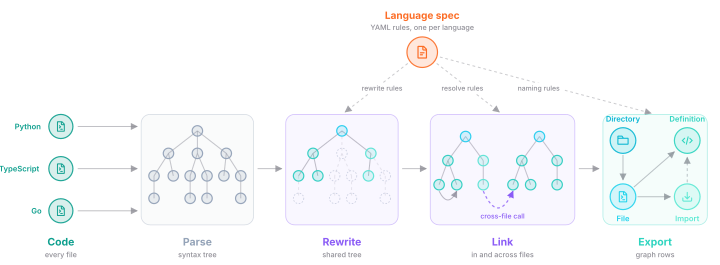
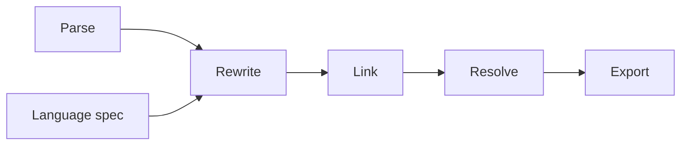
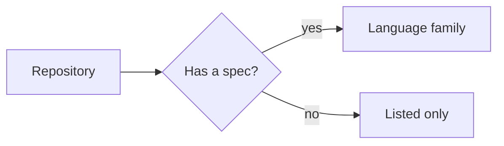
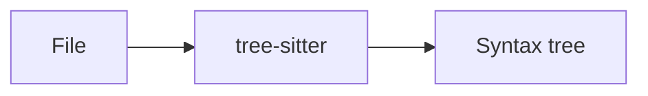
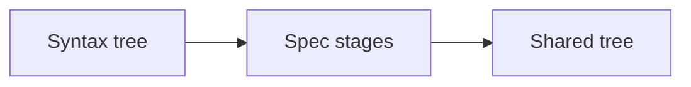
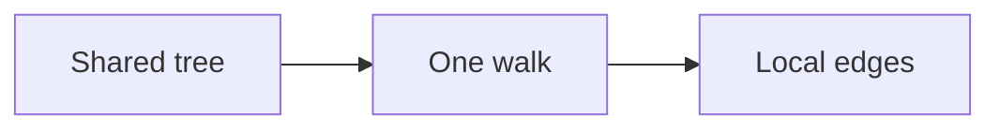
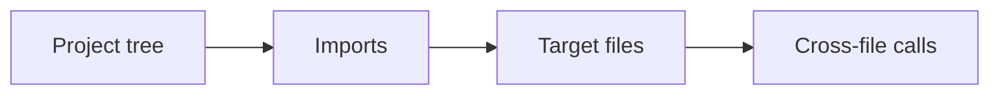
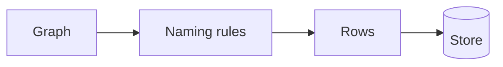
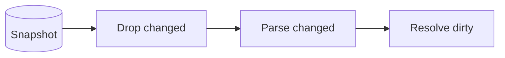

## What's in the code graph

The code graph holds the structure of a repository. That means directories,
files, definitions like classes and functions, and imported symbols. Its edges
record what contains what, which code calls which, what each import points to,
and which class extends which. One engine builds it for the Orbit indexer and
for the Orbit CLI. The engine knows no language on its own. Each language brings a
spec that rewrites its syntax trees into one shared shape. Here is a
simplified view of how source files become the graph.

## How it works

The engine reads every file in the repository and groups the files by
language. Each file is parsed into a syntax tree and rewritten by its
language's spec. Then the engine links the names inside that file. Up to here,
every file is on its own, so files run in parallel. Next, the engine resolves
imports and calls across files. Last, it exports the graph as rows that match
the ontology. [Code indexing](indexing/code-indexing.md) covers how a
repository reaches the engine and where the rows go.

### 1. Pick the files

Every file in the repository becomes a file in the graph. Only files in a
language with a spec get parsed. Binaries, minified files, Git LFS pointers,
and files that aren't UTF-8 are listed but not parsed. So are files with very
long lines.

Languages that import each other are indexed together as one family. C and C++
form one family. So do Java, Kotlin, and Scala, and so do JavaScript and
TypeScript. Every other language is a family of its own. Each family gets its
own run and its own graph, and up to a few families run at once.

The engine also reads manifests like `go.mod`, `Cargo.toml`, `package.json`,
and `tsconfig.json`. They aren't parsed as code. They tell the resolver where
modules start and which import aliases exist.

### 2. Parse

Each file is parsed with tree-sitter, using the grammar of its own language.
The result is that language's own syntax tree, with every token in place. A
file has a time budget for parsing and a limit on tree depth. A tree deeper
than the limit is cut there, and the rest of the file is still indexed.

### 3. Rewrite with the language spec

The spec is a YAML file with a list of stages. Each stage holds rules that
match a pattern in the tree, then replace it or tag it. For example, a Python
function with a `self` parameter becomes a method definition. A Python
`from x import y` becomes an import with a source path.

After the rewrite, every language uses the same vocabulary: definitions,
imports, calls, members, bindings, branches, and loops. The engine then drops
every node outside that vocabulary, along with the source text. What's left is
the shared tree. It's small, and it's all that the later steps read.

### 4. Link inside the file

The engine walks the shared tree once. At each point, it tracks which
definition each name refers to, through branches and loops. Like a compiler,
it builds static single assignment form to find the definition that reaches
each use.

From that walk, the engine emits the edges it can find inside the file. A call
to a local function becomes a call edge. A name that comes from an import gets
an edge to that import. A nested definition gets a defines edge, and a class
gets an extends edge to a local parent. The walk also records which call
produced each value, so a later method call on that value can resolve through
its type.

### 5. Resolve across files

The engine builds a tree of the project's directories and files, with the
manifests inside it. The spec's resolve rules mark where modules start. In
Python, that's packages and source roots. In TypeScript, it's the paths and
aliases from the config. In Go, it's the module named in `go.mod`.

Each import then maps to the file it names, and each imported name maps to a
definition in that file. Resolution runs in waves. Imports resolve first, then
wildcard imports, then the types that flow out of calls and bindings. Method
calls on those types resolve last, and that wave repeats until no new call
appears.

### 6. Name and export

The spec's naming rules give each definition its fully qualified name and
type, and each import its kind. The export then turns the graph into rows for
four node types: directory, file, definition, and imported symbol. One edge
table holds the contains, defines, imports, calls, and extends edges.

The export plan is checked against the ontology before any row is written. A
column the ontology doesn't know, or a type that doesn't match, fails at load.
Each row ID is a hash of the project, the branch, and what the row is. For a
definition, that's its file, its qualified name, and its position. The same
code gets the same ID on every run.

Rows leave in batches as each family finishes. The Orbit indexer writes them to
ClickHouse and adds the branch that ties the code graph to its project. The
Orbit CLI writes them to DuckDB.

### 7. Re-index changed files

A run can save its graph as a snapshot. The snapshot holds the shared trees,
the edges, and what the resolver learned, but no source text. On the next run,
the engine drops the files that changed or were removed and keeps the rest. It
parses only the changed files.

Files that imported a dropped file are marked dirty. Resolution then redoes
the dirty files and the files that import them, and keeps every other edge.
The Orbit CLI uses this between runs on the same commit. The Orbit indexer builds
the whole graph again on each push.

## When things go wrong

- **A file takes too long to parse, rewrite, or link.** The engine skips it
  and moves on. The file stays in the graph with the reason it was skipped. A
  file with too many edges is skipped the same way.
- **A file can't be read.** It stays in the graph with a read fault as its
  reason.
- **A tree is deeper than the limit.** The engine cuts it at the limit,
  indexes the rest, and reports the cut.
- **A file runs out of time during resolution.** It keeps the edges inside the
  file and loses its edges to other files.
- **A family runs out of time during resolution.** It keeps the edges it found
  so far, and the run reports it. The next run resolves the whole family
  again.
- **A family fails or panics.** The engine stops every family and fails the
  run.
- **The run is cancelled.** Every step checks for cancellation and stops.

How code indexing recovers from crashes and retries is on the
[resiliency](indexing/resiliency.md#code-indexing) page.

## Why we built it this way

We wanted a new language to be a spec, not an engine change. The linker, the
resolver, and the export only read the shared vocabulary. So they're written
once, and a speed fix there helps every language. Behavior that only one
language needs goes into its spec, through hooks the engine already exposes.

Dropping the source text and the extra nodes early keeps memory small. It also
makes a snapshot cheap to save and load. Files stay independent until
resolution, so per-file work runs in parallel, and a slow file only costs
itself.

Resolution has to see a whole family at once, because a Kotlin file can call
Java and a TypeScript file can import JavaScript. Row IDs come from content,
not from the run. So a rebuild replaces rows instead of adding copies.

## Trade-offs and what's next

- **Some languages are only listed.** Haskell, HCL, and OCaml have a grammar
  but no spec yet, so their files have no definitions. Vue single-file
  components aren't parsed.
- **Resolution reads code and doesn't run it.** A call made through reflection
  or code generated at runtime gets no edge.
- **The Orbit indexer doesn't keep snapshots.** It builds the whole graph again on
  each push, even when one file changed. The engine can already re-index only
  the changed files.
- **Type flow stays inside the engine.** The engine tracks which call produced
  a value to resolve method calls, but the graph doesn't store those links.
