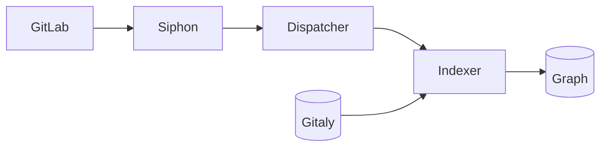
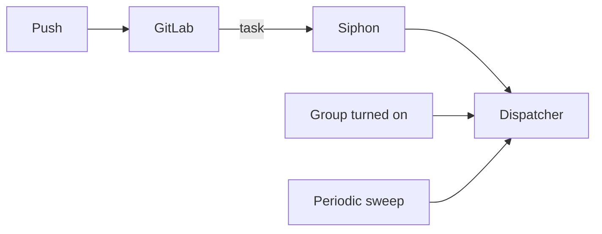
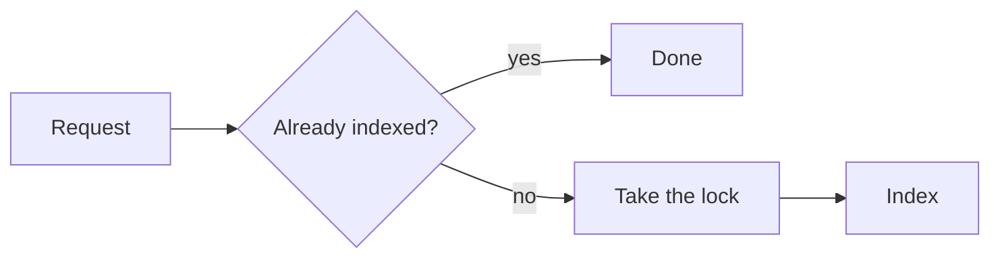
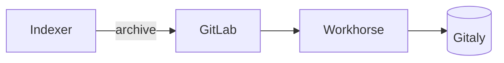
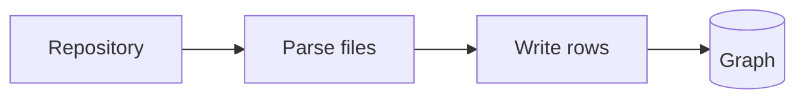
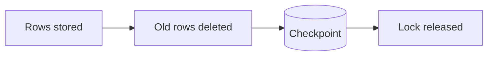
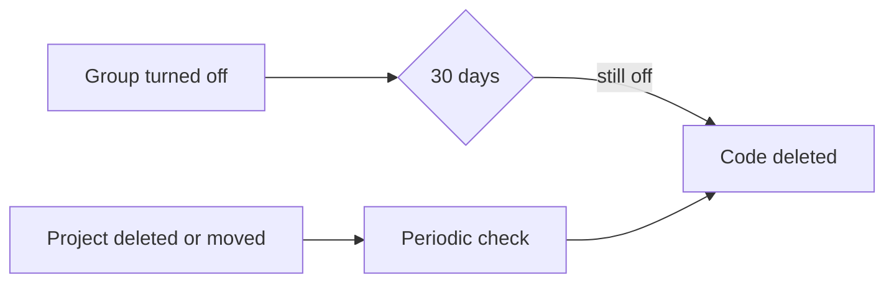

## What gets indexed

Orbit indexes the default branch of every project in an enabled group, and
nothing else. Code is different from SDLC data. The same file can look
different on every branch and at every commit, and a large repository can have
thousands of active branches. Indexing all of them would mean billions of
definitions for a single project, while most questions about code are about
what's on the default branch. The [Orbit CLI](orbit-cli.md) covers the other
branches, on the user's own machine. Here is a simplified view of how a push
reaches the code graph.

## How it works

A push to the default branch starts the chain. GitLab records it as a small
task, Siphon replicates the task, and the dispatcher turns it into a request
for the indexer. The indexer then downloads the repository from Gitaly, builds
the code graph, and writes it to ClickHouse. What the code graph contains is
on the [code graph](code-graph.md) page.

### 1. Triggers

Every push goes through the same GitLab service, whether it comes from `git
push`, a web edit, or a merge. When a push lands on the default branch of a
project in an enabled group, GitLab writes a code indexing task. The task
names the project, the commit, and where the repository is stored. Siphon
replicates those tasks to NATS, so the indexer never has to check the branch
or the group itself.

Pushes aren't the only trigger. When a group turns Orbit on, the dispatcher
queues all of its existing projects, and a periodic sweep queues any project
that still isn't indexed. The sweep also covers outages: GitLab only keeps the
tasks for about a day, so the sweep is what catches up after a long one.

The dispatcher puts every request on a NATS work queue that keeps one request
per project. While a project is waiting or being indexed, newer pushes for it
are dropped. The graph can then trail the latest commit until the next push.

### 2. Picking up a request

A worker first checks the project's checkpoint. If this task, or a newer one,
is already indexed, there's nothing to do. Otherwise it takes a lock on the
project, so two workers never index the same repository at once. The lock is a
lease in NATS KV that the worker keeps renewing while it runs. If the worker
dies, the lease expires and another worker can take over. If another worker
holds the lock, the request goes back on the queue for later.

### 3. Fetch

The worker asks the GitLab internal API for an archive of the repository at
that commit. GitLab checks the request, which is signed with a secret that
GitLab and Orbit share. It then hands the request to Workhorse, which streams
the archive from Gitaly. Orbit asks for the archive without Git LFS content,
and GitLab records every download as an audit event.

Gitaly serves the rest of GitLab too, so Orbit limits how hard it pulls. Each
Gitaly storage gets a few download slots shared by every indexer. A worker
that can't get one in time puts the request back for later.

There's no long-lived clone. Each run unpacks the archive into its own folder
and deletes it when the run ends. While unpacking, the worker records every
file in the repository. It skips the ones that aren't worth parsing, like
binaries, minified files, and very large files. Skipped files still appear in
the graph, they just aren't parsed.

### 4. Build and write

The worker parses the files and builds the code graph for the repository. Big
repositories get their own lane of workers. A flood of small projects can't
starve a monorepo, and small projects don't get stuck behind it either.

The worker writes rows to ClickHouse while it's still parsing. ClickHouse
pools the inserts from every worker into larger parts, and each worker waits
until its own rows are stored before it moves on.

### 5. Commit the result

Once every row is stored, the worker marks the rows from the project's
previous index as deleted. That way, files and definitions that no longer
exist go away. Then it saves the checkpoint, releases the lock, and
acknowledges the request.

The checkpoint is the only record that a project is indexed. If anything goes
wrong before it's saved, the project simply isn't indexed yet, and the next
request does the work again.

### 6. Removal

When a group turns Orbit off, its code is removed with the rest of its data
after the 30-day grace period described in [SDLC indexing](sdlc-indexing.md).
Projects that are deleted or moved don't wait for that: a periodic check finds
them and marks their code deleted.

## When things go wrong

- **A write fails.** The insert is retried a couple of times. If it still
  fails, the run ends without a checkpoint and NATS delivers the request again.
  Reindexing is idempotent.
- **A run is too slow.** A run that goes over its time budget gets one more
  try. If it times out again, it goes to the dead letter queue instead of
  burning a worker slot over and over. A parser error that can't succeed on
  retry goes there right away.
- **The repository is empty or gone.** The project is checkpointed as indexed
  with nothing in it, so it isn't retried forever. A push gets a few retries
  first, in case Gitaly hasn't caught up with the new commit.
- **Gitaly is overloaded.** The request goes back on the queue and nothing is
  checkpointed. An overloaded server is never mistaken for an empty
  repository.
- **A project keeps failing.** The sweep gives up after a few attempts. A new
  push still indexes it.

## Why we built it this way

We first listened to every push event that Siphon replicates. But fewer than
one push in a hundred belongs to a project with Orbit turned on. The indexer
spent its time asking GitLab about pushes only to throw them away. Only GitLab
knows which groups are enabled and which branch is the default, so we moved
the filtering there. GitLab writes a task for the pushes that matter, and the
indexer gets a stream with nothing to throw away.

Downloading a fresh archive on every run is simpler than keeping clones. The
workers keep nothing on disk between runs, so any worker can pick up any
project, and a crashed worker leaves nothing behind to repair.

## Decisions

- [ADR 005: Code indexing task table](../adr/005_code_indexing_task_table.md)
