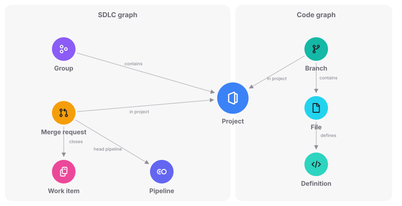
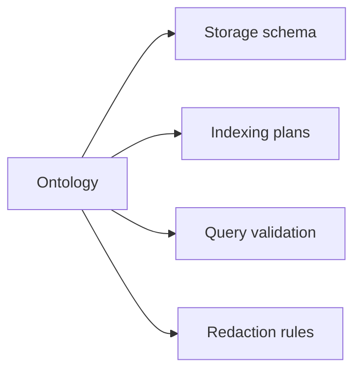

Orbit stores GitLab data as one property graph. Nodes are typed things with properties, like a project, a merge request, or a function. Edges are typed, directed links between two nodes, like a merge request that closes a work item.

## Two graphs, one store

The SDLC graph holds what GitLab keeps in its database: groups, projects, work items, merge requests, CI, security findings, packages, and registries. The code graph holds the structure of your source code: branches, directories, files, definitions, imports, and the references between them. Projects belong to both, so one query can start at a merge request, go through its project, and reach the code on its branches.

## The ontology

The ontology declares every node type, edge type, and property, along with where each one comes from and who can read it. Orbit derives storage, indexing, validation, and redaction from it, so most new SDLC entities need only a declaration and an extract query.

The ontology describes Orbit's model, not the GitLab database. Orbit Remote callers never see source or storage tables, and the Orbit CLI offers read-only SQL over its local tables. Nodes follow concepts GitLab users already know: issues, epics, and tasks are all one work item type, told apart by a property.

## How rows are stored

Every namespaced row carries its path, and the [security](security.md) model depends on that. Only declared global entities, like users and runners, go without one.

Rows are versioned in Orbit Remote: a delete writes a new version marked as deleted, and queries read the latest version and skip deleted rows. The SDLC graph lives apart from the raw replicated data, so a new schema version can rebuild it from that data. Orbit Remote and the Orbit CLI build their storage from the same ontology, and the code graph uses the same types in both.

Changing the stored shape of the graph means a new schema version. The [schema evolution](indexing/schema-evolution.md) page covers how a version reaches production.

## Why we built it this way

GitLab relationships have strong types and fixed endpoints, so each edge type declares its source and target node types. The ontology keeps the data agents and users ask about, not every source column, so a new kind of question can need an ontology change.

## Decisions

- [ADR 000: ClickHouse as graph storage](../adr/000_clickhouse_graph_storage.md)
- [ADR 014: Entity-level indexing](../adr/014_entity_level_indexing.md)
- [ADR 015: Pluggable entity pipelines](../adr/015_pluggable_entity_pipelines.md)
