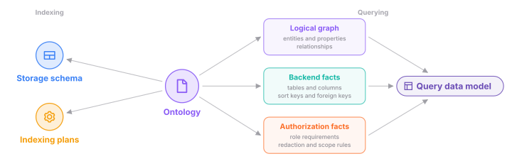

## What's in the graph

Orbit stores GitLab data as one property graph. A node is a typed thing with
properties, like a project, a merge request, or a function. An edge is a
typed, directed link between two nodes, like a merge request that closes a
work item. Here is a simplified view of the main areas and how they connect.

## Two graphs, one store

The SDLC graph holds what GitLab keeps in its database. That means groups,
projects, people, work items, merge requests, CI, security findings, packages,
container repositories, and agent sessions.

The code graph holds the structure of the source code. That means branches,
directories, files, definitions, and imports. Edges between them
record calls, uses of values and types, imports, and inheritance.

Each indexed branch belongs to one project. That project links the two graphs.
A query can follow a merge request to its project and then into the code.

[SDLC indexing](indexing/sdlc-indexing.md) and
[code indexing](indexing/code-indexing.md) explain how each graph gets built.

## The ontology

The ontology declares every node type, edge type, and property. It also
declares where each value comes from and who can read it. For indexing, Orbit
derives the storage schema and the indexing plans from it. For querying, Orbit
builds the query data model from three kinds of facts: the logical graph, the
backend facts, and the authorization facts.
[Query engine](querying/query-engine.md#1-load-the-data-model-for-the-active-schema-version)
shows how every query compiles against that model.
[The guide for adding data](../development/adding-data-to-the-knowledge-graph.md)
lists every step to add a new entity.

The ontology describes Orbit's model, not the GitLab database. Queries to
Orbit's graph use nodes and edges, not tables. Nodes follow the concepts that
GitLab users already know. For example, issues, epics, and tasks are all one
work item type. A property tells them apart.

## How rows are stored

Every row that belongs to a namespace carries its traversal path. Only global
entities, like users and runners, have none. The [security](security/README.md) model
depends on that path.

In Orbit's graph, every row has a version. A delete writes a new version that
is marked as deleted. Queries read the latest version of each row and skip
deleted rows.

The SDLC graph is stored apart from the replicated GitLab data. A schema
change gets a new version. That version re-indexes the tables the change
touches and copies the rest. [Schema evolution](indexing/schema-evolution.md)
covers how a version reaches production.

## Why we built it this way

GitLab relationships have strong types and fixed endpoints. So each edge type
declares which node types it connects. The ontology keeps the data that agents
and users ask about, not every source column. A new kind of question can need
an ontology change.

## Decisions

- [ADR 000: ClickHouse as graph storage](../adr/000_clickhouse_graph_storage.md)
- [ADR 014: Entity-level indexing](../adr/014_entity_level_indexing.md)
- [ADR 015: Pluggable entity pipelines](../adr/015_pluggable_entity_pipelines.md)
