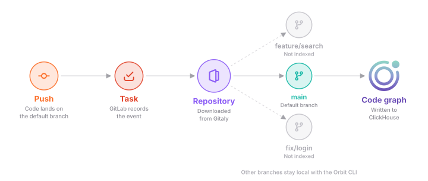
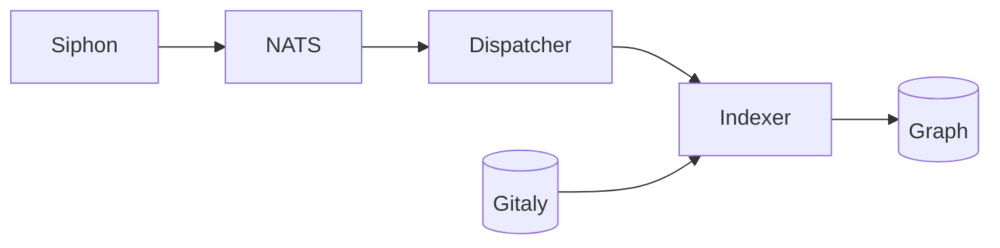
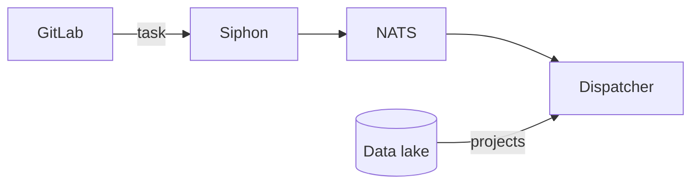
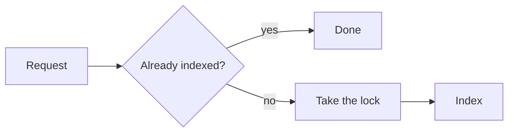
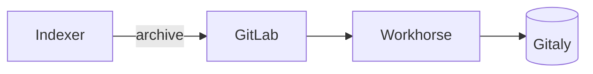
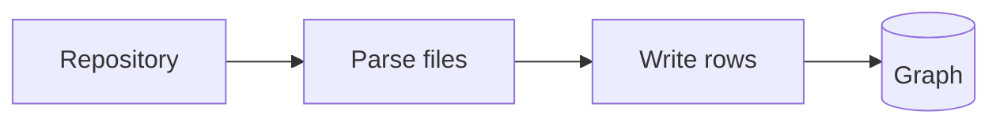
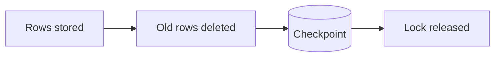
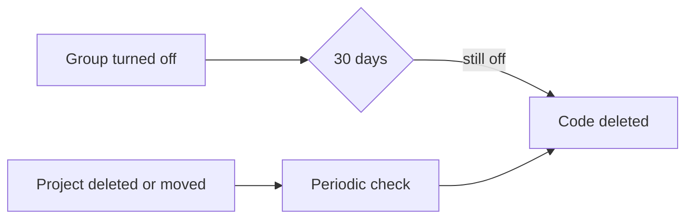

## What gets indexed

Orbit indexes the default branch of every project in an enabled group. Each
push to that branch rebuilds the project's code graph, so the graph follows
what the team has merged. The other branches aren't indexed yet, and
[Why we built it this way](#why-we-built-it-this-way) explains why. Here is a
simplified view of how a push reaches the code graph.

## How it works

A push to the default branch starts the chain. GitLab records it as a task,
and Siphon publishes it to NATS, where the dispatcher reads it directly
instead of waiting for the data lake. The indexer then downloads the
repository from Gitaly, builds the code graph, and writes it to ClickHouse.
What the code graph contains is on the [code graph](../code-graph.md) page.

### 1. Triggers

A push counts whether it comes from `git push`, a web edit, or a merge. The
task already names the project, the commit, and where the repository is
stored. The indexer never looks up the branch or the group itself.

Pushes aren't the only trigger. When a group turns Orbit on, the dispatcher
sees it on NATS. It reads the group's projects from the data lake and queues
the ones not indexed yet. A periodic sweep does the same for every enabled
group. It also catches up after an outage, since GitLab only keeps tasks for
about a day.

The dispatcher puts every request on a NATS work queue that keeps one request
per project. While a project is waiting or being indexed, newer pushes for it
are dropped. The graph can then trail the latest commit until the next push.

### 2. Picking up a request

A worker first checks the project's checkpoint, which records the last task
indexed and how many attempts it took. GitLab numbers tasks in order, so if
this task or a newer one is already indexed, there's nothing to do. Otherwise
it takes a lock on the project, so two workers never index the same repository
at once. The lock is a lease in NATS KV that the worker keeps renewing while
it runs. If the worker dies, the lease expires and another worker can take
over. If another worker holds the lock, the request goes back on the queue for
later.

### 3. Fetch

The worker downloads the repository as one archive at the indexed commit.
GitLab checks the request and hands it to Workhorse, which streams the archive
from Gitaly. A few rules keep this cheap for Gitaly and for the worker:

- The archive leaves out Git LFS content.
- Each Gitaly storage has a few download slots shared by every worker. A
  worker that can't get one puts the request back for later.
- Nothing stays on disk between runs. Each run unpacks into its own folder and
  deletes it at the end.
- Binaries, minified files, and very large files aren't parsed. They still
  appear in the graph as files.

### 4. Build and write

The worker parses the files and builds the code graph for the repository. Big
repositories get their own lane of workers. A flood of small projects can't
starve a monorepo, and small projects don't get stuck behind it either.

The worker writes rows to ClickHouse while it's still parsing. ClickHouse
pools the inserts from every worker into larger parts, and each worker waits
until its own rows are stored before it moves on.

### 5. Commit the result

Once every row is stored, the worker marks the rows from the project's
previous index as deleted. That way, files and definitions that no longer
exist go away. Then it saves the checkpoint, releases the lock, and
acknowledges the request.

The checkpoint is the only record that a project is indexed. If anything goes
wrong before it's saved, the project simply isn't indexed yet, and the next
request does the work again.

### 6. Removal

When a group turns Orbit off, its code is removed with the rest of its data
after the 30-day grace period described in [SDLC indexing](sdlc-indexing.md).
Projects that are deleted or moved don't wait for that: a periodic check finds
them and marks their code deleted.

## When things go wrong

How code indexing recovers from crashes, retries, and outages is on the
[resiliency](resiliency.md#code-indexing) page.

## Why we built it this way

We index only the default branch for now. Indexing other branches would work
the same way, but the limit is the database. Every branch is close to a full
copy of the project's graph, so storage and query cost grow with each branch
we keep.

Code indexing starts from a task that GitLab writes, not from every push. We
first listened to every push event that Siphon replicates. But fewer than one
push in a hundred belongs to a project with Orbit turned on. Only GitLab knows
which groups are enabled and which branch is the default, so the filtering
moved there.

Downloading a fresh archive on every run is simpler than keeping clones. The
workers keep nothing on disk between runs, so any worker can pick up any
project, and a crashed worker leaves nothing behind to repair.

## Decisions

- [ADR 005: Code indexing task table](../../adr/005_code_indexing_task_table.md)
