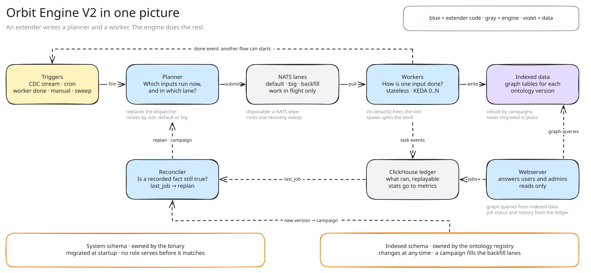

## What the engine does

The indexing engine runs all indexing work in Orbit.
A team adds a flow with two pieces of code: a planner and a worker.
The planner decides which work runs now, and where. The worker does one piece of that work.
The engine does the rest: queues, retries, scaling, records and migrations.

A third piece, the reconciler, keeps recorded facts true, such as "this group is indexed".
Here is a simplified view of the engine.

The engine runs four loops. Each loop wakes on something different, and calls one kind of team code.

| Loop | Wakes on | Calls | Runs on |
|---|---|---|---|
| Trigger | A schedule, a stream of changes, or the end of another task | A planner | Planner pods |
| Lane | A task that waits in a lane | A worker, once for each task | Worker pods that pull that lane |
| Sink (planned) | Records staged for a partition | A sink, once for each batch | Writer pods that own that partition |
| Reconcile | A timer | A reconciler | Planner pods |

The engine knows nothing about projects, groups or the ontology.
Those words live only in the planners and workers that teams write.

## How it works

Every flow follows the same path. We follow one push to a project through it.

### 1. A trigger wakes a planner

A trigger tells the engine when to call a planner.
A planner can wake on a schedule or on a stream of changes from Siphon.
It can also wake when a task of another worker ends.
The engine also calls every planner in two more cases: a manual request, and a sweep over all its work.

A stream can come from a system outside Orbit. That system publishes a small change event on a subject that the engine owns. It can publish only on its own subject.

An event only says that something changed. The data stays in its source, such as GitLab or the Git lake.
If an event is lost, a sweep or a reconciler reads the source again.

### 2. The planner picks the work and its lane

The planner turns the push into one task for the project.
It also picks a lane from the repository size in the source of truth.
A big repository goes to the big lane before it runs, so small pushes stay fast.

A planner reads only events and Orbit storage. It never calls a source, such as Gitaly.
When work must read a source to find out how to split, that split is a worker.

### 3. The task waits in its lane

A lane is a queue for one worker, with its own timeout.
Every worker has a default lane and a backfill lane. Backfills never slow down live work.

The engine keeps one waiting task for each piece of work.
Fifty pushes to the same project give one task. A push during a run queues one more.

Each pod reads only its own config. It lists the lanes the pod pulls, and how many tasks run at once.
Helm decides which configs run, and how many pods run each one.
KEDA scales those pods on the tasks that wait, down to zero when nothing waits.

### 4. A worker runs the task

The worker first takes a lease on the project, so two runs of one project never overlap.
The lease records which pod holds it and until when. The engine renews it while the work runs.

Pools limit each stage of the work.
A cluster pool limits downloads from each Gitaly storage. A pod pool limits parsing on one pod.
So a pod can fetch several repositories ahead while it parses a few.
The worker can pick the big parse pool after the fetch, when it knows the real file count.

While ClickHouse confirms the inserts, the worker frees its slot. The lane starts the next task.
The task ends as done, or as no change when the project is already up to date.

### 5. Work leads to more work

A worker can split its own work into child tasks.
When a group is turned on, one task starts the SDLC indexing and one code task for each project.
All of them form one job. The job ends when its last task ends, so one record tells if the whole group is indexed.

Work for another team never starts from a worker.
When the Git lake fetch ends, the trigram team's planner wakes and starts its build.
The fetch does not know who reads the lake. A new reader adds one planner and one worker.

### 6. The ledger records what ran

Every task that did work is recorded in ClickHouse, with its input, its result, its rows and its time.
A worker counts its rows under labels that it picks, such as one label for each kind of entity. So one task can write many kinds of rows, and the counts stay apart.
When the last task of a job ends, the job keeps the sum of its rows and its start and end times.

An admin can show any task of the last 30 days and replay its job.
A tenant can list its own jobs, and see when each key last ran and how many rows it wrote.
A task that found nothing to do writes no task row. It only updates the time when its key was last checked.
Metrics hold the counts and the durations of the cluster.

### 7. Reconcilers keep facts true

A reconciler runs on a timer, for example every minute.
It compares the wanted state with what it sees, and fixes the difference.
It never starts work itself. It asks a planner to plan some work again, or to start a campaign.

| Reconciler | Wanted state | Action |
|---|---|---|
| Namespace status | Every enabled group is indexed at the active version | Records indexed or failed. With no job, it plans the group again. |
| Schema migration | The newest ontology version is active | Creates the tables, starts a campaign, then promotes the version |
| Code freshness | Each project is indexed at its newest commit | Plans stale projects again. This heals lost push events. |
| Namespace removal | A disabled group has no graph data | Plans the deletion of its data |

### 8. Tenants see their syncs

Jobs are sorted by tenant, so a view of one tenant reads little data.
For each key, the view can show:

| Field | Meaning |
|---|---|
| Status | Pending, running, done or failed |
| Last synced | The end of the newest job that did work |
| Last checked | The last run of the key, with or without a change |
| Rows | The rows of the newest job, for each label |
| Duration | From the start of the first task to the end of the last task |
| Wait | From the submit to the start of the first task |

Today only an admin sends a manual request. Each request names one tenant, so a tenant can send its own requests later with no engine change.
A manual request for a key gives one pending task, so many requests in a row cost one run.

### 9. Schemas change without downtime

Orbit has two kinds of schema, with opposite rules.

The binary owns the system tables, such as the group status and the ledger.
The engine migrates them at startup, with steps that only change metadata, such as a new column.
If a step fails, the engine creates the tables fresh and swaps them in. It keeps the old ones as a backup.
A recovery campaign then fills them again. Indexing lags, but queries keep working.
The campaign replaces all the rows of each project. Deletion jobs remove the entities that were deleted since.
The engine never rebuilds the pointer to the active version, because queries read it.
A failed step on it stops indexing and needs an admin.

The ontology registry owns the graph tables, and a new version can come at any time.
A campaign fills the new version in the background lanes. Live work writes to both versions.
When the campaign ends, queries switch to the new version.
A newer version cancels an older campaign. A failed version is marked failed, and the active one keeps serving.

## When things go wrong

- **NATS is wiped.** NATS holds only work in flight, so no fact is lost. The engine starts one recovery campaign for each planner. Work that is up to date ends as no change.
- **A pod dies in the middle of a run.** Its lease expires, and NATS hands the task to another pod. That pod waits for the expiry, then takes the lease.
- **A shared dependency is down.** The worker asks for a throttle. The pod stops pulling from that lane until the delay ends, and no task fails while it waits.
- **A repository is slower than its size suggests.** The lane timeout stops the run and moves the task to the big lane.
- **An event is lost.** A reconciler or the next sweep finds the stale work and plans it again.
- **An outside system stops sending events.** A reconciler compares the wanted state with what Orbit has, and plans the stale keys again.
- **An outside system sends too many events.** The engine keeps one pending task for each key, so repeated events give one run. A cluster pool keyed by the publisher limits how many of its tasks run at once.
- **A system table step fails.** The engine rebuilds the system tables and starts a recovery campaign, at most once for each release. A second failure stops indexing and alerts the admin. Queries keep working.
- **A step on the active version pointer fails.** The engine never rebuilds this table. Indexing stops and alerts the admin. Queries keep using the last active version.
- **ClickHouse is too old for the schema.** The engine checks the version at startup. Indexing stops with a clear error, and queries keep working.
- **A new ontology version fails.** The version is marked failed. The active version keeps serving queries.
- **A planner pod stops.** Its leases expire, and the other replica takes over its triggers and reconcilers.
- **The ledger falls behind.** Task events stay in NATS for a day. Workers keep running.

## Why we built it this way

Every flow used to bring its own queues, retries and migrations.
The code indexer had its own lanes, and the dispatcher had one pattern for each kind of trigger.
Putting those mechanics in one engine means a new flow is only a planner and a worker.
It also means KEDA, the logs and the ledger see every flow the same way.

Keeping facts out of NATS makes NATS cheap to lose.
Keeping a ledger lets us explain a stale group and replay a run.
Moving migrations off the startup path means a rollout never waits for a reindex.

## Trade-offs and what's next

- **A failed system migration costs a full reindex.** That is the price of never needing a hotfix. CI runs every step on each supported ClickHouse version to keep it rare.
- **KEDA scales on the number of tasks, not their cost.** Planners must route work into lanes by size.
- **The ledger shares the graph cluster.** If it adds too much load there, it moves to its own backend.
- **Sinks.** SlateDB in Orbit Next wants one writer for each partition. Later, workers can stage records for a sink, and one pod for each partition writes them in batches. Records wait in object storage until then, so a pod's disk never holds the only copy.

## Decisions

- [ADR 023: A self-contained engine for indexing work](../../adr/023_self_contained_indexing_engine.md)
- [ADR 017: Clone-based non-blocking schema migrations](../../adr/017_clone_based_non_blocking_migrations.md)
