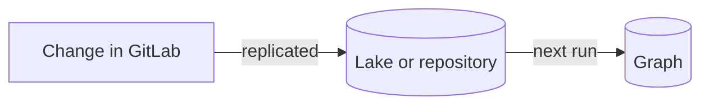
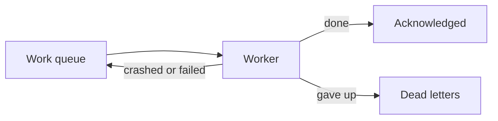

## Built on eventual consistency

Orbit doesn't update the graph at the same moment as GitLab. A change first
reaches the data lake or the repository, and the graph catches up on the next
indexing run. The graph is always a little behind, but it always gets there.

That's what keeps recovery simple. A failure only delays a change and never
loses it, because the source data is still there to read again. Every safety
net below relies on that: when something goes wrong, Orbit runs the work again
later.

## How indexing recovers

Every part of indexing leans on the same few safety nets. Work arrives as
requests on a NATS work queue, and a request only leaves the queue once a
worker acknowledges it. A worker that crashes never acknowledges, so NATS
delivers the request again to another worker.

Repeating work is always safe. Graph tables keep the latest version of each
row, so writing the same rows twice changes nothing. Progress lives in
checkpoints, so a repeated request picks up where the last one stopped
instead of starting over.

A request that keeps failing doesn't loop forever. After a few deliveries,
it's dropped, or moved to a dead letter queue when someone needs to look at
it. A watcher also clears requests that a crashed worker left behind, so the
queue never stays blocked. The scheduled sweeps then send fresh requests for
anything that's still missing.

## SDLC indexing

- **A worker crashes mid-run.** NATS delivers the request again, and the next
  worker resumes from the last checkpoint.
- **A page is written twice.** Graph tables keep the latest version of a row,
  so it replaces itself.
- **ClickHouse is overloaded or down.** The worker waits and retries, without
  counting it as a failure.
- **A request keeps failing.** It's retried a few times, then dropped. The
  data stays in the lake for the next request.
- **The graph needs a rebuild.** Replay everything from the lake and get the
  same graph.

## Code indexing

- **A write fails.** The insert is retried a couple of times. If it still
  fails, the run ends without a checkpoint and NATS delivers the request
  again. Reindexing is idempotent.
- **A run is too slow.** A run that goes over its time budget gets one more
  try. If it times out again, it goes to the dead letter queue instead of
  burning a worker slot over and over. A parser error that can't succeed on
  retry goes there right away.
- **The repository is empty or gone.** The project is checkpointed as indexed
  with nothing in it, so it isn't retried forever. A push gets a few retries
  first, in case Gitaly hasn't caught up with the new commit.
- **Gitaly is overloaded.** The request goes back on the queue and nothing is
  checkpointed. An overloaded server is never mistaken for an empty
  repository.
- **A project keeps failing.** The sweep gives up after a few attempts. A new
  push still indexes it.

## Schema evolution

- **The dispatcher crashes mid-migration.** It runs the migration again when
  it restarts. Every step can be repeated, and a table that was left half
  copied is copied again.
- **A namespace never finishes.** The switch waits for it, with no timeout.
  Version N keeps serving queries, and a metric shows how long the migration
  has been running.
- **The archive of N+1 doesn't load.** The switch doesn't happen, and the
  check tries again on its next run.
- **An older release comes back.** If its tables are still there, it becomes
  active again at once. If they were already cleaned up, it rebuilds them from
  scratch.
- **The query service can't load the active version.** It answers that it's
  unavailable and fails its readiness check, instead of serving the wrong
  schema.
