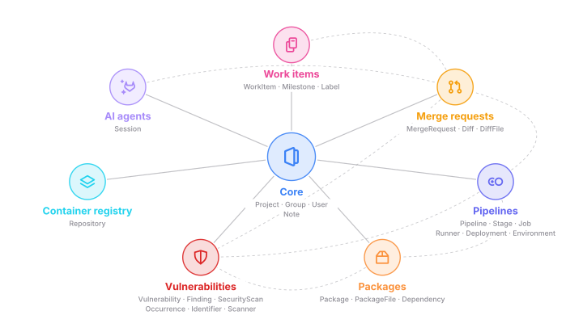
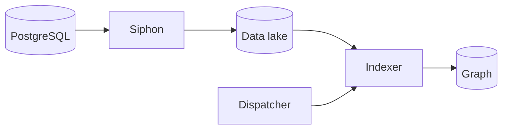
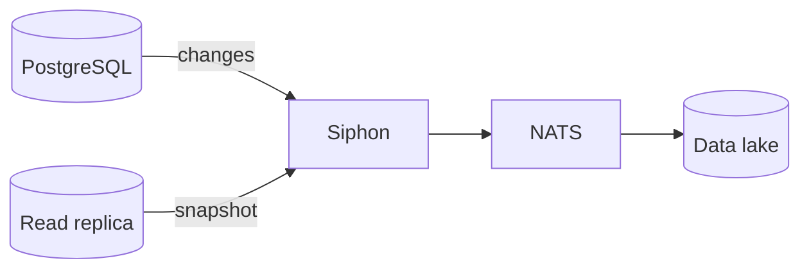
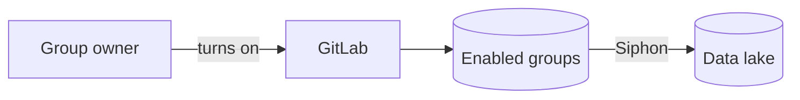
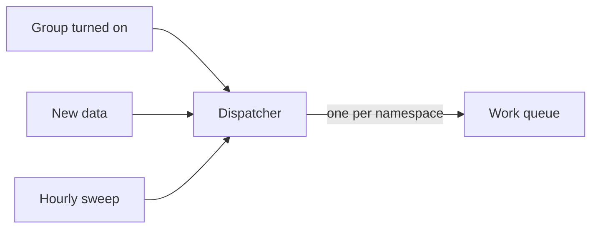
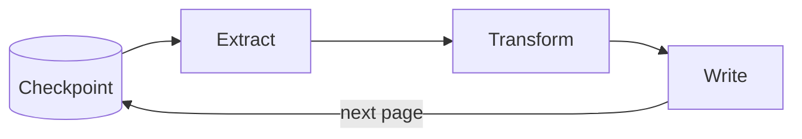
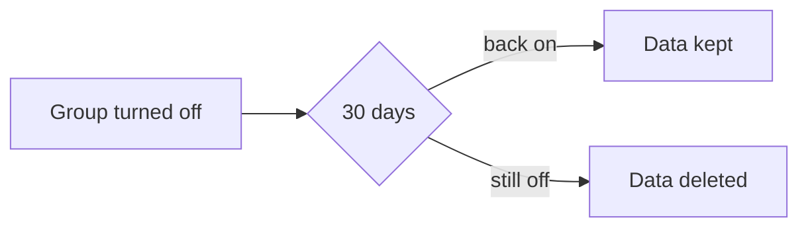

## What's in the SDLC graph

The SDLC graph holds everything GitLab stores about how software gets built.
That means groups and projects, work items, merge requests, CI pipelines,
security findings, packages, and the people involved. The
[data model](../data-model.md) page explains how the ontology declares these
types. Here is a simplified view of the main areas and how they connect.

## How it works

GitLab data reaches the graph in two hops. Siphon first replicates the GitLab
database into a data lake in ClickHouse. Orbit then reads that lake one
namespace at a time and turns the rows into nodes and edges. The steps below
follow the data along that path.

### 1. Replication into the data lake

Siphon is the GitLab Change Data Capture service. It reads every insert,
update, and delete from the PostgreSQL write-ahead log and publishes it to
NATS JetStream. From there, the changes are written into lake tables that
mirror the source tables. When a table is new, Siphon first copies it from a
read replica, so the lake starts out complete.

Each lake row also carries a version, a watermark, and a deleted flag. The
version tells which change of a row is the latest. The watermark records when
the row landed, and the flag says whether GitLab deleted it. Together, they
let Orbit find exactly what changed since its last run.

### 2. Which namespaces get indexed

Orbit only indexes the top-level groups that have it turned on. A group Owner
or an administrator turns it on, as long as the plan, license, or trial allows
it. GitLab turns it off again when a trial ends or the group loses access.

GitLab keeps that list in a table, and Siphon replicates it like any other.
GitLab never calls Orbit: the replicated list is how Orbit knows which groups
to index.

### 3. Deciding what to index

The dispatcher decides when a namespace needs indexing and puts a request for
it on a NATS work queue. A group that just turned Orbit on gets a request
right away. After that, the dispatcher watches the lake and sends a request
whenever a namespace has new data. Once an hour, it also sends one for every
namespace, in case something was missed.

The queue keeps at most one request per namespace. A namespace that is still
being indexed doesn't collect duplicates, and its new data simply waits in the
lake for the next run.

### 4. Extract, transform, load

A worker takes the request and indexes each type of entity in the namespace,
like merge requests or pipelines. The ontology tells it which lake rows to
read and how to map them, so adding an entity is a declaration, not new code.

Each type keeps a checkpoint per namespace. Its watermark marks how far the
lake has been read, and its cursor marks the last page the current run wrote.
A run reads the rows that landed between the watermark and the moment its
request was sent, one page at a time. It turns each page into nodes and edges
and moves the cursor, so a stopped run resumes from its last page. When the
last page is written, the watermark moves up and the cursor is cleared. Rows
that arrive mid-run wait for the next one, so nothing falls between two runs.

### 5. Deletes and moves

Orbit never deletes rows in place. When GitLab deletes a row, the lake flags
it. The indexer then writes a new version of the node or edge that is marked
as deleted, and queries skip it from then on.

The same thing happens when an edge's target changes, like the latest diff of
a merge request. It also happens when a group or project moves to a new path.
In both cases, the old rows are marked deleted and the new ones are written.

When a group turns Orbit off, its data stays for 30 days in case it comes
back. After that, every node and edge in the namespace, code included, is
marked deleted.

## When things go wrong

How SDLC indexing recovers from crashes, retries, and outages is on the
[resiliency](resiliency.md#sdlc-indexing) page.

## Why we built it this way

We could have built the graph inside ClickHouse with SQL and materialized
views. We didn't, because materialized views give little control over when
data refreshes, and they get expensive at our scale. On the lake's instance
they slow down inserts, and on a separate instance they scan the lake tables
over and over. Some entities can't be expressed in SQL at all, like system
notes, which are free text that needs real parsing to become edges.

A Rust ETL pipeline is more code to maintain, but it gives us control over
paging, retries, and memory. Code indexing also plugs into the same engine.

## Decisions

- [ADR 000: ClickHouse as graph storage](../../adr/000_clickhouse_graph_storage.md)
- [ADR 013: System note edges](../../adr/013_system_note_edges.md)
- [ADR 014: Entity-level indexing](../../adr/014_entity_level_indexing.md)
- [ADR 015: Pluggable entity pipelines](../../adr/015_pluggable_entity_pipelines.md)
