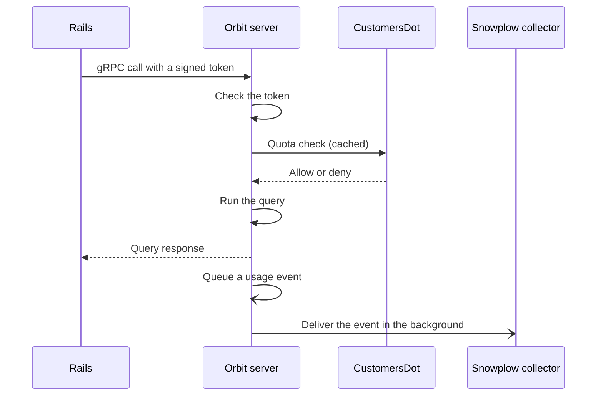
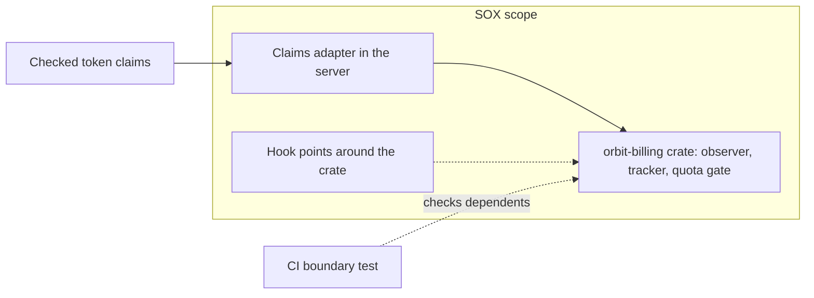

## What monetization covers

Orbit usage can be billable.
Two parts of Orbit support that.
Orbit reports each billable query.
Orbit also checks quota before it runs a query.
Both parts live in the Orbit server, because the server executes the work.
Rails only proxies the request and does not emit billing events.
The sections below cover the design as built.

## How the parts fit together

The server checks the signed token, checks quota, runs the query, and then reports the usage.
The usage reaches the billing system through a separate delivery path.
This path runs after the query.

```mermaid
flowchart LR
    accTitle: Orbit monetization components
    accDescr: A caller reaches the Orbit server through Rails. Inside the server, the request passes the token check, the quota gate, and the query pipeline. A billing observer then queues a usage event. The event travels to the Snowplow collector, the Data Insights Platform, and CustomersDot. The quota gate also asks CustomersDot whether quota remains.
    Caller --> Rails
    Rails -->|"gRPC + signed token"| Auth
    subgraph Server["Orbit server"]
        Auth["Check token"] --> Quota["Quota gate"]
        Quota --> Pipeline["Query pipeline"]
        Pipeline --> Observer["Billing observer"]
        Observer --> Queue["Event queue"]
    end
    Quota <-->|"Quota check"| CDot["CustomersDot"]
    Queue -->|"Usage event"| Collector["Snowplow collector"]
    Collector --> DIP["Data Insights Platform"]
    DIP --> CDot
```

### The billing observer

The generic query pipeline does not depend on billing.
A billing observer hooks into the pipeline and sees each graph query when it finishes.
The observer builds the event and hands it to a tracker.
The tracker owns the queue and the delivery.
The pipeline still decides when a query succeeded or failed.
So the observer interface and the code that attaches the observer are hook points.
They get the same review as the billing code.

## Request lifecycle

The server checks quota before it runs the query.
The server reports the event after the query succeeds.
Event delivery is asynchronous.
It does not run on the query path.

The [query lifecycle](querying/query-lifecycle.md) page describes the query steps in the middle of this flow.

## Billing events

Orbit sends one billable usage event for each successful graph query that it can attribute.
The event uses the shared GitLab billable usage schema and carries one unit of use for one request.
It also carries the attribution that billing needs, such as the deployment type, the namespace, the organization, and the instance.
Orbit takes this attribution from the signed token that GitLab sends with the request.

The event reaches the billing system in four steps:

1. Orbit queues the event in memory.
1. A background task sends it to the Snowplow collector. The collector authenticates the sender.
1. The Data Insights Platform ingests it.
1. CustomersDot processes it later.

Delivery is asynchronous, so a successful query does not guarantee delivery.
When the server shuts down, it tries to send the queued events before it exits.
When Orbit cannot build a valid event, it counts the case.
Operators can then see the gap.

## Quota check

Before Orbit runs a metered query, it checks whether the caller still has quota.
Orbit caches the answer for a limited time.
Most requests therefore do not wait on a network call.

Orbit denies the query when CustomersDot reports that no quota remains.
Orbit also denies the query when the check fails in a way that Orbit does not expect, such as a rejected credential.
A denied caller gets a credits-exhausted error.

## Keeping billing code auditable

Billing code falls under Sarbanes-Oxley (SOX) controls.
We therefore keep it in a small, separate area:

- **One crate.** The `orbit-billing` crate builds and sends every billing event and runs the quota check.
- **One seam.** A single adapter in the server maps the request claims to billing and quota inputs.
- **Required review.** A section of the code owners file lists the billing code and the hook points around it. A change to any of them needs code owner approval.
- **A CI check.** A test fails when any crate other than the server declares a direct dependency on the billing crate.

The [merge gates](../testing/merge-gates.md) page describes the checks that protect billing code.

## Monitoring

Orbit publishes counters for each stage of the event pipeline: events queued, dropped, rejected, delivered, and failed.
Operators watch these counters to catch a pipeline that fails silently.
Orbit also records each quota decision and the latency of the CustomersDot call.

## Why we built it this way

- **Accurate.** Usage events match billable activity.
- **Auditable.** Billing code stays small and separate, so reviewers can see all of it.
- **Not caller-controlled.** Billing attribution comes from the signed token that GitLab sends. It does not come from a field that the caller sets.
- **Priced elsewhere.** Orbit reports what happened: one request, with the attribution that billing needs. CustomersDot, the GitLab billing system, decides what that usage costs. Orbit holds no pricing, so pricing can change without a change to Orbit.

This repository does not decide pricing or credit rates, so this page does not describe them.

## Decisions

- [ADR 007: Monetization engineering](../adr/007_monetization_engineering.md)
- [ADR 020: SOX scoping for billing event emission](../adr/020_billing_sox_scope.md)
