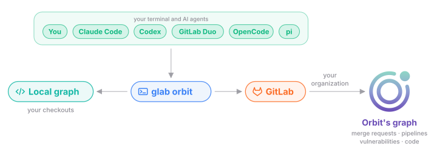

## What the Orbit CLI does

The Orbit CLI is the way into Orbit from a terminal or an AI agent. Most
people run it through the GitLab CLI as `glab orbit`. It answers from two
graphs. The local graph holds the code of the checkouts on your machine.
Orbit's graph covers the projects in the groups where Orbit is on. Here is a
simplified view.

### 1. Install with the GitLab CLI

On first use, the GitLab CLI downloads the Orbit CLI from Orbit's package
registry on GitLab.com. It checks the SHA256 checksum of the download. From
then on, it passes every `glab orbit` command to the Orbit CLI.

The GitLab CLI checks for a new version at most once a day. It prints a notice
when one exists. The `glab orbit update` command installs it.
[Getting started](https://docs.gitlab.com/orbit/local/getting-started/) lists
the other ways to install the CLI.

### 2. Connect AI agents

The `glab orbit setup` command finds the AI agents on your machine: Claude
Code, Codex, GitLab Duo, OpenCode, and pi. It adds Orbit instructions and the
Orbit skill to each agent. Then it indexes the current repository. The
`glab orbit uninstall` command removes what setup wrote, except files you
edited since.

The `glab orbit mcp serve` command serves the local graph to any MCP agent.
The `glab orbit skills` command fetches the skills that match your GitLab
instance.

### 3. Index a checkout

The `glab orbit index .` command walks the working tree of the checkout in the
current folder. So uncommitted and untracked files are part of the graph. It
skips what `.gitignore` excludes. It lists binary, minified, and very large
files, but it doesn't parse them. Tree-sitter grammars parse each
[supported language](https://docs.gitlab.com/orbit/compare-local-remote/#supported-languages)
into the code types that the [data model](data-model.md) page describes.

Each checkout and commit gets its own file on your machine. The
`glab orbit sql` command reads every indexed checkout at once, so one query
can span several repositories. A repeat run on the same commit parses only the
files that changed. The `glab orbit grep` and `glab orbit context` commands
index the current commit when it isn't indexed yet.

### 4. Ask the local graph

The main commands that read the local graph are:

- `glab orbit grep` works like grep. It shows each match inside its enclosing
  definition, with that definition's callers and callees.
- `glab orbit context` expands a definition, a file, a line range, or a
  folder.
- `glab orbit repo-map` prints a compact map of a repository for a language
  model.
- `glab orbit sql` runs DuckDB SQL on the local graph.

### 5. Ask Orbit's graph

Orbit's graph answers what the local context can't. It holds merge requests,
pipelines, vulnerabilities, and the code of every indexed project. The main
commands that ask Orbit's graph through the GitLab API are:

- `glab orbit query` sends a question to Orbit's graph.
- `glab orbit ontology` shows the node and edge types.
- `glab orbit dsl` shows the query language.
- `glab orbit graph-status` shows the indexing progress of a project or a
  group.

GitLab checks who you are and which groups you can see, as
[security](security/README.md) explains. The GitLab CLI passes your sign-in to the
Orbit CLI in its environment. The Orbit CLI never stores the token.

## Why use the Orbit CLI

One tool covers all your context. An agent learns one set of commands. The
same commands work on a checkout and on your whole organization.

Several agents can index and query in separate worktrees at the same time.

## Decisions

- [ADR 007: Monetization engineering](../adr/007_monetization_engineering.md)
- [ADR 010: Graph status](../adr/010_graph_status_endpoint.md)
- [ADR 011: Agent command surface](../adr/011_agent_command_surface.md)
