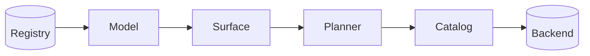

The data model is being built on the
[data model branch](https://gitlab.com/gitlab-org/orbit/knowledge-graph/-/tree/michaelusa/data-model-spike).
This page changes as each part ships.

## What the data model does

The data model is the single description of what Orbit holds and how it is
reached. It replaces the ontology. Packages describe entities, their storage,
their sources and their access rules. The indexer, the migrations and the
query engine all read the same checked model, so they always agree.

A package is a small set of YAML documents. Each document has one kind:

| Kind | Describes |
|---|---|
| Graph | Entities, typed properties and relationships |
| Authorization | The scope, role floor and redaction check of each entity |
| Storage | The tables of one store and how each entity is laid out in them |
| Source | Where indexed data comes from and how it maps onto entities |
| Service | Properties that an outside service returns on request |

The platform ships the GitLab packages. An integration, such as Jira or Slack,
ships its own package. A tenant can load an overlay package that only it sees.

## How it works

We follow two things through the system. First, a new version of the code
review package goes live. Then a query for open merge requests and their
authors runs against it.

The registry holds every package version. The loader checks a version once and
builds the model. A surface parses the query into a logical plan, which
describes what is asked in graph terms. The planner builds a physical plan for
one backend through that backend's catalog. Later phases rewrite the plan
through the same catalog, and the catalog renders the request.

### 1. Packages describe what exists

The code review package describes merge requests once in each kind of
document. The graph document gives the properties, such as the title and the
state. The authorization document says that merge requests belong to a
namespace and need the reporter role. The storage document lays them out in
the graph store. The source document names the data lake tables they come
from.

Each document refers to the graph and to nothing else. The graph knows nothing
about tables, so a new store or a new source never changes it. A relationship
that a foreign key already carries, such as the author of a merge request,
needs no source entry.

Packages compose under strict rules. A package cannot redeclare an entity that
another package owns. It cannot add a second access rule for the same entity.
It can add relationships to platform entities, and it can bind its own
entities to a platform store.

### 2. The loader checks every package once

The loader turns the packages into one model. Every name becomes an ID, so
later stages read facts by ID and never search by name. The loader collects
every error, names the package of each one, and then fails once.

The loader also computes a guard for every read. A guard is the path filter,
the role floor and the redaction check that the read must apply. Merge
requests carry their own traversal path, so their guard filters on it. Users
are global, so their guard is a role floor alone. An entity that no guard rule
covers fails the load.

A hash of the packages identifies the model. Caches use it as a key, and every
plan carries it, so no plan is ever checked against a different model.

### 3. A new version goes live after its backfill

The registry keeps one version line for each package. A tenant's model is the
active version of every package that applies to it. So a change to one
integration never touches another.

When a new version arrives, the registry compares its storage with the active
model's storage. The difference is the migration scope. Nobody writes the
scope by hand. A change that only adds query metadata has an empty scope and
goes live at once.

Otherwise, the [indexing engine](indexing/README.md) creates the new tables
and backfills the ones in scope. Its workers read the source documents of the
new version, so they write the tables the query engine will read. When the
backfill ends, the registry promotes the version. The query engine swaps to
the new model, and queries already in flight finish on the old one.

### 4. Catalogs give each connection a typed view

A connection is one engine instance, such as the graph's ClickHouse cluster or
the code indexing service. A catalog is the typed view of one connection. It
lists every store on that connection and what the engine can do.

Each kind of engine has its own catalog and its own plan language. The
relational catalog speaks in tables, reads, joins and filters. The Orbit Next
catalog speaks in repositories and structural code matches. A live connector's
catalog speaks in API calls. They share one way of building plans, not one set
of operations.

Engines declare their capabilities as facts, such as reading only the current
version of a row. Shared code reads a capability and never asks which engine
it is talking to. One query targets one connection, and it can read every
store on it.

### 5. A surface turns text into a logical plan

A surface parses one query language. The GQL surface reads the example query
and builds a logical plan. The plan reads open merge requests, follows the
authored relationship back to users, and returns each author and title.

The surface builds that plan through the model, so a wrong name or an
impossible relationship fails while the plan is built. The error lists the
valid names, or suggests reversing an arrow. There is no separate validation
pass. The surface records what the caller asked for and makes no planning
decisions.

### 6. The planner builds the physical plan

Planning is the query engine's job. The planner reads the logical plan and
builds a physical plan for the target connection, through that connection's
catalog. It decides and builds in one step, so no intermediate plan
description sits in between.

For the example query, the planner sees that the authored relationship is
carried by a foreign key on the merge request. It joins the two reads on that
key and skips the edge table. It reads only the current version of each merge
request. It leaves the username to a later lookup, because the base query does
not need it.

Every call to the catalog is checked as the plan grows. The catalog rejects a
column that the input does not expose, or a join between unrelated reads, at
the call that makes it. When two parts of a query need the same read, the
planner shares it. A later phase decides whether the shared read becomes one
stored result or stays inline at each use.

### 7. Phases rewrite the plan and security adds guards

The phases after planning shape the result. They add pagination, limits and
result columns. Each one rewrites the plan through the same catalog, so a
phase cannot leave behind a plan that the catalog would reject.

Security is a phase of its own. It reads the guard of every read and adds it
as ordinary plan operations. The merge request read gets its path filter, and
the user read gets its role floor. A final check proves that every read
carries its guard before anything leaves the query engine.

### 8. The catalog renders the request

The catalog that built the plan also renders it, because both must agree on
what each operation means. The relational catalogs render SQL with parameters.
Orbit Next renders a request that travels over gRPC to the code indexing
service. A live connector renders a call for the Data Extraction Service.

## When things go wrong

- **A package has a mistake.** The loader rejects the version with every error
  and its package. The previous model keeps serving queries.
- **A new version changes storage.** The query engine keeps the old model
  until the backfill is done. It never sees tables that are not built yet.
- **A query names something that does not exist.** The surface rejects it
  while it builds the plan, with the valid names.
- **A phase builds an invalid plan.** The catalog rejects the change at the
  call that makes it, so the broken plan never reaches an engine.
- **A read is missing its guard.** The final security check rejects the plan
  before it leaves the query engine.

## Why we built it this way

The ontology mixed the graph, its tables, its access rules and its pipelines
in one file per entity. Adding a store or a source meant editing that file,
and a third party could not add an entity without touching platform files.
Splitting it into small documents with one job each lets graph, storage,
sources and access change on their own.

The compiler used to look up facts by name on every query, so a typo in a YAML
file failed a query in production. Checking everything once at load moves
those failures to the moment a package is published. It also lets the security
phase read a guard instead of deriving one.

Every pipeline used to build plans its own way, and passes edited a SQL tree
that nothing checked. Building every plan through a checked catalog gives
every engine the same discipline. A new backend brings its own plan language,
and a new query language is one more surface.

## Trade-offs and what's next

- **The registry is planned.** Packages load from the binary today. Storing
  versions in a registry and loading them at runtime come next.
- **The migration scope covers storage only.** A source change that produces
  different rows with the same columns also needs a backfill. The scope must
  include source changes too.
- **Live and code backends are planned.** The relational catalogs ship first.
  The Orbit Next and live connector catalogs follow the same design.
- **One query reaches one connection.** Data from two connections meets only
  through lookups. General execution across engines needs separate
  orchestration.

## Decisions

- [ADR 024: A data model that replaces the ontology](../adr/024_data_model_replaces_ontology.md)
- [ADR 023: A self-contained engine for indexing work](https://gitlab.com/gitlab-org/orbit/knowledge-graph/-/merge_requests/3333)
- [ADR 017: Clone-based non-blocking schema migrations](../adr/017_clone_based_non_blocking_migrations.md)
- [ADR 000: ClickHouse graph storage](../adr/000_clickhouse_graph_storage.md)
