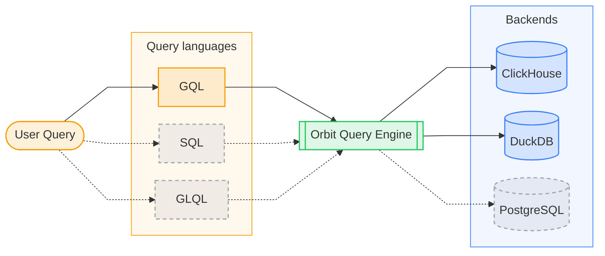
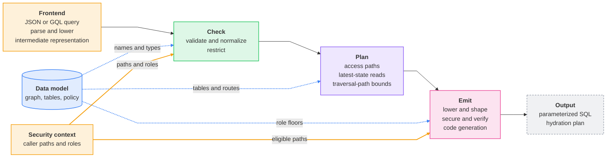
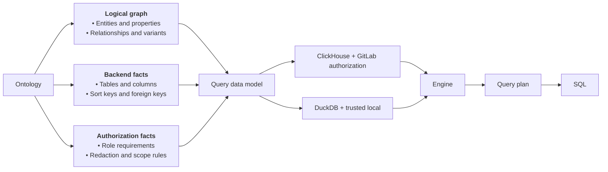
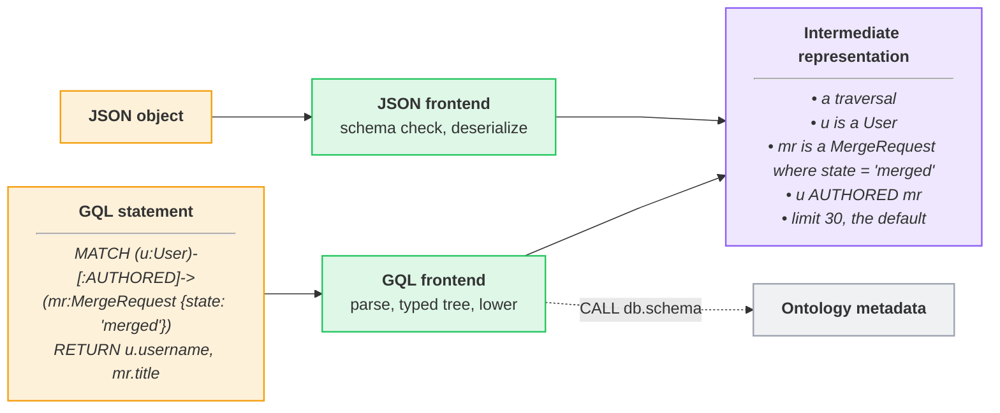
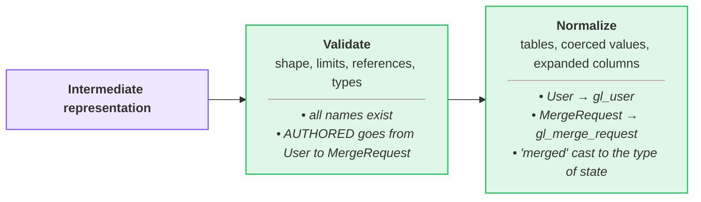
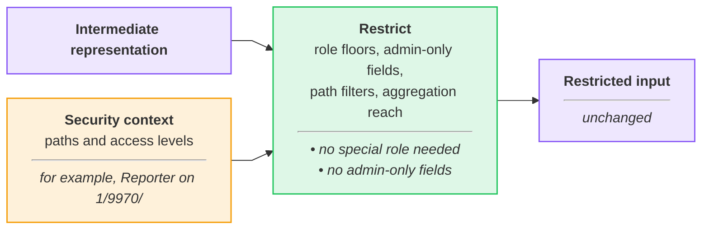
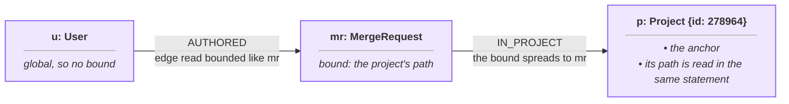
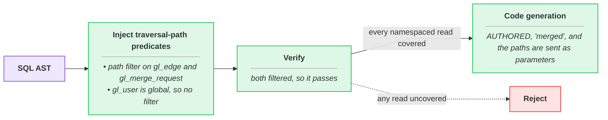

## What the engine does



The Orbit Query Engine is a multi-pass compiler. It turns a JSON Query DSL or
GQL query into one parameterized SQL statement over the ontology's node and
edge tables. Every statement it emits is bounded, carries a traversal-path
predicate on every namespaced read, and resolves each row to its latest
version. ClickHouse is the production backend. The same passes target DuckDB
for the local graph schema and the code-graph test suites.

The engine compiles four query types. Each row shows a GQL query and the core
of the SQL that it produces.

> [!note]
> These SQL fragments show only the core of each query.
> The full SQL also has authorization filters, page limits, and query settings.

<!-- markdownlint-disable MD044 -->

| Query type | Example (GQL) | SQL output fragment |
| --- | --- | --- |
| **Traversal**<br>Merged merge requests and the users who wrote them | <pre><code class="language-cypher">MATCH (u:User)-[:AUTHORED]-&gt;&#10;      (mr:MergeRequest {state: 'merged'})&#10;RETURN u.username, mr.title</code></pre> | <pre><code class="language-sql">FROM gl_edge AS e JOIN gl_merge_request mr&#10;  ON mr.id = e.target_id&#10;WHERE e.relationship_kind = ?&#10;  AND mr.state = ?</code></pre> |
| **Aggregation**<br>How many merge requests one project has in each state | <pre><code class="language-cypher">MATCH (mr:MergeRequest)-[:IN_PROJECT]-&gt;&#10;      (p:Project {id: 278964})&#10;RETURN mr.state, count(mr) AS mrs</code></pre> | <pre><code class="language-sql">SELECT mr.state, COUNT(mr.id) AS mrs&#10;... GROUP BY mr.state</code></pre> |
| **Path finding**<br>The shortest path from a group to a project | <pre><code class="language-cypher">MATCH path = ANY SHORTEST&#10;  (g:Group {id: 9970})-[:CONTAINS*1..2]-&gt;&#10;  (p:Project {id: 278964})&#10;RETURN path</code></pre> | <pre><code class="language-sql">WITH forward AS (...),&#10;     backward AS (...)&#10;SELECT ... FROM forward&#10;JOIN backward ON ...</code></pre> |
| **Neighbors**<br>Everything directly connected to one merge request, in either direction | <pre><code class="language-cypher">MATCH (mr:MergeRequest {id: 42})--(n)&#10;RETURN n</code></pre> | <pre><code class="language-sql">SELECT ... FROM gl_edge WHERE source_id = ?&#10;UNION ALL&#10;SELECT ... FROM gl_edge WHERE target_id = ?</code></pre> |

<!-- markdownlint-enable MD044 -->

## How it works



The engine compiles in small passes, and each pass declares the state it reads
and writes, so a pass sees only what earlier passes produced. Pipelines reuse
these passes per frontend and backend: hydration skips parsing and pagination,
and DuckDB drops the security passes. Every pass reads one immutable data
model for the schema version that was active when the request started. That
model is the only source of tables, columns, and authorization rules, so
nothing from the query reaches SQL unless the model resolves it. The output is
one parameterized SQL statement, plus a plan for the hydration statement.

Every statement that the engine emits has these guarantees:

| Guarantee | Meaning |
| --- | --- |
| **Parameterized SQL** | Values are bound parameters, and names must match the ontology. |
| **Fail-closed authorization** | Every namespaced read has an authorization filter, or the query is rejected. |
| **Bounded queries** | Hard limits on query shape, result size, time, and memory. |
| **Current state** | Every read sees the latest version of each row. |
| **Stable results** | The plan changes how data is read, never what is returned. |
| **Read-only access** | The webserver can only run `SELECT`. |

## Walkthrough: GQL query to secure SQL

The steps below follow one GQL query through the remote ClickHouse pipeline,
from the data model it compiles against to the statement that ClickHouse runs.

Each step's diagram traces this query through that step, and the italic text
in each box shows what happens to it. The colors mean the same thing in every
step. Green is a compiler pass, and purple is the query as it moves between
passes. Amber comes from the caller, blue is the data model, and gray is
outside the compiled statement.

```gql orbit-query
MATCH (u:User)-[:AUTHORED]->(mr:MergeRequest {state: 'merged'})
RETURN u.username, mr.title
```

### 1. Load the data model for the active schema version



When the server loads a schema version, it builds one data model from that
version's ontology. The graph catalog holds entities, properties,
relationships, and their variants. The layout maps each of them to ClickHouse
tables, columns, sort keys, and edge routes. The policy holds role floors,
redaction rules, and admin-only fields. Every pass reads the model and never
changes it.

### 2. Turn a user query into an intermediate representation



Every pass after the frontend works on one intermediate representation (IR):
node selectors, relationship selectors, filters, aggregations, ordering, and
limits. The JSON frontend checks the payload against its JSON schemas, then
deserializes it. The GQL frontend parses the statement against an openCypher 9
grammar, then lowers it and checks for one connected pattern and unique
variables. Both produce the same IR, so no later pass knows which language the
query came from. A `CALL db.schema()` statement stops here and returns
ontology metadata, and [Query languages](query-languages.md) covers both
frontends.

### 3. Validate and normalize the query



Validation checks the IR's shape and limits, resolves every name against the
data model, and checks that filter values fit their property types. A query
that fails a check is rejected with an error that names the problem.
Normalization then resolves entities to tables, coerces filter values, and
expands wildcard columns. It also sorts predicates into a fixed order, so the
same query always produces the same SQL.

### 4. Apply the caller's access rules



Restriction is the first pass that reads the caller's security context: their
traversal paths, and their role on each one. It rejects a query on an entity
whose required role the caller holds on no path. It removes admin-only
columns, and rejects filters, sorts, and aggregates on admin-only fields. It
checks any traversal-path filter in the query against the caller's paths. It
also rejects aggregations that no namespaced node can reach, because
aggregates skip row-by-row redaction.

### 5. Plan the reads and pick the latest row versions


The planner turns the IR into a relation graph, with one read per
relationship, joined through shared nodes. It reads edge tables first, and
joins a node table only when the query needs that node's data. A relationship
stored in several edge tables becomes a `UNION ALL`, and a selective chain
passes each hop's results to the next hop. Tables keep old row versions until
ClickHouse merges them, so every read must pick the latest one. The planner
uses `FINAL` by default, and a cheaper two-step read for exact IDs and
selective filters.

### 6. Narrow reads to the namespaces the query names

A traversal-path bound limits a read to one namespace when the query names it,
so ClickHouse can skip most of the table. The example names no project or
group, so it gets no bound, and here is the same query pinned to one project:

```gql orbit-query
MATCH (u:User)-[:AUTHORED]->(mr:MergeRequest {state: 'merged'})-[:IN_PROJECT]->(p:Project {id: 278964})
RETURN u.username, mr.title
```



The project is the anchor, and the engine reads its current path inside the
same statement. The bound spreads to `mr` through `IN_PROJECT`, and the
`AUTHORED` edge read gets it too, but the global `User` gets none. A bound
never crosses relationships like `CLOSES` that can leave the namespace, and
the authorization filter always still applies.

### 7. Build the SQL tree and shape the result

```mermaid
%%{init: {"flowchart": {"curve": "linear", "nodeSpacing": 28, "rankSpacing": 48, "padding": 14}}}%%
flowchart LR
    accTitle: Lowering and result shaping, with the example query
    accDescr: Lowering builds the SQL AST, then pagination, the response policy, the result contract, hydration planning, and settings shape it. For the example, the AST joins gl_edge to gl_merge_request and gl_user, the page is LIMIT 31, and the result contract adds ID and type columns for u and mr.
    Plan["<b>Relation graph</b>"]
    AST["<b>SQL AST</b><hr/><i>• gl_edge joined to gl_merge_request on target_id<br/>• gl_edge joined to gl_user on source_id</i>"]
    Page["<b>Pagination window</b><hr/><i>LIMIT 31: 30 rows, plus 1 to check for more</i>"]
    Shape["<b>Response policy and result contract</b><hr/><i>adds ID and type columns for u and mr</i>"]
    Extras["<b>Hydration plan and settings</b><hr/><i>username and title are already in the main query</i>"]
    Plan --> AST --> Page --> Shape --> Extras

    classDef pass fill:#22C55E26,stroke:#22C55E,stroke-width:1.5px
    classDef state fill:#8B5CF626,stroke:#8B5CF6,stroke-width:1.5px
    classDef caller fill:#F59E0B26,stroke:#F59E0B,stroke-width:1.5px
    classDef data fill:#3B82F626,stroke:#3B82F6,stroke-width:1.5px
    classDef external fill:#9CA3AF26,stroke:#9CA3AF,stroke-width:1.5px
    classDef reject fill:#EF444426,stroke:#EF4444,stroke-width:1.5px
    class Plan,AST state
    class Page,Shape,Extras pass
```



Lowering turns the relation graph into a SQL syntax tree, and attaches the
bounds to each read. Pagination asks for one row past the page, so the server
can tell whether more rows exist. The response policy caps long text values,
so a page fits in one response message. The result contract adds the ID and
type columns that Rails needs for redaction. This step also plans the
hydration statement, and sets time and memory limits for the query type.

### 8. Add authorization filters, verify them, and render SQL



Security runs last, after every pass that can add a read to the tree. It adds
a `startsWith(traversal_path, ?)` filter to every namespaced read, using only
the paths where the caller meets the entity's role floor. Verification then
walks the finished tree, and rejects the query if any namespaced read lacks a
filter. Code generation renders the tree as SQL for one backend, with every
value as a bound parameter. A backend that can't express an operation rejects
the query instead of approximating it.

## Decisions

- [ADR 000: ClickHouse as graph storage](../adr/000_clickhouse_graph_storage.md)
- [ADR 016: Column statistics for join ordering](../adr/016_column_statistics_for_join_ordering.md)
