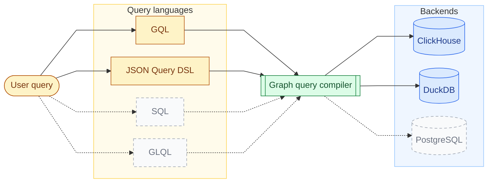
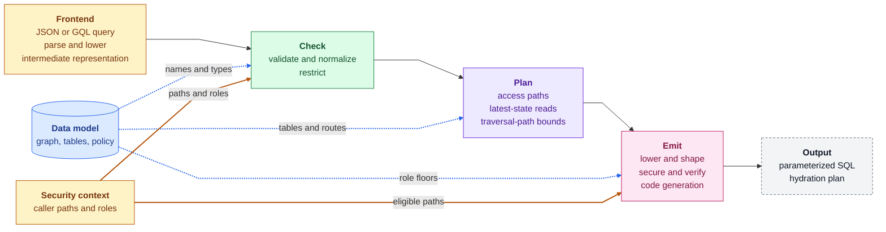
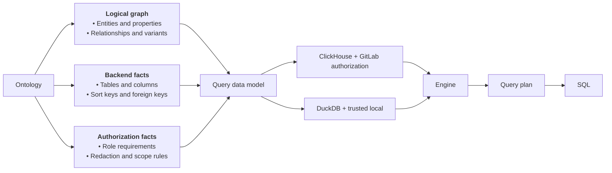
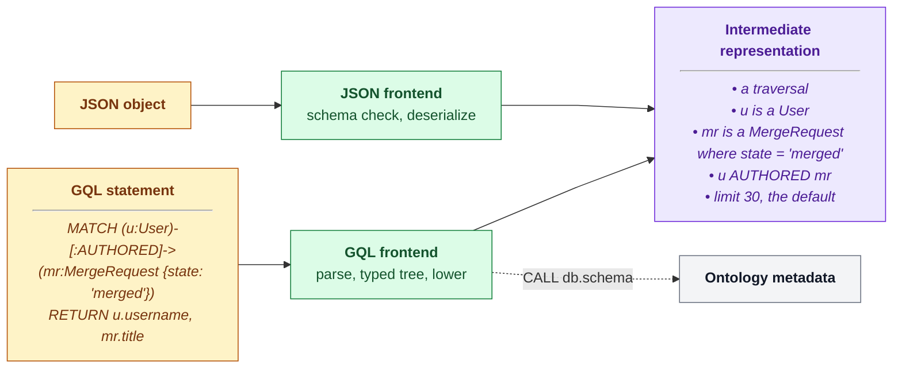
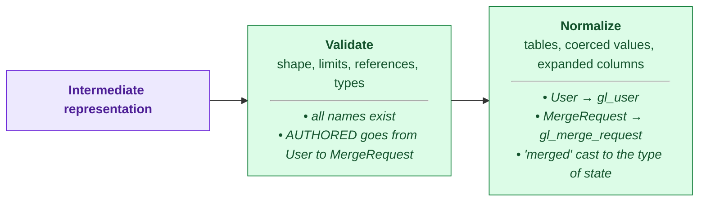
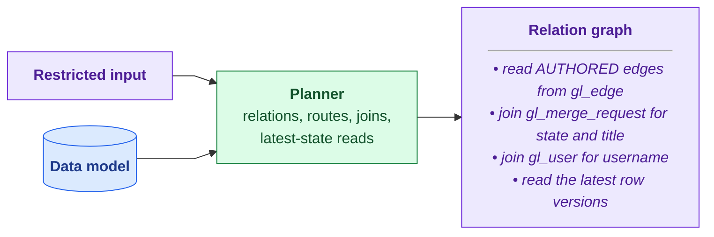
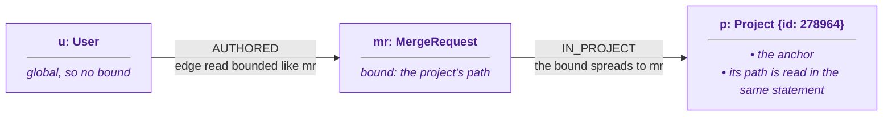
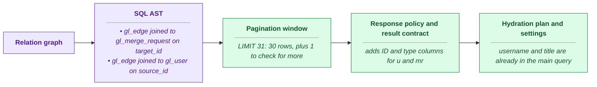
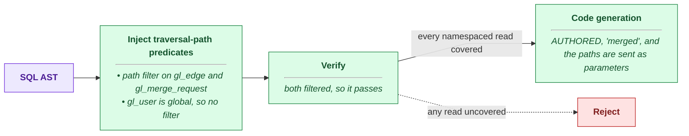

## What the engine does



Dashed boxes are planned and not yet supported.

The graph query engine is a multi-pass compiler. It turns a JSON Query DSL or
GQL query into one parameterized SQL statement over the ontology's node and
edge tables. Every statement it emits is bounded, carries a traversal-path
predicate on every namespaced read, and resolves each row to its latest
version. ClickHouse is the production backend. The same passes target DuckDB
for the local graph schema and the code-graph test suites.

The engine compiles four query types. Each row shows a GQL query and the core
of the SQL that it produces.

> [!note]
> These SQL fragments show only the core of each query.
> The full SQL also has authorization filters, page limits, and query settings.

<!-- markdownlint-disable MD044 -->

| Query type | Example (GQL) | Meaning | SQL output fragment |
| --- | --- | --- | --- |
| **Traversal** | <pre><code class="language-cypher">MATCH (u:User)-[:AUTHORED]-&gt;(mr:MergeRequest {state: 'merged'})&#10;RETURN u.username, mr.title</code></pre> | Merged merge requests and the users who wrote them | <pre><code class="language-sql">FROM gl_edge AS e JOIN gl_merge_request AS mr ON mr.id = e.target_id&#10;WHERE e.relationship_kind = ? AND mr.state = ?</code></pre> |
| **Aggregation** | <pre><code class="language-cypher">MATCH (mr:MergeRequest)-[:IN_PROJECT]-&gt;(p:Project {id: 278964})&#10;RETURN mr.state, count(mr) AS mrs</code></pre> | How many merge requests one project has in each state | <pre><code class="language-sql">SELECT mr.state, COUNT(mr.id) AS mrs ... GROUP BY mr.state</code></pre> |
| **Path finding** | <pre><code class="language-cypher">MATCH path = ANY SHORTEST&#10;  (g:Group {id: 9970})-[:CONTAINS*1..2]-&gt;(p:Project {id: 278964})&#10;RETURN path</code></pre> | The shortest path from a group to a project | <pre><code class="language-sql">WITH forward AS (...), backward AS (...)&#10;SELECT ... FROM forward JOIN backward ON ...</code></pre> |
| **Neighbors** | <pre><code class="language-cypher">MATCH (mr:MergeRequest {id: 42})--(n)&#10;RETURN n</code></pre> | Everything directly connected to one merge request, in either direction | <pre><code class="language-sql">SELECT ... FROM gl_edge WHERE source_id = ?&#10;UNION ALL&#10;SELECT ... FROM gl_edge WHERE target_id = ?</code></pre> |

<!-- markdownlint-enable MD044 -->

## How it works



The engine compiles in passes, and each pass has one job. A pass declares the
state it reads and the state it writes. That state is the IR, the query plan,
the SQL AST, the result context, or the hydration plan. A macro turns those
declarations into a typed context for each pipeline, so a pass sees only the
state it declared. A pass that needs state an earlier pass hasn't produced
fails with an invariant error, never on partial input.

A pipeline is an ordered list of passes for one frontend and one backend. The
JSON and GQL pipelines for ClickHouse share every pass after their frontend.
The hydration pipeline reuses the remote passes, minus parsing, pagination,
and hydration planning. The DuckDB pipelines reuse the frontends,
normalization, lowering, pagination, and the result contract. They swap in a
DuckDB planner and code generator, and drop restriction, bounds, and security,
because a local graph has a single user.

Every pass reads one immutable data model for the active schema version. The
model is the only source of table names, columns, edge routes, and
authorization rules. No identifier from the query reaches SQL unless the model
resolves it. Each request compiles against the schema snapshot that was active
when it started, so a schema switch never changes a query mid-compilation.

The output is one SQL statement with bound parameters, plus a plan for the
hydration statement.

Every statement that the engine emits has these guarantees:

| Guarantee | Meaning |
| --- | --- |
| **Parameterized SQL** | Values are bound parameters, and names must match the ontology. |
| **Fail-closed authorization** | Every namespaced read has an authorization filter, or the query is rejected. |
| **Bounded queries** | Hard limits on query shape, result size, time, and memory. |
| **Current state** | Every read sees the latest version of each row. |
| **Stable results** | The plan changes how data is read, never what is returned. |
| **Read-only access** | The webserver can only run `SELECT`. |

## Walkthrough: GQL query to secure SQL

The steps below follow one GQL query through the remote ClickHouse pipeline,
from the data model it compiles against to the statement that ClickHouse runs.

Each step's diagram traces this query through that step, and the italic text
in each box shows what happens to it. The colors mean the same thing in every
step. Green is a compiler pass, and purple is the query as it moves between
passes. Amber comes from the caller, blue is the data model, and gray is
outside the compiled statement.

```gql orbit-query
MATCH (u:User)-[:AUTHORED]->(mr:MergeRequest {state: 'merged'})
RETURN u.username, mr.title
```

### 1. The query data model



The server builds one data model each time it loads a schema version. The
model combines three parts. The graph catalog holds entities, properties,
relationships, and relationship variants under typed IDs. The layout pairs the
physical schema with a mapping from graph identities to tables, columns, sort
keys, foreign keys, variant routes, and sorted copies. The policy holds role
floors, redaction metadata, and admin-only and hidden fields. Passes only read
the model. Schema management derives the same physical schema for DDL,
migrations, and cleanup, so the queries and the stored data cannot drift
apart.

### 2. Intermediate representation



Every pass after the frontend works on one intermediate representation (IR):
the language-neutral compiler input. It holds node selectors, relationship
selectors, filters, aggregations, ordering, and limits. Each query language
has one frontend that produces the IR, and that frontend is the first pass of
its pipelines. The JSON frontend validates the payload against the base and
ontology-derived JSON schemas, then deserializes it. The GQL frontend parses
against an openCypher 9 grammar and builds a typed syntax tree. Lowering then
applies statement-wide checks: one connected pattern, unique variables, and an
inferred query type. Both produce the same IR, so no later pass knows which
language the query came from.

The GQL frontend also answers schema calls. The server parses a statement once
and routes on the result. A `MATCH` statement continues into the compiler, and
`CALL db.schema()` returns ontology metadata without running any further pass.
The [query languages](query-languages.md) page covers both frontends in
detail.

### 3. Validation and normalization



Validation checks the input's shape and bounds, resolves every reference
against the data model, and checks that filter values fit their property
types. Normalization resolves entities to tables, coerces filter values, and
expands wildcard projections. It also puts predicates in a canonical order, so
equal queries produce byte-identical SQL and parameters.

### 4. Restriction


Restriction is the first pass that reads the security context. It rejects
queries on entities whose role floor the caller meets on no authorized path.
It strips admin-only columns, and rejects filters, sorts, and aggregates on
admin-only fields. It checks explicit traversal-path filters against the
authorized set. It also rejects aggregations in which no traversal-path-scoped
node is reachable, because aggregates bypass row-level redaction.

### 5. Planning and latest-state reads



The planner builds a relation graph, with one relation per relationship
occurrence, joined through shared node bindings. Reads are edge-first. A node
table is joined only for node data that the query consumes: a filter, a
projection, a group key, or a sort key. Variant routing picks the edge table
for each relationship kind and endpoint pair. A relationship that spans
several tables becomes a `UNION ALL` with a uniform column set. Selective
chains pass distinct-endpoint frontiers from hop to hop, and path finding runs
a bidirectional frontier search. Foreign-key relationships join node to node
with no edge read. A relation that is referenced more than once becomes a CTE,
unless it is a point lookup. Planning changes access paths, never results.

Node and edge tables are `ReplacingMergeTree(_version, _deleted)`, so a read
must resolve each key to its latest version. The default is `FINAL`, a
streaming merge with bounded memory. For exact IDs, narrow ranges, frontiers,
and filters that the ontology marks as selective, the planner uses a two-step
read instead. It finds candidate keys without `FINAL`, then reads every
version of only those keys, and keeps the latest with `LIMIT 1 BY` on the
replacement key. Filters on sort-key and immutable columns run before the
pick, because tombstones carry those columns. Filters on mutable columns, and
`_deleted = false`, run after it.

### 6. Traversal-path bounds

A traversal-path bound limits a read to one namespace when the query names
that namespace. It is an extra `startsWith` filter on top of the authorization
filter, and it lets ClickHouse skip most of the table.

The example query names no project or group, so it gets no bound, and it reads
every namespace that the caller can see. Here is the same query pinned to one
project:

```gql orbit-query
MATCH (u:User)-[:AUTHORED]->(mr:MergeRequest {state: 'merged'})-[:IN_PROJECT]->(p:Project {id: 278964})
RETURN u.username, mr.title
```



The project has a known ID, so it is the anchor. The engine reads the
project's current path in a subquery of the same statement, so a moved project
is bounded by its new path. `IN_PROJECT` keeps a merge request in its
project's namespace, so the bound spreads to `mr`. `AUTHORED` edges are stored
with their merge request, so the edge read gets the same bound. `User` is
global and has no path, so `u` gets no bound.

Some relationships, like `CLOSES`, can cross namespaces. A bound never spreads
across them, and never from a child namespace up to its parent. A bound only
narrows a read, and the authorization filter still applies.

### 7. Lowering and result shaping



Lowering turns the plan into a SQL AST with physical result bindings, and
attaches the bounds to the reads they own. Pagination sets a limit of the page
size plus one probe row, lowers `SKIP` to an `OFFSET`, and adds tie-breakers
so that windows are stable. The response policy caps large text projections so
that a page fits within the Workhorse gRPC message limit. The result contract
adds redaction ID and type columns for every returned node and edge, and
records the result context that redaction and formatting read. The pass also
builds the hydration plan and resolves the ClickHouse settings for the query
type.

### 8. Security, verification, and code generation



Security runs on the finished AST, after every pass that can add a read. It
adds `startsWith(traversal_path, ?)` to every namespaced node and edge alias,
using only the paths where the caller meets the entity's role floor. With no
eligible path, the predicate is a constant false. Verification then walks the
final AST, and rejects the statement if any namespaced alias lacks a
role-eligible predicate or a fail-closed false. Code generation renders the
AST in the backend's dialect with bound parameters. The AST has a closed
function vocabulary, and a backend rejects any operation it can't express.

## When things go wrong

- **An unresolved reference.** Validation rejects the query before planning.
- **A namespaced read without a predicate.** Verification rejects the
  statement. It never reaches ClickHouse.
- **An anchor that isn't indexed or is deleted.** The bound subquery returns a
  sentinel path, and the read falls back to the authorization predicate alone.
- **Too many anchors.** Past eight anchors on one node, the node keeps only
  its authorization predicate.
- **An operation the backend can't express,** such as token search on DuckDB.
  Code generation rejects it, and never substitutes an approximation.
- **An invariant violation between passes.** The pipeline returns an internal
  error, not degraded SQL.

## Why we built it this way

Declaring each pass's state makes ordering explicit, and stops one pass from
reading state that another hasn't produced yet. Pipelines can then reuse runs
of passes. Hydration and local compilation share the remote passes instead of
copying them, and running security last guarantees that verification sees the
final AST.

`FINAL` stays the default for latest-state reads. An `argMax` aggregation over
IDs can be faster on small results, but its memory grows with result
cardinality, which is unknown at compile time. On settled parts, `FINAL` was
as fast or faster in every measured case, with bounded memory. A slow `FINAL`
points to part fragmentation, and the fix belongs in storage.

Bounds resolve the anchor path inside the statement, not in a lookup before
it. That avoids a cache and its staleness window, and production `EXPLAIN`
output shows the same granule pruning as a literal prefix.

## Decisions

- [ADR 000: ClickHouse as graph storage](../adr/000_clickhouse_graph_storage.md)
- [ADR 016: Column statistics for join ordering](../adr/016_column_statistics_for_join_ordering.md)
